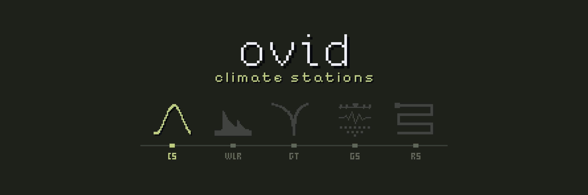
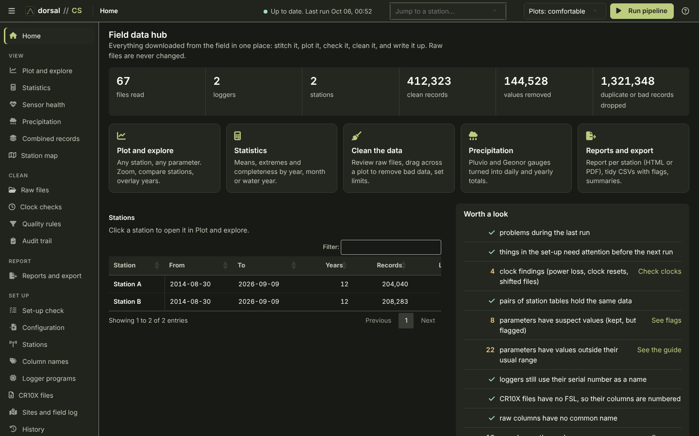
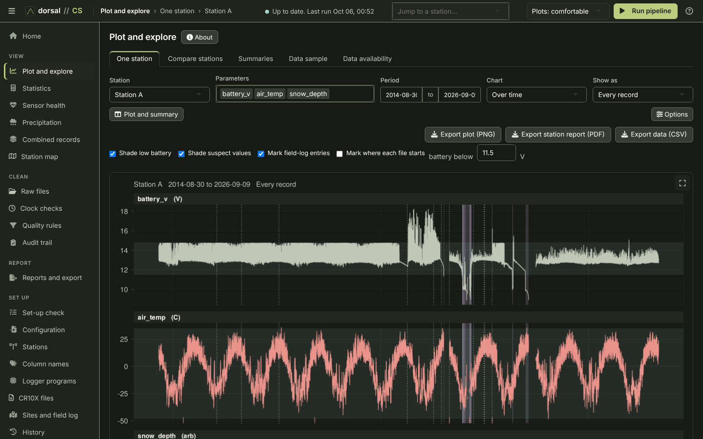
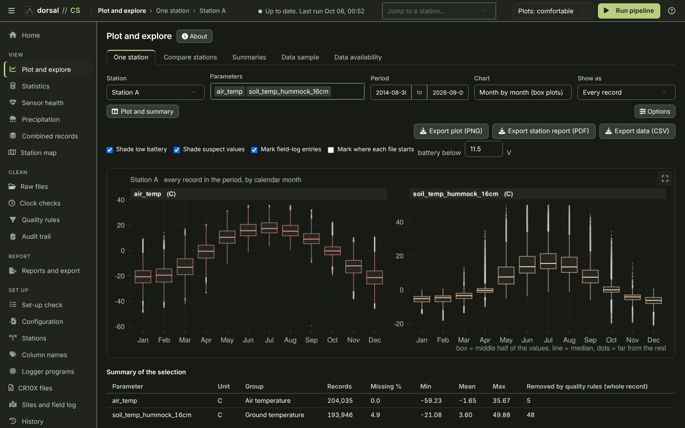

# ovid Core // CS

<!-- layout: ovid-app-readme v1 (short page; detail folded below) -->

Ingests Campbell Scientific logger files (TOA5, TOB3, CR10X), stitches them into one record per logger table, assigns records to stations, applies calibrations and quality rules, and writes flagged station records, summaries and reports.

| Goes in | Comes out |
|---|---|
| Campbell `.dat` files (TOA5, TOB3, CR10X) | One record per station, with flags |
| Logger programs | Daily, monthly and annual summaries |
| Field log and gauge set-up | Precipitation by year and water year |
| Set-up tables | Station reports (HTML, PDF) |
|  | Audit trail |

## Open it

- **Mac:** double-click `Open CS (Mac).command` in the Ovid_Apps folder. The first time, right-click > Open if macOS warns.
- **Windows:** double-click `Ovid_CS.bat` in this folder.
- Needs R 4.x. The first start installs the R packages it needs, which takes a few minutes.
- Running from R or the command line, and making a copy for computers without R: see **Run it** under More detail.
- **Workbench (preview):** an additional, more detailed view of the same project, with every Standard page (listed under Pages)
  around a spreadsheet of the record: click, drag or shift-click cells, click a time to select a record or a heading to select a
  parameter, and the chart highlights the selection. Drag across the chart to zoom in, use the wheel to zoom in and out, and
  double-click to see the whole period again. Remove, Restore, Calibrate, Clock and Note act on the selection and write the
  same set-up tables as the Standard interface; the pipeline applies them on the next run. Open it with **Workbench** in the title
  bar or `?ui=workbench` in the address; **Standard** in its title bar goes back.

## Screenshots

*Home: the field data hub with counts, shortcuts, the station list and the to-do list.*

| | |
|---|---|
|  |  |
| *Plot and explore for one station: battery voltage, air temperature and snow depth over the 12-year record, with low-battery shading and field-log marks.* | *Month-by-month box plots of air and soil temperature, with Export plot (PNG), Export station report (PDF) and Export data (CSV).* |

## More detail

<b>About</b>

A hub for Campbell Scientific logger data: stitch raw .dat files into one record per station, plot it, check it, clean it and write it up. Raw files are never changed. Theme: olive-crt (dark) from vimcolorschemes. Full detail: [docs/CS_reference_guide.md](docs/CS_reference_guide.md) (also .html and .pdf).

<b>Run it</b>

### Run it on a Mac
Double-click **`Open CS (Mac).command`** in the Ovid_Apps folder (the first time, right-click > Open if macOS warns).

### Run it on Windows
Double-click **`Ovid_CS.bat`**. The app opens in your browser with Browse… buttons beside the folder fields (Finder or Explorer); closing the tab (or the black window) stops it.
- The launcher uses `R-portable\` inside the folder if it is there, otherwise the R installed on the computer (R 4.2 or newer).
- Packages are kept in `library\` inside the folder. The first start installs them (needs the internet once); copy package `.zip` files into `launcher\packages\` to install offline.
- **To share it with people who have no R:** run **`Make_Portable.bat`** once on a computer with R and the internet. It copies that R into `R-portable\`, every package into `library\` and the shared ovid Core files into `core\`; zip the whole folder and it runs anywhere.

### Run it from R
    shiny::runApp("cs_app")
or, without the app:
    Rscript cs_pipeline.R        # set the folders at the top of the file, or CS_RAW_DIRS / CS_PROJECT_DIR

<b>What is where</b>

    app.R              the Shiny app: loads core, wires the pages together
    pages/             one file per page of the app (ui.R is the interface)
    www/cs.css         the CS look
    Ovid_CS.bat, Make_Portable.bat, launcher/run_app.R   Windows launcher and portable copy
    cs_pipeline.R      settings and run_pipeline(), the orchestration layer
    R/plots.R          the colour theme, plots, HTML report
    R/toa5.R           finding files, TOA5 headers, logger identity, timestamps
    R/tob3.R           TOB3 binary files read directly (10 Hz ts_data and other skipped tables only listed, with their date range)
    R/cr10x.R          CR10X mixed-array files and Edlog .FSL labels
    R/program.R        logger program files (.CR1, .CR1X, .CR3, .CR6, Edlog .CSI/.DLD): matched to .dat files, units and how each column was made
    R/stitch.R         one record per logger table: overlaps, clock checks, time corrections
    R/config.R         set-up tables, column aliases, station assignment
    R/qc.R             quality rules, suspect flags, cross-sensor and between-station checks, sensor health
    R/derived.R        derived variables; daily, monthly and water-year summaries
    R/precip.R         OTT Pluvio2 and Geonor T-200B gauges
    R/history.R        program-change history and station/logger lineage
    R/preflight.R      set-up check before a run
    R/io.R             reading station tables after a run
    R/export.R         flag columns, station report (HTML and/or PDF), export zip
    R/composite.R      combined records: one parameter stitched from several stations (config/composites.csv)
    www/               the Station map (cs_map.js; map_tools.js is the same file as in ovid RS)
    tests/run_tests.R  tests on synthetic logger files (also the reader samples, damaged files, the golden project and the formulas)
    tests/test_bad_files.R, test_golden.R, test_formulas.R   each also runs on its own; test_golden.R accept "<name>" after checking tests/golden/expected

The files in R/ are sourced by cs_pipeline.R in a fixed order; they are not a package.

The audit trail, the small helpers, reading set-up tables, the run cache, the time-zone table, corrupt-timestamp removal,
reports, the app shell, import and export, the run manifest and parts of the set-up check are shared with the other ovid
apps (WLR, GT, GS, RS). They live in the ovid Core (see core/README.md) and are sourced before R/. The apps find it
through the OVID_CORE environment variable, core/ inside the app folder, ../core beside it (the Ovid_Apps bundle) or
~/Desktop/Ovid.

<b>What a run does, in short</b>

- Only what changed is rebuilt: unchanged logger and station tables are reused from <project>/cache/. **Rescan** on the
  Raw files page reads the selected files again.
- Records with corrupt time stamps among good ones (off the time grid and out of the order the file was written in) are
  left out and audited (`drop_stray_records`).
- A logger set to station `ignore` on the Stations page is set aside: its files are not read at all.
- Two raw columns that map to one parameter: if they take turns (a sensor swap) they are joined into one series, the
  newer sensor winning (`sensor_change` in the audit); if they were recorded at the same time (paired sensors) they are
  kept apart as `air_temp` and `air_temp_2` (`alias_kept_apart`).
- Clocks in another zone are moved with the shared time-zone table (`config/timezones.csv`) for stations that have
  `utc_offset_hours`.
- TOB3 binary `.dat` files (card or CPU) are read directly; TOB1/TOB2 still need converting to TOA5 with CardConvert.
- Exports are named `ovid_cs_<what>_<YYYY-MM-DD>.<ext>`.

<b>Station metadata, map and combined records (CS 1.8.0)</b>

- **Station map**: every station with coordinates in Station details on satellite imagery, coloured by whether it is
  still recording, with a legend toggle and a 250 ppi PNG of the view (with or without the legend), as in ovid RS.
- **Combined records**: pick a parameter and the stations to take it from, most preferred first, each with an optional
  period and offset. Where two have a value, the preferred one wins; every value keeps its station. Saved records are
  rebuilt on every run into `output/composites/<name>.csv`, with `output/audit/composites.csv` saying what each source
  supplied and its median difference where it overlaps a preferred source.

<b>Logger programs</b>

Add the programs the loggers ran on the **Logger programs** page (upload, or copy from a folder); they are kept in
config/programs. Each .dat file is matched to a program by the name and signature in its TOA5 header, or by its
columns when the program was renamed (config/program_matches.csv). In a run, blank units in a header are filled
from the program and output/audit/column_dictionary.csv gains the program, the measuring instruction and the
output interval of each column (output/audit/program_matches.csv). Edlog .CSI and .DLD programs can stand in for
an .FSL on the CR10X files page; their labels are worked out the way Edlog writes them.

<b>Tests</b>

    Rscript tests/run_tests.R
Builds small synthetic logger files in a temporary folder, runs the pipeline on them and checks the results. Exit status 1 if anything fails.

<b>Versions</b>

PIPELINE_VERSION (top of cs_pipeline.R) is written into output/audit/run_manifest.csv on every run, with the R and package versions,
the settings, and an MD5 fingerprint of each set-up table. output/audit/run_history.csv keeps one line per run.
Bump the version when a change alters the output.

<b>What's new</b>

### New in CS 1.10.0
- New projects start with wide spike and step limits that catch glitches, not weather; *Fill in suggested spike and step limits* on Quality rules adds them to an existing project (blank cells only).
- Every quality rule has a `rule_id`, and `flags.csv` names the rule behind each flag.

### New in CS 1.9.0
- Flag-only checks: BSRN radiation limits, humidity above 103 %, frozen anemometer, rain below freezing; a step test (`max_step_per_hour`).
- Wind direction averaged on the circle, with Yamartino spread and resultant wind; dew point.
- Weighing gauges: 10 m coefficients when `wind_height_m` is 5 or more; low and high corrected values from the ±0.2 uncertainty.
- Exports give WMO quality codes (`_qc`) by default; the letters S, R, M remain a choice.
- See `CHANGELOG.md` and section 13 of the reference guide.

[Reference guide](docs/CS_reference_guide.md) · [Changelog](CHANGELOG.md) · [System overview](../docs/overview.md) · [All five apps](../README.md)
