# ovid CS how-to guide

One task per section: when to use it, the steps, what changes and how to check it. Page names are those of the Standard view: the stages are on the top bar, the pages of the stage shown are listed on the left, and those under **More pages** are folded at the bottom of that list; **Go to** (⌘K or Ctrl K) finds any page. Numbers in brackets point to the markers in the figure. For what CS does to the data and why, see the CS reference guide.

## Contents

**Bring in:** 1. Add a new download; 2. Send a file to another station or leave it out; 3. Name the columns of CR10X files

**Organize:** 4. Give a logger a station; 5. Give a raw column a common name; 6. Combine stations into one record

**Correct:** 7. Fix a logger clock; 8. Set the time zone; 9. Remove a bad stretch; 10. Add a calibration; 11. Change a quality limit; 12. Set up a weighing gauge; 13. Get evapotranspiration and albedo

**Check and report:** 14. Find out why a value was removed; 15. Find failing sensors; 16. Export data and reports; 17. Back up or share the set-up; 18. Report a problem

## The three views

The same project, data and edits in three views, switched at the top (**Simple**, **Standard**, **Workbench**) or with ?ui=simple, ?ui=standard or ?ui=workbench in the address. A new install opens in Simple.

<figure>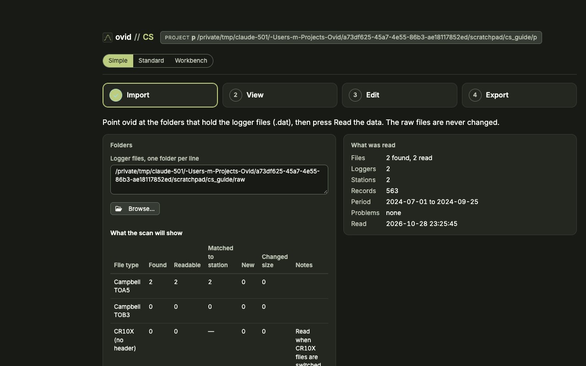</figure>

- **Simple**: a field check in four steps (Import, View, Edit, Export). Edit renames stations, places them and moves loggers between them; it changes no data value.
- **Standard**: the set-up flow these tasks use: bring in files, organize loggers and stations, assess the records, decide what the run found, report.
- **Workbench**: every change to the data. Removing values, quality limits, corrections over a period and clock shifts made by hand are edited here; the Standard view shows them and links to it.

## 1. Add a new download

**When:** after a field visit, with new .dat files.

<figure>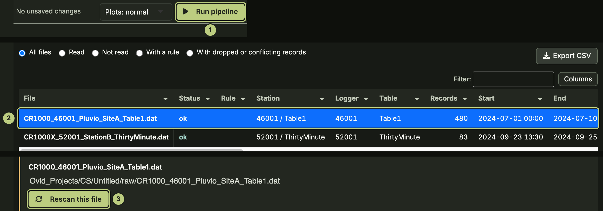</figure>

1. Copy the files into a raw folder of the project. Keep the overlapping old ones.
2. Press **Run** (1).

**Result:** only logger tables with new or changed files are read again; the rest come from cache/. Overlapping records are merged, the newest download's values winning.

**Check:** **2 Bring in files** lists each new file and where its records went (2). To read a file again, select it and press **Rescan this file** (3).

## 2. Send a file to another station or leave it out

**When:** a file belongs to another logger, is a bad copy, or should not be used.

<figure>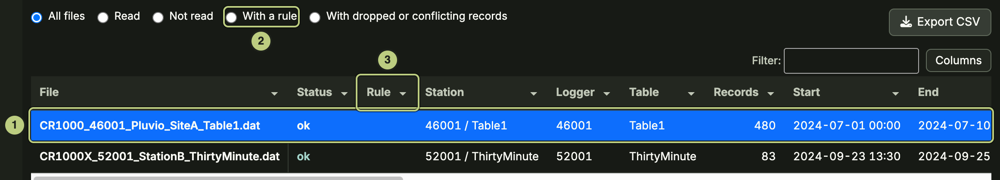</figure>

1. **2 Bring in files:** select the file (1).
2. Below its details, give a reason and your initials, then **Send to this station**, **Leave out of the next run**, or drag across its plot and **Remove these records from this file**.
3. Press **Run**. The rule is saved at once.

**Result:** a file rule in the set-up tables, applied on the next run. The raw file is not changed.

**Check:** **With a rule** (2) lists the file; the **Rule** column (3) shows it. The **Audit trail** says why.

## 3. Name the columns of CR10X files

**When:** CR10X mixed-array files show columns without names.

<figure>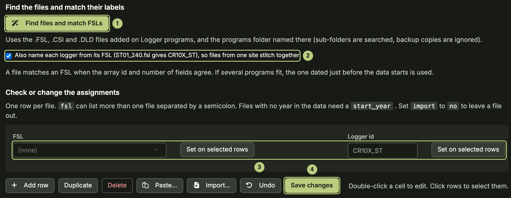</figure>

1. Add the .FSL files on **Logger programs** (More pages).
2. **CR10X files** (More pages): press **Find files and match FSLs** (1). Tick **Also name each logger from its FSL** (2) so files from one site stitch together.
3. Check each file has an FSL and a logger id; set missing ones with **Set on selected rows** (3), then **Save changes** (4).
4. Press **Run**.

**Result:** each array gets time stamps and column names from its FSL.

**Check:** **Loggers and files** (More pages) lists the logger with its columns named.

## 4. Give a logger a station

**When:** a new logger, a logger moved, or two loggers make up one station.

<figure></figure>

1. **3 Loggers and stations:** select the logger rows (3).
2. Pick the **Station** (1) and press **Apply to selected rows** (2).
3. A logger that moved: one row per station and period in the **Deployment sheet** (4).
4. To set a logger aside, name its station **ignore**: its files are not read. Press **Run**.

**Result:** records go to stations by logger, header name, table and date.

**Check:** **Logger history** (More pages), tab **Station lineage**.

## 5. Give a raw column a common name

**When:** a column keeps its raw name (for example a new sensor or a renamed program variable).

<figure>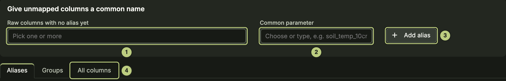</figure>

1. **Column names** (More pages): pick the column under **Raw columns with no alias yet** (1) and the **Common parameter** (2).
2. Press **Add alias** (3), then **Run**.

**Result:** the raw column is renamed to the common parameter (AirTC_Avg becomes air_temp) in every table that has it.

**Check:** the **All columns** tab (4); output/audit/column_dictionary.csv.

## 6. Combine stations into one record

**When:** one parameter needs a single record from several stations, for example a sensor that moved.

<figure>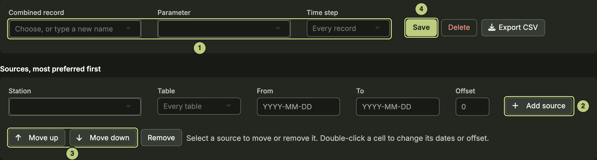</figure>

1. **Combined records:** name the **Combined record**, pick its **Parameter** and **Time step** (1).
2. **Add source** (2) for each station and table. Limit each with **From** and **To**; give an **Offset** if needed.
3. Order the sources with **Move up** and **Move down** (3): where two have a value, the higher one wins.
4. **Save** (4).

**Result:** the record is rebuilt on every run into output/composites/. Each value keeps the station it came from.

**Check:** **Export CSV** on the page.

## 7. Fix a logger clock

**When:** **Clocks** lists a finding (a power loss, a reset clock, overlapping files that disagree in time).

<figure>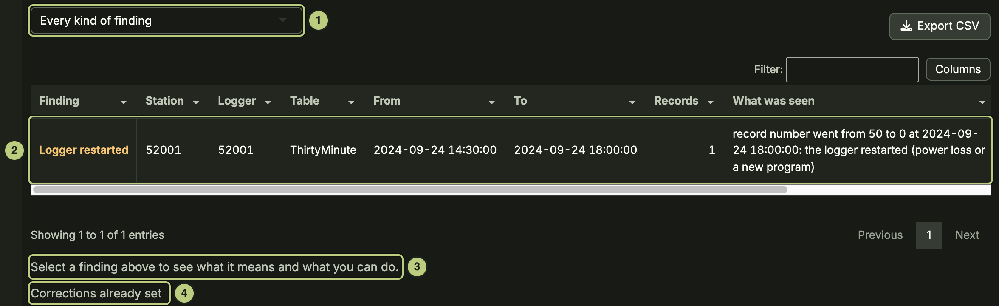</figure>

1. **Clocks:** pick the kind (1) and select the finding (2). Read what it means below (3).
2. A suggested shift: accept it here or in **Needs you**. Any other correction is made in the Workbench: **Move the timestamps** (by minutes, or the real time of the first record) or **Remove the records**, with a reason, then **Add this correction**.
3. Press **Run**.

**Result:** a row in the clock corrections, applied before stitching.

**Check:** **Corrections already set** (4) lists it; the finding is gone from **Clocks**; output/audit/timestamp_checks.csv.

## 8. Set the time zone

**When:** before the first run, or when a logger kept a different clock.

<figure>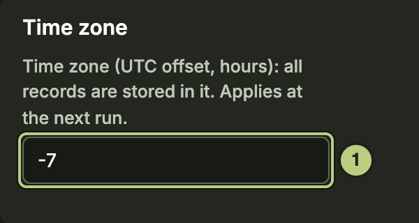</figure>
<figure>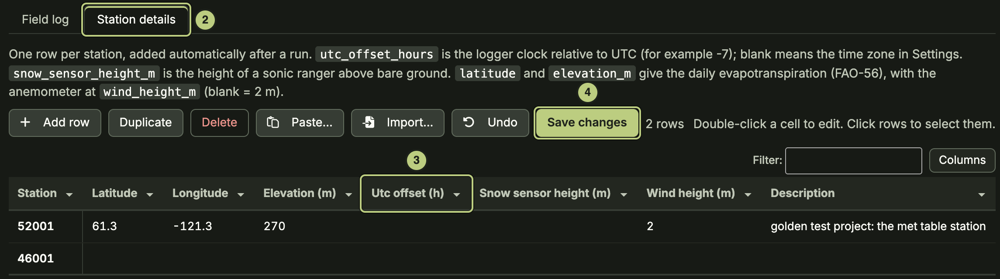</figure>

1. **Settings** (gear, top right): **Time zone** as a UTC offset in hours (1), for example -7.
2. A logger on another clock: **Sites and field log** (More pages), tab **Station details** (2). Set its **Utc offset (h)** (3); blank uses the Settings time zone.
3. **Save changes** (4), then **Run**.

**Result:** every time stamp is moved to the project time zone; exports say which.

## 9. Remove a bad stretch

**When:** a sensor was down, being serviced or plainly wrong.

<figure>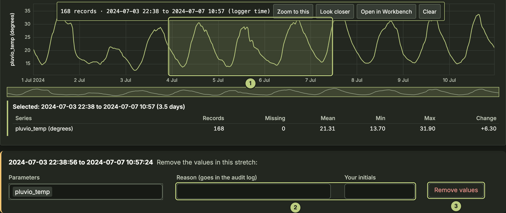</figure>

1. Switch to the **Workbench** (top right): removing values is done there. Its **Plot and explore**: Shift + drag across the stretch (1).
2. Give a reason and your initials (2), then **Remove values** (3). The row is saved at once.
3. Press **Run**.

In the Workbench: select the stretch, **Remove…**, then **Write rows**. To keep the values but mark them, use **Correct a period…** with action flag.

**Result:** a row in **Corrections over a period**. The values are blanked on the next run; the old values stay in the audit trail. **Restore…** in the Workbench deletes the row.

**Check:** the stretch shows as removed on the plot; the **Audit trail** lists the values.

## 10. Add a calibration

**When:** a sensor needs a multiplier or an offset over a period, or a tipping bucket needs mm per tip.

<figure>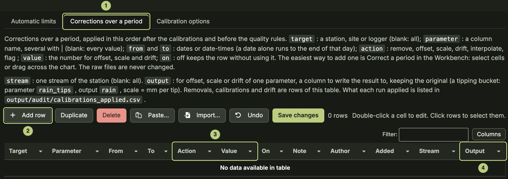</figure>

1. In the **Workbench** (calibrations change data values, so the table is edited there): **Calibrations and limits**, tab **Corrections over a period** (1): **Add row** (2).
2. Fill in Target (station), Parameter, From, To, **Action** scale or offset and its **Value** (3).
3. To keep the original, name an **Output** column (4). Tipping bucket: parameter rain_tips, output rain, scale = mm per tip.
4. **Save changes**, then **Run**.

**Result:** scale multiplies the values by Value, offset adds Value, over the period.

**Check:** output/audit/calibrations_applied.csv.

## 11. Change a quality limit

**When:** a limit removes good values or lets bad ones through.

<figure>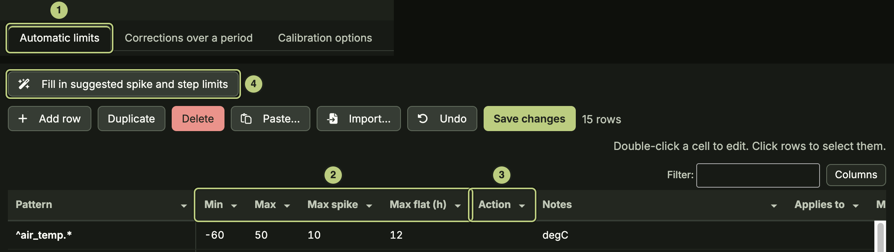</figure>

1. In the **Workbench**: **Calibrations and limits**, tab **Automatic limits** (1). **Pattern** picks the parameters, **Applies to** the stations. The Standard view shows the limits.
2. Edit **Min**, **Max**, **Max spike**, **Max flat (h)** or **Max step per hour** (2), and the **Action** (3): blank, remove or flag.
3. **Fill in suggested spike and step limits** (4) fills only blank spike and step cells.
4. **Save changes**, then **Run**.

**Result:** values outside the limits are removed or flagged and written to the audit trail with the rule. Max step per hour only flags.

**Check:** **Set-up check** warns of a limit that would remove everything.

## 12. Set up a weighing gauge

**When:** a Pluvio2 or Geonor gauge, especially one whose columns are not named acc_total and bucket_nr, or GN_mm.

<figure>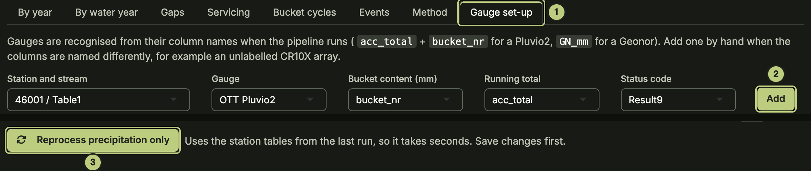</figure>
<figure>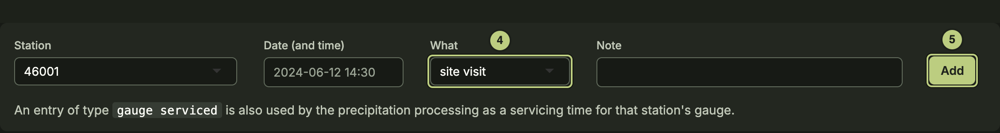</figure>

1. **Precipitation corrections**, tab **Gauge set-up** (1): check the gauge is listed, or set its station, gauge and columns and **Add** (2).
2. **Sites and field log** (More pages), tab **Field log**: for each emptying, top-up or service, pick **What** gauge serviced (4) and **Add** (5).
3. **Reprocess precipitation only** (3).

**Result:** bucket content turned into precipitation per interval and per day, with undercatch correction where a wind station is set.

**Check:** tabs **Bucket cycles**, **Servicing** and **Gaps**; days marked low_confidence are read from the bucket.

## 13. Get evapotranspiration and albedo

**When:** daily ET (FAO-56 and Priestley-Taylor) or daylight albedo is blank.

<figure>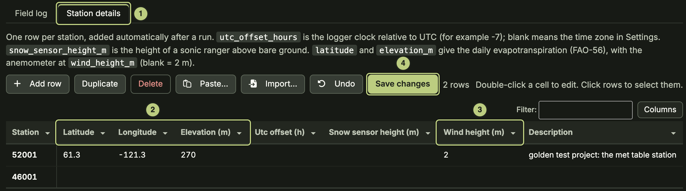</figure>
<figure>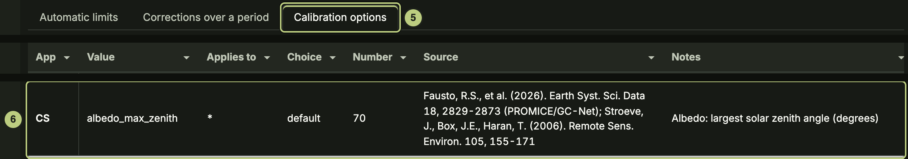</figure>

1. **Sites and field log** (More pages), tab **Station details** (1): enter **Latitude**, **Longitude** and **Elevation (m)** (2); **Wind height (m)** (3) if the anemometer is not at 2 m.
2. **Save changes** (4), then **Run**.
3. The daylight limit is **albedo_max_zenith** (6) under **Calibration options** (5): default 70, the sun more than 20 degrees above the horizon.

**Result:** daily ET from radiation, temperature, humidity and wind; daily albedo from daylight records only.

**Check:** the daily table in the export. Without coordinates, albedo falls back to incoming shortwave above 50 W/m2; the run log says which was used.

## 14. Find out why a value was removed

<figure>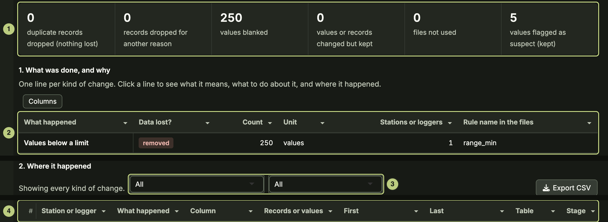</figure>

1. **Audit trail** (More pages): read it top down: the totals (1), what was done and why (2), where it happened (3), then the single records and values (4).
2. Click a line in (2) to see what it means, what to do about it and where it happened.

**Result:** each removed or changed value with its old value, the rule and the set-up row behind it.

## 15. Find failing sensors

<figure>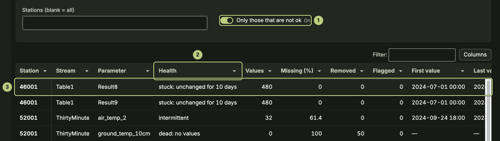</figure>

1. **Sensor health** (More pages): with **Only those that are not ok** (1), every parameter that needs a look, worst first. **Health** (2): dead, stopped, failing, dying, stuck, intermittent or suspect.
2. Click a row (3) to open its plot in **Plot and explore**. Remove its bad stretch (task 9) or note it in the field log.

## 16. Export data and reports

<figure>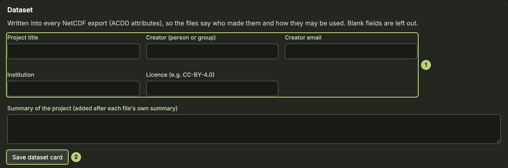</figure>
<figure>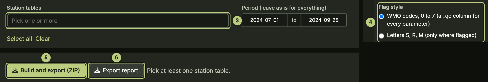</figure>

1. **Settings:** fill in the **Dataset** card (1) and **Save dataset card** (2). It is written into NetCDF exports.
2. **7 Report:** pick the **Station tables** (3) and the **Flag style** (4).
3. **Build and export (ZIP)** (5), or **Export report** (6) for the report alone.

**Result:** one zip that can be used without the app: a tidy CSV per station table with flag columns, daily and monthly summaries, a report per table (HTML, PDF or both), the processing level of each file and a readme.

## 17. Back up or share the set-up

<figure>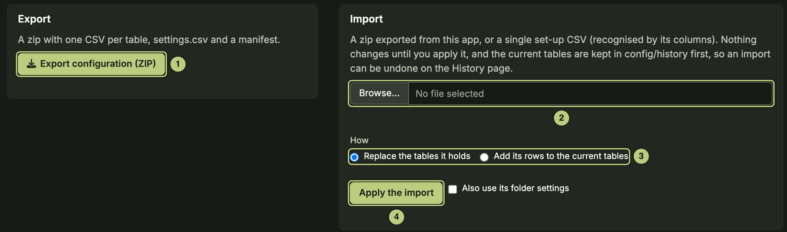</figure>

1. **Configuration** (More pages): **Export configuration (ZIP)** (1) writes every set-up table and the folder settings.
2. In another project: **Browse…** for the zip (2), pick **How** (3), then **Apply the import** (4).

**Result:** the replaced tables are kept in config/history; the History page undoes the import.

## 18. Report a problem

1. A notice with a reference (E- and six characters) means part of a page failed; the app carries on.
2. The lifebuoy button (top right) builds a troubleshooting zip: versions, logs and set-up, no raw data. Send it with the reference.

