# ovid CS quick start

Climate station loggers (Campbell Scientific), from raw .dat files to checked, gap-aware records per station.

## Before you start

- **Raw files.** Put every .dat download in one or more raw folders; subfolders are searched. TOA5 (LoggerNet, PC400, CardConvert), TOB3 straight from a card and CR10X mixed-array files are read. Keep every download, overlapping ones too: CS sorts them out.
- **CR10X only.** Have the Edlog .FSL file for each program, so the columns get names.
- **Optional.** A field log of visits and servicing, and each station's latitude, longitude and elevation (needed for evapotranspiration and daylight albedo).

Open the app with **Open CS (Mac).command** (Windows: **Ovid_CS.bat**). The numbers in each figure match the list under it.

## The Simple view

For someone new to the data, or a field check: four steps in one column, and nothing that changes a data value. A new install opens in Simple; the switch at the top (**Simple**, **Standard**, **Workbench**) moves between the three views of the same project, as does ?ui=simple, ?ui=standard or ?ui=workbench in the address.

<figure>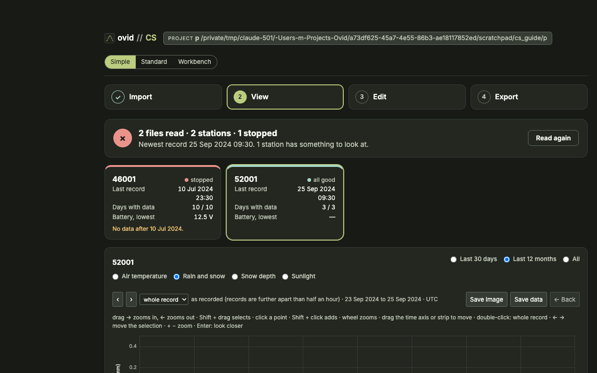</figure>

- **Import**: the raw folders and the project folder, then **Read the data**. A summary says what was read.
- **View**: one tile per station (last record, days with data, lowest battery; amber or red when it needs a look) and a plot of the daily air temperature, rain and snow, snow depth or sunlight.
- **Edit**: rename a station, give it a place (latitude and longitude), or drag a logger onto another station, from its whole record or from a date. Changes wait in a list until **Save**, with **Undo** and a change log. Data values, quality rules and corrections are not changed here.
- **Export**: the Simple report (one page, HTML or PDF) and the daily values (one CSV per station, with a README).

<figure>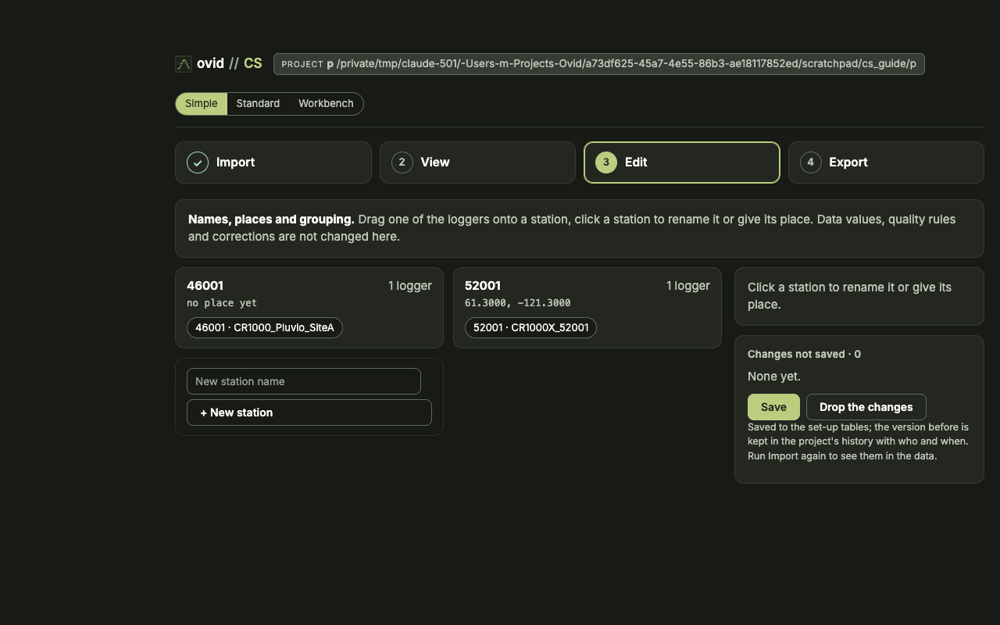</figure>

## The top bar and the pages

This and the rest of this guide are the Standard view.

<figure>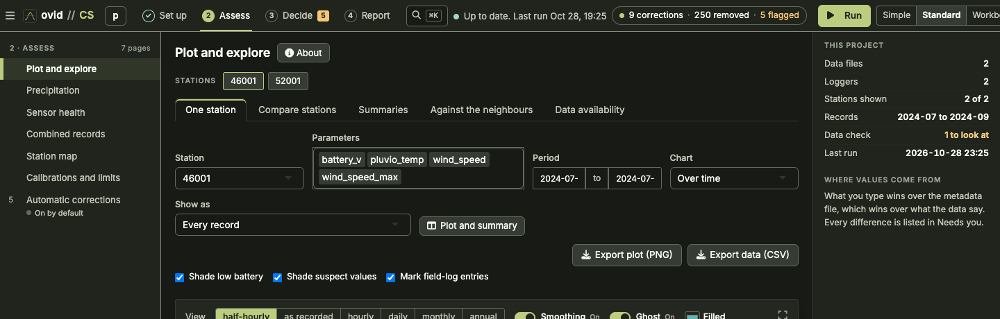</figure>

1. The stages, in working order, on the top bar: **1 Set up**, **2 Assess**, **3 Decide**, **4 Report**. A tick marks a stage that is done; the number on **Decide** is what waits in **Needs you**.
2. The pages of the stage shown are listed on the left, each step with a line saying where it stands. **More pages** at the bottom holds the tools and set-up pages (Overview, History, Set-up check, Column names, CR10X files and others). The ☰ button folds the list away.
3. **Go to** (⌘K or Ctrl K): any page, station or setting by typing a few letters.
4. **Run**: reads the raw files and rebuilds every output. Beside it, the run state: up to date, or set-up changed and waiting for a run.
5. **Settings** (gear): the time zone, plot height, the Explanations switch and the troubleshooting zip.

Removing values, adding a quality rule and shifting a clock by hand are done in the Workbench; the Standard pages show them and say so.

## 1 Project

<figure>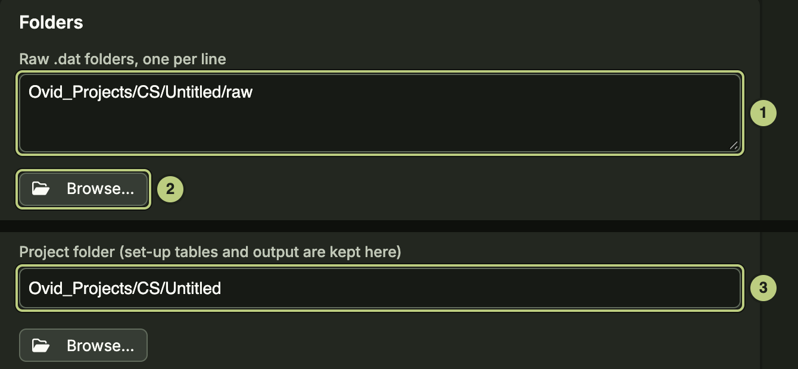</figure>

1. **Raw .dat folders, one per line.** Raw files are never changed.
2. **Browse…** to pick a folder instead of typing it.
3. **Project folder**: holds config/ (set-up tables) and output/. Default ~/Projects/Ovid/Projects/CS/project.

## 2 Bring in files

<figure>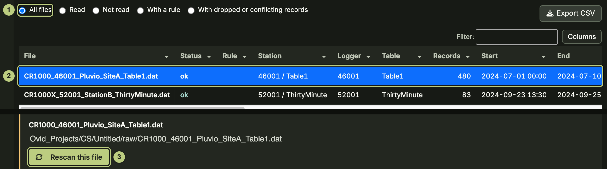</figure>

1. Filter the list: **All files**, **Read**, **Not read**, **With a rule**, **With dropped or conflicting records**.
2. Select a file to see where its records went. Below its details: send it to another station or leave it out.
3. **Rescan this file** reads it again. CR10X files: on **CR10X files** (More pages), press **Find files and match FSLs**.

Then press **Run**. The first run writes the set-up tables with the built-in defaults.

## 3 Loggers and stations

<figure>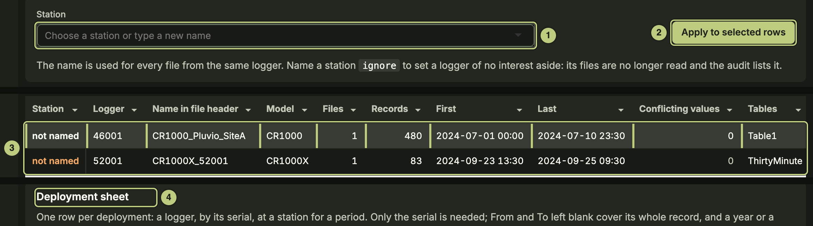</figure>

1. **Station**: pick a station or type a new name. **ignore** sets a logger aside.
2. **Apply to selected rows**.
3. The loggers found in the files; **not named** ones still need a station.
4. **Deployment sheet**: one row per logger and period; a logger that moved gets a row per station.

## 4 Needs you

<figure>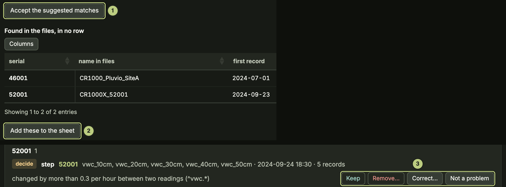</figure>

1. **Accept the suggested matches** of loggers to stations.
2. **Add these to the sheet**: loggers found in the files but in no row.
3. Decide each finding of the last run: **Keep**, **Remove…**, **Correct…** or **Not a problem**.

## 5 Stations: rename, what shows

<figure>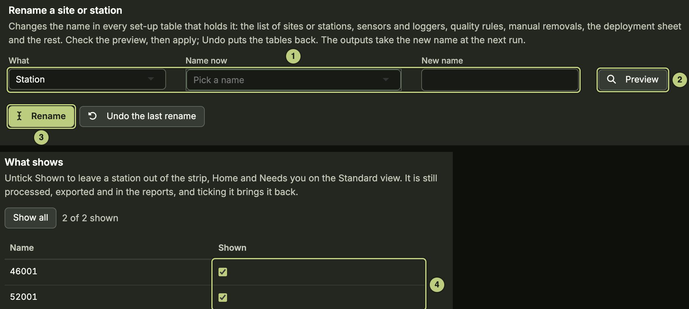</figure>

1. Pick **What** and the **Name now**, type the **New name**.
2. **Preview** lists every set-up table that changes.
3. **Rename** changes it everywhere; **Undo the last rename** puts it back.
4. **Shown**: untick to hide a station from the strip, Home and Needs you. It is still processed and exported.

## Clocks

<figure></figure>

1. Pick the kind of finding, or **Every kind of finding**.
2. Select a finding (a restart, a reset clock, files that disagree in time).
3. Below: what it means. Accepting a suggested shift is done here (or in **Needs you**); moving the timestamps or removing the records by hand is done in the Workbench.
4. **Corrections already set** lists the clock corrections in use.

## Precipitation corrections

<figure></figure>

1. Weighing gauges (Pluvio2, Geonor): tab **Gauge set-up**. Check each gauge is listed.
2. **Add** a gauge whose columns are not recognised. Enter servicing in the field log (Sites and field log, More).
3. **Reprocess precipitation only** reruns this step in seconds.

## Calibrations and limits

<figure>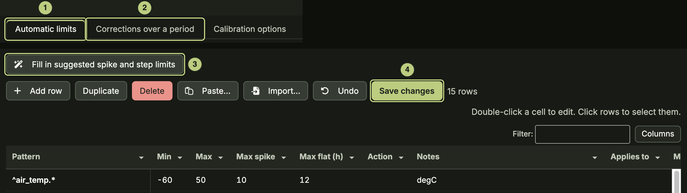</figure>

1. **Automatic limits**: check the min, max, spike, step and flat-line limits.
2. **Corrections over a period**: calibrations and bad periods.
3. Both tables are shown here and edited in the Workbench (**Fill in suggested spike and step limits** too), because they change data values.

## 6 Automatic corrections

<figure>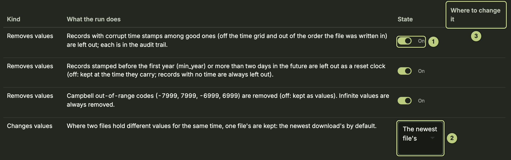</figure>

1. A switch per correction, on by default. Leave them on unless you have a reason.
2. Where two files disagree, which file's values are kept (default: the newest).
3. **Where to change it**: corrections driven by a set-up table name that table.

## Apply and check

<figure>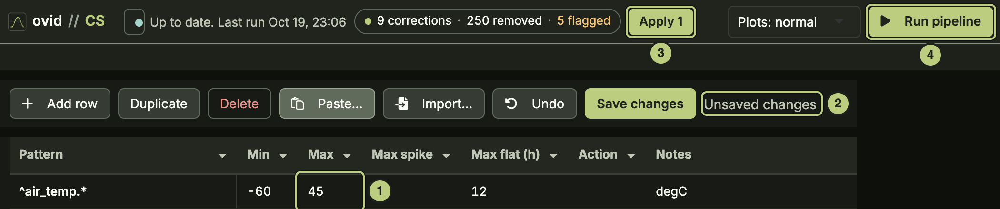</figure>

1. An edited cell in a set-up table.
2. **Unsaved changes** shows beside **Save changes**.
3. **Apply 1** (top bar; the number of edits): its **Apply** button saves every edited table.
4. **Run** also saves them, then runs.

<figure>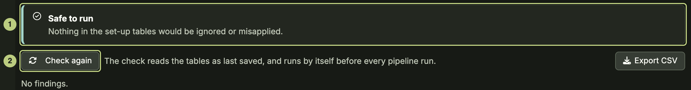</figure>

1. **Set-up check** (More pages): clear anything it lists before trusting a run. **Safe to run** means nothing is ignored or misapplied.
2. **Check again** after a change. The check also runs before every pipeline run.

## 7 Report

<figure>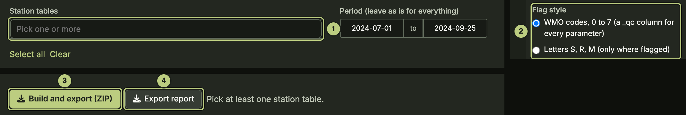</figure>

1. **Station tables**: pick one or more (**Select all**).
2. **Flag style**: WMO codes 0 to 7, or letters S, R, M.
3. **Build and export (ZIP)**: a CSV per station table with flag columns, daily and monthly summaries, a report per table and a readme.
4. **Export report**: the report alone, for the first station picked.

## What you have at the end

One continuous record per station and parameter, stitched from every file. Every removed or changed value is in the audit trail with its old value and the rule that changed it, and the same raw files and set-up give the same result again.

## Next

See the CS how-to guide: add a new download, fix a logger's clock, remove a bad stretch, add a calibration, set up a weighing gauge, combine stations into one record, share a set-up.
