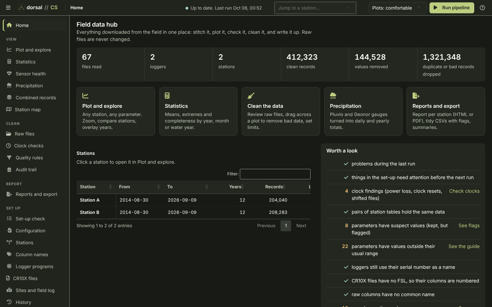
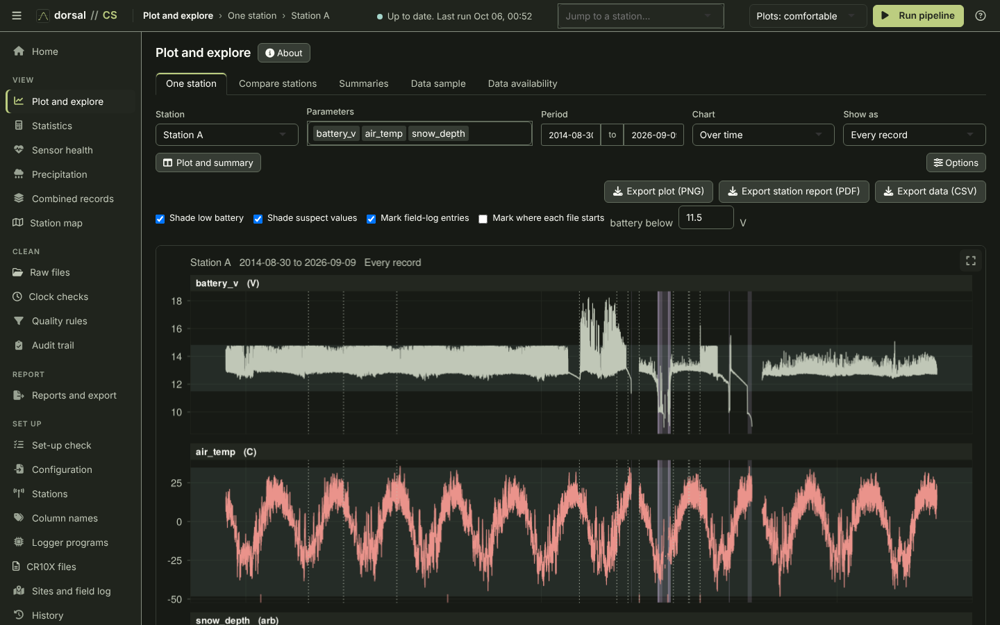
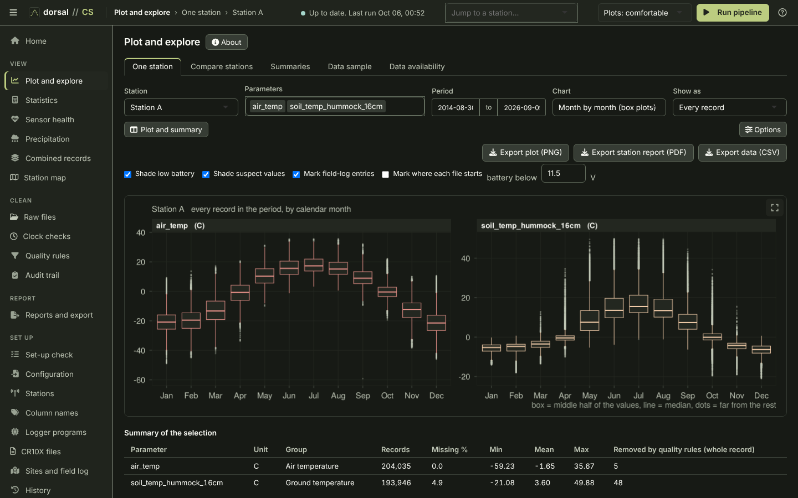
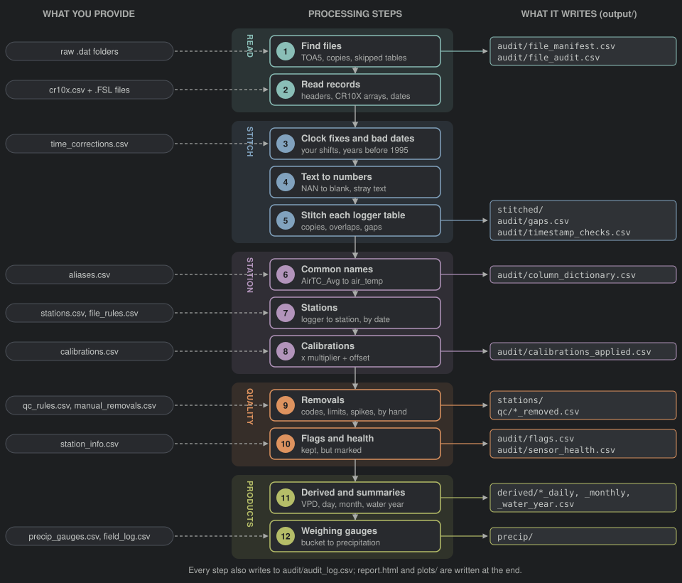
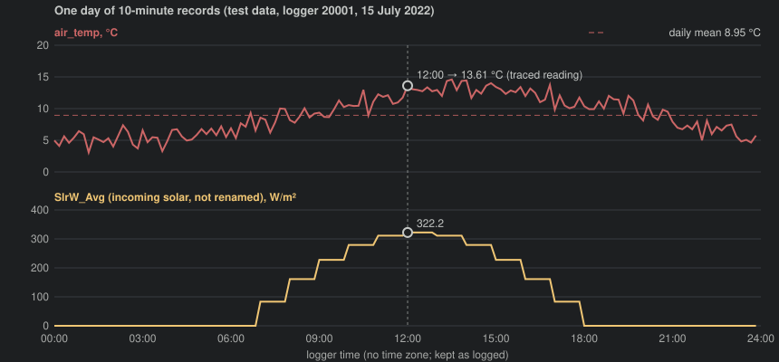
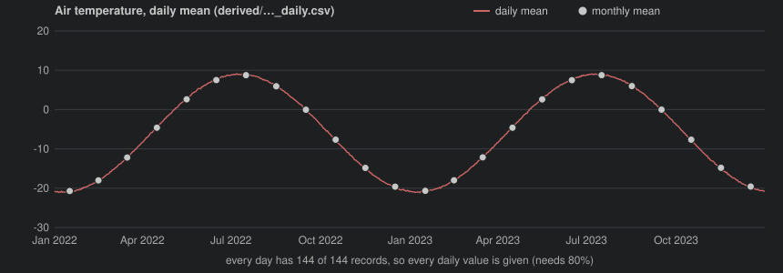
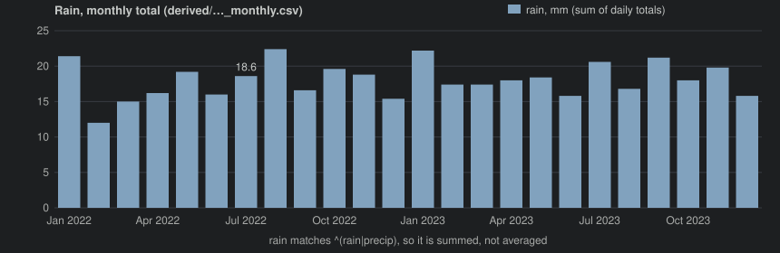

# ovid CS Reference Guide

Campbell Scientific loggers: what the app does to every record, why, and
how to check it. For CS 1.10.0 (ovid Core 1.14.0). Settings are quoted
with their defaults; change them in the app or at the top of
`cs_pipeline.R`. Raw files are never changed.

**Contents**

1.  [Quick start](#quick)
2.  [What it looks like](#what-it-looks-like)
3.  [What happens to the data, in order](#order)
4.  [The pipeline at a glance](#flow)
5.  [One reading through the pipeline](#trace)
6.  [1. Finding files](#files)
7.  [2. Reading records and time stamps](#read)
8.  [3. Clock corrections and impossible dates](#clock)
9.  [4. Text to numbers](#num)
10.  [5. Stitching each logger table](#stitch)
11. [6. Common parameter names](#names)
12. [7. Stations](#stations)
13. [8. Calibrations](#cal)
14. [9. Quality rules and removals](#qc)
15. [10. Flags and sensor health](#flags)
16. [11. Derived values and summaries](#summ)
17. [12. Weighing precipitation gauges](#precip)
18. [Reading the outputs](#outputs)
19. [Sensor notes](#sensors)
20. [Reasonable values](#values)
21. [Troubleshooting](#trouble)
22. [Glossary](#glossary)
23. [References](#refs)

## Quick start

1.  Collect the raw `.dat` files (TOA5 from LoggerNet, PC400 or
    CardConvert, TOB3 binary straight from a card or the logger's CPU,
    and CR10X mixed-array files) in one or more raw
    folders. Subfolders are searched. Keep every download, including
    overlapping ones: the app sorts them out.
2.  Open the app (`Open CS (Mac).command`, `Ovid_CS.bat` on Windows,
    or `shiny::runApp()`) and choose the raw folders and a project
    folder with **Browse…**. `config/` and `output/` are kept
    in the project folder.
3.  Run the **Set-up check**. Fix anything it lists in red first.
4.  Press **Run**. The first run writes the set-up tables in `config/`
    with the built-in defaults.
5.  For CR10X files, open **CR10X files** and give each file a logger id
    and its Edlog `.FSL` file, so the columns get names.
6.  On **Stations**, give each logger a station name. Split a logger by
    date if it moved, or set the station to `ignore` to set the logger
    aside: its files are then not read at all.
7.  On **Column names** (aliases), check that each raw column maps to
    the common name you want. Unmapped columns keep their raw name.
8.  Read **Clock checks**. Add a clock correction (shift or remove)
    where a logger's clock was wrong, and run again.
9.  Check **Quality rules** and **Sensor health**. Add manual removals
    for periods you know are bad (a sensor down for repair, a bucket
    being serviced).
10. For weighing gauges, check **Gauge set-up** and enter servicing in
    the **Field log**. Then look at the data in **Plot and explore** and
    export from **Reports and export**.

A run only rebuilds what changed (`incremental = TRUE`): a logger table
whose files, clock corrections and settings are the same as last time is
read back from `cache/`. Use **Rescan** on the Raw files page to make
the app read particular files again.

## What it looks like

The three screens you will use most, from a run on example data.

*1. Home: the field data hub with counts, shortcuts, the station list and the to-do list.*

*2. Viewing data: Plot and explore for one station, battery voltage, air temperature and snow depth over the 12-year record, with low-battery shading and field-log marks.*

*3. Another plot and exporting: month-by-month box plots of air and soil temperature, with Export plot (PNG), Export station report (PDF) and Export data (CSV).*

## What happens to the data, in order

| \#  | Step         | What changes                                                                                                                                              | Logged in                                                                   |
|-----|--------------|-----------------------------------------------------------------------------------------------------------------------------------------------------------|-----------------------------------------------------------------------------|
| 1   | Find files   | Chooses which files are read; byte-identical copies, skipped tables and unreadable files are left out                                                     | `audit/file_manifest.csv`, `audit/file_audit.csv`                           |
| 2   | Read records | TOA5 header gives logger serial, model, program and table; spreadsheet dates rewritten as `YYYY-MM-DD HH:MM:SS`; CR10X arrays given time stamps and names | `audit/file_manifest.csv`, `malformed_row` entries                          |
| 3   | Clock fixes  | Your shifts and removals applied; records before `min_year` (1995) or in the future dropped                                                               | `audit/timestamp_checks.csv`, audit trail                                   |
| 4   | Numbers      | `NAN` and blanks become missing; text in a numeric column removed                                                                                         | rule `non_numeric`                                                          |
| 5   | Stitch       | One record per logger table: identical copies dropped, overlapping records merged (newest file wins)                                                      | `stitched/`, `audit/gaps.csv`, rules `duplicate_record`, `overlap_conflict` |
| 6   | Names        | Raw columns renamed to common parameters (`AirTC_Avg` → `air_temp`)                                                                                       | `audit/column_dictionary.csv`                                               |
| 7   | Stations     | Records sent to stations (by logger, header name, table and date); overlaps between loggers merged                                                        | `audit/lineage.csv`, rule `station_overlap`                                 |
| 8   | Calibrations | `value × multiplier + offset`, in place or into a new parameter                                                                                           | `audit/calibrations_applied.csv`                                            |
| 9   | Removals     | Overflow codes, values outside limits, spikes and your manual removals blanked                                                                            | `qc/*_removed.csv`, `audit/audit_index.csv`                                 |
| 10  | Flags        | Doubtful values marked, not changed; each parameter given a health verdict                                                                                | `audit/flags.csv`, `audit/sensor_health.csv`                                |
| 11  | Summaries    | Adds VPD, albedo, net radiation, snow depth where possible; daily, monthly, water-year values                                                             | `derived/`, `audit/derived_summary.csv`                                     |
| 12  | Gauges       | Weighing-gauge bucket content turned into precipitation per interval and per day                                                                          | `precip/`, `audit/precip_summary.csv`                                       |

Nothing is dropped or blanked except through two functions that write to
the audit trail. The run stops if **records read = records kept +
records dropped** fails for a logger table, or if **values before −
values after = values audited** fails for a station.
`audit/file_audit.csv` repeats the record count per raw file.

## The pipeline at a glance

Five stages, twelve steps. Inputs on the left enter at the step that
uses them (all are tables in `config/` except the raw folders); files on
the right are written at the step that makes them.

<figure style="margin:8px 0 14px">

</figure>

## One reading through the pipeline

CS has no real data in this guide, so the example comes from the
**synthetic test data** the app is benchmarked on: eight CR1000 loggers,
a 10-minute table, two years, with each monthly download also holding
the month before (as real cumulative downloads do). The values are made
up and the weather is not real; the processing is. The reading is logger
20001 at 12:00 on 15 July 2022.

### In the raw file

"TOA5","Stn1","CR1000","20001","CR1000.Std.32","CPU:met.CR1","1234","Table10min"
"TIMESTAMP","RECORD","BattV_Min","PTemp_C_Avg","AirTC_Avg","RH","WS_ms_Avg","WindDir","SlrW_Avg","BP_mbar_Avg","Rain_mm_Tot","SnowDepth_Avg"
"TS","RN","","","","","","","","","",""
"","","Avg","Avg","Avg","Avg","Avg","Avg","Avg","Avg","Avg","Avg" …
"2022-07-15
12:00:00",28152,12.59,11.39,13.61,48.5,4.78,138,322.2,903.8,0,0

The same line is in two downloads: `…_2022-07.dat` and `…_2022-08.dat`.

| Step          | What happens to this reading                                                                                                                                                                                                                                             | Value after the step             |
|---------------|--------------------------------------------------------------------------------------------------------------------------------------------------------------------------------------------------------------------------------------------------------------------------|----------------------------------|
| 1 Files       | Both files start with `TOA5`; they differ (different MD5), so both are read. Table `Table10min` is not in `skip_tables`                                                                                                                                                  | 2 copies of the record           |
| 2 Read        | Serial 20001 in the header becomes the logger id (`id_source` = header serial). The time stamp is already ISO; it is kept as logged, with no time zone                                                                                                                   | 2022-07-15 12:00:00              |
| 3 Clock       | No clock correction for this logger; 2022 is between 1995 and today                                                                                                                                                                                                      | kept                             |
| 4 Numbers     | Every field parses as a number; no `NAN`                                                                                                                                                                                                                                 | AirTC_Avg = 13.61, RH = 48.5 …   |
| 5 Stitch      | Records sorted by time, newest file first. The `2022-07` copy is identical to the `2022-08` copy and is dropped (`duplicate_record`). Interval 10 min, no gaps                                                                                                           | 1 record, source `…_2022-08.dat` |
| 6 Names       | `AirTC_Avg`→`air_temp`, `RH`→`rh`, `WS_ms_Avg`→`wind_speed`, `WindDir`→`wind_dir`, `Rain_mm_Tot`→`rain`, `SnowDepth_Avg`→`snow_depth`, `BattV_Min`→`battery_v_min`, `PTemp_C_Avg`→`panel_temp`. `SlrW_Avg` and `BP_mbar_Avg` have no built-in alias and keep their names | air_temp = 13.61, rh = 48.5      |
| 7 Station     | No row in `stations.csv`, so the station is the logger id and the stream is the table name                                                                                                                                                                               | station 20001, stream Table10min |
| 8 Calibration | No calibration applies                                                                                                                                                                                                                                                   | unchanged                        |
| 9 Removals    | No overflow code. air_temp inside −60 to 50, rh inside 0 to 105, wind_speed inside 0 to 75, wind_dir inside 0 to 360, battery inside 0 to 20. No flat run long enough                                                                                                    | kept                             |
| 10 Flags      | No second sensor to compare with; no `sw_in` (solar is still `SlrW_Avg`), so no night-sun check; the daily mean does not depart from the other 7 stations                                                                                                                | no flag                          |
| 11 Summaries  | VPD = 0.6108·e17.27·13.61/(13.61+237.3) × (1 − 0.485) = 1.5586 × 0.515. The day holds 144 of 144 records (needs 115.2): day mean air_temp 8.949 °C, rain 0.8 mm. July 2022: mean 8.751 °C, rain 18.6 mm                                                       | vpd_kpa = 0.8027                 |
| 12 Gauges     | No weighing-gauge columns, so nothing to do                                                                                                                                                                                                                              | —                                |

### What the outputs look like

**stations/20001\_\_Table10min.csv** (the clean record; logger_id,
battery_v_min and panel_temp left out, `source_file` shortened):

| station | stream     | TIMESTAMP           | RECORD | air_temp | rh   | wind_speed | wind_dir | SlrW_Avg | BP_mbar_Avg | rain | snow_depth | source_file    |
|---------|------------|---------------------|--------|----------|------|------------|----------|----------|-------------|------|------------|----------------|
| 20001   | Table10min | 2022-07-15 12:00:00 | 28152  | 13.61    | 48.5 | 4.78       | 138      | 322.2    | 903.8       | 0    | 0          | …\_2022-08.dat |

**derived/20001\_\_Table10min_daily.csv**:

| Date       | records | air_temp | rh      | wind_speed | wind_dir | SlrW_Avg | BP_mbar_Avg | rain | snow_depth | vpd_kpa |
|------------|---------|----------|---------|------------|----------|----------|-------------|------|------------|---------|
| 2022-07-15 | 144     | 8.94924  | 69.2819 | 3.33097    | 171.958  | 101.967  | 899.892     | 0.8  | 0          | 0.35943 |

**derived/20001\_\_Table10min_water_year.csv** (some rows):

| water_year | parameter | value    | days_with_value | statistic | complete |
|------------|-----------|----------|-----------------|-----------|----------|
| 2022       | air_temp  | −3.30686 | 273             | mean      | FALSE    |
| 2023       | air_temp  | −5.99654 | 365             | mean      | TRUE     |
| 2022       | rain      | 157.4    | 273             | total     | FALSE    |
| 2023       | rain      | 221.6    | 365             | total     | TRUE     |

Water year 2022 runs 1 Oct 2021 to 30 Sep 2022; the data start on 1 Jan
2022, so it has 273 days and is incomplete (needs 0.8 × 365 = 292).

**audit/file_audit.csv** (the 2022-08 download): status ok, read 8,928,
in output 4,464, dropped 4,464 (all `duplicate_record`: the July half
was already in the July file), reconciles TRUE.

**audit/metadata.csv**: logger 20001, CR1000, program met.CR1, interval
10 min, 105,120 records from 2022-01-01 to 2023-12-31 23:50, 100%
complete, 0 gaps, 24 files.

### What the plots look like

<figure style="margin:10px 0 16px">

</figure>

Top: the traced reading (13.61 °C) among the day's 144 air temperatures;
the dashed line is the day's mean in the daily file. Bottom: the solar
column, still under its raw name because there is no alias for
`SlrW_Avg`.

<figure style="margin:10px 0 16px">

</figure>

<figure style="margin:10px 0 16px">

</figure>

The synthetic air temperature follows a sine wave with noise; rain is
0.2 mm in about 2% of records. Real data will look less regular.

## 1. Finding files

Every file ending in `.dat` (any case) under the raw folders is listed;
macOS `._` files are ignored. The first bytes decide the format.

| Status                                                                  | Meaning                                                                                | Read? |
|-------------------------------------------------------------------------|----------------------------------------------------------------------------------------|-------|
| `ok`                                                                    | TOA5 (comma- or tab-separated), TOB3 binary, or a CR10X mixed-array file with `import_cr10x = TRUE` | yes   |
| `duplicate_file`                                                        | Byte-identical (same MD5) to another file; the newest copy is read                     | no    |
| `skipped_table`                                                         | Table in `skip_tables`: Public, Status, DataTableInfo, ts_data                         | no    |
| `unsupported_binary_TOB`                                                | Binary TOB1/TOB2 (TOB3 is read); convert to TOA5 with CardConvert                        | no    |
| `unsupported_mixed_array`                                               | Header-less CR10X file with `import_cr10x = FALSE`                                     | no    |
| `excluded_by_user`                                                      | Left out by a row in `file_rules.csv` (Raw files page)                                 | no    |
| `empty_file`, `truncated_header`, `no_data_rows`, `unrecognised_format` | Nothing usable                                                                         | no    |

**TOB3 binary** (CR1000, CR3000, CR6 card and CPU tables) is read
directly: its ASCII header gives the same identity as TOA5 (plus a line
of data types), and the data come from fixed-size frames, each stamped
with seconds since 1990 and the first record number. Frames whose
validation stamp does not match the file's are old or never written and
are skipped. Tables in `skip_tables` (such as 10 Hz `ts_data`) are not
loaded, but their first and last record times are still read so the Raw
files page shows their date range.

### Which logger a file belongs to

The TOA5 first line is
`"TOA5", station name, model, serial, OS, program, signature, table`.
The logger id is:

serial if it is 2+ digits and not 16777215 else a 4–6 digit number in
the station name (not a year, model tokens like CR1000 removed) else
NOSN\_ + station name in capitals

**Example.** Header `"TOA5","Met_45012","CR200X","No_SN",…` → no serial,
number 45012 in the name → logger id `45012`, id_source "number in
station name".

## 2. Reading records and time stamps

TOA5 has four header lines (environment, column names, units,
processing); the data start on line 5. Every field is read as text
first. Repeated column names get `_dup`; extra unnamed trailing columns
that are empty are dropped.

### Dates that went through a spreadsheet

If the first 50 time stamps are not `YYYY-MM-DD HH:MM:SS`, each is tried
against ISO forms, then `d/m/y` or `m/d/y`. Day-first is chosen when the
first number exceeds 12 somewhere and the second never does; otherwise
month-first, with a note in the Problems list when it cannot tell.

**Example.** `3/22/2010 16:00` → second number 22 \> 12, so month/day →
`2010-03-22 16:00:00`.

### Time zone

Logger clocks carry no time zone. Times are kept exactly as logged and
stored as UTC so that R never applies a daylight-saving shift. Only the
night-sun check (section 10) uses `utc_offset_hours` from
`station_info.csv`.

### CR10X mixed-array files

Each line starts with an array id (e.g. `101`). The most common field
count per id makes table `A101`; another count seen 10 times or more
makes `A101_12f`; other lines are logged as `malformed_row`. Names come
from the `.FSL` given in `cr10x.csv` (same array id and field count);
without one, columns are `F02`, `F03`… and the year, day and hhmm fields
are guessed from their values.

TIMESTAMP = 1 Jan(year) + (day − 1) days + (hhmm div 100) h + (hhmm mod
100) min + seconds no year field: year = start_year + number of times
the day number went down

**Example.** `101,2012,311,1430,-4.21,87.3` → year 2012, day 311, 14:30
→ `2012-11-06 14:30:00`, values in F05, F06 (or the FSL names).
Printable-ASCII lines (`01+0101. 02+2012. …`) are rewritten as commas
first.

## 3. Clock corrections and impossible dates

Your rows in `time_corrections.csv` run first, on the time stamps as
they are in the raw file. `start`/`end` blank means open-ended; an end
given as a date covers that whole day. `source_file` (part of a file
name) narrows a row to one file.

action = shift : TIMESTAMP_new = TIMESTAMP + shift_minutes × 60 s action
= remove: records dropped (rule clock_fix_removed)

**Example (test data).** Shift +60 min on one file:
`2020-01-01 01:00:00` → `2020-01-01 02:00:00`; the audit line reads "10
records from 2020-01-01 01:00:00 to 2020-01-01 10:00:00 moved by +60
minutes".

Then any record whose time stamp is unreadable, before `min_year` (1995)
or more than 2 days in the future is dropped (`bad_timestamp`) and
listed as `impossible_date` in `timestamp_checks.csv`. A logger that
lost power often restarts at a default date such as 1990.

### Time zones (config/timezones.csv)

Each station keeps its times in its own zone, set as `utc_offset_hours` in the Station details table (`station_info.csv`).
The time-zone table is the same in every ovid app. It says which zone a logger's clock was in, for a whole logger, model, folder
or period at once. Its columns are `serial`, `model`, `file_pattern`, `start`, `end`, `offset_hours` and `reason`; a blank
column matches anything and the first matching row wins.

When a file's clock was in a different zone from its station, the file's records are moved into the station's zone. This is
done as a clock correction, so it appears in the audit (rule `clock_fix_shifted`, reason starting "time zone table") and
changes the cache key like any correction. A station without `utc_offset_hours` is never moved; a time-zone row that matches such a station's files is listed in `audit/problems.csv` so it is not silently ignored.

> **Worked example.** Station Bog is at UTC−7. Its logger was left on daylight time (UTC−6) for the files in its 2019 folder.
> One row with `file_pattern` 2019/ and `offset_hours` −6 moves those records by (−7 − (−6)) × 60 = −60 minutes, so a
> record logged at 14:00 is kept as 13:00.

## 4. Text to numbers

A column becomes numeric when at least `numeric_min` (0.99) of its
non-missing values parse as numbers. `NAN`, `-NAN`, `NA` and blanks
become missing (counted as `logger_nan_values` in `metadata.csv`, not as
removals). Other text in a numeric column is removed (`non_numeric`).
Below 99% the column stays text.

**Example (test data).** `"2020-01-01 09:00:00",9,-1.0,"NAN"` → rh
missing at 09:00, air_temp −1.0.

## 5. Stitching each logger table

All files of one logger and table are joined, then sorted by time stamp
with the newest file first (`prefer = "newest"`; "oldest" reverses it).

1.  **Identical copies.** A record equal in every column to one already
    kept is dropped (`duplicate_record`). This is where overlapping
    downloads go.
2.  **Overlaps.** Records that share a time stamp but differ are merged
    into one. For each column the first non-missing value wins; a logger
    overflow code only wins if no copy has a real value. Each value that
    differed is logged (`overlap_conflict`), with the kept value in the
    reason.
3.  **Corrupt time stamps.** A logger whose memory or clock fails can
    write records stamped at random times between good ones. A record
    that is both off the time grid and out of the order its file was
    written in is dropped (`stray_record`, setting
    `drop_stray_records = TRUE`, shared core `timestamps.R`) and listed
    as `stray_records` in the clock checks. A record written in order
    but off the grid is real and is kept.
4.  **Interval and gaps.** The interval is the most common step between
    records. A step above 1.5 × interval is a gap:
    `missing = round(step / interval) − 1`.

**Example (test data, logger 20003, 2023-05-01 15:50).** The older file
has BattV_Min = 12.6, the newer file 99.9. The newer wins: **kept
99.9**, and the 12.6 is logged as `overlap_conflict`. Section 9 then
removes 99.9 (above the battery limit of 20), so the value ends up
missing; both steps are in the audit trail.

### Clock checks (nothing changed, listed in `timestamp_checks.csv`)

| Check                         | Found when                                                                                                                                                                                           |
|-------------------------------|------------------------------------------------------------------------------------------------------------------------------------------------------------------------------------------------------|
| `clock_went_backwards`        | Within one file, the next record is stamped earlier                                                                                                                                                  |
| `logger_restarted`            | The RECORD counter goes down (power loss or new program)                                                                                                                                             |
| `off_the_time_grid`           | Fewer than half the records fall off the table's usual phase of the interval (interval ≥ 60 s)                                                                                                       |
| `clock_differs_between_files` | 50+ conflicting values, and ≥ 90% of a file's values agree with the other files once shifted by 1–12, 24 or 48 intervals (and \< 60% agree unshifted). The shift is suggested in `suggest_shift_min` |
| `files_disagree`              | Many conflicts that no shift up to a day explains: perhaps a different logger under the same id                                                                                                      |

**Example (test data).** RECORD 1000 at 10:00, then 11 at 11:00 →
`logger_restarted`: "record number went from 1000 to 11 at 2020-01-01
11:00:00".

## 6. Common parameter names

Each raw column is matched against `aliases.csv` (regular expressions,
case-ignored, first match wins; logger-specific rows before general
ones). The pattern can carry part of the name across, e.g. depth.

| Raw name (examples)                                     | Parameter                              |
|---------------------------------------------------------|----------------------------------------|
| `AirTC_Avg`, `AirTC_1_Avg`, `T_tmpr_rh`                 | air_temp                               |
| `RH`, `RH_1_Avg`                                        | rh                                     |
| `WS_ms_Avg`, `WS_ms_S_WVT`, `wnd_spd_Avg` / `WS_ms_Max` | wind_speed / wind_speed_max            |
| `WindDir_D1_WVT`, `WindDir` / `WindDir_SD1_WVT`         | wind_dir / wind_dir_sd                 |
| `SWTop_Avg`, `CM3_up_Avg`, `SUp_Avg` / `SWBottom_Avg`   | sw_in / sw_out                         |
| `LWTopC_Avg`, `LUpCo_Avg` / `LWBottomC_Avg`             | lw_in / lw_out (temperature-corrected) |
| `Rn_Avg`, `NetTot_Avg`                                  | net_rad                                |
| `SnowDepth_Avg`, `SR50A_SnowDepth_Avg`                  | snow_depth                             |
| `Rain_mm_Tot` / `TBRG_TOT`, `Rain_tip_Tot`              | rain (mm) / rain_tips (tips)           |
| `VWC_10cm_Avg`, `TC_10cm_Avg`, `EC_10cm_Avg`            | vwc_10cm, soil_temp_10cm, soil_ec_10cm |
| `BattV_Min`, `PTemp_C_Avg`                              | battery_v_min, panel_temp              |

If two raw columns map to the same parameter there are two cases.
**Sensor swap:** the columns take turns (a sensor was replaced and the
program wrote it under a new name), so they are joined into one series;
where both hold a value the newer sensor wins, the other value is logged
(`alias_collision`) and the hand-over is a `sensor_change` line in the
audit trail. **Paired sensors:** the columns were recorded at the same
time (two sensors, or a sample beside its average), so they are kept
apart; the average (or sensor 1, or the one with no number) gets the
parameter name and the other keeps its own (`air_temp_2`, or
`<parameter>_sample` for a plain sample), logged as `alias_kept_apart`.
Columns with no match keep their raw name.
Every mapping is listed in `audit/column_dictionary.csv`. New built-in
aliases are offered, not added silently, to an existing project.

**Example.** `AirTC_1_Max` matches `^AirTC_1_(Min|Max)$` →
`air_temp_\L\1` → `air_temp_max`.

## 7. Stations

By default a station is named after its logger id and its stream after
the table. `stations.csv` changes that per logger, optionally per table
and between `start` and `end` (an end date is inclusive). General rows
are applied first, then table- and date-specific ones. A row with
`header_name` applies only to files whose header carries that station
name; those files are stitched separately. Station `ignore` sets a
logger aside (a one-off experiment, a logger of no interest): when the
row covers the whole logger, or a file rule assigns `ignore`, its files
are not read at all, and each is listed in the audit as `set_aside`.
An `ignore` row limited to a table, header name or period drops those
records (`ignored_source`).

When two loggers feed one station (a logger replaced), their records are
merged the same way as overlaps in step 5 (rule `station_overlap`).
`audit/lineage.csv` lists which logger fed which station when.

**Example.** Logger 99001 with a row `station = OtherSite` for one
header name → the records from that file go to `OtherSite / Table1`; the
rest stay at `99001 / Table1` (test data).

## 8. Calibrations

new = value × multiplier + offset (blank multiplier = 1, blank offset =
0) applies where station or logger is in applies_to, start ≤ time \< end

A blank `output` changes the parameter in place; a name writes the
result there and keeps the original. Typical use: a tipping bucket
logged in tips.

**Example.** `rain_tips` = 3 in one record, multiplier 0.254 (a TE525
tips at 0.254 mm), output `rain` → rain = 3 × 0.254 + 0 = 0.762 mm,
rain_tips stays 3.

## 9. Quality rules and removals

Removals blank a value (the record stays) and write it, with its old
value, to `qc/<station>__<stream>_removed.csv` and the audit trail. In
order:

1.  **Overflow codes** (`sentinel`): values in `sentinels` (−7999, 7999,
    −6999, 6999) or infinite.
2.  **Rules in `qc_rules.csv`**, by parameter pattern. A rule with
    `applies_to` replaces the general rule for those stations or
    loggers. `action = flag` keeps the value and flags it instead.
3.  **Manual removals** (`manual_removals.csv`): station, stream,
    parameter pattern (blank or `*` = all), start, end, reason, author.

range_min : x \< min range_max : x \> max spike : \|x_i − x\_(i−1)\| \>
max_spike and \|x_i − x\_(i+1)\| \> max_spike, same sign flat_line :
same value for ≥ max_flat_hours (and ≥ 3 records) → flagged unless
action = remove

| Pattern | min | max | spike | step per hour | flat hours | Unit |
|---|---|---|---|---|---|---|
| `^air_temp.*` | −60 | 50 | 10 | 10 | 12 | °C |
| `^rh(_.*)?$` | 0 | 105 | 40 | 50 | 72 | % |
| `^wind_speed.*` | 0 | 75 |  |  | 48 | m/s |
| `^wind_dir$` | 0 | 360 |  |  |  | degrees |
| `^sw_(in\|out)$` | −25 | 1500 |  |  |  | W/m² |
| `^lw_(in\|out)$` | 50 | 700 | 150 | 200 | 12 | W/m² |
| `^net_rad$` | −300 | 1200 |  |  |  | W/m² |
| `^snow_depth$` | −0.25 | 5 | 0.2 | 0.3 |  | m |
| `^soil_temp_.*` | −40 | 50 | 8 | 10 |  | °C |
| `^(surface_temp\|snow_temp).*` | −60 | 60 | 15 | 20 |  | °C |
| `^temp_above_ground.*` | −60 | 50 | 10 | 10 |  | °C |
| `^(ground_temp\|soil_probe_temp).*` / `^ground_temp_107.*` | −50 / −35 | 50 | 5 | 5 |  | °C |
| `^vwc.*` | 0 | 1 (1.3 for CS615/616 in peat) | 0.15 | 0.3 |  | m³/m³ |
| `^battery_v.*` | 0 | 20 | 3 | 3 |  | V |

The spike and step limits are starting values for new projects, set
wide so they catch sensor glitches and not weather: a cold front, a
passing cloud or a snowfall should pass. They follow the step and spike
tests of Zahumenský (2004) and Estévez et al. (2011), widened for
30-minute and hourly records. A spike is removed (unless `action =
flag`); a step (`step`, the change between two readings divided by the
hours between them, never by less than one hour) is only flagged. A
spike must also be more than the limit away from the median of the five
readings around it, so a good reading between two sensor dropouts (snow
depth 1.45, 4.22, 1.45, 4.22, 1.50 m) is kept. Both tests run only on
tables recorded every 3 hours or more often (`spike_step_max_interval_h`,
0 = every table): in a daily table a maximum that jumps 10 °C and back
is weather. A project made before CS 1.10.0
keeps its table as it is: *Fill in suggested spike and step limits* on
Quality rules fills only the blank cells of these rows. There is no
rule for `rain` or for columns left under raw names (e.g. `SlrW_Avg`,
`BP_mbar_Avg`); add one where you need it.

Every row has a `rule_id` (Q-01, Q-02 ...), given once and kept when
rows are added or reordered. `audit/flags.csv` names the row behind
each flag.

**Example.** Spike with `max_spike = 5` on air_temp: 2.1, **14.0**, 2.4
→ differences +11.9 and +11.6, same sign, both \> 5 → 14.0 removed. A
step 2.1, 14.0, 14.2 is not a spike (second difference −0.2), but at
30-minute records it is a change of 11.9 °C within an hour, above 10, so
14.0 is flagged `step`.

**Example (test data).** `"2020-01-01 08:00:00",8,7999,58` → air_temp
7999 is an overflow code → removed (`sentinel`); rh 58 kept.

## 10. Flags and sensor health

Flags never change data. They are listed as periods in `audit/flags.csv`
and become `<parameter>_flag` columns in exports. `flags.csv` has the
station, stream, parameter, period, records, check and detail, and ends
with the columns every ovid app shares: `rule_id` (the row of
`qc_rules.csv` that raised it, or the check's name for a built-in
check), `qc_code` (its WMO code, section 13), `app` and `run_id`.

| Check                         | Condition                                                                                                               |
|-------------------------------|-------------------------------------------------------------------------------------------------------------------------|
| `outgoing_exceeds_incoming`   | sw_in \> 50 and sw_out \> sw_in + 10 W/m² (snow or frost on the upper sensor, tilted mount)                             |
| `sunlight_at_night`           | sw_in \> 20 W/m² with the sun more than 6° below the horizon (needs latitude and longitude in `station_info.csv`)       |
| `sensors_disagree`            | air_temp vs air_temp_2 (or high vs low) differ by \> 5 °C; rh vs rh_2 by \> 25 %                                        |
| `mean_outside_min_max`        | air_temp below air_temp_min − 0.05 or above air_temp_max + 0.05                                                         |
| `differs_from_other_stations` | Daily mean of air_temp, rh, sw_in or lw_in departs from the median of the other stations (3 or more) by more than usual |
| `flat_line`                   | Section 9, when the rule's action is not `remove`                                                                       |

sun elevation: δ = 23.44° · sin(2π (284 + doy) / 365) h = ((UTC hours) +
lon/15 − 12) · 15° el = asin( sin φ sin δ + cos φ cos δ cos h ) UTC =
logger time − utc_offset_hours (blank: round(lon / 15)) between
stations: d = daily value − median(other stations that day) (3 or more
stations on the day) expected = 31-day running median of d for that
station departure = d − expected flag if \|departure\| \> max( 6 ·
MAD(departure), floor ) + allow allow = \|others(day + 3) − others(day −
3)\|, so a few days' difference in timing is tolerated while all
stations warm or cool fast floor: air_temp 6 °C, rh 30 %, sw_in 80 W/m²,
lw_in 50 W/m²

**Example.** A station runs 1.0 °C colder than the others on most days
(expected d = −1.0, MAD of the departures 0.6). On one day d = −8.5:
departure = −8.5 + 1.0 = −7.5, \|−7.5\| \> max(3.6, 6) = 6 (the others
change little that week, so allow is about 0) → that day flagged. A
constant offset alone is never flagged, and an offset that drifts slowly
with the season is followed by the 31-day running median.

### Sensor health (`audit/sensor_health.csv`)

One verdict per parameter, first that applies: **dead** (no values),
**stopped** (nothing in the last 30 days of the table), **failing**
(more than half removed), **dying** (over half missing in the last
tenth, 3× more than before), **stuck** (unchanged for more than 7 days;
rain totals and zero snow depth excepted), **intermittent** (\> 10%
missing or \> 2% removed), **suspect** (\> 10% flagged), else **ok**.

`audit/duplicate_sources.csv` lists pairs of station tables that hold
the same values (sampled at midnight every tenth day): the same logger
filed twice under two names.

## 11. Derived values and summaries

| Added             | Needs                                      | Formula                                                                 |
|-------------------|--------------------------------------------|-------------------------------------------------------------------------|
| `vpd_kpa`         | air_temp, rh                               | 0.6108 · exp(17.27 T / (T + 237.3)) · (1 − RH/100), RH clipped to 0–100 |
| `albedo_calc`     | sw_in, sw_out (no albedo column)           | sw_out / sw_in when sw_in \> 50 and 0 ≤ sw_out ≤ sw_in; daily: Σ sw_out / Σ sw_in over those records [26] |
| `net_rad_calc`    | sw_in, sw_out, lw_in, lw_out (no net_rad)  | sw_in − sw_out + lw_in − lw_out                                         |
| `snow_depth_calc` | distance column and `snow_sensor_height_m` | height − distance                                                       |
| `et0_fao56_mm`    | air_temp, rh, wind_speed, sw_in or net_rad, latitude | FAO-56 Penman-Monteith, daily, Tmean = (Tmax + Tmin)/2; in the polar night the last day's cloudiness Rs/Rso is carried forward [30] |
| `et_pt_mm`        | air_temp, rh, sw_in or net_rad, latitude   | Priestley-Taylor, α = 1.26 or the station's `pt_alpha`                  |

**Example.** sw_in = 600, sw_out = 480, lw_in = 250, lw_out = 310 →
albedo_calc = 0.800, net_rad_calc = 600 − 480 + 250 − 310 = 60 W/m².

A day is the calendar date of the logger time stamp. Totals (names
matching `^(rain|precip)`, `_Tot$`, `_mm_Tot`) are summed; everything
else is averaged.

daily : value given if records ≥ min_complete × records per day (0.8 ×
86400 / interval) monthly : from daily values, if days ≥ 0.8 × days in
the month water yr: from daily values, Oct–Sep (water_year_start_month =
10), named by the year it ends complete = days_with_value ≥ 0.8 × 365

**Example.** 10-minute data: 144 records a day, need 115.2. A day with
110 records gets no daily air_temp (blank), and that day does not count
towards the month.

## 12. Weighing precipitation gauges

A weighing gauge reports what is in its bucket, not what fell. Station
tables with `acc_total` and `bucket_nr` are taken as an OTT Pluvio2;
columns like `GN_mm…` as a Geonor T-200B. Each gets a row in
`precip_gauges.csv` that you can edit.

1.  Records are put on the gauge's regular grid; off-grid records are
    left out, missing times stay blank. Readings with a non-zero status,
    below −5 mm or above `max_bucket_mm` (1500), and spikes more than
    `spike_mm` (50 Pluvio, 20 Geonor) from the 5-record median are not
    used.
2.  **Servicing.** A drop of more than `service_step_mm` (50) is an
    emptying; a one-interval rise of more than 50 mm is a top-up
    (antifreeze, oil); servicing entered by hand also counts. Each
    starts a new bucket cycle and is never counted as precipitation.
3.  **Bucket series.** Within a cycle, the running maximum of the
    bucket, differenced. Evaporation and weight oscillation cannot
    create precipitation.
4.  **Geonor:** the bucket is first smoothed with a running median of
    `smooth_records` (5), and precipitation is booked only in whole
    steps of `noise_mm` (0.2).
5.  **Pluvio2:** its own running total `acc_total` is differenced,
    allowing for the 500 mm rollover (when the previous value was ≥ 450)
    and power resets. Days where acc_total gives more than the bucket by
    \> `mismatch_mm` (2) are mismatches; runs of 3+ such days
    (bridging 3) are faulty, and the bucket is used there.
6.  After a gap longer than `long_gap_hours` (6 h) the gain across the
    gap is reported apart, not as one interval.

filled_t = max(bucket_1 … bucket_t) within the cycle P_t = filled_t −
filled\_(t−1) Geonor: filled_t = b0 + floor((filled_t − b0) / noise_mm)
× noise_mm Pluvio acc after rollover: P = (500 − acc_prev) + acc

**Example (Geonor, noise 0.2 mm).** Smoothed bucket 412.03, 412.11,
412.08, 412.27, 412.31 mm; b0 = 412.03. Running max 412.03, 412.11,
412.11, 412.27, 412.31 → stepped 412.03, 412.03, 412.03, 412.23, 412.23
→ P = 0, 0, 0, 0.2, 0 mm. Then 412.31 → 85.40 (drop 326.9 \> 50):
emptying, new cycle, 0 mm.

**Example (Pluvio rollover).** acc_total 498.6 then 1.3 → previous ≥
450, so P = (500 − 498.6) + 1.3 = 2.7 mm.

**Optional wind undercatch** (`undercatch` = `single_alter` or
`unshielded`, with wind and temperature columns), after Kochendorfer et
al. (2017):

CE = exp( −a · U · (1 − atan(b · T) + c) ), U capped at u_max (7.2 m/s)
single_alter: a 0.0348, b 1.366, c 0.779 unshielded: a 0.0785, b 0.729,
c 0.407 corrected = P / CE

The code itself says to check these coefficients against Table 2 of the
paper before using the corrected series.

**Smith (2007) option** (`undercatch` = `smith2007`, an Alter-shielded
Geonor with wind at gauge height and an `rh` column): snow CE =
1.18 · exp(−0.18 · U), 1 below 1.2 m/s and 0.23 above 9 m/s; rain CE =
0.95; mixed precipitation split by the rain fraction below, as applied
by Pan et al. \[28\] after Smith \[29\].

**Phase** (`precip_class`: Snow, Mixed, Rain). The hydrometeor
temperature Ti, from air temperature and relative humidity by the
psychrometric energy balance of Harder and Pomeroy \[27\], gives the
rain fraction fr = 1 / (1 + 2.630006 · 0.09336^Ti) \[27, 28\]. Below
0.05 is Snow and above 0.95 Rain (ovid's bins). A record with no
humidity uses air temperature alone: Snow below −2 °C, Rain above 2 °C,
an ovid default with no published source.

Outputs per gauge in `precip/`: `_interval`, `_daily` (precip_mm,
source, qc_flag: good, partial_day, missing, acc_bucket_mismatch,
servicing_day, low_confidence…), `_events`, `_gaps`, `_servicing`,
`_cycles`, `_yearly`, `_water_year`, `_faulty_periods`.

## 13. Quality codes, added checks and wind statistics

**WMO quality codes in exports.** The export gives every parameter a
`_qc` column with the code of WMO BUFR table 0 33 020, "Quality control
indication of following value" \[22\]: 0 good, 1 inconsistent, 2
doubtful, 3 wrong, 4 not checked, 5 has been changed, 6 estimated, 7
missing value. The categories are those of the WMO guidelines for
automatic weather stations \[23\]. Inside the app a flag still names
the check that failed; the code says what that check found. Range
limits, overflow codes and manual removals give 3; spikes, stuck values,
steps and differences from other stations give 2; checks against another
sensor or parameter give 1; a parameter with no quality rule gives 4,
not 0; a calibrated value gives 5. When several checks apply the worst
is given (wrong, inconsistent, doubtful, estimated, changed, good, not
checked, missing). The older letters (S, R, M) remain a choice on the
Export page.

**Added checks (flag only, never removed).**

| Check | Parameter | Rule | Code |
|---|---|---|---|
| `sw_above_physical_limit` | `sw_in` | above the BSRN physically possible limit S_a × 1.5 × μ0^1.2 + 100 W/m², with S_a the solar constant (1367 W/m²) corrected for the Earth–Sun distance and μ0 the cosine of the solar zenith angle \[20\] | 3 |
| `lw_outside_physical_limit` | `lw_in` | outside 40 to 700 W/m² (BSRN physically possible limits) \[20\] | 3 |
| `rh_above_103` | `rh` | relative humidity above 103 % | 3 |
| `possible_icing` | `wind_speed` | no wind (≤ 0.01 m/s) for 3 hours or more while the air is below 0 °C and the humidity above 90 % | 2 |
| `tips_below_freezing` | `rain`, `rain_tips` | a tipping bucket records while the air is below 0 °C | 2 |
| `step` | any, from `max_step_per_hour` in the quality rules | the change between two readings divided by the time between them is larger than the limit; readings more than three intervals apart are not compared | 2 |

Only the BSRN physically possible limits for incoming sunlight and
incoming longwave are used: they are the two that could be checked
against the published tests \[20\]. The step test is written as a rate
so that one limit means the same at 10-minute and 30-minute intervals;
it has no default, because the WMO step limits \[23\] are defined for
one-minute values.

**Wind direction.** A compass direction is averaged on the circle: the
mean direction is that of the mean unit vector, so 359°, 0° and 1°
average to 0°, not 120°. Daily, monthly and water-year means of
`wind_dir` (and its high and low values) are taken this way. The daily
table also gives `wind_dir_sd_calc`, the standard deviation of the
direction by the Yamartino method, σθ = arcsin(ε)·(1 + 0.1547 ε³) with
ε = √(1 − (s̄² + c̄²)) \[18\], and the resultant wind,
`wind_speed_resultant_calc` and `wind_dir_resultant_calc`, from the mean
of the wind vectors \[19\].

**Dew point.** `dew_point_calc` is derived from air temperature and
relative humidity with the Magnus formula and the constants of Alduchov
and Eskridge (a = 17.625, b = 243.04 °C) \[21\].

**Weighing gauges.** The undercatch coefficients are Table 2 (Eq. 3) of
Kochendorfer et al. \[17\]. The gauge-height set is used by default;
set `wind_height_m` on the gauge to 5 or more to use the 10 m set
(single-Alter a 0.0281, b 1.628, c 0.837; unshielded a 0.0623, b 0.776,
c 0.431; wind capped at 9 m/s). The paper gives 0.2 (in units of
collection efficiency) as a representative uncertainty of the transfer
functions, so each corrected value has `precip_corrected_low_mm` and
`precip_corrected_high_mm` from CE + 0.2 and CE − 0.2. Sheltered sites
can be over-corrected \[24\]; the uncorrected series is always kept
beside the corrected one.

**Times in UTC−6 on export (added October 2026).** CS keeps each station's records in that station's own zone. The Export page
has *Times in*: as stored (default), UTC−6 or UTC−7. A common zone moves each station's records from its `utc_offset_hours`
(Station details) and adds a `time_zone` column. Stations with no offset are left as recorded unless a zone is chosen for them;
when none of the chosen stations has one, the page asks which zone their loggers were set to. Summaries stay in each station's
own days.

## 14. ovid defaults with no published source

The methods above have published sources; these limits and defaults do
not. They are ovid's own choices, kept as settings so they can be
changed, and should be reported as such.

| Value | Default | Where to change it |
|---|---|---|
| Albedo only when incoming shortwave is above | 50 W/m² | code (derived values) |
| Phase without humidity: snow below, rain above | −2 °C, +2 °C | code (weighing gauges) |
| Phase bins on the rain fraction: snow below, rain above | 0.05, 0.95 | code (weighing gauges) |
| Pluvio2 running total vs bucket: mismatch, jump, bridge | 2 mm, 10 mm, 3 days | Gauge set-up |
| Geonor running median and booking step | 5 records, 0.2 mm | Gauge set-up |
| ET cloudiness before any day with enough sun | 0.5 | code (derived values) |
| Neighbour estimates: r², shared days, longest gap | 0.9, 60 days, 31 days | pipeline settings (code) |
| Share of records a day, month or water year needs | 80 % | pipeline settings (code) |

## Reading the outputs

| File (in output/)                                                               | What it holds                                                                                                                                                       |
|---------------------------------------------------------------------------------|---------------------------------------------------------------------------------------------------------------------------------------------------------------------|
| `stations/<station>__<stream>.csv`                                              | The clean record: station, stream, TIMESTAMP, logger_id, RECORD, one column per parameter, source_file. Removed values are blank. Parquet too with `station_format` |
| `stitched/<logger>__<table>.csv`                                                | Each logger table after step 5, under raw names                                                                                                                     |
| `derived/…_daily.csv`, `_monthly.csv`, `_water_year.csv`                        | Summaries (section 11)                                                                                                                                              |
| `qc/…_removed.csv`                                                              | Every value a quality rule removed, with its old value and reason                                                                                                   |
| `audit/audit_log.csv` (or `audit/detail/`)                                      | One line per change: stage, rule, station, logger, time, column, old value, reason, file. Combined only up to 1,000,000 entries                                     |
| `audit/audit_summary.csv`, `audit_index.csv`, `audit_by_column.csv`             | Counts by rule, by column                                                                                                                                           |
| `audit/file_audit.csv`                                                          | Per raw file: read, in output, dropped and why, reconciles                                                                                                          |
| `audit/metadata.csv`, `logger_registry.csv`                                     | Per logger table: model, program, OS, interval, span, completeness, gaps, conflicts                                                                                 |
| `audit/timestamp_checks.csv`, `gaps.csv`                                        | Clock findings and gaps                                                                                                                                             |
| `audit/flags.csv`, `qc_summary.csv`, `sensor_health.csv`, `parameter_stats.csv` | Flags; good / suspect / removed per parameter; health verdicts; min, 1%, median, 99%, max with an `outside_typical` marker                                          |
| `audit/program_history.csv`, `lineage.csv`, `sources.csv`                       | Program changes, which logger fed which station, header names seen                                                                                                  |
| `audit/problems.csv`, `run_manifest.csv`, `run_history.csv`                     | What did not stop the run; versions, settings and set-up table fingerprints                                                                                         |
| `precip/`, `plots/`, `report.html`                                              | Gauge outputs, PNG plots, the run report                                                                                                                            |

In exports, a `<parameter>_flag` column is `S` (suspect, kept), `R`
(removed by a rule) or `M` (missing), only for parameters that have any.
Exported files are named `ovid_cs_<what>_<YYYY-MM-DD>.<ext>`, and each
export button says its format, e.g. **Export data (CSV)**.

## Sensor notes

The sensors below are the ones the app's aliases, rules and parameter
guide are written for. Specifications are the manufacturers'.

| Logger                      | Format                                | Analog accuracy                            | Operating range                 | Power             | Clock     |
|-----------------------------|---------------------------------------|--------------------------------------------|---------------------------------|-------------------|-----------|
| CR1000X                     | TOA5 (TOB1 must be converted)         | ±(0.04% of reading + offset), 0–40 °C      | −40 to +70 °C (ext. −55 to +85) | 10–18 V           | ±3 min/yr |
| CR1000 (retired)            | TOA5                                  | ±(0.06% of reading + offset), 0–40 °C      | −25 to +50 °C (ext. −55 to +85) | 9.6–16 V          | ±3 min/yr |
| CR10X, CR23X, 21X (retired) | Mixed-array, labelled from Edlog .FSL | —                                          | —                               | stops below 9.6 V | —         |
| CR200X series               | TOA5, often "No_SN"                   | identified by a number in the station name |                                 |                   |           |

| Parameter                 | Sensor                             | Range                                          | Accuracy / resolution                                      |
|---------------------------|------------------------------------|------------------------------------------------|------------------------------------------------------------|
| Air temperature           | HMP45C                             | −39.2 to +60 °C                                | ±0.2 °C at 20 °C, ±0.5 °C at −40 °C                        |
| Air temperature           | HC2S3                              | −40 to +60 °C (to −50/+100)                    | ±0.1 °C at 23 °C                                           |
| Relative humidity         | HMP45C                             | 0.8 to 100 %                                   | ±2 % (0–90 %), ±3 % (90–100 %)                             |
| Relative humidity         | HC2S3                              | 0 to 100 %                                     | ±0.8 % at 23 °C                                            |
| Wind speed / direction    | 05103 Wind Monitor                 | 0 to 100 m/s; 0–360° (gap near north)          | ±0.3 m/s or 1 %; starts at 1.0 m/s; ±3°                    |
| Radiation, 4 components   | CNR4 (CNR1 older)                  | pyranometer 305–2800 nm, pyrgeometer 4.5–42 µm | daily total \< 5 % (SW), \< 10 % (LW); −40 to +80 °C       |
| Incoming shortwave        | CM3 pyranometer                    | 305–2800 nm                                    | daily totals within ±10 %                                  |
| Snow depth                | SR50A sonic ranger                 | 0.5 to 10 m                                    | ±1 cm or 0.4 % of distance; 0.25 mm; needs air temperature |
| Rain                      | TE525 tipping bucket               | 0.254 mm (0.01 in) per tip; TE525MM 0.1 mm     | ±1 % up to 25 mm/h; 0 to 50 °C                             |
| Precipitation             | Geonor T-200B                      | 600, 1000 or 1500 mm; 200 cm²                  | 0.1 % of full scale; 0.05 mm (600 mm model); −40 to +60 °C |
| Precipitation             | OTT Pluvio2 (200 / 400)            | 1500 / 750 mm; 200 / 400 cm²                   | ±0.1 mm or ±1 %; 0.01 mm (digital); −40 to +60 °C          |
| Barometric pressure       | CS100                              | 600 to 1100 hPa                                | ±0.5 hPa at 20 °C, ±1.5 hPa −20 to +50 °C                  |
| Soil / ground temperature | 109 (107)                          | −50 to +70 °C (107: −35 to +50)                | ±0.1 °C 0–70 °C, to ±0.5 °C at −50 °C                      |
| Soil water content, EC    | CS655 / CS650 (CS616, CS615 older) | 0 to 100 % VWC                                 | ±3 % VWC typical; EC ±(5 % + 0.05 dS/m); T ±0.1–0.5 °C     |

### Known quirks

- **Columns without an alias keep their raw name**, and then no rule,
  cross-check or derived value finds them. In the test data `SlrW_Avg`
  (solar) and `BP_mbar_Avg` (pressure) stay raw: no sw_in limits, no
  night-sun check. Add an alias (e.g. `^SlrW_Avg$ → sw_in`).
- **Tips or millimetres.** Some programs log tips under `Rain_mm_Tot`.
  Whole numbers only in a rain column usually mean tips; map it to
  `rain_tips` and add a calibration.
- **Newest file wins** in overlaps. A newer file with a bad value (as in
  the 20003 example) replaces a good older one; the old value is in the
  audit trail.
- **Daylight saving.** Times are never shifted. A logger set to local
  daylight time in summer shows up only through clock checks or a
  night-sun flag.
- **CR10X years.** Files without a year field need `start_year` in
  `cr10x.csv`; the year then advances each time the day number goes
  down.
- **Wind direction** is averaged on the circle in daily summaries
  (since CS 1.9.0; section 13), so a day mixing 350° and 10° averages
  near 0°. The logger's own unit-vector direction (`WindDir_D1_WVT`)
  remains the best value per record.
- **SR50A** reads the distance; snow depth is right only if the logger
  corrected for air temperature and the height was set.
  `snow_depth_calc` uses the height in `station_info.csv`.
- **Unheated tipping buckets** record snow as rain when it melts, often
  days later.

## Reasonable values

Typical values from the app's parameter guide (written for a northern
continental site). `parameter_stats.csv` marks a parameter
`outside_typical` when its 1st or 99th percentile falls outside them.

| Parameter         | Typical range          | What to expect                                                                                                       |
|-------------------|------------------------|----------------------------------------------------------------------------------------------------------------------|
| air_temp          | −50 to 35 °C           | −45 in winter to 30+ in summer; daily range 5–15 °C, smaller under cloud                                             |
| rh                | 10 to 100 %            | Near 100 at night, in fog and over snow; lowest on warm afternoons. Slightly above 100 happens; above 105 is removed |
| wind_speed        | 0 to 30 m/s            | 0–10 at a sheltered site, gusts 20–30. Long runs of exactly 0 in winter: iced propeller                              |
| wind_dir          | 0 to 360°              | Meaningless near calm                                                                                                |
| sw_in             | −10 to 1200 W/m²       | 0 at night; up to ~1000 at summer noon; small negative values at night are normal offsets                            |
| sw_out / albedo   | −10 to 900 W/m²; 0–1   | Albedo 0.1–0.2 forest/wet peat, 0.2–0.3 dry vegetation, 0.7–0.9 fresh snow                                           |
| lw_in, lw_out     | 100 to 550 W/m²        | lw_in ~150 in clear arctic winter to 400+ in cloudy summer                                                           |
| net_rad           | −200 to 900 W/m²       | −100 on clear nights to 600–800 at summer noon                                                                       |
| snow_depth        | −0.05 to 2.5 m         | 0 to 1–1.5 m at boreal sites; a few cm of noise around 0 in summer                                                   |
| rain              | 0 to 40 mm per record  | 0 most of the time; a few mm per half hour, 10–30 in a thunderstorm                                                  |
| precip (weighing) | 0 to 1500 mm in bucket | Steps up during precipitation, flat otherwise, drops at servicing                                                    |
| pressure          | 930 to 1060 hPa        | Within ~30 hPa of the site mean; ~12 hPa less per 100 m of elevation                                                 |
| soil_temp         | −30 to 35 °C           | Deep probes change slowly; near 0 for weeks while soil freezes or thaws                                              |
| vwc               | 0 to 0.95 m³/m³        | 0.05–0.5 mineral soil, 0.2–0.9 peat; drops sharply on freezing                                                       |
| battery_v         | 11.5 to 14.8 V         | 12–14 V with a small daily cycle; the logger stops below 9.6 V                                                       |
| vpd_kpa           | 0 to ~4 kPa            | 0 at saturation; 1–3 on warm dry afternoons                                                                          |

## Using the app: the set-up flow and the Workbench

The app has two views of the same project, data and edits: the **Standard** view, a numbered set-up flow (1 Bring in, 2 Organize, 3 Correct, 4 Report, 5 Save), and the **Workbench**, a chart over a grid of every value. The switch at the top right moves between them; an edit made in either shows in the other at once.

### Check the data

- Each site or station gets a plot of its main series with what the automatic checks found listed under it. Decide each one (Keep, Remove, or Flag where offered); the decisions wait in the "unsaved changes" chip at the top until **Apply**, then one run applies them.
- Drag across a plot with the right mouse button (or shift-drag) to select a stretch: its records, missing values, mean, minimum, maximum and change are listed under the plot. **Look closer** zooms to it and opens the Workbench there.
- The view bar sets every plot to half-hourly, as recorded, hourly, daily, monthly or annual values; the smoothing and the ghost of the raw data are display only.

### The Workbench

- The tree on the left picks a site, station, deployment or table and its parameters; the chart shows one panel per parameter, the grid every value with its unit under the heading.
- Dashed red lines on a panel are the quality-rule limits (Settings: quality rules) when they fall within the view; each panel is labelled with its unit.
- Right-drag on the chart (or drag in the grid) selects values; each further right-drag adds to the selection, Esc clears it. The inspector on the right lists the selection's count, mean, standard deviation, minimum, maximum, missing, removed and flagged values.
- **Remove**, **Flag** and **Restore** write rows to the set-up tables (manual removals) with a reason and initials. They show as pending until the next run applies them; the old values stay in the audit trail and raw files are never changed.

### When something goes wrong

- If part of a page fails, a notice says so with a short reference (E- and six characters) and the app carries on. The life-ring button collects versions, logs and the set-up into a troubleshooting zip (no raw data) to send with the reference.
- If the output folder is deleted or moved while the app is open, the pages notice within seconds and show what is left; run again to rebuild it.
- A project folder that cannot be written to (read-only, a locked or full drive), or a file where the output, cache or config folder should be, stops the run before anything is changed, with what to do.
- A set-up table that is damaged or was saved by another program with columns missing is shown with those columns added empty and a notice; nothing changes in the file until it is saved.

## Troubleshooting

| You see                                     | Likely cause                                              | What to do                                                                      |
|---------------------------------------------|-----------------------------------------------------------|---------------------------------------------------------------------------------|
| "None of the … .dat files could be read"    | TOB1/TOB2 binary files, or CR10X files with import off    | Convert with CardConvert; set `import_cr10x = TRUE`                             |
| Two stations for one logger                 | Files with different header names, or a `header_name` row | Fix `stations.csv`                                                              |
| Logger id like `NOSN_MYSITE`                | No serial and no number in the station name               | Fine; or give it a station name                                                 |
| Many `overlap_conflict` for one file        | Its clock was off, or it is another logger's file         | Read `timestamp_checks.csv`; add a shift of `suggest_shift_min`, or a file rule |
| `impossible_date` records                   | Logger restarted at a default date                        | Add a clock correction (shift) for that file and range                          |
| A parameter missing from summaries          | Text column (\< 99% numbers) or all values removed        | Check `column_dictionary.csv`, `qc_summary.csv`                                 |
| Daily values blank                          | Fewer than 80% of the day's records                       | Expected; lower `min_complete` only knowingly                                   |
| "records do not reconcile" stops the run    | A bug, not a data problem                                 | Keep the files and the message and report it                                    |
| Gauge daily totals flagged `low_confidence` | Pluvio running total disagreed with the bucket for days   | Check the field log for service visits; bucket values are used there            |
| Station marked "stuck" in sensor health     | Value unchanged for more than 7 days                      | Check the sensor; add a manual removal for the period                           |

## Glossary

|                           |                                                                                            |
|---------------------------|--------------------------------------------------------------------------------------------|
| **TOA5**                  | Campbell's ASCII table format: 4 header lines, then one row per record                     |
| **Mixed-array**           | Header-less output of older loggers (CR10X, CR23X, 21X); each line begins with an array id |
| **.FSL**                  | Edlog file listing the labels of each output array                                         |
| **Table / stream**        | One output table of a logger program (e.g. Table10min); a station's stream                 |
| **Logger table**          | All records of one logger and one table, stitched                                          |
| **Station**               | The place the data describe; may be fed by several loggers over time                       |
| **Alias**                 | A rule renaming a raw column to a common parameter                                         |
| **Sentinel**              | A logger overflow code such as −7999 or 6999                                               |
| **Removed / flagged**     | Blanked with an audit entry / kept and marked suspect                                      |
| **VPD**                   | Vapour pressure deficit: saturation minus actual vapour pressure, kPa                      |
| **Water year**            | 1 October to 30 September, named by the year it ends                                       |
| **Bucket cycle**          | Weighing-gauge period between two servicings                                               |
| **Collection efficiency** | Share of true precipitation a gauge catches in wind                                        |

## References

1.  Campbell Scientific. CR1000X Measurement and Control Datalogger,
    specifications.
    [campbellsci.com/cr1000x](https://www.campbellsci.com/cr1000x)
2.  Campbell Scientific. CR1000 Datalogger (retired), specifications.
    [campbellsci.com/cr1000](https://www.campbellsci.com/cr1000)
3.  Campbell Scientific. CR10X Datalogger (retired).
    [campbellsci.com/cr10x](https://www.campbellsci.com/cr10x)
4.  Campbell Scientific. LoggerNet manual (TOA5 file format,
    CardConvert).
    [s.campbellsci.com/documents/us/manuals/loggernet.pdf](https://s.campbellsci.com/documents/us/manuals/loggernet.pdf)
5.  Campbell Scientific. HMP45C-L Temperature and Relative Humidity
    Probe.
    [campbellsci.com/hmp45c-l](https://www.campbellsci.com/hmp45c-l)
6.  Campbell Scientific. HC2S3-L Temperature and Relative Humidity
    Probe. [campbellsci.com/hc2s3](https://www.campbellsci.com/hc2s3)
7.  Campbell Scientific. 05103 Wind Monitor.
    [campbellsci.com/05103](https://www.campbellsci.com/05103)
8.  Campbell Scientific. CNR4 Net Radiometer.
    [campbellsci.com/cnr4](https://www.campbellsci.com/cnr4)
9.  Campbell Scientific. SR50A Sonic Ranging Sensor.
    [campbellsci.com/sr50a](https://www.campbellsci.com/sr50a)
10. Campbell Scientific. TE525 Tipping Bucket Rain Gage.
    [campbellsci.com/te525](https://www.campbellsci.com/te525)
11. Campbell Scientific Canada. T-200B Geonor precipitation gauge.
    [campbellsci.ca/t-200b](https://www.campbellsci.ca/t-200b); manual
    [t-200b_man.pdf](https://s.campbellsci.com/documents/ca/manuals/t-200b_man.pdf)
12. OTT HydroMet. OTT Pluvio2 data sheet.
    [stevenswater.com/…/Pluvio2_en.pdf](https://stevenswater.com/resources/datasheets/Pluvio2_en.pdf)
13. Campbell Scientific. CS100 Barometric Pressure Sensor.
    [campbellsci.com/cs100](https://www.campbellsci.com/cs100)
14. Campbell Scientific. 109 Temperature Probe.
    [campbellsci.com/109](https://www.campbellsci.com/109)
15. Campbell Scientific. CS655 Soil Water Content Reflectometer.
    [campbellsci.com/cs655](https://www.campbellsci.com/cs655)
16. Allen, R.G., Pereira, L.S., Raes, D., Smith, M. (1998). Crop
    evapotranspiration. FAO Irrigation and Drainage Paper 56 (saturation
    vapour pressure, eq. 11).
    [fao.org/4/x0490e](https://www.fao.org/4/x0490e/x0490e00.htm)
17. Kochendorfer, J. et al. (2017). Analysis of single-Alter-shielded
    and unshielded measurements of mixed and solid precipitation from
    WMO-SPICE. Hydrology and Earth System Sciences 21, 3525–3542.
    [doi:10.5194/hess-21-3525-2017](https://doi.org/10.5194/hess-21-3525-2017)
18. Yamartino, R.J. (1984). A comparison of several "single-pass"
    estimators of the standard deviation of wind direction. Journal of
    Climate and Applied Meteorology 23, 1362–1366.
19. U.S. Environmental Protection Agency (2000). Meteorological
    Monitoring Guidance for Regulatory Modeling Applications.
    EPA-454/R-99-005.
20. Long, C.N., Dutton, E.G. (2002). BSRN Global Network recommended
    QC tests, V2.0. Baseline Surface Radiation Network.
    [epic.awi.de/30083](https://epic.awi.de/30083/1/BSRN_recommended_QC_tests_V2.pdf)
21. Alduchov, O.A., Eskridge, R.E. (1996). Improved Magnus form
    approximation of saturation vapor pressure. Journal of Applied
    Meteorology 35, 601–609.
22. World Meteorological Organization. BUFR code table 0 33 020,
    Quality control indication of following value. WMO Codes Registry.
    [codes.wmo.int/bufr4/codeflag/0-33-020](https://codes.wmo.int/bufr4/codeflag/0-33-020)
23. Zahumenský, I. (2004). Guidelines on Quality Control Procedures
    for Data from Automatic Weather Stations. World Meteorological
    Organization, Geneva.
24. Smith, C.D. et al. (2020). Evaluation of the WMO Solid
    Precipitation Intercomparison Experiment (SPICE) transfer functions
    for adjusting the wind bias in solid precipitation measurements.
    Hydrology and Earth System Sciences 24, 4025–4043.
    [doi:10.5194/hess-24-4025-2020](https://doi.org/10.5194/hess-24-4025-2020)

25. Estévez, J., Gavilán, P., Giráldez, J.V. (2011). Guidelines on
    validation procedures for meteorological data from automatic
    weather stations. Journal of Hydrology 402, 144–154.
    [doi:10.1016/j.jhydrol.2011.02.031](https://doi.org/10.1016/j.jhydrol.2011.02.031)
26. Oke, T.R. (1987). Boundary Layer Climates, 2nd edition. Routledge,
    London.
27. Harder, P., Pomeroy, J.W. (2013). Estimating precipitation phase
    using a psychrometric energy balance method. Hydrological Processes
    27, 1901–1914.
    [doi:10.1002/hyp.9799](https://doi.org/10.1002/hyp.9799)
28. Pan, X. et al. (2016). Bias corrections of precipitation
    measurements across experimental sites in different ecoclimatic
    regions of western Canada. The Cryosphere 10, 2347–2360.
    [doi:10.5194/tc-10-2347-2016](https://doi.org/10.5194/tc-10-2347-2016)
29. Smith, C.D. (2007). Correcting the wind bias in snowfall
    measurements made with a Geonor T-200B precipitation gauge and Alter
    wind shield. 87th AMS Annual Meeting, 14th Symposium on
    Meteorological Observations and Instrumentation, paper 1.5.
30. ASCE-EWRI (2005). The ASCE Standardized Reference
    Evapotranspiration Equation. Allen, R.G. et al. (eds.), American
    Society of Civil Engineers, Reston, VA.
