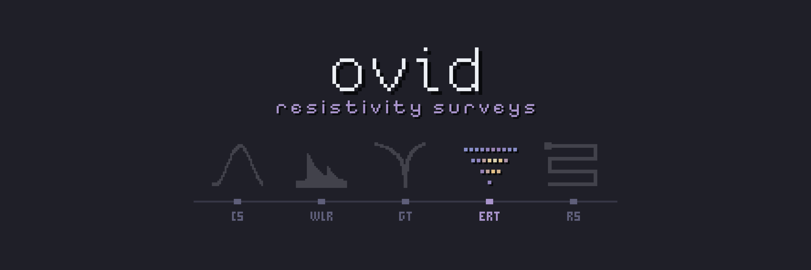

# ovid Core // GS

<!-- layout: ovid-app-readme v1 (short page; detail folded below) -->

Catalogues electrical resistivity survey files (AGI SuperSting, IRIS Syscal), reads them into one measurement model, links copies and derived sets to their original survey, and applies QC profiles that flag measurements without deleting them. It does not do inversion.

| Goes in | Comes out |
|---|---|
| AGI SuperSting `.stg` files with `.crs` and `.cmd` | Catalogue of surveys and files |
| EarthImager sets | One folder per survey |
| IRIS Prosys exports (`.txt`) | Pseudosection previews |
| Res2DInv `.dat` files | Survey exports with provenance |
|  | Transect map |
|  | Shareable catalogue zip |

## Open it

- **Mac:** double-click `Open GS (Mac).command` in the Ovid_Apps folder. The first time, right-click > Open if macOS warns.
- **Windows:** double-click `Ovid_GS.bat` in this folder.
- Needs R 4.x. The first start installs the R packages it needs, which takes a few minutes.
- Running from R or the command line, and making a copy for computers without R: see **Run it** under More detail.
- **Workbench (preview):** an additional, more detailed view of the same project, with every Standard page (listed under Pages)
  around a spreadsheet of one survey, a row per measurement, its pseudosection drawn above it as points: click, drag or
  shift-click cells, click a number to select the measurement or a heading the column, and the pseudosection highlights the
  selection; click a point, or shift-drag a box, to select there. Flag and Unflag act on the selection and write
  manual_flags.csv (and electrode_status.csv when Unflag turns an electrode back on); electrodes are turned off on the QC page;
  a rebuild applies them. Open it with **Workbench** in the title bar or
  `?ui=workbench` in the address; **Standard** in its title bar goes back.

## More detail

<b>About</b>

Catalogue, metadata, QA/QC and viewing for electrical resistivity tomography surveys (AGI SuperSting, IRIS Syscal). Not an inversion tool.
Raw files are never changed; QC only adds flags; failed and unreadable surveys stay in the catalogue. Theme: kanagawa.nvim (wave) from vimcolorschemes; map, GPR and pseudosection colours follow the scheme picked in Settings > Colours (Spectral, Viridis and the GPR Grey and Blue-white-red scales stay fixed; map labels stay white on imagery). Full detail: [docs/GS_reference_guide.md](docs/GS_reference_guide.md) (also .html and .pdf); design: [docs/DESIGN.md](docs/DESIGN.md).

<b>Run it</b>

- **Mac:** double-click `Open GS (Mac).command` in the Ovid_Apps folder. **Windows:** double-click `Ovid_GS.bat` (`Make_Portable.bat` makes a copy that runs without R).
- From R: `shiny::runApp("GS")`. The first start builds the catalogue; set the raw archive and project folders on the Settings page.
- Without the app: `Rscript gs_pipeline.R` (folders from CFG, or GS_RAW_DIRS and GS_PROJECT_DIR); tests: `Rscript tests/run_tests.R` (with tests/test_bad_files.R, test_golden.R and test_formulas.R; samples in tests/samples, the golden project in tests/golden).
- **Set-up tables** edits every table in config/ (the Survey, Map and QC pages write some of them too).
- A rebuild redoes only what changed (`incremental = TRUE`, kept in `<project>/cache/`): a survey is checked again when its measurements, its details or the QC rows, manual flags and electrode rows that can apply to it change, and a preview is drawn again when its measurements, flags or title change.

<b>The app</b>

- **Archive:** every survey with filters (year, project, transect, folder, instrument, quality) and search; select several rows and add them to a project or a transect in one go (new names are created); double-click a row to open it; **Export catalogue** writes a zip others can open without the raw files (index.html, tables, previews, metadata; measurements optional). **Open a catalogue** loads such a zip into the app (kept beside your project in GS_imports/, changes saved in that copy; a link in the top bar goes back to your own catalogue). Without measurements, the survey page shows the preview and details.
- **Survey:** interactive pseudosection (hover a point for its values; colour by resistivity, resistance, current, voltage, error, contact or chargeability; show all, passed or flagged; display options), distributions, contact resistance by electrode, error against current, geometry, a filterable data table, and what the files record grouped by instrument, acquisition, geometry, signal and record; and the details people enter (name, date, operator, project, site, transect, conditions, quality, notes), saved to config/surveys.csv; **Export survey** writes every measurement with its QC result, the passed set, instrument fields, metadata and a provenance record.
- **Map:** transects on satellite imagery (or streets), one layer per survey year, filtered by project; edit each transect's start and end points and its surveys; the transect table lists all transects, by year or by project. A Legend box shows or hides the legend, and Export view (PNG) saves the map as on screen at 250 ppi, with or without the legend.
- **QC:** a slider for every limit (hover the i for what it means), applied live; save the settings as a profile or export the survey with them.
- **Reference:** what each QC profile and rule does, what every statistic means, and how the electrode arrays compare (from Loke 1999 and the AGI manuals in ref_manuals).
- Apparent resistivity is drawn on 1-10,000 ohm-m everywhere so surveys compare; flagged points are drawn on top, one colour per reason.

Status: file inventory and roles; AGI `.stg` (instrument and EarthImager sets) with `.crs` and `.cmd`; IRIS Syscal Prosys exports;
Res2DInv general-array `.dat`; survey ids; links between copies, merged files and derived sets; QC profiles (flags only), survey
statistics and pseudosection previews; the Shiny app above. Exports are named `ovid_gs_<what>_<YYYY-MM-DD>.<ext>`. Next: Syscal binary `.bin` (none in the sample archive yet), coordinates for 3D layouts.

    gs_pipeline.R    settings and run_pipeline()
    R/config.R        set-up tables (projects, sites, transects, surveys, QC profiles, manual flags, file rules)
    R/importers.R     format sniffing, the common measurement model, AGI, Syscal and Res2DInv readers
    R/catalogue.R     files, surveys, companions, links, geometry summary
    R/qc.R            QC profiles, manual flags, survey statistics
    R/plots.R         pseudosection previews
    R/views.R         the app's interactive views (plotly)
    R/reference.R     the Reference page
    R/export.R        survey and catalogue exports
    app.R             the Shiny app: loads core, wires the pages together
    pages/            one file per section of the app (ui.R is the interface)

<b>What's new</b>

### New in GS 0.4.0
- Every row of `qc_profiles.csv` has a `rule_id`, and each survey's `flags.csv` names the row behind each flag.

### New in GS 0.3.0
- QC rules `moving_median` and `bad_electrode` (in new projects' default profiles; in an existing project switch them on and tune them on the QC page, then *Save profile*).
- Electrodes turned off (`electrode_status.csv`, and a control on the QC page).
- `applies_to` can be `site:`, `transect:` or `months:` so a limit can differ by place and season.
- See `CHANGELOG.md` and section 5 of the reference guide.

[Reference guide](docs/GS_reference_guide.md) · [Changelog](CHANGELOG.md) · [Design notes](docs/DESIGN.md) · [System overview](../docs/overview.md) · [All five apps](../README.md)
