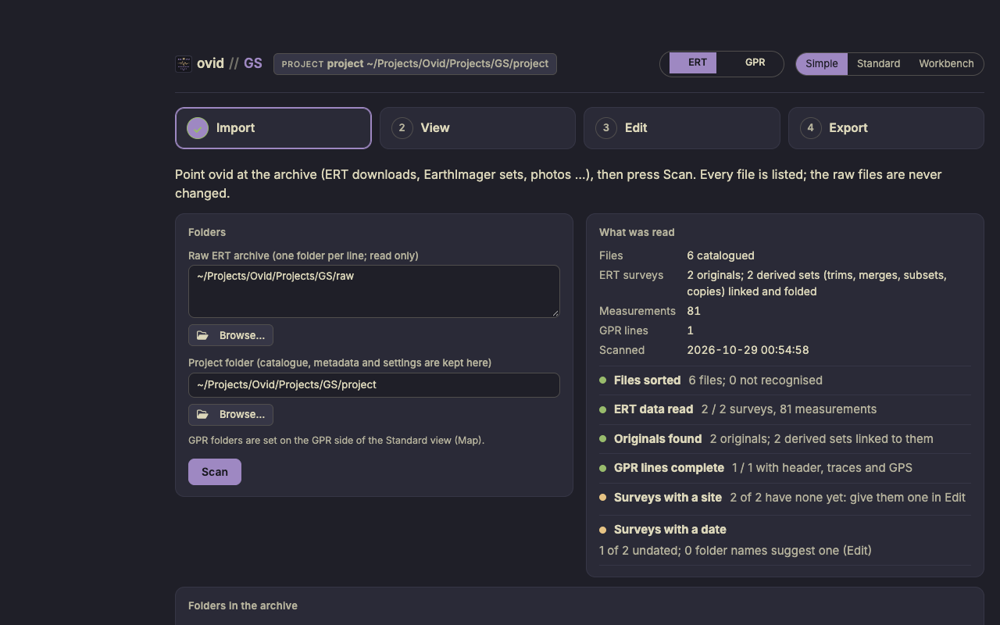

# ovid GS how-to guide

One task per section: when to use it, the steps, what changes and how to check it. Page names are those on the left of the Standard view (**Home**, **Archive**, **Stack**, **Map**, **Survey**, **QC**, **Set-up tables**; on the GPR side, **Map** and **Processing**). For a first project, start with the GS quick start; for what GS does to the data and why, see the GS reference guide.

## Contents

**Simple:** 1. Check the archive after a field season; 2. Name, date and place surveys

**Catalogue:** 3. Add new surveys; 4. Group surveys into a project or a transect; 5. Place a transect on the map

**Survey and QC:** 6. Look at a survey; 7. Try other QC limits; 8. Save a QC profile; 9. Turn an electrode off or flag measurements by hand; 10. Add electrode elevations

**GPR and report:** 11. Look at a GPR line; 12. Export and share the catalogue; 13. Report a problem

## The three views

The same project, data and edits in three views, switched at the top (**Simple**, **Standard**, **Workbench**) or with ?ui=simple, ?ui=standard or ?ui=workbench in the address. A new install opens in Simple.

<figure></figure>

- **Simple**: a field check in four steps (Import, View, Edit, Export). Edit names, dates and places surveys and groups them into sites; it changes no data value.
- **Standard**: the catalogue, survey, QC and map pages these tasks use.
- **Workbench**: every change to what the data say or how they are read. QC profiles, manual flags, electrodes turned off and electrode elevations are edited here; Standard shows those tables and points to the Workbench.

## 1. Check the archive after a field season

**When:** New survey folders are in the archive.

1. **Simple**, **Import**: press **Scan**. **What was read** gives the counts and the checklist.
2. **View**: a tile per folder or site. Amber tiles have surveys with more than 10 % of their measurements flagged; **Need a look** shows only those, and each tile's link opens **QC** in Standard.
3. **Export**: **Download the report (HTML)**, with your initials.

**Result:** Nothing changes in the catalogue; the report records the surveys, what needs a look and the methods with their sources.

## 2. Name, date and place surveys

**When:** Surveys have no site, or no date (files that give none).

1. **Simple**, **Edit**: **Sites from folders** proposes a site and a date from each folder's name; drop any that are wrong.
2. Under **Survey details**, pick a survey and set its name, date, transect and quality; **Add to changes**.
3. Drag a survey onto a site, or click a site to rename it or give its place. Then **Save**.

**Result:** The changes go to `surveys.csv` and `sites.csv`, the version before kept in the project's history; the data files are never changed.

## 3. Add new surveys

1. Copy the survey folders into the raw archive.
2. **Home**: **Scan the archive** (or **Scan** in Simple).

**Result:** New and changed files are read; everything people entered is kept. Trims, merges, subsets and copies are linked to their original and folded into it.

**Check:** **Archive** lists the new surveys; unreadable or partial surveys stay in the catalogue with their status.

## 4. Group surveys into a project or a transect

1. **Archive**: filter by year, folder, instrument or quality, or search.
2. Select the rows and add them to a project or a transect in one step.

**Check:** **Stack** shows a project's surveys side by side.

## 5. Place a transect on the map

1. **Map**: on the right, enter the transect's start and end points (decimal degrees, WGS84) and its surveys.
2. Coordinates for many transects at once: **Import coordinates (CSV or Excel)…** on **Home**.

**Result:** The transect is drawn on the map, one layer per survey year. **Export view (PNG)** saves the map as shown, with the legend when **Legend** is on.

## 6. Look at a survey

1. Double-click a survey in **Archive**, or pick it on **Survey**.
2. The pseudosection shows apparent resistivity on a log scale; flagged measurements are crosses, one colour per reason, with their counts in the legend. Other tabs: what was read from the files, distributions, contact resistance by electrode, error against current, geometry, and every measurement.
3. Set the survey's quality (Good, Usable, Usable with caution, Poor, Unusable, Incomplete) and its reasons on the right.

**Result:** The quality is set by people and is separate from the measurement flags.

## 7. Try other QC limits

1. **QC**: start from a profile and move any limit; the survey is flagged again at once. Each limit's (i) note says what it measures and where its value comes from.
2. **Export survey (ZIP)** on **Survey** writes the data with the flags of the QC profile picked beside it.

**Result:** Nothing is saved; the catalogue keeps the project's profile.

## 8. Save a QC profile

**When:** A set of limits should apply to the project.

1. QC profiles change what the data say, so they are saved in the **Workbench** (the switch at the top right).
2. In the Workbench, open the QC profiles table, change the limits and save; then scan again.

**Result:** Each flag carries its rule's ID (Q-01, Q-02 …). The default profile is frozen ground (reference guide, section 5).

## 9. Turn an electrode off or flag measurements by hand

1. In the **Workbench**, open **Electrodes turned off** or **Manual flags**.
2. Add a row with the survey, the electrode or measurement, and the reason; save.

**Result:** The measurements are flagged, never deleted; a manual flag can be switched off with `active` = FALSE.

## 10. Add electrode elevations

1. In the **Workbench**, open **Electrode elevations**, or add a CSV of electrode and elevation (or distance and elevation, interpolated).
2. Save, and look at the survey's geometry tab.

**Result:** Only the z of the electrodes changes; the instrument's apparent resistivity is kept as read.

## 11. Look at a GPR line

1. Switch to **GPR** (top left in Standard, or beside the view switch in Simple). In Standard, set the GPR folders on **Map** and press **Search again**.
2. Pick the day or folder and the line: the map shows its GPS track and the radargram its traces.
3. **Processing**: the processing flow on the left (ordered steps, each with a switch and its settings, presets, **Undo**, before and after), the velocities and display in the middle, the radargram with picks and field markers.

**Result:** Flows, picks and markers are saved with the line in the project's set-up; raw files are never written. In Simple, GPR lines are view only.

## 12. Export and share the catalogue

1. **Archive**: **Export catalogue** writes a zip that others can open and browse in GS.
2. In Simple, **Export** gives the catalogue report and the tables, data and previews as .zip files.

## 13. Report a problem

1. Press the life-ring button on the top bar: it downloads the troubleshooting zip (versions, logs, problems and the set-up; no raw data).
2. Send it with the reference shown in the notice (E- and six characters).

The GS reference guide's Troubleshooting section lists the common messages and what to do.
