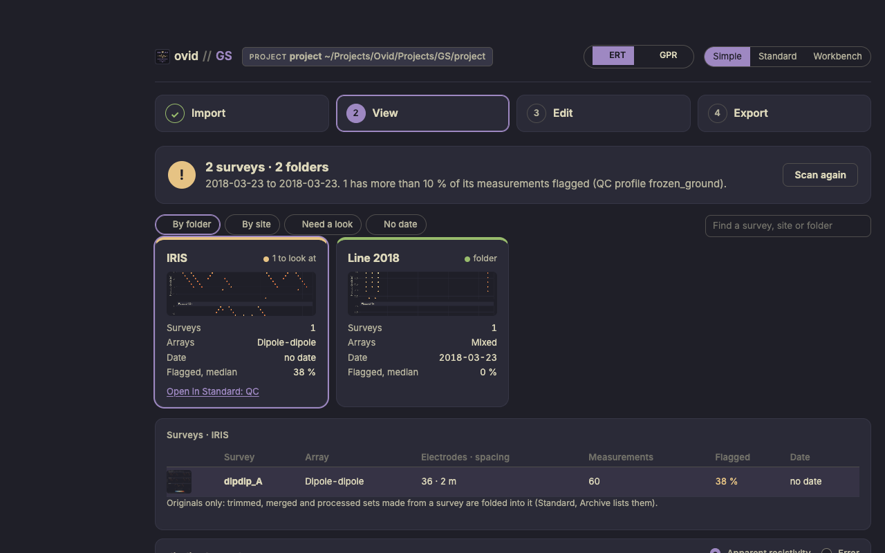
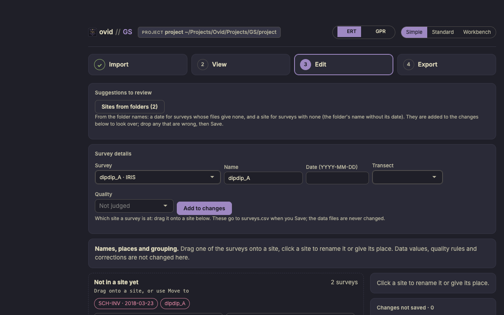
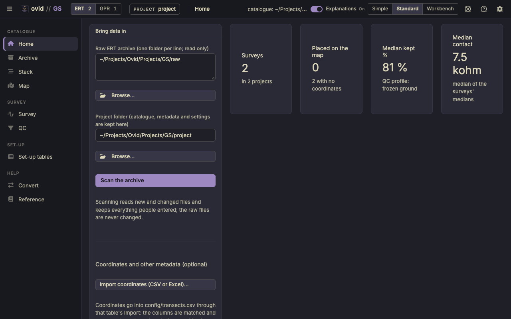

# ovid GS quick start

Geophysics surveys: ERT resistivity (AGI SuperSting, IRIS Syscal, EarthImager and Res2DInv sets) and GPR lines (MALA), from a raw archive to a catalogue of every survey with its quality control, pseudosection, map and radargram.

## Before you start

- **Raw archive.** One or more folders of survey files, in any layout: an AGI `.stg` with its `.cmd` and `.crs`, IRIS exports, EarthImager trimmed sets, Res2DInv `.dat`. The archive is read only: raw files are never changed, and quality control only adds flags.
- **GPR lines.** MALA `.rd3` or `.rad` with their `.cor` (GPS) and `.mrk` files, in folders of their own.
- **Project folder.** Where the catalogue, metadata and settings are kept; never inside the raw archive.

Open the app with **Open GS (Mac).command** (Windows: **Ovid_GS.bat**). The figures use the app's test archive (two folders of ERT surveys and one GPR line), not a field campaign.

## The Simple view

For someone new to the data, or a field check: four steps in one column, and nothing that changes a data value. A new install opens in Simple; the switch at the top (**Simple**, **Standard**, **Workbench**) moves between the three views of the same project, as does ?ui=simple, ?ui=standard or ?ui=workbench in the address. **ERT** and **GPR** beside it switch the side shown.

<figure></figure>

- **Import**: the raw ERT archive and the project folder, then **Scan**. **What was read** counts the files, the original surveys and the derived sets (trims, merges, subsets, copies) folded into them, the measurements and the GPR lines, with a checklist: files sorted, ERT data read, originals found, GPR lines complete, surveys with a site and with a date. GPR folders are set on the GPR side of the Standard view.
- **View** (ERT): one tile per folder or site, with a preview, the arrays, the date and the median share of flagged measurements; amber when more than 10 % are flagged under the QC profile. **By folder**, **By site**, **Need a look** and **No date** pick the tiles; the table under them lists the surveys, and the plot shows a survey's pseudosection. **View** (GPR): each line's track and radargram, view only.
- **Edit** (ERT): a survey's name, date, transect and quality; sites from the folder names to look over; drag a survey onto a site, rename a site or give it a place. GPR lines are view only.
- **Export**: the catalogue report (one page, HTML), and the catalogue tables, the survey data and the previews, each as a .zip.

<figure></figure>

Changes wait in a list until **Save**, with **Undo** and a change log; they go to `surveys.csv` and `sites.csv`. The data files are never changed.

## The Standard view

<figure></figure>

The pages on the left: **Catalogue** (Home, Archive, Stack, Map), **Survey** (Survey, QC), **Set-up** (Set-up tables) and **Help** (Convert, Reference); **Settings** is the gear. **ERT** and **GPR** at the top left switch to the GPR pages (Map and Processing), with the count of each.

1. **Home:** the raw ERT archive and the project folder, then **Scan the archive**. Scanning reads new and changed files and keeps everything people entered.
2. **Archive:** every survey with its date, project, transect, instrument, array, number of measurements, share passing QC and quality. Filter, search, or select rows and add them to a project or a transect; double-click a row to open it.
3. **Survey:** the pseudosection, with flagged measurements drawn as crosses (one colour per reason), and everything read from the files.
4. **QC:** the limits of the profile and what each flags.
5. **Map:** the transects on satellite imagery or streets, one layer per survey year.

## What the values mean

- **Geometric factor** k = 2π / (1/AM − 1/BM − 1/AN + 1/BN), from the 3-D electrode distances; **apparent resistivity** ρa = k × V/I (Telford et al. 1990; Loke 2004; Binley and Kemna 2005).
- **Pseudo-depth** = 0.19 × the distance between the outermost electrodes, below their centre: a plotting convention close to the median depth of investigation (Edwards 1977; Loke 1999), not an image of the ground.
- **Flags** come from the QC profile's limits (repeat error, current, voltage, V/I, apparent resistivity, contact resistance, outliers, reciprocal error), taken from the EarthImager and SuperSting manuals; the frozen-ground profile is the default. A flag never deletes a measurement.

The GS reference guide gives every rule, statistic and source.
