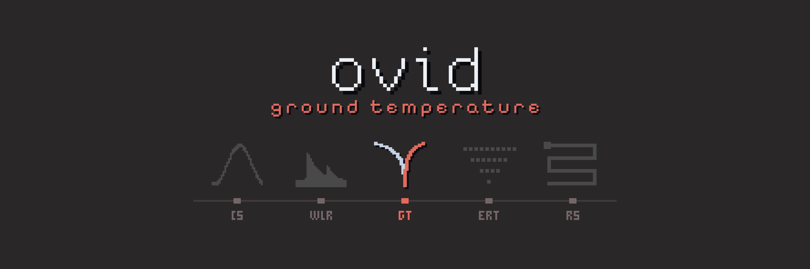

# ovid Core // GT

<!-- layout: ovid-app-readme v1 (short page; detail folded below) -->

Ingests ground temperature logger files (RBR, GeoPrecision, HOBO, EM50, Campbell), stitches each logger into one record, assigns sensors to sites and depths, applies quality rules, and derives daily means, annual statistics, active-layer thickness and freeze/thaw dates.

| Goes in | Comes out |
|---|---|
| RBR `.hex` files | One record per site and depth |
| GeoPrecision FG2_Shell `.csv` exports | Daily means |
| HOBOware `.csv` exports | Annual statistics and trumpet curves |
| EM50 `.xls` and Campbell `.dat` files | Active-layer thickness, freeze and thaw dates |
| Sensor registry, borehole metadata and field notes | Soil moisture and EC |
|  | Run and site reports |
|  | Audit trail |

## Open it

- **Mac:** double-click `Open GT (Mac).command` in the Ovid_Apps folder. The first time, right-click > Open if macOS warns.
- **Windows:** double-click `Ovid_GT.bat` in this folder.
- Needs R 4.x. The first start installs the R packages it needs, which takes a few minutes.
- Running from R or the command line, and making a copy for computers without R: see **Run it** under More detail.
- **No metadata file needed.** Without a registry workbook each logger is processed under its serial. To name loggers or give sites and depths, fill in the **logger list** (Sensors and depths > Logger list): start from the loggers found, paste rows from Excel or import a spreadsheet, and add columns of your own. Only the serial is needed.
- **Workbench (preview):** an additional, more detailed view of the same project, with every Standard page (listed under Pages)
  around a spreadsheet of one site, a column per depth: click, drag or shift-click cells, click a time to select a record or a
  heading to select a depth, and the chart highlights the selection. Drag across the chart to zoom in, use the wheel to zoom in
  and out, and double-click to see the whole period again. Remove, Flag, Restore, Trim and Clock act on the selection and write
  the same set-up tables as Plot and explore; the pipeline applies them on the next run. Open it with **Workbench** in the title
  bar or `?ui=workbench` in the address; **Standard** in its title bar goes back.

## More detail

<details>
<summary><b>About</b></summary>

Processing suite for ground temperature loggers (RBR, GeoPrecision, Onset HOBO, METER EM50 and Campbell Scientific), built on the same pattern as ovid Core // CS and WLR: a pipeline script that does the work, and a Shiny app (soviet.nvim dark colours from vimcolorschemes, poster-red accent) that calls it and edits its set-up tables. Raw files are never changed; every value that is left out is in the audit trail, and the run stops if any logger's value count does not reconcile.

Full detail: [docs/GT_reference_guide.md](docs/GT_reference_guide.md) (also .html and .pdf).

</details>

<details>
<summary><b>Run it</b></summary>

On a Mac: double-click **`Open GT (Mac).command`** in the Ovid_Apps folder. On Windows: double-click **`Ovid_GT.bat`** (R from `R-portable\` if present, otherwise the installed R; packages go in `library\`). Run **`Make_Portable.bat`** once to make a folder that runs on computers without R.

From R:
```r
shiny::runApp("~/Projects/Ovid/Ovid_Apps/GT")   # the app: set the folders on Home > Data source, then Run pipeline
```
or without the app:
```
Rscript gt_pipeline.R          # folders from CFG at the top of the file, or GT_RAW_DIRS (; separated), GT_METADATA_DIR, GT_PROJECT_DIR
Rscript tests/run_tests.R      # builds synthetic files of every format, runs the pipeline on them and checks the results
                               # (also the reader samples, damaged files, the golden project and the formula checks below)
Rscript tests/test_bad_files.R # damaged copies of the samples: each gives a clear problem or flag
Rscript tests/test_golden.R    # a whole run on tests/golden against accepted outputs; `accept "<name>"` after checking them
Rscript tests/test_formulas.R  # each derived value against a worked case from its source, or a hand-computed one
```
Needs R 4.2+ with data.table, ggplot2, readxl, zip, shiny and DT (installed on first run if missing).

</details>

<details>
<summary><b>Folders</b></summary>

```
GT/data/                 logger files in any layout (rbr/2024, cryogeek/2024, hobo/..., em50/..., campbell/...)
GT/metadata/             the registry workbook (a sheet with Name, Type and SN columns), NTGS metadata workbooks, field notes (.docx)
GT/reference_manuals/    manuals (not read)
GT/project/              the working folder: config/ (set-up tables, with history/) and output/ (any folder can be used; set it on Home)
```

</details>

<details>
<summary><b>What it reads</b></summary>

| Logger | Read from | Notes |
|---|---|---|
| RBR XR-420 | the `.hex` file itself (calibration from its header); else the Ruskin `.txt` (UTC) or `.xls` (logger clock) | the `.hex` is checked against its export when both exist; clock drift at download is read from the header |
| GeoPrecision | the FG2-Shell `.csv` (the `.f2b` cannot be read; export it with FG2_Shell) | tags (`<NEW PAR>`, `<FIRMWARE RESET>` ...) become events; `(NoReply)` is a sensor error; battery is kept separately |
| HOBO U12 | the HOBOware `.csv` (the `.hobo` gives only its identity; Bulk Export in HOBOware Pro writes CSVs for many files) | the zone stated in the header is used; a file holding two exports joined (a second heading with other columns) is read up to that heading and the rest listed as a problem: export them as files of their own |
| EM50 | the ECH2O Utility `.xls` | raw counts 4094/4095 and VWC above 1 are errors; temperature, VWC and EC are kept apart |
| Campbell | TOA5 `.dat` tables | columns matched by the patterns under Quality rules > Campbell columns |

Each download is a **bundle**: the logger's own file plus its exports, matched by type, folder, serial and file name. A bundle with nothing readable (an `.f2b` with an empty CSV) is listed as **needs export**, with what to do.

</details>

<details>
<summary><b>What a run does</b></summary>

1. Seeds `sites.csv` and `sensors.csv` from the registry on the first run, and indexes every metadata workbook and field-note paragraph.
2. Finds and identifies every file, drops byte-identical copies, groups downloads into bundles.
3. Reads each file, moves its clock to UTC-7 (Ruskin text is UTC; HOBO states its zone; other clocks are taken as UTC-7 unless the time-zone table says otherwise; the table wins over the file), removes impossible times, corrupt time stamps among good readings (off the time grid and out of written order, `drop_stray_records`), clock resets and readings superseded when a clock was set back, and stitches every download of a logger into one record (repeats kept once, the newest download wins where they disagree).
4. Gives every sensor a site and a depth: `sensors.csv` (set by hand or from the registry), else a template for its make and model, else the **default steps** (0.10 m, 0.20 m, ...; Settings). Assumed depths are marked everywhere. Values outside a sensor's deployment dates are dropped.
5. Quality rules: limits, spikes, stuck sensors (zero-curtain values exempt), sensors that swing like air, a string not yet in the ground, manual removals and flags. Sensor health lists failed and failing sensors and every gap.
6. One record per site. A site holds **one instrument type**; loggers of the same type that replaced each other are joined (the later deployment wins where two overlap); different types are never merged, even with similar names. Soil moisture and conductivity go to `output/soil`, apart from temperature.
7. Daily means, then **A** annual statistics and trumpet curves, **B** thaw depth and active-layer thickness, **C** freeze/thaw dates and zero-curtain periods.
8. The audit trail, reconciliation, and a catalogue of files, bundles, loggers, sites, gaps, flags and clock events.

A rerun only rebuilds the loggers and sites whose files or set-up changed (`incremental = TRUE`, kept in `<project>/cache/`): a quality rule or manual removal redoes only the loggers it can apply to (by type, serial or site), a clock correction or time-zone row only the loggers whose files it can match, and the message at the end of a run says how many were redone; **Rescan** on the Raw files page reads the selected files again. Exports are named `ovid_gt_<what>_<YYYY-MM-DD>.<ext>`.

</details>

<details>
<summary><b>The app</b></summary>

Plot and explore (heatmap with interpolated contours or one band per sensor, full profile, individual depths, box plots by year / water year / season / month at any time step, profiles on dates, trumpet curves with the maximum in red and the minimum in blue, seasons and years, freeze and thaw, data availability, QC view), Compare sites (similar sensors at one depth, as values, differences or anomalies, or a scatter; and the between-site check, which flags days on which a site departs from the others at the same depth), Summaries, Soil moisture and EC, Site details (installation, record, statistics, every metadata field and the field notes that mention the site), Raw files, Sensor health, Clock checks, Audit trail, Sites and landcover, Sensors and depths, Quality rules, Configuration (export and import every set-up table as one zip), Set-up check, Settings, Reports and export (any time zone, long or wide, with flags; a run report and one report per site in HTML, PDF or both). Every run also writes `output/report.html`. Every temperature axis can be automatic, fixed, symmetric around zero or clipped to percentiles.

</details>

<details>
<summary><b>Shared code</b></summary>

The audit trail, small helpers, reading and backing up set-up tables, configuration import / export, the run cache, the time-zone
table, corrupt-timestamp removal, the between-site comparison, reports, the app shell, file import and export, the run manifest,
the set-up check's collector and the launcher are shared with the other ovid apps (CS, WLR, GS, RS). They live in the ovid
Core (`../core` in the Ovid_Apps bundle; see core/README.md) and are sourced before `R/`. The folder can
also be given with `OVID_CORE`; `Make_Portable.bat` copies it into `core/`.

</details>

<details>
<summary><b>What's new</b></summary>

### New in GT 1.7.0
- Every quality rule has a `rule_id`, and `flags.csv` names the rule behind each flag.

### New in GT 1.6.0
- WMO quality codes in exports (`qc`, or `T_<depth>m_qc` in the wide layout) by default.
- See `CHANGELOG.md` and section 16 of the reference guide.

</details>

[Reference guide](docs/GT_reference_guide.md) · [Changelog](CHANGELOG.md) · [System overview](../docs/overview.md) · [All five apps](../README.md)
