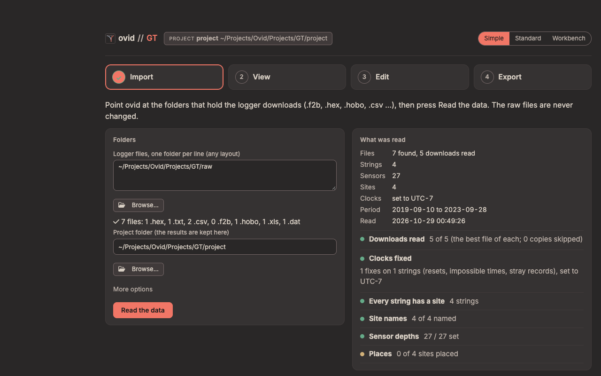

# ovid GT how-to guide

One task per section: when to use it, the steps, what changes and how to check it. Page names are those in the contents on the right of the Standard view (**1 Bring in**, **2 Organize**, **3 Correct**, **4 Report** and **More**). For a first project, start with the GT quick start; for what GT does to the data and why, see the GT reference guide.

## Contents

**Simple:** 1. Check the sites after a field visit; 2. Set the depths of a string

**Bring in:** 3. Add a new download; 4. Read a download that needs an export

**Organize:** 5. Give a string a site, dates or depths; 6. Decide what the run found; 7. Rename a site or hide it

**Correct:** 8. Set the time zone of files that state none; 9. Fix a logger clock; 10. Remove a stretch of data; 11. Change a quality limit; 12. Switch an automatic correction off

**Check and report:** 13. Look at a site over time; 14. Export data and reports; 15. Report a problem

## The three views

The same project, data and edits in three views, switched at the top (**Simple**, **Standard**, **Workbench**) or with ?ui=simple, ?ui=standard or ?ui=workbench in the address. A new install opens in Simple.

<figure></figure>

- **Simple**: a field check in four steps (Import, View, Edit, Export). Edit sets sensor depths, renames sites, places them, sets their land cover and moves strings between them; it changes no data value.
- **Standard**: the set-up flow these tasks use: bring in files, organize strings, sites and depths, correct, report.
- **Workbench**: every change to the data by hand. Removals, quality rules, clock corrections, corrections over a period and ground-surface changes are edited here; Standard shows those tables and points to the Workbench.

## 1. Check the sites after a field visit

**When:** New downloads are in the data folder and you want to know whether every string is recording.

1. **Simple**, **Import**: press **Read the data**. **What was read** lists the files and the checklist.
2. **View**: a tile per site. Amber or red tiles need a look; **Need a look** shows only those. Each tile's link opens the Standard page that fixes it (Needs you, Sensor health, or the depths).
3. **Export**: **Download the report (HTML)** with your initials, for a one-page record of the check.

**Result:** Nothing changes in the set-up; the report records the period, the sites, what needs a look and the methods with their sources.

## 2. Set the depths of a string

**When:** A site's depths are assumed (*default* or *template*), or a string was reinstalled at other depths.

1. **Simple**, **Edit**: pick the site under **Sensor depths**.
2. Type each depth in metres below the surface; add **+** for a sensor above the ground, e.g. +0.10. **Even steps**, **Paste a list**, **Copy from site…** or the model's template fill several at once.
3. **Add to changes**, then **Save**. To give every site with the same model and sensor count these depths, use the option under the list.
4. **Import**, **Read the data**.

**Result:** The depths are written to the set-up tables (the old version is kept in the project's history); MAGT and ALT are computed at the new depths.

**Check:** The tile's sensor count and depth range, and **Sensor depths** in the checklist under **What was read**.

## 3. Add a new download

**When:** After a field visit, with new logger files.

1. Copy the files into a data folder, each logger's file with its export.
2. Press **Run pipeline** (Standard) or **Read the data** (Simple).

**Result:** Only loggers whose files or set-up changed are read again; a logger's downloads are joined into one record.

**Check:** **Bring in files** lists each file with its status.

## 4. Read a download that needs an export

**When:** **Bring in files** shows a bundle as *needs export*: a `.f2b` or `.hobo` with no readable export beside it.

1. Open the file in FG2-Shell (GeoPrecision) or HOBOware Pro's **Bulk Export** (Onset) and write the CSV into the same folder.
2. Press **Run pipeline**.

**Result:** The bundle is read from its export. A Campbell table that is not TOA5 must be converted with CardConvert first.

## 5. Give a string a site, dates or depths

**When:** A string has no site, is at the wrong site, or moved during the record.

1. **Loggers, sensors and depths** (2 Organize): each sensor's site, depth, start and end.
2. Double-click a cell to change it, then **Save changes** and **Run pipeline**.

**Result:** The string's records are given to the site for those dates. A match by dates is assigned on its own; anything else is a suggestion on **Needs you**.

**Check:** **Sites: rename, what shows, landcover** lists each site with its strings.

## 6. Decide what the run found

**When:** **Needs you** shows a count.

1. **Needs you** (2 Organize): each line is grouped by site and says what to do: **decide** a flag (keep, remove or note), **fix in ovid** a set-up change, **raw data** a problem in the files, or **add a file** that may exist.
2. Use the line's button, or follow its link to the page that settles it.

**Result:** A kept flag stays in the data as a flag. A removal becomes a row in Corrections over a period.

## 7. Rename a site or hide it

1. **Sites: rename, what shows, landcover** (2 Organize): rename a site once and it is renamed in every set-up table, with a preview and **Undo**.
2. **What shows** chooses which sites appear on the strip, the overview and Needs you; a hidden site is still processed.

## 8. Set the time zone of files that state none

**When:** Some files that state no time zone were logged in a different zone from the one given at the first run.

1. **Clocks** (3 Correct): the files and the zone each was read in.
2. In the **Time zones** table, **Add row** with the serial, model, file pattern or dates, and the offset from UTC; **Save changes**, then **Run pipeline**.

**Check:** The site plot has no whole-hour step at the download.

## 9. Fix a logger clock

**When:** A logger's clock was wrong by a known amount, or reset.

1. **Clocks** shows **Clock corrections**; it changes data values, so it is edited by hand in the **Workbench** (the link under it, or the switch at the top right).
2. In the Workbench, add a row with the serial, the start and end (blank = all of its record) and `shift_minutes`; save, then **Run**.

**Result:** The readings are moved in time; each shifted record is in the audit trail. Without a known offset, the records after a reset stay out.

## 10. Remove a stretch of data

**When:** A sensor was exposed, frost-heaved, or logging before it was in the ground.

1. Switch to **Workbench**. In the tree, pick the site.
2. Shift + drag across the chart to select the stretch; the inspector shows its count, mean, minimum, maximum and how many are already removed or flagged.
3. **Remove**, **Flag** or **Restore**, with a reason and your initials. Then **Run**.

**Result:** A row is added to Corrections over a period. The old values stay in the audit trail; raw files are never changed.

## 11. Change a quality limit

**When:** A limit removes good readings, or lets bad ones through.

1. **Quality rules** (3 Correct) shows the rules; they are edited by hand in the **Workbench**.
2. In the Workbench, change **min**, **max**, **max_spike** or **max_flat_hours**, and the **action** (remove or flag); save, then **Run**.

**Result:** Each removal or flag carries the rule's ID. The seeded limits are ovid defaults with no published source (reference guide, section 17): check them against your sensors.

## 12. Switch an automatic correction off

1. **Automatic corrections** (3 Correct) lists everything a run changes on its own, each with a switch.
2. Turn it off, then **Run pipeline**.

**Check:** The **Audit trail** (More) no longer lists that correction.

## 13. Look at a site over time

1. **Plot and explore** (More): pick the site and the depths. The view bar sets half-hourly, hourly, daily, monthly or annual values.
2. Drag left to right zooms in, right to left zooms out; Shift + drag selects a stretch; double-click shows the whole record. To remove a stretch, use the Workbench (task 10).
3. **Compare sites** (More) shows the between-site check: a site that does not follow the others.

**Result:** Nothing changes in the project.

## 14. Export data and reports

1. **Report** (4 Report): pick the sites and the format (HTML, PDF or both).
2. In Simple, **Export** gives the one-page field check report and the daily temperatures per site.

**Result:** Every run also writes `output/report.html`. Exports carry WMO quality codes and a README of the methods and their sources.

## 15. Report a problem

**When:** A page shows a notice with a reference (E- and six characters), or a run stops.

1. Press the life-ring button on the top bar: it downloads the troubleshooting zip (versions, logs, problems and the set-up; no raw data).
2. Send it with the reference.

The GT reference guide's Troubleshooting section lists the common messages and what to do.
