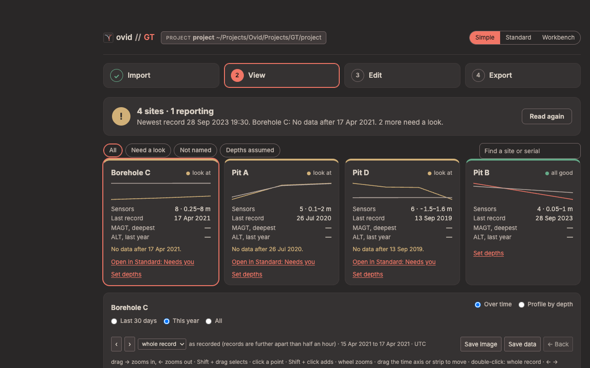
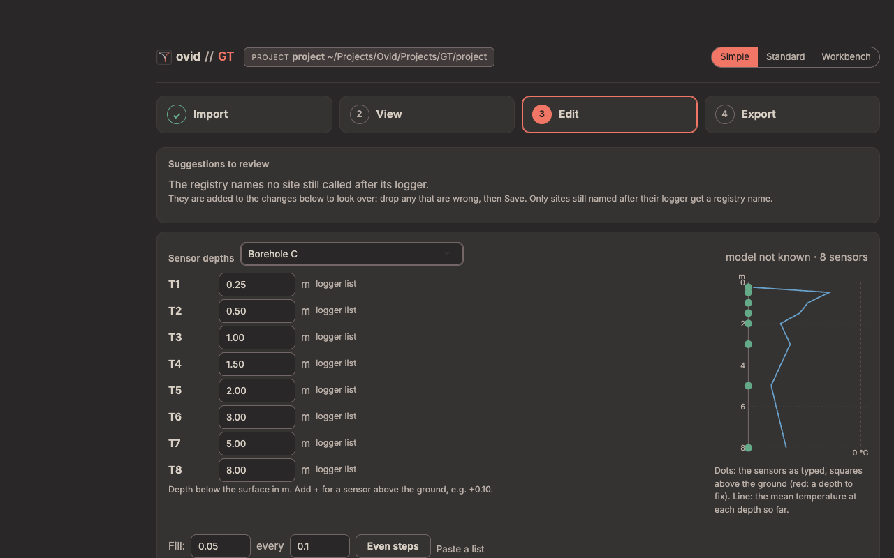
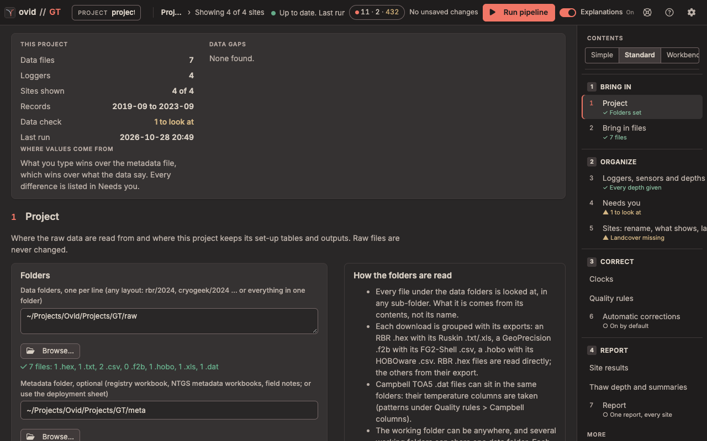

# ovid GT quick start

Ground temperature strings (RBR, GeoPrecision, HOBO, EM50 and Campbell loggers), from raw downloads to daily temperatures at each depth, MAGT, thaw depth and active-layer thickness for each site.

## Before you start

- **Raw files.** Put the logger downloads in a data folder, in any layout (`rbr/2024`, `geoprecision/2024` … or all in one folder). Keep each logger's own file and its export together: an RBR `.hex` with its Ruskin `.txt`, a GeoPrecision `.f2b` with its FG2-Shell `.csv`, a `.hobo` with its HOBOware `.csv`. RBR `.hex` files are read directly; the others are read from their export. Raw files are never changed.
- **Optional.** A registry workbook (a sheet with Name, Type and SN columns), borehole metadata workbooks and field notes in a metadata folder, or a deployment sheet in the project's `config/` folder with each string's site and sensor depths.

Open the app with **Open GT (Mac).command** (Windows: **Ovid_GT.bat**). The figures use the app's test project (four constructed sites, Pit A, Pit B, Pit D and Borehole C), not field data.

## The Simple view

For someone new to the data, or a field check: four steps in one column, and nothing that changes a data value. A new install opens in Simple; the switch at the top (**Simple**, **Standard**, **Workbench**) moves between the three views of the same project, as does ?ui=simple, ?ui=standard or ?ui=workbench in the address.

<figure></figure>

- **Import**: the data folders and the project folder, then **Read the data**. The first read asks the time zone of files that state none. **What was read** lists the files, strings, sensors and sites, and a checklist: downloads read, clocks fixed, every string has a site, site names, sensor depths and places.
- **View**: one tile per site (sensors and their depth range, last record, MAGT at the deepest sensor, ALT of the last year; amber or red when it needs a look, with a link to the Standard page that fixes it). The buttons above the tiles show all sites, those that need a look, those not named, or those with assumed depths. The plot shows a site **Over time** or as a **Profile by depth**.
- **Edit**: sensor depths, site names, land cover and grouping (below).
- **Export**: the field check report (one page, HTML) and the daily temperatures (one CSV per site, with a README) or the plots, each as a .zip.

## Sensor depths in Simple

<figure></figure>

1. Pick the site under **Sensor depths**. Each sensor (T1, T2 …) has its depth in metres below the surface, with where it came from.
2. Type a depth, or add **+** for a sensor above the ground, e.g. +0.10. **Fill** with **Even steps**, **Paste a list**, copy from another site, or use the model's template where there is one.
3. **Add to changes**. The list of changes below waits until **Save** (with **Undo** and a change log); the next **Read the data** uses the new depths.

Depths change MAGT and ALT. The plot beside the list shows the sensors as typed (a square above the ground, red for a depth to fix) and the mean temperature at each depth so far. Below the depths, rename a site, give it a place or a land cover, or drag a string onto another site. Data values, quality rules and corrections are not changed here.

## The Standard view

<figure></figure>

The contents on the right list the steps in working order: **1 Bring in** (Project, Bring in files), **2 Organize** (Loggers, sensors and depths; Needs you; Sites: rename, what shows, landcover), **3 Correct** (Clocks, Quality rules, Automatic corrections) and **4 Report** (Site results, Thaw depth and summaries, Report). **More** holds Overview, Plot and explore, Compare sites, Soil moisture and EC, Site details, Sensor health, Audit trail, Configuration, Set-up check and Settings. Each step shows its state under its name.

The top bar has the project, the run state, the corrections the last run applied, **Run pipeline**, the Explanations switch and the view switch. **This project** at the top of a page counts the files, loggers, sites and records, and lists the data gaps.

## The first run

1. **1 Project:** set the data folders, the metadata folder (optional) and the project folder; **Browse…** picks a folder. The line under each says what was found.
2. Run the **Set-up check** (More) and fix anything in red.
3. Press **Run pipeline**. Files that state no time zone ask for one; the answer is kept for later runs. The first run fills `sites.csv` and `sensors.csv` from the registry or the deployment sheet.
4. **Loggers, sensors and depths:** every sensor needs a site and a depth. Depths marked *default* or *template* are assumptions: replace them with measured depths.
5. **Bring in files** lists bundles that *need export* (a `.f2b` or `.hobo` with no readable export): export them with FG2-Shell or HOBOware Pro's Bulk Export, which write a CSV beside each file, then run again.
6. **Needs you:** decide each finding (keep, remove or note), or follow its link to the page that fixes it.

Only loggers whose files or set-up changed are read again; the rest are reused from the last run.

## What the results mean

- **Daily means** use complete days only (80 % of the expected records unless set in Settings).
- **MAGT** is the mean of the daily means over a complete year (90 % of its days), at each depth, for the calendar year and the water year (October to September) (van Everdingen 1998; Romanovsky et al. 2010).
- **Thaw depth** each day is the 0 °C crossing, interpolated linearly between the deepest sensor above 0 °C and the first at or below it; **ALT** is the year's deepest thaw depth, given only where a sensor stays at or below 0 °C for two years running (Brown et al. 2000; Nelson and Hinkel 2003; van Everdingen 1998).
- **Zero curtain** is a run of at least 3 days within 0.2 °C of 0 °C (Outcalt et al. 1990).

The GT reference guide gives every formula, its sources and the defaults with no published source.

## Report

**Report** (4 Report) exports the data and reports (HTML, PDF or both) for the sites picked; every run also writes `output/report.html`. **Site results** and **Thaw depth and summaries** show each site's annual statistics, trumpet curves, thaw depth and ALT.
