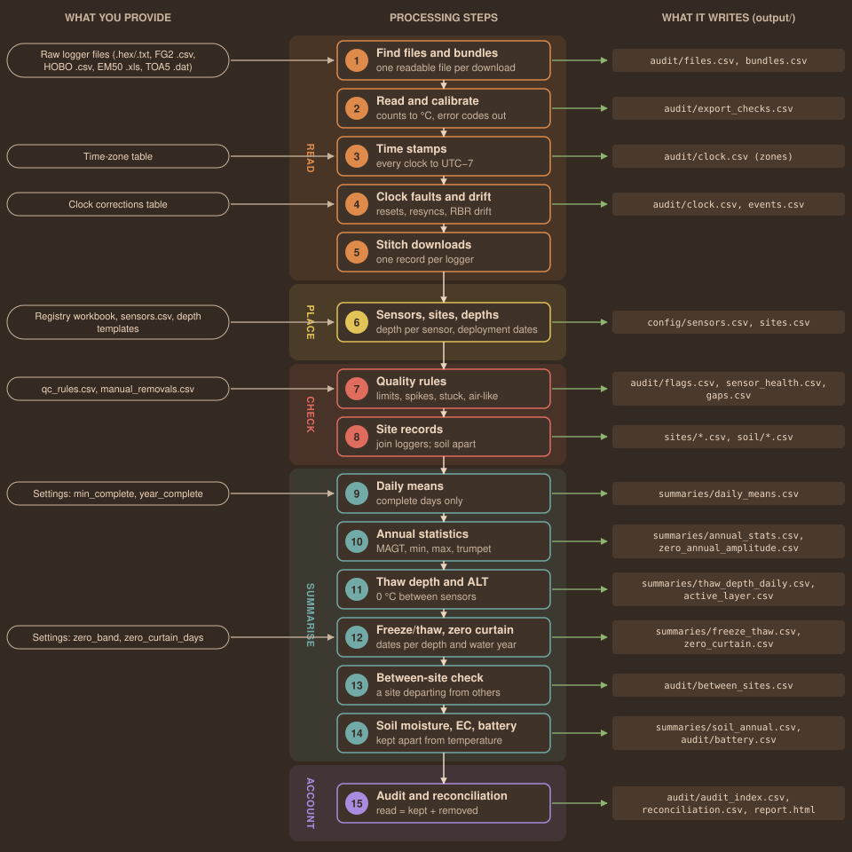
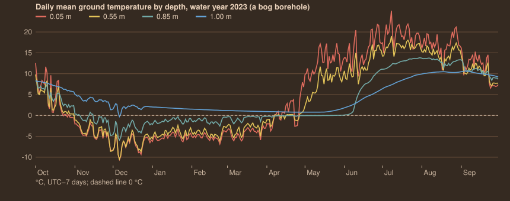
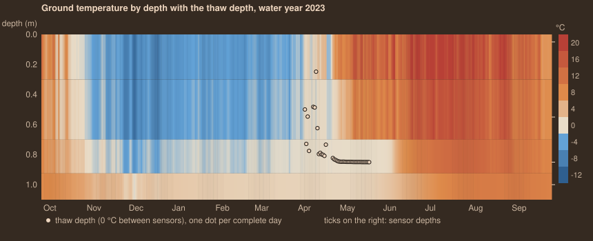
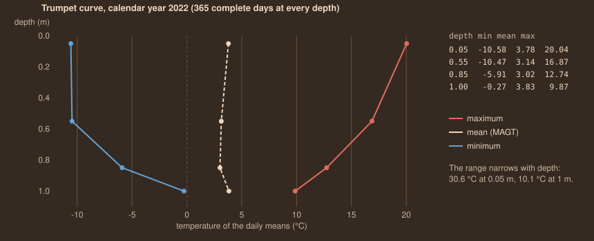

# ovid GT Reference Guide

Ground temperature loggers: what the app does to every reading, why, and
how to check it. For GT 1.7.0 (ovid Core 1.14.0). Settings are quoted
with their defaults; change them in the app (Settings, Quality rules) or
in `CFG` at the top of `gt_pipeline.R`.

**Contents**

1.  [Quick start](#quick)
3.  [What happens to the data, in order](#order)
4.  [The pipeline at a glance](#flow)
5.  [One reading through the pipeline](#trace)
6.  [1. Finding files and bundles](#files)
7.  [2. Reading and calibration](#read)
8.  [3. Time stamps and time zones](#time)
9.  [4. Clock faults and drift](#clock)
10.  [5. Stitching each logger](#stitch)
11. [6. Sensors, sites and depths](#depth)
12. [7. Quality rules and flags](#qc)
13. [8. Site records](#site)
14. [9. Daily means](#daily)
15. [10. Annual statistics and trumpet curves](#annual)
16. [11. Thaw depth and active-layer thickness](#thaw)
17. [12. Freeze/thaw dates and zero curtain](#ft)
18. [13. Between-site check](#between)
19. [14. Soil moisture, EC and battery](#soil)
20. [15. Audit trail and reconciliation](#audit)
21. [Reading the outputs](#outputs)
22. [Sensor notes](#sensors)
23. [Reasonable values](#values)
24. [Troubleshooting](#trouble)
25. [Glossary](#glossary)
26. [References](#refs)

## Quick start

1.  Put the logger files in the data folder, in any layout (for example
    `data/rbr/2024`, `data/cryogeek/2024`, `data/hobo/…`, `data/em50/…`,
    `data/campbell/…`). Keep each logger's own file *and* its exports:
    an RBR `.hex` with its Ruskin `.txt`, a GeoPrecision `.f2b` with its
    FG2-Shell `.csv`, a `.hobo` with its HOBOware `.csv`.
2.  Put the registry workbook (a sheet with Name, Type and SN columns),
    any borehole metadata workbooks and field notes (`.docx`) in the
    metadata folder.
3.  Start the app (`Open GT (Mac).command`, or `Ovid_GT.bat` on
    Windows) and set the data, metadata and project folders on
    **Home › Data source** (each has a **Browse…** button).
4.  Run the **Set-up check**. Fix anything in red first.
5.  Press **Run pipeline**. The first run seeds `sites.csv` and
    `sensors.csv` from the registry.
6.  Open **Sensors and depths**: every sensor needs a site and a depth.
    Depths marked *default* or *template* are assumptions; replace them
    with measured depths.
7.  Read **Raw files** for bundles that *need export* (a `.f2b` or
    `.hobo` with no readable export) and **Clock checks** for resets and
    drift. The `.f2b` and `.hobo` files themselves cannot be read: export
    them with FG2_Shell (GeoPrecision) and HOBOware Pro's **Bulk Export**
    (Onset), which write a CSV beside each file, then run again.
8.  Run again. Read **Sensor health**, the flags on **Plot and explore**
    (QC view) and the between-site check on **Compare sites**.
9.  Export data and reports (HTML, PDF or both) from **Reports and
    export**. Every run also writes `output/report.html`.

Only loggers whose files or set-up changed are processed again (setting
`incremental = TRUE`, cache in `<project>/cache`). **Rescan** on the Raw
files page reads the selected files again and rebuilds only their
loggers and sites; everything else is reused. Adding one new logger
does not make the other loggers run again.

## What happens to the data, in order

| \#  | Step                   | What changes                                                                                            | Logged in                                                |
|-----|------------------------|---------------------------------------------------------------------------------------------------------|----------------------------------------------------------|
| 1   | Find files and bundles | Each download becomes a bundle; the best readable file is used; byte-identical copies skipped           | `audit/files.csv`, `bundles.csv`                         |
| 2   | Read and calibrate     | RBR `.hex` counts converted to °C; values the logger marks as errors removed                            | `audit/export_checks.csv`, audit trail (`sensor_error`)  |
| 3   | Time stamps            | Every clock moved to UTC−7                                                                              | `audit/files.csv` (zone, zone_why)                       |
| 4   | Clock faults and drift | Impossible times, clock resets and superseded readings removed; hand shifts applied; RBR drift optional | `audit/clock.csv`, `events.csv`                          |
| 5   | Stitch                 | One record per logger; repeats kept once; the newest download wins a disagreement                       | audit trail (`duplicate_value`, `overlap_conflict`)      |
| 6   | Sensors and depths     | Each value gets a site and a depth; values outside the deployment dates removed                         | `config/sensors.csv`, audit trail (`outside_deployment`) |
| 7   | Quality rules          | Limits and spikes removed; stuck, air-like, pre-install and manual periods flagged or removed           | `audit/flags.csv`, `sensor_health.csv`, `gaps.csv`       |
| 8   | Site records           | Loggers that replaced each other joined (later deployment wins); soil apart                             | `sites/`, `soil/`, audit trail (`site_overlap`)          |
| 9   | Daily means            | Mean, min, max per site, depth and day; incomplete days marked                                          | `summaries/daily_means.csv`                              |
| 10  | Annual statistics      | MAGT, min, max, range per depth and year                                                                | `annual_stats.csv`, `zero_annual_amplitude.csv`          |
| 11  | Thaw depth and ALT     | Depth of 0 °C each day; deepest thaw each year where permafrost is present                              | `thaw_depth_daily.csv`, `active_layer.csv`               |
| 12  | Freeze/thaw            | Freeze and thaw dates per depth and water year; zero-curtain periods                                    | `freeze_thaw.csv`, `zero_curtain.csv`                    |
| 13  | Between sites          | Flags days on which a site departs from the others at the same depth (never removes)                    | `audit/between_sites.csv`, `flags.csv`                   |
| 14  | Soil and battery       | Moisture and conductivity summarised apart; battery to its own table                                    | `soil_annual.csv`, `audit/battery.csv`                   |
| 15  | Audit                  | Every removal indexed; counts reconciled per logger channel                                             | `audit/audit_index.csv`, `reconciliation.csv`            |

Every value read is accounted for: **values read = values in the
output + values removed**, per logger and channel. The run stops if that
does not hold. Raw files are never changed.

## The pipeline at a glance

Five stages, fifteen steps. Inputs on the left enter at the step that
uses them; files on the right are written at the step that makes them.
Each step passes the full record down; nothing leaves without an entry
in the audit trail.

## One reading through the pipeline

A real reading from a bog borehole with a GeoPrecision FG2 logger and a
four-node thermistor chain (nodes at 0.05, 0.55, 0.85 and 1.00 m;
30-minute logging). The reading is node 2, at 0.55 m, at noon on 15
August 2022. Site and logger identifiers are left out.

### In the raw file

NO,TIME,#1((unk.)),#2((unk.)),#3((unk.)),#4((unk.)),HK-BAT(V)
53576,15.08.2022 12:00:00,20.056,15.963,12.342,9.161

| Step             | What happens to this reading                                                                                                                                                                            | Value after the step                                               |
|------------------|---------------------------------------------------------------------------------------------------------------------------------------------------------------------------------------------------------|--------------------------------------------------------------------|
| 1 Files          | The `.f2b` cannot be read; its FG2-Shell `.csv` in the same bundle is used (MD5 recorded). The `.log` is a companion.                                                                                   | row 53576, column `#2` → channel `T2`                              |
| 2 Read           | FG2-Shell already wrote °C; no `(NoReply)` on this row                                                                                                                                                  | value = 15.963 °C                                                  |
| 3 Time           | No zone in the file and no time-zone table row: the logger clock is taken as UTC−7                                                                                                                      | 2022-08-15 12:00:00, shift 0 h                                     |
| 4 Clock          | After 2000, not in the future, not written after a clock reset or resync (this logger had 10 superseded readings per channel elsewhere)                                                                 | kept                                                               |
| 5 Stitch         | Only one download holds this time                                                                                                                                                                       | unchanged                                                          |
| 6 Depth          | Sensor `T2` of this serial has depth 0.55 m from the registry, deployment from 2019-08-07                                                                                                               | site = the borehole, depth_m = 0.55, depth_source = registry       |
| 7 QC             | Inside −50 to 50 °C. Spike threshold = max(1, 10 × 1.4826 × MAD of steps) = max(1, 0.51) = 1 °C; the step in is +0.130 and out −0.153: no spike. Not flat; day range 2.8 °C (air-like needs over 15 °C) | kept, no flag                                                      |
| 8 Site           | Only one logger at this site and depth                                                                                                                                                                  | column `T_0.55m`                                                   |
| 9 Daily mean     | One of 48 readings that day (needs ≥ 0.8 × 48 = 38.4)                                                                                                                                                   | mean 16.750, min 15.298, max 18.098, complete                      |
| 10 Annual        | One of 365 complete days of calendar year 2022 at 0.55 m                                                                                                                                                | mean 3.139, min −10.471 (6 Dec), max 16.868 (14 Aug), range 27.338 |
| 11 Thaw depth    | All four depths above 0 °C that day                                                                                                                                                                     | thaw_m blank: thawed below the deepest sensor                      |
| 12 Freeze/thaw   | Water year 2023 starts on 1 Oct 2022, after this day; the reading counts in water year 2022                                                                                                             | see the table below for water year 2023                            |
| 13 Between sites | Five sites have a node at 0.55 m. Others' median 15.910; offset +0.840; usual offset (31-day running median) +0.622; departure +0.219 °C, far below max(6 × 0.42, 1.5) °C                               | not flagged                                                        |
| 15 Audit         | Channel T2: 90,445 values read = 89,724 in the output + 721 removed (708 outside deployment, 10 clock resync, 3 spikes)                                                                                 | reconciles                                                         |

### What the outputs look like

**sites/\<site\>.csv** (wide: one column and one flag column per depth):

| timestamp_utc-07    | T_0.05m | T_0.05m_flag | T_0.55m    | T_0.55m_flag | T_0.85m | T_0.85m_flag | T_1m  | T_1m_flag |
|---------------------|---------|--------------|------------|--------------|---------|--------------|-------|-----------|
| 2022-08-15 11:30:00 | 19.532  |              | 15.833     |              | 12.338  |              | 9.160 |           |
| 2022-08-15 12:00:00 | 20.056  |              | **15.963** |              | 12.342  |              | 9.161 |           |
| 2022-08-15 12:30:00 | 20.535  |              | 16.116     |              | 12.350  |              | 9.161 |           |

**summaries/daily_means.csv**:

| site | depth_m | date       | temp   | tmin   | tmax   | n   | expected | complete |
|------|---------|------------|--------|--------|--------|-----|----------|----------|
| …    | 0.05    | 2022-08-15 | 18.991 | 14.609 | 26.165 | 48  | 48       | TRUE     |
| …    | 0.55    | 2022-08-15 | 16.750 | 15.298 | 18.098 | 48  | 48       | TRUE     |
| …    | 0.85    | 2022-08-15 | 12.340 | 12.248 | 12.426 | 48  | 48       | TRUE     |
| …    | 1       | 2022-08-15 | 9.161  | 9.147  | 9.176  | 48  | 48       | TRUE     |

**summaries/annual_stats.csv** (calendar 2022):

| depth_m | year | mean  | min     | max    | range  | days | date_min   | date_max   | complete |
|---------|------|-------|---------|--------|--------|------|------------|------------|----------|
| 0.05    | 2022 | 3.783 | −10.577 | 20.036 | 30.613 | 365  | 2022-12-06 | 2022-08-14 | TRUE     |
| 0.55    | 2022 | 3.139 | −10.471 | 16.868 | 27.338 | 365  | 2022-12-06 | 2022-08-14 | TRUE     |
| 0.85    | 2022 | 3.015 | −5.905  | 12.741 | 18.646 | 365  | 2022-12-06 | 2022-08-27 | TRUE     |
| 1       | 2022 | 3.829 | −0.272  | 9.871  | 10.143 | 365  | 2022-12-06 | 2022-09-06 | TRUE     |

**summaries/freeze_thaw.csv** (water year 2023, October 2022 to
September 2023):

| depth_m | first ≤ 0  | last ≤ 0   | first \> 0 after | days frozen | days thawed | days zero curtain | mean  |
|---------|------------|------------|------------------|-------------|-------------|-------------------|-------|
| 0.05    | 2022-10-23 | 2023-04-26 | 2023-04-27       | 168         | 192         | 5                 | 4.725 |
| 0.55    | 2022-11-01 | 2023-04-26 | 2023-04-27       | 163         | 193         | 9                 | 3.676 |
| 0.85    | 2022-11-05 | 2023-05-23 | 2023-05-24       | 146         | 156         | 63                | 3.305 |
| 1       | 2022-12-06 | 2022-12-06 | 2022-12-07       | 1           | 364         | 0                 | 4.288 |

**summaries/active_layer.csv** (2022): `alt_m` blank, result *no
permafrost within the sensors: thawed below the deepest sensor*. The
1.00 m node went below 0 °C on one day only (−0.27 °C), so no depth
stays frozen all year; this borehole has seasonal frost, not permafrost,
within its 1 m.

**audit/flags.csv** (the same logger, at the start of the record):

| channel | start               | end                 | records | check       | detail                                                                                                            |
|---------|---------------------|---------------------|---------|-------------|-------------------------------------------------------------------------------------------------------------------|
| T2      | 2019-08-07 00:00:00 | 2019-08-08 20:00:00 | 45      | pre_install | at the start of the record every sensor reads the same temperature: the string was probably not in the ground yet |

### What the plots look like

The same borehole drawn as the app shows it on Plot and explore and in
the site report.

The surface node (red) follows the air with a lag; the 1.00 m node
(blue) barely leaves 0–5 °C. From late April to early June the 0.85 m
node stays a few hundredths of a degree below zero (a 40-day zero
curtain) while the 0.55 m node above it has already warmed.

One band per sensor, each reaching halfway to its neighbours. The light
dots are the daily thaw depth: they appear in spring when the top is
thawed and a deeper node is still at or below 0 °C, and settle just
above 0.85 m (0.848 m on 10 May). They are absent in summer (thawed
below 1 m) and in winter (frozen at the surface).

The trumpet curve plots each depth's annual minimum, mean and maximum of
the daily means. The envelope narrows with depth; where it would close
to under 0.1 °C is the depth of zero annual amplitude (not reached
here).

## 1. Finding files and bundles

Every file under the data folders is identified by its content (not its
name), with size, MD5 checksum, serial and model. Byte-identical copies
(same MD5) are listed as `duplicate_file` and skipped. Files of one
download (the logger's own file plus its exports, matched by type,
folder, serial and file name) form a **bundle**; the best readable
member is read: RBR `.hex` first, then the Ruskin `.txt` or `.xls`.

| Logger                | Read from                                                               | Not readable (kept as identity only)          |
|-----------------------|-------------------------------------------------------------------------|-----------------------------------------------|
| RBR XR-420 / concerto | `.hex` (calibrated from its header); else Ruskin `.txt` (UTC) or `.xls` | `.rsk`                                        |
| GeoPrecision FG2      | FG2-Shell `.csv`; else the `.f2b` itself, decoded by GT                 | `.log` (companion)                            |
| Onset HOBO U12        | HOBOware `.csv`                                                         | `.hobo` (header gives serial, model and zone) |
| METER EM50            | ECH2O Utility `.xls`                                                    | —                                             |
| Campbell Scientific   | TOA5 `.dat`                                                             | mixed-array (CR10X) and binary tables         |

| Bundle status | Meaning                                                                                                                                                                         |
|---------------|---------------------------------------------------------------------------------------------------------------------------------------------------------------------------------|
| ok            | A readable file is used                                                                                                                                                         |
| needs_export  | Only an unreadable file (for example an `.f2b` with an empty CSV). The advice says what to export, e.g. *Open the .f2b in FG2-Shell and export it as .csv into the same folder* |
| unsupported   | A Campbell mixed-array or binary table: convert to TOA5 with CardConvert                                                                                                        |
| water_logger  | A HOBO water-level (U20) or conductivity (U24) logger: a pressure or conductivity channel in its CSV, or that model in its `.hobo`. Read by WLR, not GT; nothing to export    |
| raw_not_used  | A readable logger file (an `.f2b`) whose FG2-Shell export from the same download is read instead                                                                              |

An `.f2b` with no FG2-Shell export is decoded by GT (`R/f2b.R`), matching FG2-Shell's export row for row: channels
`#1, #2 …` become `T1, T2 …`, (NoReply) is a logger error, the battery is its own variable and a new parameter set is an
event. Times are the logger clock as FG2-Shell shows them; a clock that was never set reads from 1998-01-01 and those
records are removed as impossible times. An `.f2b` that does not start with an FG2 marker (for example a file saved under
the wrong name) is an unrecognised format; one that starts like an `.f2b` but cannot be decoded still needs an export.

Override decisions with File rules (pattern, action, serial, reason,
author), e.g. ignore a test file or set a serial. Outputs:
`audit/files.csv`, `audit/bundles.csv`.

## 2. Reading and calibration

### RBR .hex: counts to temperature

The `.hex` holds raw 24-bit counts per channel and the four calibration
coefficients of each thermistor in its header. The app applies RBR's
Steinhart–Hart style polynomial:

r = count / 2²⁴ L = ln( (1 − r) / r ) T (°C) = 1 / (c0 + c1·L + c2·L² +
c3·L³) − 273.15

**Example.** Coefficients from an XR-420 header: c0 = 0.00432304, c1 =
−0.000277840, c2 = 0.00000362266, c3 = −0.000000125537. A count of
`180000` hex = 1,572,864.  
r = 1,572,864 / 16,777,216 = 0.09375; L = ln(0.90625 / 0.09375) =
2.26868  
c0 + c1·L + c2·L² + c3·L³ = 0.0038077 → 1 / 0.0038077 = 269.55 K →
**−3.600 °C**.

A count of 0 or 16,777,215 (FFFFFF) is an open or shorted thermistor and
is removed as `sensor_error`. A channel whose unit is not *Degrees_C* is
not a thermistor and is removed (`not_a_sensor`). Time stamps come from
the header's logging start and sample period, re-anchored at every
time-stamp event the logger wrote.

With `check_exports = TRUE` the `.hex` is compared with the Ruskin
export of the same download at every shared time stamp: *agree* when the
largest difference is under 0.0001 °C. In the example run all three RBR
loggers agree to 5 × 10⁻⁸ °C.

### The other loggers

| Logger                | What the app does                                                                                                                                                          | Removed as a sensor error                                            |
|-----------------------|----------------------------------------------------------------------------------------------------------------------------------------------------------------------------|----------------------------------------------------------------------|
| GeoPrecision FG2 .csv | Values are already °C. Columns `#1…#n` become `T1…Tn`; `HK-BAT` is battery (V). Tags such as `<NEW PAR>`, `<FIRMWARE RESET>`, `<MEMORY CLEAR>`, `<READOUT>` become events. | `(NoReply)`, `(Error)`: “logger reported (NoReply)”                  |
| HOBO U12 .csv         | Values are already °C (HOBOware applies the TMC probe curve). The zone in the column header (`GMT-07:00`) is used.                                                         | blank cells (`missing_value`)                                        |
| EM50 .xls             | Processed sheet read; its *Unprocessed Data* sheet checked for error counts. Temperature, VWC and EC become separate variables per port (`P1_temp`, `P1_vwc`, `P1_ec`).    | raw count ≥ 4094 (“raw count 4095 (sensor error code)”); VWC above 1 |
| Campbell TOA5         | Columns matched by the Campbell column patterns (e.g. `^T10[79]_C(_[0-9]+)?_Avg$` → temp; VWC, EC similarly).                                                              | `NAN`, `INF`, −7999, 7999, −6999, 6999, −9999                        |

**Example (EM50).** Port 4 processed VWC 1.011 m³/m³ with raw count 4095
on the Unprocessed sheet → value removed, reason “raw count 4095 (sensor
error code)”. A processed VWC of 1.08 with no raw sheet → removed as
“VWC above 1 (sensor error)”.

## 3. Time stamps and time zones

All times are stored at **UTC−7** (`base_offset_h = -7`), with no
daylight saving.

t_out = t_file − (offset_file − offset_base) hours

Which zone a file is in, first match wins:

1.  A row of the time-zone table (`config/timezones.csv`: serial, model,
    file pattern, start, end, offset_hours)
2.  A zone the file states: Ruskin `.txt` is UTC (0); a HOBOware header
    such as `GMT-07:00`
3.  Otherwise the logger's own clock, taken as UTC−7 (GeoPrecision,
    EM50, RBR `.hex`/`.xls`, Campbell)

**Examples.** A Ruskin text row `2024-03-01T06:30:00` (UTC): 06:30 − (0
− (−7)) h = **2024-02-29 23:30**. A GeoPrecision row
`15.08.2022 12:00:00`: no zone stated, no table row → **12:00**,
unchanged. A HOBO file stating `GMT-06:00`: 12:00 → **11:00**.

A logger set from a computer on daylight time is one hour off all year.
Fix it with a time-zone table row for that serial (and dates), not by
editing the file.

### Standardising to UTC−6, and files that state no zone (added October 2026)

Every record is stored in the base zone, UTC−7 by default (Settings, *Base time zone*). Set it to −6 to standardise all records
to UTC−6; nothing else changes by default. A file that states its zone is converted from that zone. A file that states none is
read in the zone set under *Zone of files that state none*; left blank, it is read in the base zone, as before. If no file in
a run states its zone and none has been chosen, the app asks which zone the loggers' clocks were in before running (a script
carries on in the base zone and lists it in the problems). The time-zone table and a zone set by hand still win.

## 4. Clock faults and drift

Within each file the rows are checked in the order they were written:

| Rule            | When                                                                                                                          | Action                                           |
|-----------------|-------------------------------------------------------------------------------------------------------------------------------|--------------------------------------------------|
| impossible_time | Before `min_year = 2000`, or more than 2 days in the future                                                                   | removed                                          |
| stray_record    | A corrupt time stamp among good readings: off the time grid and out of the order the file was written in (`drop_stray_records = TRUE`, core `timestamps.R`) | removed; a reading written in order but off the grid is kept |
| clock_reset     | The clock jumps back by more than a day compared with the latest trusted time so far (a firmware reset or flat clock battery) | removed: these readings cannot be placed in time |
| clock_resync    | The clock was set back by less than a day; readings written earlier but stamped at or after a later reading's time            | removed: the later readings are kept             |

reset if t_i \< max(t_1 … t\_(i−1), trusted) − 86400 s resync if t_i ≥
min(t\_(i+1) … t_n, trusted)

**Examples from the example run.** A GeoPrecision logger that lost its
clock backup restarted at `1998-01-01 00:00:30` (the FG2 restart time):
1 row removed as *impossible_time*. An EM50 whose clock fell back to
`2000-01-02 00:30` mid-record: 1,937 rows removed as *clock_reset*.
GeoPrecision loggers set back at a readout: 10 readings per channel
superseded (*clock_resync*).

### RBR clock drift

The `.hex` header gives the computer's time and the logger's time at
download. Whole hours (a zone difference) are removed, leaving the
drift:

drift = (host − logger) − round((host − logger) / 3600) × 3600 s with
correct_rbr_drift = TRUE: t' = t + drift × (t − t_start) /
(t_logger_at_download − t_start)

**Example.** Host `15:47:04`, logger `15:32:13` → 891 s; round(891/3600)
= 0 → drift = **+891 s** (14 min 51 s slow). With correction on, a
reading halfway through the record moves +445 s, the last one +891 s.
The default is `correct_rbr_drift = FALSE`: the drift is reported in
`audit/clock.csv` but times are not changed.

**Clock corrections by hand** (`config/time_corrections.csv`: serial,
start, end, shift_minutes, reason) shift every time of that serial in
the window: `t' = t + shift_minutes × 60`, logged as
*clock_shift_by_hand*.

## 5. Stitching each logger

All downloads of one logger are joined per channel and sorted by time.
Values the logger marked as errors and blanks leave first. Where the
same time appears in more than one download:

\|v_new − v_old\| \< 0.000001 → duplicate_value: one copy kept otherwise
→ overlap_conflict: the newest download is kept

**Example.** Download A (2023) and B (2024) both hold 2023-09-20 12:00
at 3.412 °C → one kept. If B had 3.415 °C, B's value is kept and A's is
logged as *overlap_conflict* with the old value.

**Gaps**: a hole longer than `gap_factor = 3` × the logging interval
(most common step) is listed in `audit/gaps.csv`. Nothing is
interpolated.

**Example.** 30-minute logging; a gap is more than 90 minutes between
readings. 12:00 then 14:00 → a 2.0 h gap.

## 6. Sensors, sites and depths

Every sensor (channel) gets a row in `config/sensors.csv` with site,
depth and deployment start/end. Where the depth comes from, first match
wins:

1.  Set by hand, or seeded from the registry workbook (`depth_source` =
    what you typed, or *registry*)
2.  A depth template for the make and model
    (`config/sensor_templates.csv`), e.g. Onset U12-008: 0.05, 0.20,
    0.40, 1.00 m (*template*)
3.  The default steps (*default*):

depth = default_first_depth + default_step × (n − 1) 0.10 m, 0.10 m n =
the number in the sensor name (T3 → 3, port P4 → 4; no number → 1)

**Example.** An RBR string with channels T1…T8 and no depths: T1 → 0.10
m, T5 → 0.50 m, T8 → **0.80 m**, all marked *default*. Because n comes
from the name, a dead T3 that wrote nothing does not shift T4 to 0.30 m.

Assumed depths (*template*, *default*) are marked in every table and
plot and are recomputed each run, so changing the steps applies at once.
A logger not in the registry gets a site named after itself (e.g.
*RBR_14040*).

**Deployment window.** A value outside its sensor's start and end is
removed (`outside_deployment`). An end date without a time covers the
whole day (+86,399 s).

**Example.** Start 2019-08-07; the logger was launched on 2019-07-08 at
12:52. The 708 hourly readings per channel before 7 August are removed,
so a logger reading in the truck never reaches the site.

## 7. Quality rules and flags

**Removed** values are blanked and logged with the old value (they stay
visible in the QC view). **Flagged** values are kept and marked in the
`T_<depth>_flag` column and `audit/flags.csv`. Default rules
(`config/qc_rules.csv`, page Quality rules):

| Variable | Min | Max | Spike | Flat hours | Exempt band | Action | Why                                        |
|----------|-----|-----|-------|------------|-------------|--------|--------------------------------------------|
| temp     | −50 | 50  | 1 °C  |            |             | remove | open or shorted thermistor, failing logger |
| temp     |     |     |       | 720 (30 d) | 0.2 °C      | flag   | stuck sensor; the zero curtain is exempt   |
| vwc      | 0   | 0.8 | 0.3   |            |             | remove | m³/m³                                      |
| ec       | 0   | 20  |       |            |             | remove | bulk EC, mS/cm (= dS/m)                    |
| battery  | 2.5 | 4.2 |       |            |             | flag   | GeoPrecision battery, V                    |

A rule's `applies_to` can be *all*, a logger type, a serial or a site
(several separated by \|).

### Limits

**Example.** An RBR node reads, say, −62.4 °C for one sample in winter:
below −50 → removed as *range_min*. (In the example run, a few RBR nodes
did this at a shallow plateau site.)

### Spikes

A single reading that jumps away and comes straight back, by more than
the rule's limit *and* far more than this sensor usually moves:

d1 = v_i − v\_(i−1) d2 = v_i − v\_(i+1) threshold = max( max_spike,
spike_k × 1.4826 × MAD(d1) ) spike_k = 10 spike if sign(d1) = sign(d2)
and min(\|d1\|, \|d2\|) \> threshold

**Example.** A 0.55 m node whose steps have MAD 0.034 °C: threshold =
max(1, 10 × 1.4826 × 0.034) = max(1, 0.51) = **1 °C**. Readings 5.20,
7.40, 5.25: d1 = +2.20, d2 = +2.15, same sign, both over 1 → 7.40
removed as *spike*. Readings 5.20, 7.40, 7.45 (a real step) → not a
spike: d2 is −0.05.

### Stuck sensor and the zero curtain

flat_line if a run of identical values lasts ≥ max_flat_hours and
\|value\| \> flat_exempt_band

**Example.** A node reads exactly 3.412 °C for 31 days → flagged
*flat_line*. A node reads −0.05 °C for 40 days in spring → exempt
(\|−0.05\| ≤ 0.2): in freezing ground latent heat holds temperature at 0
°C for weeks.

### Built-in checks (flags only)

| Flag                     | When                                                                                                                                                                            | Settings                                                                         |
|--------------------------|---------------------------------------------------------------------------------------------------------------------------------------------------------------------------------|----------------------------------------------------------------------------------|
| air_like                 | At depth ≥ 0.2 m, a day's range (max − min of the raw readings, at least 4 readings) is over 15 °C: the sensor may be exposed, or above the ground                              | `check_air_like = TRUE`, `air_like_daily_range = 15`, `air_like_min_depth = 0.2` |
| pre_install              | At the start of the record (within 60 days), every time stamp with ≥ 3 sensors has them all within 0.3 °C of each other, for at least 6 h: the string was not in the ground yet | `check_pre_install = TRUE`, `pre_install_spread = 0.3`, `pre_install_days = 60`  |
| differs_from_other_sites | See section 13                                                                                                                                                                  | `between_site_check = TRUE`                                                      |
| manual_flag / manual     | Your entries in `manual_removals.csv` (site or serial, sensor, depth, variable, start, end, value range, action, reason, author)                                                | Quality rules page                                                               |

**Example (air-like).** A node at 1.00 m reads 3.1 °C at 05:00 and 19.6
°C at 15:00: range 16.5 \> 15 → the whole day is flagged. **Example
(pre-install).** Four nodes read 14.21, 14.30, 14.18, 14.25 °C (spread
0.12) for the first 45 hours after launch, then spread → those 45 hours
flagged (as in the traced borehole).

### Sensor health

failed nothing usable kept failing errors \> 50% of values read
intermittent errors or QC removals \> 2% suspect flagged \> 10% of
values kept ok otherwise

**Example.** The traced node: 90,445 read, 89,724 kept, 0 errors, 721
removed (0.8%), 45 flagged (0.05%) → **ok**, 99.2% valid.

## 8. Site records

A site holds **one instrument type**. A site name used for two types is
split (e.g. *Plateau \[RBR\]* and *Plateau \[HOBO\]*), never merged.
Loggers of the same type that replaced each other are joined; where two
cover the same depth and time, the **later deployment** wins
(`site_overlap`).

**Example.** Logger A (deployed 2019-08-07) and its replacement B
(deployed 2024-09-21) both read 0.55 m on 2024-09-21 14:00 → B's value
is kept and A's is logged.

Temperature goes to `sites/<site>.csv` (one column per depth, plus a
flag column); moisture and conductivity go to `soil/<site>.csv`.

## 9. Daily means

expected = round(86400 / logging interval s) complete if n ≥
min_complete × expected min_complete = 0.8 temp = mean, tmin = min, tmax
= max of that day's readings (UTC−7 day)

**Example.** 30-minute logging → 48 per day, a day needs 38.4, so **39**
readings. Hourly → 24, needs 20. A day with 36 of 48 readings is kept in
`daily_means.csv` but `complete = FALSE` and is left out of every
summary below.

## 10. Annual statistics and trumpet curves

From complete days only, per site, depth and year, both calendar year
and water year (October to September, `water_year_start = 10`, named by
the year it ends):

mean (MAGT), min, max of the daily means; range = max − min complete
year if days ≥ year_complete × days in year year_complete = 0.9 water
year = calendar year + 1 if month ≥ October

**Example.** 0.55 m in 2022: 365 complete days ≥ 0.9 × 365 = 328.5 →
complete; mean **3.139 °C**, min −10.471, max 16.868, range **27.338
°C**. 2019 (140 days, logger installed in August) → incomplete. 15 Nov
2022 → water year **2023**.

For water years the leap-day test uses the water-year number (the year
it ends), so a water year ending in a leap year is counted as 366 days.

The **trumpet curve** is these minima, means and maxima plotted against
depth. The **depth of zero annual amplitude** is the shallowest depth
whose annual range is under 0.1 °C in a complete calendar year
(`zero_annual_amplitude.csv`; blank if no sensor is that deep).

**Example.** Ranges 30.6, 27.3, 18.6, 10.1 °C at 0.05–1.00 m: none under
0.1 → `zaa_m` blank. A 15 m borehole with a range of 0.08 °C at 12 m and
0.15 °C at 10 m → **12 m**.

## 11. Thaw depth and active-layer thickness

Each day, from complete daily means at depths ≥ 0, going down from the
shallowest sensor, the first depth at or below 0 °C; the 0 °C crossing
is interpolated linearly between it and the sensor above:

k = first sensor (going down) with T_k ≤ 0 thaw = z\_(k−1) + (z_k −
z\_(k−1)) × T\_(k−1) / (T\_(k−1) − T_k)

**Example (real, 10 May 2023).** 0.05 m 11.598, 0.55 m 5.736, 0.85 m
−0.029, 1.00 m 0.786 °C. First ≤ 0 is 0.85 m. thaw = 0.55 + 0.30 × 5.736
/ (5.736 + 0.029) = 0.55 + 0.30 × 0.9949 = **0.848 m**.

Blank, with the reason in `state`, when the shallowest sensor is at or
below 0 (*frozen at the shallowest sensor*), every sensor is above 0
(*thawed below the deepest sensor*), or there are fewer than two
sensors.

The search stops at the first frozen sensor. A frozen layer over warmer
ground (as in this example, 1.00 m at +0.79 °C) is not seen as a talik;
the thaw depth is the top of the frozen layer.

**Active-layer thickness (ALT)** per site and calendar year is the
deepest daily thaw depth of the year, reported only where permafrost is
present within the sensors:

permafrost if some depth has annual max ≤ 0 °C (complete year) ALT =
max(thaw_m) over the year; date_alt = its date

**Example.** A plateau borehole with nodes at 0.5, 1.0, 1.5, 2.0 m:
annual max at 1.5 m is −0.3 °C → permafrost. On 2 Sept the 1.0 m node is
+0.6 °C and 1.5 m −0.3 °C: thaw = 1.0 + 0.5 × 0.6 / 0.9 = 1.333 m, the
deepest of the year → **ALT = 1.333 m**. In the example run no site had
a depth frozen all year, so every result reads *no permafrost within the
sensors* or *year incomplete*.

| result                                                                      | Meaning                                                                          |
|-----------------------------------------------------------------------------|----------------------------------------------------------------------------------|
| ALT                                                                         | Permafrost present, alt_m given                                                  |
| no permafrost within the sensors: thawed below the deepest sensor           | The whole string thawed at some time                                             |
| no permafrost within the sensors (no depth stays at or below 0 °C all year) | Seasonal frost only                                                              |
| year incomplete at one or more depths                                       | Fewer than 90% of days at some depth                                             |
| no thaw found                                                               | Permafrost, but no thaw depth between sensors (e.g. the top sensor never thawed) |

## 12. Freeze/thaw dates and zero curtain

Per site, depth and water year, from complete daily means
(`zero_band = 0.2` °C):

first_day_at_or_below_0 first day with T ≤ 0 last_day_at_or_below_0 last
day with T ≤ 0 first_day_above_0_after_freezing first day \> 0 after
that days_frozen = days T \< −0.2; days_thawed = days T \> 0.2;
days_zero_curtain = days \|T\| ≤ 0.2 zero-curtain period: ≥
zero_curtain_days (3) consecutive days with \|T\| ≤ 0.2

**Example (real, 0.85 m, water year 2023).** First ≤ 0 on 2022-11-05,
last on 2023-05-23, thaw on 2023-05-24; 146 frozen, 156 thawed and 63
zero-curtain days. The periods 1–3 Apr (3 days, mean −0.18), 7–23 Apr
(17 days) and 25 Apr–3 Jun (40 days, mean −0.005 °C) are listed in
`zero_curtain.csv`. A missing day breaks a period.

## 13. Between-site check

For each depth that three or more sites share, each site's complete
daily mean is compared with the median of the other sites that day.
Sites differ by a steady, seasonal amount (snow, shade, landcover), so
only a sudden departure from the usual offset counts:

offset = T_site − median(T_others) expected = running median of offset
over 31 days between_site_window departure = offset − expected allow =
\|others(t+3 d) − others(t−3 d)\| (fast spring/autumn change) flag if
\|departure\| \> max(6 × MAD(departure), floor) + allow between_site_k =
6 floor = 5 °C at ≤ 0.1 m, 3 °C at ≤ 0.5 m, 1.5 °C deeper

**Example (real).** 0.55 m, 15 Aug 2022: site 16.750, others' median
15.910 → offset +0.840; expected +0.622 → departure **+0.219 °C**.
Threshold ≥ max(6 × 0.42, 1.5) = 2.54 °C → not flagged. On 2–4 Dec 2020
the same site's 0.05 m node departed by +5.44 °C (a local snow or sensor
difference: check the plot) → flagged for 3 days.

A summary per site and depth in `audit/between_sites.csv`: days
compared, median offset, `r_change` (correlation of 7-day changes with
the others'; not judged where the others change by under 0.2 °C), days
departing and a verdict: *ok*, *departs at times*, *out of step*
(r_change \< `between_site_r_min = 0.5`), or *too short to judge* (\< 30
days). Days are flagged, never removed: it may be a real local event.

## 14. Soil moisture, EC and battery

Volumetric water content (VWC, m³/m³) and bulk electrical conductivity
(EC, mS/cm = dS/m) from EM50 ports or Campbell columns are checked with
their own rules (VWC 0–0.8 with a 0.3 spike; EC 0–20) and written to
`soil/<site>.csv` (columns `vwc_<depth>`, `ec_<depth>`). The app does
not recalibrate them: values are as ECH2O Utility or the datalogger
computed them.

soil_annual.csv: mean, min, max, n per site, variable, depth and
calendar year (all kept readings)

**Example.** A bog port at 0.1 m in 2021: mean VWC 0.132, min 0.062, max
0.800, 6,336 readings. A max of exactly 0.80 sitting at the rule limit
suggests saturated or flooded readings were clipped: check the plot. A
reading of 0.92 → removed as *range_max*.

**Battery** (GeoPrecision `HK-BAT`, V) is kept out of the site records
and summarised per logger and day (`audit/battery.csv`: volts_min,
volts_max); readings outside 2.5–4.2 V are flagged.

**Example.** 3.36 V at launch is a healthy lithium cell; a slow fall to
3.0 V over five years is normal; a drop under 2.5 V can explain a later
clock reset to 1998.

## 15. Audit trail and reconciliation

values_read = values_out + removed per logger and channel
(reconciliation.csv)

Every removal goes through one function that writes the stage, rule,
site, logger, channel, variable, count and time span to
`audit/audit_index.csv`, and each value (old value kept) to
`audit/detail/` up to 200 values, else a summary line. The run stops if
any row does not reconcile.

**Example.** The traced logger's file: 376,864 values read (4 channels +
battery) = 373,949 in the output (site + battery table) + 2,915 removed
(2,832 outside deployment, 42 clock resync, 41 spikes) → reconciles.

## 16. WMO quality codes in exports

Exports give each value a `qc` column (long layout) or a `T_<depth>m_qc`
column (wide layout) with the code of WMO BUFR table 0 33 020, "Quality
control indication of following value" (WMO Codes Registry): 0 good, 1
inconsistent, 2 doubtful, 3 wrong, 4 not checked, 5 has been changed, 6
estimated, 7 missing value. The `flag` text still names the checks. A
string that was not yet in the ground (`pre_install`) is 3; an air-like
swing, a flat run, a spike or a difference from the other sites is 2;
temperature with no quality rule is 4. When several checks apply the
worst is given, and an hourly, daily or monthly mean takes the worst
code of the values in it. *Checks only* on the export page leaves the
`qc` column out.

## 17. ovid defaults with no published source

The methods above have published sources; these limits and defaults do
not. They are ovid's own choices, kept as settings where they can be
changed, and should be reported as such.

| Value | Default | Where to change it |
|---|---|---|
| Zero curtain: daily mean within this of 0 °C, for at least | ±0.2 °C, 3 days | Settings |
| Zero-curtain sensor offset listed when the median is further than | 0.1 °C | Settings |
| Gap fill linearly in time: longest gap, from this depth down | 5 days, 0.5 m | Settings |
| Gap fill from the sensors above and below: r² at least | 0.95 | Settings |
| Share of a day's readings for a daily mean, of a year's days for a complete year | 80 %, 90 % | Settings |

## Reading the outputs

| File                                                            | What it holds                                                                        |
|-----------------------------------------------------------------|--------------------------------------------------------------------------------------|
| sites/\<site\>.csv                                              | Temperature, one column per depth (`T_0.55m`) and its flag column, times at UTC−7    |
| soil/\<site\>.csv                                               | VWC and EC per depth                                                                 |
| summaries/daily_means.csv                                       | site, depth_m, date, temp, tmin, tmax, n, expected, complete                         |
| summaries/annual_stats.csv                                      | Calendar and water year: mean, min, max, range, days, dates of min and max, complete |
| summaries/zero_annual_amplitude.csv                             | zaa_m per site and year                                                              |
| summaries/thaw_depth_daily.csv                                  | thaw_m and state per site and day                                                    |
| summaries/active_layer.csv                                      | alt_m, date_alt, permafrost, deepest frozen depth, result                            |
| summaries/freeze_thaw.csv, zero_curtain.csv                     | Freeze/thaw dates and day counts per depth and water year; zero-curtain periods      |
| summaries/soil_annual.csv                                       | Soil moisture and EC per year                                                        |
| audit/files.csv, bundles.csv, file_audit.csv                    | Every file: format, status, zone and why, values read, kept, dropped and why         |
| audit/clock.csv, events.csv                                     | Clock resets, resyncs, impossible times, RBR drift, hand shifts; logger tags         |
| audit/export_checks.csv                                         | RBR .hex against its Ruskin export                                                   |
| audit/flags.csv                                                 | Every flagged period: site, logger, channel, start, end, records, check, detail, then rule_id (the row of qc_rules.csv, or the check's name), qc_code (WMO), app, run_id |
| audit/sensor_health.csv, gaps.csv                               | Per sensor: read, kept, errors, removed, gaps, % valid, health                       |
| audit/between_sites.csv                                         | Between-site summary per site and depth                                              |
| audit/audit_index.csv, reconciliation.csv                       | Every removal; read = out + removed per channel                                      |
| audit/sites_summary.csv, loggers.csv, battery.csv, problems.csv | Catalogue of sites and loggers, battery per day, everything that needs attention     |
| report.html                                                     | The run report; site reports from Reports and export                                 |

## Sensor notes

From the makers' manuals and data sheets. The accuracy of a ground
temperature record is usually limited by the thermistor and its depth,
not the logger.

| Logger / sensor                                        | Range                                       | Accuracy                                                                                      | Resolution                             | Clock and memory                                                                                                                                                     |
|--------------------------------------------------------|---------------------------------------------|-----------------------------------------------------------------------------------------------|----------------------------------------|----------------------------------------------------------------------------------------------------------------------------------------------------------------------|
| RBR XR-420 thermistor string (TR-1050 / T8 type)       | −5 to 35 °C standard (wider on request)     | ±0.002 °C (factory calibrated)                                                                | \<0.00005 °C                           | about ±1 min/yr; drift recorded at download                                                                                                                          |
| RBR concerto³ / duo³ (successor; Ruskin)               | −5 to 35 °C standard (wider on request)     | ±0.002 °C initial; stability ±0.002 °C/yr                                                     | \<0.00005 °C                           | ±60 s/yr; 240 M readings; 8 AA cells                                                                                                                                 |
| GeoPrecision FG2 / M-Log5W with TNode thermistor chain | about −40 to 60 °C                          | typically ±0.1 °C (TNI sensors; ±0.05 °C with calibration)                                    | 0.01 °C                                | radio readout (cryoDongle / FlexGate, 10–100 m); append-only flash; after losing clock backup restarts at 1998-01-01 00:00:00; logs battery and internal temperature |
| Onset HOBO U12-008 (4-channel external)                | 0–2.5 V inputs, 12-bit; logger −20 to 70 °C | ±2 mV ±2.5% of reading (voltage)                                                              | 0.6 mV                                 | ±1 min/month at 25 °C; 43,000 measurements; 1-year battery                                                                                                           |
| Onset TMCx-HD thermistor probe (with U12)              | −40 to 50 °C in water/soil                  | ±0.25 °C from 0 to 50 °C (larger below 0)                                                     | 0.03 °C at 20 °C                       | response 30 s in stirred water                                                                                                                                       |
| METER/Decagon EM50 with 5TM / 5TE / ECT                | logger −40 to 60 °C; 5 ports                | VWC ±0.03 m³/m³ generic (±0.01–0.02 soil-specific); temperature ±1 °C; 5TE EC ±10% (0–7 dS/m) | VWC 0.0008 m³/m³, 0.1 °C, EC 0.01 dS/m | 36,864 scans; overwrites oldest when full; 5 AA; raw 4094/4095 = error                                                                                               |
| Campbell 107 / 109 probes (TOA5 tables)                | 107: −35 to 50 °C; 109: −50 to 70 °C        | ±0.2 °C typical interchangeability (worst case up to ±0.5 °C at the range ends)               | set by the datalogger (\<0.01 °C)      | datalogger clock; NAN and ±7999 are out-of-range codes                                                                                                               |

### Known quirks

- **GeoPrecision clock resets.** A flat or replaced battery restarts the
  clock at 1998-01-01; those rows are removed as *impossible_time* or
  *clock_reset*. Readings after a reset up to the next readout cannot be
  placed in time unless you know the offset (then use a clock
  correction).
- **GeoPrecision resync at readout.** When the dongle sets the clock
  back a few minutes, a few readings overlap in time; the later ones are
  kept (*clock_resync*).
- **.f2b and .hobo cannot be read.** Always export them (FG2-Shell CSV,
  HOBOware CSV). A bundle with no export is listed as *needs export*.
- **Ruskin text is UTC**; the .hex is logger time. The app handles both;
  never mix a hand-shifted export with the raw file.
- **RBR drift** is reported, not corrected, by default. Over a 3-year
  deployment, 15 minutes of drift matters little for daily means.
- **HOBO TMC probes** are less accurate below 0 °C than above it; the
  zero curtain may read a few tenths off zero.
- **EM50 memory** wraps: the oldest scans are overwritten when full, so
  download in time: 36,864 scans last about 768 days at 30-minute
  logging, half that at 15 minutes. Its clock falls back to 2000-01-01
  after a battery change.
- **Self-heating and lag.** Ground sensors lag the air by hours to
  months with depth. A shallow sensor in a dry, open hole can read like
  air: see *air_like*.

## Reasonable values

Typical ranges for subarctic and arctic boreholes in peatland and tundra
with discontinuous permafrost. Use them to spot problems, not as limits.

| Parameter                                 | Typical                           | Possible but check                                    | Not possible / sensor fault                     |
|-------------------------------------------|-----------------------------------|-------------------------------------------------------|-------------------------------------------------|
| Near-surface (≤ 0.1 m) ground temperature | −25 to 25 °C                      | −35 to −25, 25 to 35 °C (thin snow, bare dark ground) | \< −50 or \> 50 °C                              |
| Ground at 0.5–1 m                         | −15 to 18 °C                      | −20 to −15 °C                                         | a daily range \> 15 °C (air-like)               |
| Ground at 5–15 m                          | −5 to 5 °C, nearly constant       | annual range 0.1–1 °C                                 | daily swings of degrees                         |
| Daily range at 0.05 m                     | \< 10 °C                          | 10–20 °C (bare, sunny)                                | \> 25 °C under snow                             |
| Step between readings (30 min, ≥ 0.5 m)   | \< 0.1 °C                         | 0.1–1 °C (rain, meltwater)                            | a jump \> 1 °C that comes straight back (spike) |
| MAGT, permafrost                          | −3 to 0 °C                        | −6 to −3 °C (colder north)                            |                                                 |
| Zero curtain                              | days to 8 weeks, \|T\| ≤ 0.2 °C   | \> 8 weeks in wet peat                                | exactly constant to 0.001 °C for months (stuck) |
| Active-layer thickness                    | 0.4–1.2 m (peat plateaus, tundra) | 1.2–3 m (mineral soil, burned)                        | deeper than the sensors (reported as such)      |
| Thaw depth day to day                     | \< 2 cm/day                       | 2–5 cm/day in early summer                            | jumps back and forth by tens of cm              |
| VWC (peat, unfrozen)                      | 0.3–0.8 m³/m³                     | 0.05–0.3 (dry surface, frozen: liquid water only)     | \< 0 or \> 0.8; raw 4095                        |
| Bulk EC (peat)                            | 0.01–0.5 mS/cm                    | 0.5–2 mS/cm                                           | \< 0 or \> 20                                   |
| GeoPrecision battery                      | 3.0–3.6 V                         | 2.5–3.0 V (replace soon)                              | \< 2.5 V                                        |
| Between-site departure                    | \< 1 °C                           | 1–3 °C at the surface                                 | persistent \> 3 °C at depth                     |

## Using the app: the set-up flow and the Workbench

The app has two views of the same project, data and edits: the **Standard** view, a numbered set-up flow (1 Bring in, 2 Organize, 3 Correct, 4 Report, 5 Save), and the **Workbench**, a chart over a grid of every value. The switch at the top right moves between them; an edit made in either shows in the other at once.

### Check the data

- Each site or station gets a plot of its main series with what the automatic checks found listed under it. Decide each one (Keep, Remove, or Flag where offered); the decisions wait in the "unsaved changes" chip at the top until **Apply**, then one run applies them.
- Drag across a plot with the right mouse button (or shift-drag) to select a stretch: its records, missing values, mean, minimum, maximum and change are listed under the plot. **Look closer** zooms to it and opens the Workbench there.
- The view bar sets every plot to half-hourly, as recorded, hourly, daily, monthly or annual values; the smoothing and the ghost of the raw data are display only.

### The Workbench

- The tree on the left picks a site, station, deployment or table and its parameters; the chart shows one panel per parameter, the grid every value with its unit under the heading.
- Dashed red lines on a panel are the quality-rule limits (Settings: quality rules) when they fall within the view; each panel is labelled with its unit.
- Right-drag on the chart (or drag in the grid) selects values; each further right-drag adds to the selection, Esc clears it. The inspector on the right lists the selection's count, mean, standard deviation, minimum, maximum, missing, removed and flagged values.
- **Remove**, **Flag** and **Restore** write rows to the set-up tables (manual removals) with a reason and initials. They show as pending until the next run applies them; the old values stay in the audit trail and raw files are never changed.

### When something goes wrong

- If part of a page fails, a notice says so with a short reference (E- and six characters) and the app carries on. The life-ring button collects versions, logs and the set-up into a troubleshooting zip (no raw data) to send with the reference.
- If the output folder is deleted or moved while the app is open, the pages notice within seconds and show what is left; run again to rebuild it.
- A project folder that cannot be written to (read-only, a locked or full drive), or a file where the output, cache or config folder should be, stops the run before anything is changed, with what to do.
- A set-up table that is damaged or was saved by another program with columns missing is shown with those columns added empty and a notice; nothing changes in the file until it is saved.

## Troubleshooting

| Message or symptom                           | What it means                                                     | What to do                                                                         |
|----------------------------------------------|-------------------------------------------------------------------|------------------------------------------------------------------------------------|
| needs_export: Open the .f2b in FG2-Shell …   | A download with no readable file                                  | Export the CSV into the same folder and run again                                  |
| unsupported: mixed-array / binary            | A Campbell table GT cannot read                                   | Convert to TOA5 with CardConvert                                                   |
| Many *outside_deployment* removals           | Deployment start/end in sensors.csv too narrow, or the wrong year | Check dates on Sensors and depths                                                  |
| Site named after a logger (*RBR_14040*)      | Serial not in the registry                                        | Give it a site on Sensors and depths                                               |
| Depths marked default or template            | No measured depth for the sensor                                  | Enter measured depths; summaries depend on them                                    |
| clock_reset with hundreds of rows            | The logger lost its clock                                         | If the true offset is known, add a clock correction; otherwise those rows stay out |
| A whole-hour step at a download              | A file in a different zone                                        | Add a row to the time-zone table                                                   |
| export_checks: disagree or no matching times | .hex and Ruskin export differ, or the export is in another zone   | Re-export; check the zone                                                          |
| pre_install flag at the start                | String logging before it was in the ground                        | Trim on Plot and explore, or move the deployment start                             |
| air_like at depth                            | Sensor exposed, frost-heaved or at the wrong depth                | Check field notes; remove the period by hand if exposed                            |
| flat_line flag                               | Stuck sensor or logger repeating its last value                   | Check in the QC view; remove by hand if confirmed                                  |
| ALT blank: no permafrost within the sensors  | No depth stays ≤ 0 °C all year                                    | Correct for seasonal frost; deeper sensors needed for ALT                          |
| Thaw depth stuck just above a sensor         | That sensor is in a long zero curtain                             | Expected; the 0 °C crossing interpolates to that node                              |
| between sites: out of step                   | A site does not follow the others                                 | Check depth, clock and site assignment                                             |
| Run stopped: values do not reconcile         | A count does not add up (a bug or a file changed mid-run)         | Run again; if it persists, send the audit folder                                   |

## Glossary

|                               |                                                                                                     |
|-------------------------------|-----------------------------------------------------------------------------------------------------|
| **Active layer, ALT**         | Ground above permafrost that thaws each summer; its thickness is the year's deepest thaw.           |
| **Bundle**                    | The files of one download: the logger's own file and its exports.                                   |
| **Clock reset / resync**      | The logger clock jumping back by more than a day / set back by less.                                |
| **Complete day / year**       | A day with ≥ 80% of its readings; a year with ≥ 90% of its days.                                    |
| **Flag**                      | A mark on a kept but doubtful value.                                                                |
| **MAD**                       | Median absolute deviation; × 1.4826 approximates a standard deviation, robust to outliers.          |
| **MAGT**                      | Mean annual ground temperature at a depth.                                                          |
| **Permafrost**                | Ground at or below 0 °C for at least two consecutive years (here: a sensor with annual max ≤ 0 °C). |
| **Talik**                     | An unfrozen layer within or below frozen ground.                                                    |
| **Thermistor string / chain** | Several temperature sensors on one cable at set depths.                                             |
| **Trumpet curve**             | Annual minimum, mean and maximum plotted against depth.                                             |
| **UTC−7**                     | The single time zone all data are stored in (no daylight saving).                                   |
| **VWC, EC**                   | Volumetric water content (m³/m³); bulk electrical conductivity (mS/cm).                             |
| **Water year**                | October to September, named by the year it ends.                                                    |
| **Zero curtain**              | A period when ground holds near 0 °C while water freezes or thaws (latent heat).                    |
| **ZAA**                       | Depth of zero annual amplitude: where the annual range falls below 0.1 °C.                          |

## References

- RBR, *RBRconcerto³ / duo³* specifications and *Ruskin User Guide*;
  XR-420/620 Series brochure and thermistor string data sheet:
  [rbr-global.com](https://rbr-global.com), [RBR Thermistor
  Strings](https://www.lwandle.co.za/wp-content/uploads/2018/05/RBR-Thermistor-Strings.pdf),
  [XR-420 Tx data
  sheet](https://www.esonetyellowpages.com/datasheets/datasheet-xr420tx_1275395583.pdf).
- GeoPrecision, *cryoDongle / FlexGate* and *FG2-Shell* manuals;
  temperature string pages:
  [geoprecision.com](http://www.geoprecision.com/en/produkte-en/temperaturmesskette-en),
  [thermistor-string.com](https://www.thermistor-string.com/string-features).
- Onset, *HOBO U12-008 4-Channel External Data Logger* manual; *TMCx-HD
  Air/Water/Soil Temperature Sensor*:
  [onsetcomp.com](https://www.onsetcomp.com/products/sensors/tmcx-hd).
- METER Group / Decagon, *Em50 Series Data Collection System* manual;
  *5TM* and *5TE* operator's manuals: [5TE
  manual](https://www.labcell.com/media/24156/5te-manual.pdf), [5TM
  brochure](https://s.campbellsci.com/documents/ca/product-brochures/5tm_br.pdf).
- Campbell Scientific, *107* and *109 Temperature Probe* manuals:
  [campbellsci.com/109](https://www.campbellsci.com/109), [109
  manual](https://s.campbellsci.com/documents/au/manuals/109.pdf).
- Steinhart J.S., Hart S.R. (1968). Calibration curves for thermistors.
  *Deep-Sea Research* 15, 497–503.
- Outcalt S.I., Nelson F.E., Hinkel K.M. (1990). The zero-curtain
  effect: heat and mass transfer across an isothermal region in freezing
  soil. *Water Resources Research* 26(7), 1509–1516.
- Brown J., Hinkel K.M., Nelson F.E. (2000). The Circumpolar Active
  Layer Monitoring (CALM) program. *Polar Geography* 24(3), 165–258.
- Biskaborn B.K. et al. (2015). The new database of the Global
  Terrestrial Network for Permafrost (GTN-P). *Earth System Science
  Data* 7, 245–259.
- van Everdingen R.O. (ed.) (1998, rev. 2005). *Multi-language Glossary
  of Permafrost and Related Ground-Ice Terms*. IPA / NSIDC.
- Leys C. et al. (2013). Detecting outliers: do not use standard
  deviation around the mean, use absolute deviation around the median.
  *J. Experimental Social Psychology* 49, 764–766.

- World Meteorological Organization. BUFR code table 0 33 020, *Quality
  control indication of following value*. WMO Codes Registry.
  [codes.wmo.int/bufr4/codeflag/0-33-020](https://codes.wmo.int/bufr4/codeflag/0-33-020)
