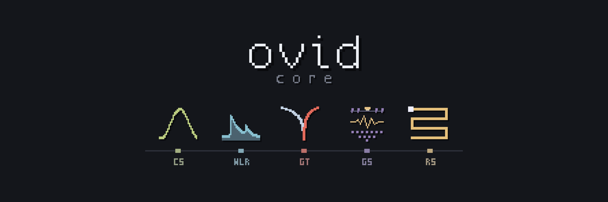
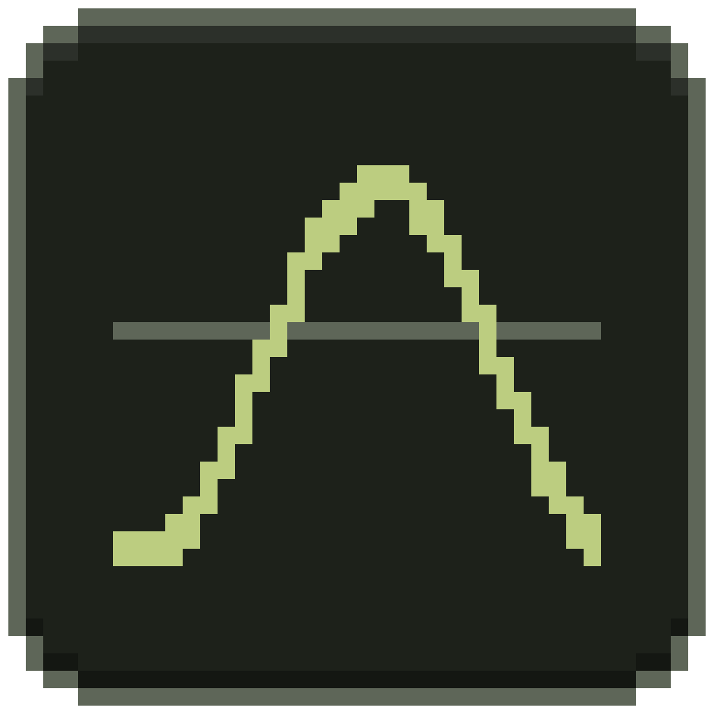
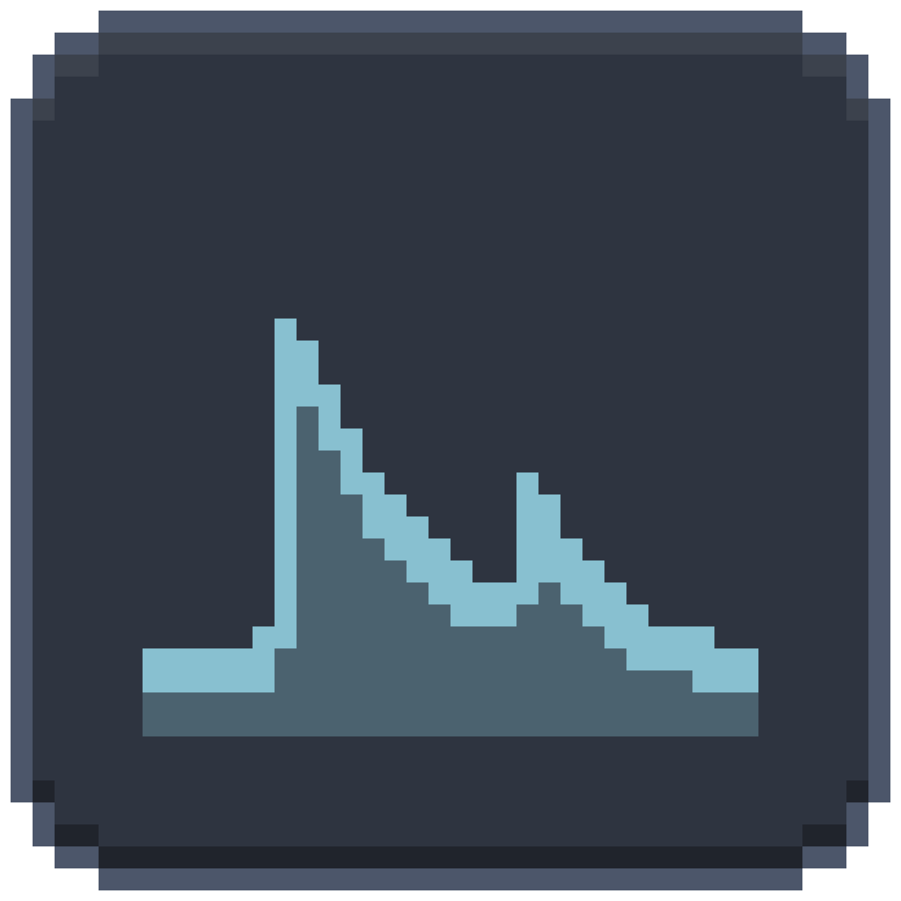
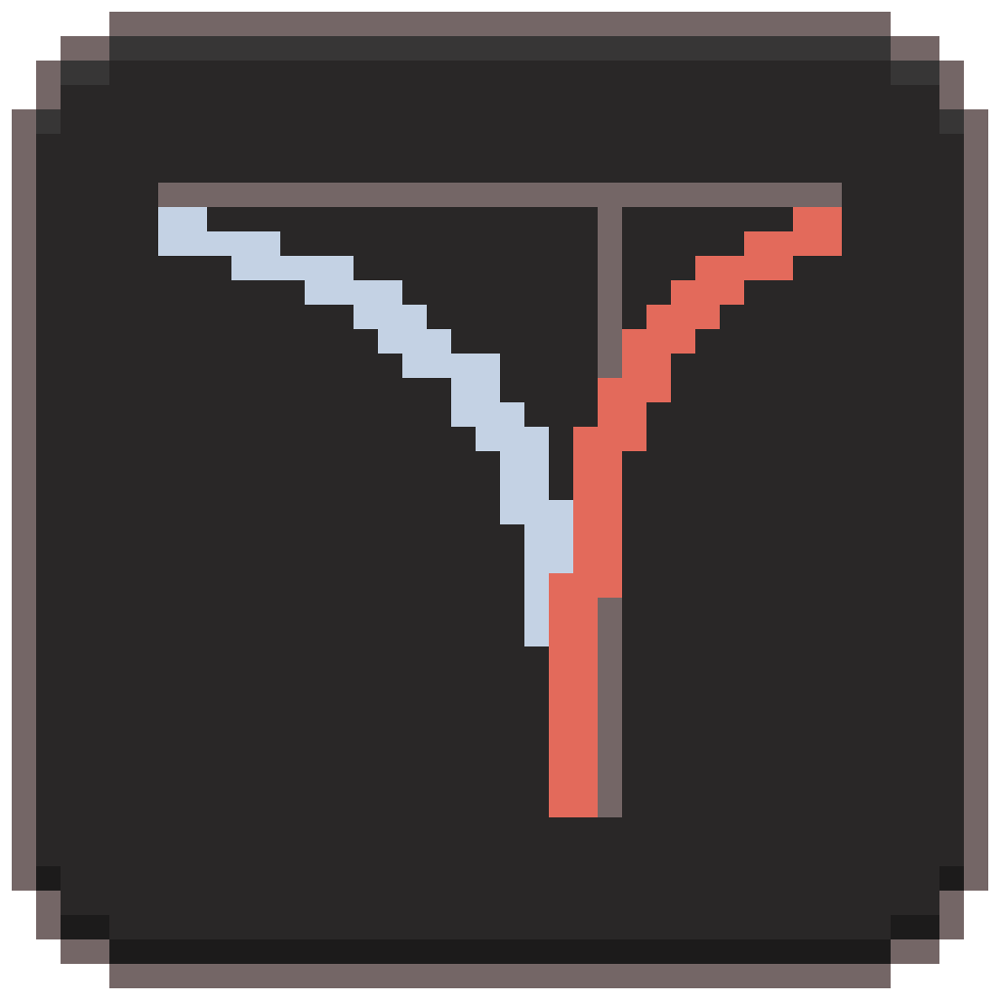

# ovid

ovid is a set of five R/Shiny apps that turn raw environmental logger downloads and geophysical surveys into clean, documented, analysis-ready records. Each app handles one kind of monitoring, and all five share one core of code for the work that does not depend on the data type.

| App | What it handles | Details |
|---|---|---|
|  **CS** | Campbell Scientific climate stations | [CS/README.md](CS/README.md) |
|  **WLR** | Water level loggers with barometric compensation | [WLR/README.md](WLR/README.md) |
|  **GT** | Ground temperature cables and soil sensors | [GT/README.md](GT/README.md) |
|  **GS** | Geophysical surveys: electrical resistivity (AGI SuperSting, IRIS Instruments) and ground-penetrating radar: catalogue, metadata, QC and viewing | [GS/README.md](GS/README.md) |
|  **RS** | Remote sensing: catalogue, provenance and positioning status for archived drone (UAV) flights | [RS/README.md](RS/README.md) |

Raw files are never changed, and every removed or changed value is explained in an audit trail. See the [system overview](docs/overview.md) ([PDF](docs/overview.pdf)) for how the pieces fit together.

## Opening an app

Needs R 4.x (<https://cran.r-project.org>). The first run installs the R packages it needs, which takes a few minutes.

- **Mac:** double-click `Open CS (Mac).command` (or WLR, GT, GS, RS). The first time, right-click > Open if macOS warns.
- **Windows:** open the app's folder and double-click `Ovid_CS.bat` (or `Ovid_WLR.bat`, `Ovid_GT.bat`, `Ovid_GS.bat`, `Ovid_RS.bat`).
- **Computers without R:** run `Make_Portable.bat` in an app folder once on a Windows computer that has R; the folder can then be zipped and used anywhere.

Your data stays outside this folder. Each app asks for your project folder (raw files, metadata, set-up tables, outputs), so this folder can be copied, backed up or shared without any data in it.

Keep the folder together: the apps look for `core/` beside them.

##  CS: climate stations

Ingests Campbell Scientific logger files (TOA5, TOB3, CR10X), stitches them into one record per logger table, assigns records to stations, applies calibrations and quality rules, and writes flagged station records, summaries and reports.

**Goes in:** Campbell `.dat` files (TOA5, TOB3, CR10X), logger programs, a field log.<br>
**Comes out:** one record per station, summaries, precipitation, station reports.


*Home: the field data hub with counts, shortcuts, the station list and the to-do list.*

<details>
<summary>More screenshots</summary>

| | |
|---|---|
|  |  |
| *Plot and explore for one station: battery voltage, air temperature and snow depth over the 12-year record, with low-battery shading and field-log marks.* | *Month-by-month box plots of air and soil temperature, with Export plot (PNG), Export station report (PDF) and Export data (CSV).* |

</details>

[CS README](CS/README.md) · [CS reference guide](CS/docs/CS_reference_guide.md)

##  WLR: water level loggers

Ingests HOBO and Solinst water level logger files, stitches each logger into one record, applies barometric compensation per deployment, and derives water depth, depth to water and water elevation with quality flags.

**Goes in:** HOBO `.hobo` and Solinst `.xle` files with their CSV exports, barologger files, the metadata workbook, dGPS surveys.<br>
**Comes out:** water depth, depth to water and elevation per deployment, summaries, reports.

[WLR README](WLR/README.md) · [WLR reference guide](WLR/docs/WLR_reference_guide.md)

##  GT: ground temperature

Ingests ground temperature logger files (RBR, GeoPrecision, HOBO, EM50, Campbell), stitches each logger into one record, assigns sensors to sites and depths, applies quality rules, and derives daily means, annual statistics, active-layer thickness and freeze/thaw dates.

**Goes in:** RBR `.hex`, GeoPrecision and HOBO `.csv` exports, EM50 `.xls`, Campbell `.dat`, a sensor registry and field notes.<br>
**Comes out:** site records, daily means, trumpet curves, active-layer thickness, freeze and thaw dates.

[GT README](GT/README.md) · [GT reference guide](GT/docs/GT_reference_guide.md)

##  GS: geophysical surveys (ERT and GPR)

Catalogues electrical resistivity survey files (AGI SuperSting, IRIS Syscal), reads them into one measurement model, links copies and derived sets to their original survey, and applies QC profiles that flag measurements without deleting them. It does not do inversion.

**Goes in:** AGI SuperSting `.stg` files with `.crs` and `.cmd`, EarthImager sets, IRIS Prosys exports, Res2DInv `.dat`.<br>
**Comes out:** a survey catalogue, a folder per survey, pseudosections, a shareable catalogue zip.

[GS README](GS/README.md) · [GS reference guide](GS/docs/GS_reference_guide.md)

##  RS: remote sensing (drone flights and imagery)

Catalogues archived drone flights, imagery, LiDAR and GIS layers from file headers and sidecars, groups images into flights, links logs and GNSS records to each flight with a score and evidence, and determines each flight's positioning status (RTK, PPK or standalone). It does not process imagery.

**Goes in:** drone images, flight logs and geotags, satellite and aerial scene metadata, LiDAR headers, GIS layers, GNSS surveys.<br>
**Comes out:** flight, image and file catalogues, a map of every flight, a shareable viewer zip.

[RS README](RS/README.md) · [RS reference guide](RS/docs/RS_reference_guide.md)

## Versions and what changed

Core 1.14.0, CS 1.10.0, WLR 0.10.0, GT 1.7.0, GS 0.4.0, RS 0.5.0 (6 October 2026). `CHANGELOG.md` summarises each release across
the bundle; each app folder and `core/` has its own `CHANGELOG.md` with the detail, including whether results already produced
would come out differently. The system overview is in `docs/overview.md` (.html, .pdf).

## Repository layout

```
core/            shared ovid Core (used by all five apps)
CS/  WLR/  GT/  GS/  RS/   the apps: app.R, R/, launcher/, tests/, README.md
docs/            banner, app icons, system overview, screenshots
```

Reference material: the [system overview](docs/overview.md) and one reference guide per app, each as .md, .html and a dark-mode .pdf in the app's colours: [CS](CS/docs/CS_reference_guide.md), [WLR](WLR/docs/WLR_reference_guide.md), [GT](GT/docs/GT_reference_guide.md), [ERT](GS/docs/GS_reference_guide.md), [RS](RS/docs/RS_reference_guide.md). Also the [core notes](core/README.md) and the ERT and RS design notes (`docs/DESIGN.md` in each).

## License

Copyright (C) 2026 yedoma. Released under the [GNU General Public License v3.0](LICENSE). This software comes with no warranty.
