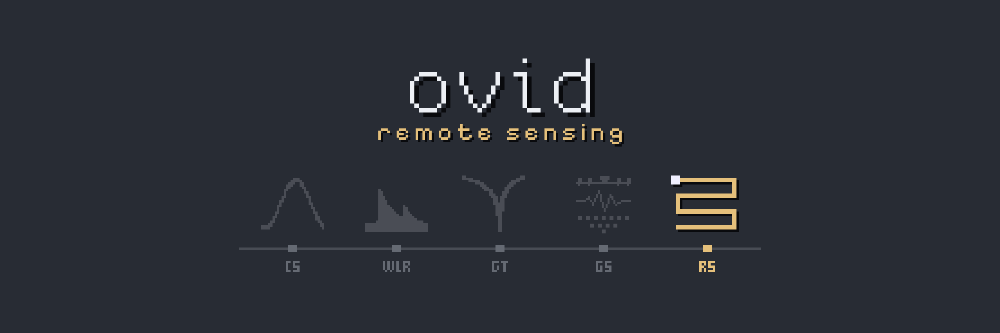

# ovid Core // RS

<!-- layout: ovid-app-readme v1 (short page; detail folded below) -->

Catalogues archived drone flights, imagery, LiDAR and GIS layers from file headers and sidecars, groups images into flights, links logs and GNSS records to each flight with a score and evidence, and determines each flight's positioning status (RTK, PPK or standalone). It does not process imagery.

| Goes in | Comes out |
|---|---|
| Drone images (EXIF and XMP headers only) | Flight catalogue with positioning status |
| Flight records: MRK, RPT, geotags, KML/KMZ, RINEX headers | Link, image, file and dataset catalogues |
| Satellite and aerial scene metadata | Map of every flight and layer |
| LiDAR headers | Stitched GNSS points |
| GIS layers: shapefile, GeoJSON, GPX | Shareable viewer zip |
| GNSS survey files |  |

## Open it

- **Mac:** double-click `Open RS (Mac).command` in the Ovid_Apps folder. The first time, right-click > Open if macOS warns.
- **Windows:** double-click `Ovid_RS.bat` in this folder.
- Needs R 4.x. The first start installs the R packages it needs, which takes a few minutes.
- Running from R or the command line, and making a copy for computers without R: see **Run it** under More detail.
- **Workbench (preview):** an additional, more detailed view of the same archive, with every Standard page (listed under Pages)
  around a spreadsheet of one flight, a row per image, its images drawn above it at their positions (metres east and north, to
  scale): click, drag or shift-click cells, click a number to select the image or a heading the column; click a point, or
  shift-drag a box, to select there. Leave out (an ignore rule in file_rules.csv) and Edit flight (flights.csv) act on the
  selection; Rebuild applies them from the sources' last scans, reading no source. Open it with **Workbench** in the title bar
  or `?ui=workbench` in the address; **Standard** in its title bar goes back. Its tabs: **Needs you** (shown first: every
  flight's open problems, worst first, each with Fix, Accept as is with a reason, or Skip; an accepted check counts as ok on the
  Map too; missing metadata below), **Photos and reference** (the grid), **Positioning** (with status by year and checkpoint
  accuracy), **Products** and **STAC export** (the STAC catalogue and the
  shareable viewer). Settings is under Pages.
- **Set-up tables** edits every table in config/ (the Flight and Sources pages write some of them too).

## More detail

<b>About</b>

Catalogue, provenance and positioning status for archived drone flights: DJI Matrice 350 RTK (P1, L2, H30T), Phantom 3, Phantom 4 / 4 Pro,
Phantom 4 RTK, senseFly eBee and eBee Plus (S.O.D.A., Sequoia, Canon S110/S110R). The UAV part of ovid RS. Not a processing tool.
The archive is never changed: files are only read, and nothing is written inside it. Full detail: [docs/RS_reference_guide.md](docs/RS_reference_guide.md)
(also .html); design: [docs/DESIGN.md](docs/DESIGN.md).

<b>Run it</b>

From this folder:

| Command | What it does |
|---|---|
| `Rscript rs_pipeline.R scan /Volumes/T7 T7` | adds the drive as source `T7` (or rescans it) and rebuilds the catalogue |
| `Rscript rs_pipeline.R scan "/Volumes/Backup"` | adds another source; flights it shares with earlier sources become copies, not new flights |
| `Rscript rs_pipeline.R` | rescans every source that is plugged in; sources that are not keep their last scan |
| `Rscript rs_pipeline.R export` | writes the viewer to send: `<project>/output/viewer/Ovid_RS_viewer.zip` |

The project folder is set on the app's Data source page (saved in app_settings.json), or `RS_PROJECT_DIR`; with none set it is `~/Projects/Ovid/Projects/RS/project`. Sources are listed in
`config/sources.csv`. Each image is opened once (its first 64 kB: EXIF and XMP) and the result kept per folder in
`<project>/cache/sources/<source>/`, so a rescan only reads folders whose files changed. Tests: `Rscript tests/run_tests.R` (with tests/test_bad_files.R, test_golden.R and test_formulas.R; samples in tests/samples, the golden project in tests/golden). eMotion mission plans (.mis3) have no sample yet: the files at hand hold place names.

<b>The app</b>

Double-click `Open RS (Mac).command` in Ovid_Apps (or `Ovid_RS.bat` on Windows, or `shiny::runApp("RS")`). Packages install
themselves on the first start. Pages:
- **Map**: every flight on satellite imagery with filters and the flight table. Dashed lines are planned (KML plans), solid are observed
  (image positions, flown tracks, receivers), dotted outlines are derived by ovid; colour is the positioning status. Click a flight
  on the map or in the table to see it beside the map. Every map (Map, GNSS, the viewer) has a Legend / PNG bar: show or hide the
  legend, and save the view as a 250 ppi PNG with or without it.
- **Timeline**: sites by year, a square per flight coloured by sensor, with the years no one flew kept; click a site or a flight,
  and Set site for a flight with none (nothing is filled in on a guess); coverage by site, year and sensor below.
- **Flight**: name, project, site, positioning status (with a reason, optional) and notes, saved to `config/flights.csv`; each linked file
  with its evidence, confirmed or rejected with a reason (`config/links.csv`).
- **QA**: files tied to no flight, datasets and their datum, products and STAC.
- **Sources**: scan a new drive or folder, rescan what is plugged in, rebuild, and export the viewer to send (each runs in
  the background with Cancel, after the set-up check); the problems of the last run are listed under the set-up check.
Theme: accent.vim (dark, yellow accent) from vimcolorschemes, through the app, plots, map and the viewer. The map uses Leaflet and map tiles
from the internet. App tests: `Rscript tests/test_app.R`.

<b>The viewer</b>

One folder (and its zip): `index.html` with a map (satellite imagery), filters, summary cards and the flight table, plus
`flights.csv`, `links.csv` and `sources.csv`. Everything shown is inside the page, so the person receiving it unzips it and
double-clicks `index.html`; no R and no archive needed, only the internet for map tiles. Image positions are thinned to
150 per flight to keep it small; flights marked `exclude_from_archive` in `config/flights.csv` are left out.

<b>What it writes (<code>&lt;project&gt;/output/catalogue/</code>)</b>

| File | One row per |
|---|---|
| `flights.csv` | flight: date, site, aircraft, sensor, images, size, positioning status with its evidence, linked records, copies, QA flags |
| `geometry.csv` | line or point for the map, tagged planned (KML plans), observed (flown KML tracks, receivers) or derived (extents worked out by ovid) |
| `links.csv` | file linked to a flight (MRK, RPT, logs, KML, RINEX, onboard GNSS, LiDAR raw, video), with score, state (auto, probable, suggested, confirmed) and evidence |
| `images.csv` | image: flight, UTC time, position, altitudes, RTK flag and standard deviations |
| `files.csv` | every file found, with its format and role |
| `unassigned.csv` | records and images not tied to any flight, and why |

<b>What people decide (<code>&lt;project&gt;/config/</code>)</b>

`flights.csv` (display name, project, site, positioning status, notes), `sites.csv` (site to project), `links.csv` (confirm or reject a
link: flight_id, file, state), `file_rules.csv` (ignore a path pattern or give it a role). A non-empty cell wins over what was found;
the found value stays beside it (`site_found`, `positioning_found`). Every change is backed up in `config/history/` (ovid Core).

<b>How flights and statuses are worked out</b>

- A flight is a run of images from one camera in one folder, split where exposures pause for more than 10 minutes; senseFly images
  are grouped by the flight number in their names (EP-01-00001_0359_0005.JPG) or folder (NIR_BogA_354). Its id comes from the
  camera serial and the first exposure (UTC), or the flight number when the camera clock is unusable (the Canon S110 reads 1980),
  so the same flight in another folder or source is one flight with copies.
- senseFly logs (.bb3, .bbx, .bbz), eMotion geotags (geoinfo.txt), plans (.mis3) and Pix4D projects are linked by aircraft serial and
  flight number, or by the image names a geoinfo file or eMotion KML lists. Images with no number in their name or folder (Sequoia
  bands in img/msp) take it from the one flight number among the logs in their folder or the two above.
- Sequoia writes four band images per capture: a flight counts images and captures, and is grouped by the camera's FlightUUID.
- KML/KMZ: a track with times (eMotion's export) is the observed path; a line or area without times is a plan. A Canon S110 flight
  with no usable clock takes its time from a linked track. RINEX headers give receiver, marker, position and time span; observations
  anywhere in the archive that span a flight are a probable link and never proof of correction.
- Google Earth tile KMLs (super-overlays of many small KMLs that each place one image tile) are listed as map tiles and
  counted apart, never read as plans or tracks. A source with no drone images ends its scan with "No flights found".
- Processed products (orthomosaics, DSMs, Pix4D and DJI Terra outputs, point clouds) are listed as out of scope and not read.
- Other files in the folder are scored: same folder 0.5, file-name time within the flight +0.4, named after the folder +0.4, only flight
  in the folder +0.3, time outside the flight -0.3. 0.8 or more is auto, 0.5 to 0.8 probable, below that suggested.
- senseFly positioning comes from geotag accuracy: centimetres in the camera's own images is RTK corrected; metres there but
  centimetres in eMotion's geotags is PPK corrected; metres everywhere is standalone. RINEX or base files alone never count.
- DJI aircraft come from the image metadata or the camera model (FC330 Phantom 4, FC6310 Phantom 4 Pro, FC6310R Phantom 4 RTK,
  FC300X Phantom 3). Phantom 3 and 4 have no RTK, so their positions are standalone GNSS.
- DJI positioning comes from each image's RTK flag: 95 % or more fixed is RTK corrected, some fixed is partly RTK corrected, none fixed
  with onboard GNSS observations kept is "correction data available, not confirmed", none at all is standalone.
- Site comes from DJI mission folder names (`DJI_<time>_<nn>_<Site>-<suffix>`); the suffix is not trusted for the sensor, which comes
  from the image metadata (some "-L2" folders hold P1 or L2 RGB images).

Status: the aircraft and sensors above; MRK, RPT, eMotion geoinfo, KML/KMZ/wpml, RINEX headers; sources scanned one after another;
the shareable viewer. Listed and linked but not read inside: .bb3/.bbx/.bbz logs and .mis3 plans (encrypted senseFly formats).
eBee Plus is inferred from the EP- serial prefix. Next: satellite, aerial, LiDAR, GNSS survey and GIS datasets.

Imagery page: satellite scenes (WorldView/QuickBird/GeoEye/IKONOS .IMD, SPOT DIMAP), aerial photos, airborne LiDAR tiles (LAS/LAZ headers) and other georeferenced rasters, with platform, product, date (marked inferred when it comes from a name), GSD, cloud and footprint. Footprints go on the Map as their own layers: solid from vendor scene corners, dashed from file headers (converted from UTM for display only). Only headers and sidecars are read. Catalogue: output/catalogue/datasets.csv.

GIS layers: shapefiles, GeoJSON and GPX are listed on the Imagery page and drawn on the Map by kind (GCPs and checkpoints, plots/transects/grids, boundaries and extents, field sites and trails, other), from their names. A shapefile without a .prj borrows its folder neighbour's (marked inferred). Folders with more than 20 layers (CanVec, basins) keep only extents. The GNSS page's stitched points also show on the Map.

GNSS page: upload survey CSVs from Emlid Reach, DJI RTK (point CSVs, Timestamp.MRK) or Leica (with or without a header) and they are stitched into one table (repeats dropped, reused point names flagged), shown on satellite imagery and exported as one CSV (also kept in output/gnss). Command line: `Rscript rs_pipeline.R gnss out.csv file1.csv file2.txt ...`. Coordinates are copied as found; nothing is converted.

<b>What's new</b>

### New in RS 0.5.0
- Flight quality from the image headers on the Flight page: ground sample distance, speed, motion blur, overlap, sun elevation.
- GNSS position quality: satellites, DOP, samples, age of corrections, baseline, correction type; a quality table on the GNSS page.
- See `CHANGELOG.md` and sections 4 and 11 of the reference guide.

[Reference guide](docs/RS_reference_guide.md) · [Changelog](CHANGELOG.md) · [Design notes](docs/DESIGN.md) · [System overview](../docs/overview.md) · [All five apps](../README.md)
