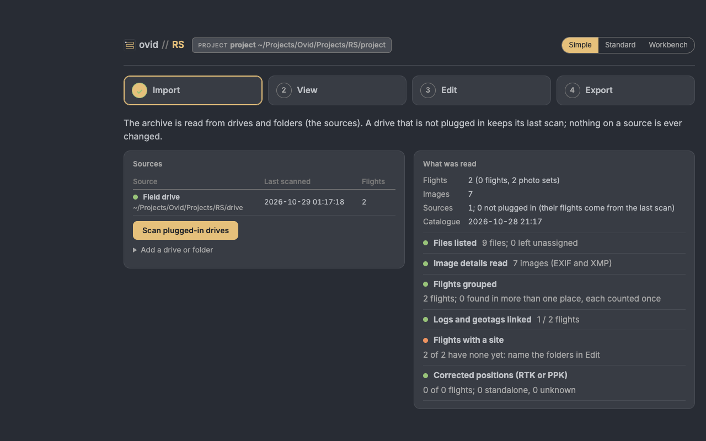

# ovid RS how-to guide

One task per section: when to use it, the steps, what changes and how to check it. Page names are those on the left of the Standard view (**Map**, **Timeline**, **Flight**, **Imagery**, **GNSS**, **QA**, **Sources**, **Set-up tables**). For a first project, start with the RS quick start; for what RS does to the files and why, see the RS reference guide.

## Contents

**Simple:** 1. Check the archive after a field season; 2. Give flights their sites

**Archive:** 3. Add a drive or folder; 4. Rescan the sources; 5. Look at a flight; 6. Name a flight and give it a project

**Workbench:** 7. Confirm or reject a file linked to a flight; 8. Set the time zone of a camera; 9. Set a GNSS base or a positioning status

**Review and share:** 10. Work through QA; 11. Stitch GNSS survey points; 12. Send the catalogue to someone without R; 13. Report a problem

## The three views

The same project, catalogue and edits in three views, switched at the top (**Simple**, **Standard**, **Workbench**) or with ?ui=simple, ?ui=standard or ?ui=workbench in the address. A new install opens in Simple.

<figure></figure>

- **Simple**: a field check in four steps (Import, View, Edit, Export). Edit gives folders and flights their sites and names; it changes nothing about what a flight is made of.
- **Standard**: the map, flight, QA and source pages these tasks use.
- **Workbench**: what flights are made of and how files are read. Confirmed and rejected links, file rules, time zones, GNSS bases and calibration are edited here; Standard shows those tables and points to the Workbench.

## 1. Check the archive after a field season

**When:** New flights are on a drive.

1. **Simple**, **Import**: **Scan plugged-in drives**. **What was read** gives the counts and the checklist.
2. **View**: a tile per folder guess, year or site; **Need a look** shows the groups with a check to look at. The footprints card draws the group's flights.
3. **Export**: **Download the report (HTML)**, with your initials.

**Result:** Nothing changes in the catalogue; the report records, per site, the flights, dates, sensors, images, corrected positions, ground sample distance, products and checks, with the methods and their sources.

## 2. Give flights their sites

1. **Simple**, **Edit**: under **Folder names → sites**, give each folder name the site it means; camera and backup folders (DCIM, 100MEDIA …) are left out.
2. **Add to changes**, then **Save**. Drag a single flight onto a site to place it on its own.

**Result:** Every flight in that folder takes the site at the next rebuild of the catalogue.

**Check:** **Import**: **Flights with a site**.

## 3. Add a drive or folder

1. **Sources**: **Browse…** to the drive or folder, give it a short name, **Scan folder**. In Simple: **Add a drive or folder** on **Import**.

**Result:** The source is added and scanned; its flights join the catalogue.

## 4. Rescan the sources

1. **Sources** (or **Scan plugged-in drives** in Simple).

**Result:** Plugged-in sources are read again, only the folders whose files changed; a drive that is not plugged in keeps its last scan.

## 5. Look at a flight

1. **Map**: click a flight on the map or in the table; the flight shows beside the map. **Timeline** lists the flights by date.
2. **Flight**: its files, images, positioning, footprint and checks.

## 6. Name a flight and give it a project

1. **Flight**: give it a display name, project and site; or in Simple, **Flight details** on **Edit**.
2. Everything typed is saved to `config/` and backed up.

## 7. Confirm or reject a file linked to a flight

**When:** A log, geotag file or mission was linked to the wrong flight, or a link was missed.

1. Links change what a flight is made of, so they are edited in the **Workbench** (the switch at the top right): open **Confirmed and rejected links**.
2. Confirm or reject the file for the flight; save, then rebuild the catalogue.

**Result:** The link is kept or left out at every later scan.

## 8. Set the time zone of a camera

**When:** Image times are off by whole hours from the logs.

1. In the **Workbench**, open **Time zones** and add a row for the camera or folder with its offset from UTC.
2. Save and rebuild.

**Check:** The flight's images and its log line up in time on **Flight**.

## 9. Set a GNSS base or a positioning status

1. In the **Workbench**, open **GNSS bases** to give a base station's position and height, used for flights corrected after the flight (PPK).
2. Save and rebuild.

**Result:** The flight's positioning status (RTK or PPK corrected, standalone GNSS, unknown) is shown on the map and on **Flight**.

## 10. Work through QA

1. **QA**: the flights with flags (! or ✕) and the files tied to no flight.
2. For each, follow the link to the page or table that settles it.

## 11. Stitch GNSS survey points

1. **GNSS**: upload the survey files (Emlid Reach, DJI RTK or Leica exports). They are stitched into one table: exact repeats dropped, a point name reused with other coordinates flagged.
2. Points with latitude and longitude show on the map; grid-only points need a UTM zone typed on the page.
3. **Export stitched points (CSV)**.

**Result:** Coordinates are copied as found; nothing is converted. For the accuracy of a product against checkpoints, RMSE_H = √(RMSE_x² + RMSE_y²), with the checkpoint survey error added in quadrature (ASPRS 2023): see the reference guide.

## 12. Send the catalogue to someone without R

1. **Sources**: **Create viewer**, then **Export viewer (ZIP)**.
2. In Simple, **Export** gives the catalogue tables and the footprints as GeoJSON.

**Result:** The viewer is a folder that opens in a browser, with the map and the flights.

## 13. Report a problem

1. Press the life-ring button on the top bar: it downloads the troubleshooting zip (versions, logs, problems and the set-up; no raw data).
2. Send it with the reference shown in the notice (E- and six characters).

The RS reference guide's Troubleshooting section lists the common messages and what to do.
