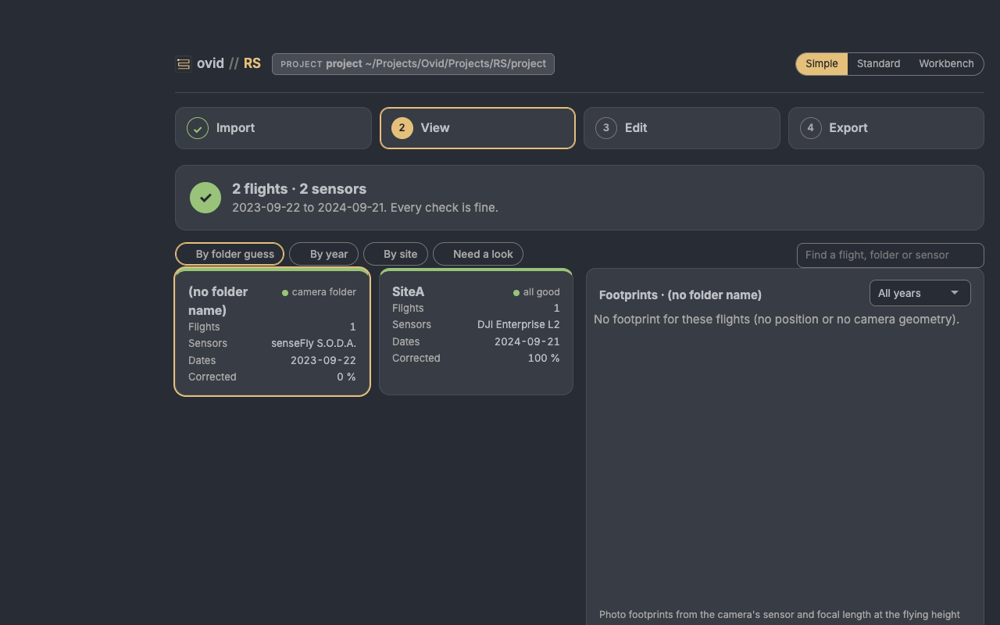
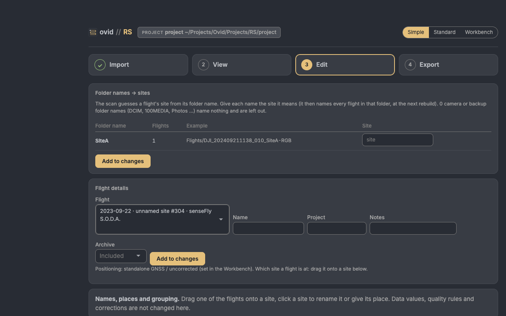
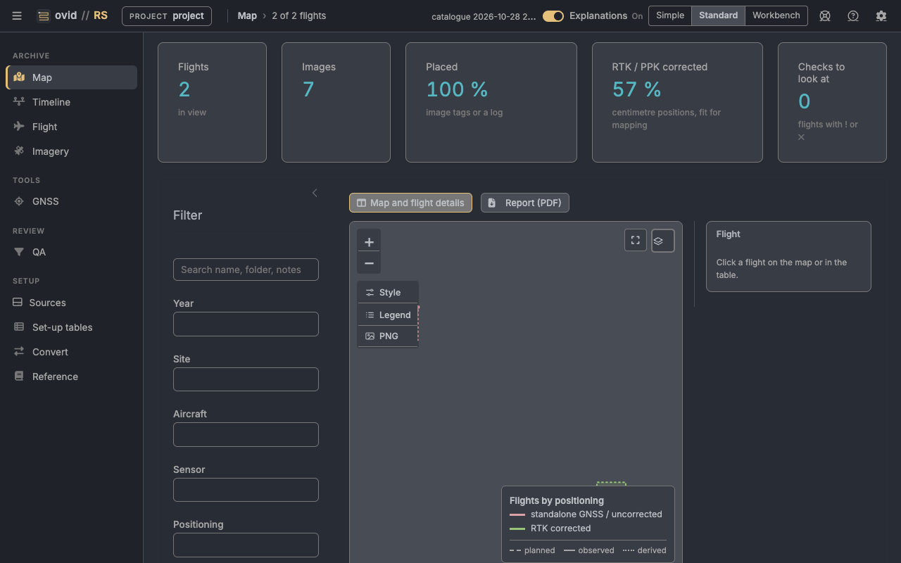

# ovid RS quick start

Remote sensing: a catalogue of drone flights (DJI, senseFly eBee and others), satellite, aerial and LiDAR datasets, GIS layers and GNSS survey points, read from drives and folders, with each flight's positioning, footprint and checks.

## Before you start

- **Sources.** The drives and folders that hold the flight archive, in any layout: a flight's images with their logs, geotags (DJI `.MRK`) and mission files. A drive that is not plugged in keeps its last scan. Nothing on a source is ever changed.
- **Project folder.** Where the catalogue, the set-up tables (`config/`) and the viewer are kept.

Open the app with **Open RS (Mac).command** (Windows: **Ovid_RS.bat**). The figures use the app's test archive (two short photo sets), not a field campaign; the map imagery is left out of them.

## The Simple view

For someone new to the archive, or a field check: four steps in one column, and nothing that changes what a flight is made of. A new install opens in Simple; the switch at the top (**Simple**, **Standard**, **Workbench**) moves between the three views of the same project, as does ?ui=simple, ?ui=standard or ?ui=workbench in the address.

<figure></figure>

- **Import**: the sources with when each was last scanned, **Scan plugged-in drives**, and **Add a drive or folder**. **What was read** counts the flights and photo sets, images and sources, with a checklist: files listed, image details read, flights grouped, logs and geotags linked, flights with a site, and corrected positions (RTK or PPK).
- **View**: one tile per folder guess, year or site (flights, sensors, dates, the share with corrected positions), and the footprints of the group picked, for one year or all. **Need a look** shows the groups with a check to look at.
- **Edit**: **Folder names → sites** gives each folder name the site it means, for every flight in that folder; **Flight details** sets a flight's name, project, notes and whether it is in the archive; drag a flight onto a site, rename a site or give it a place.
- **Export**: the catalogue report (one page, HTML), the catalogue tables (.zip) and every flight's footprint as GeoJSON, for a GIS.

<figure></figure>

Changes wait in a list until **Save**, with **Undo** and a change log; they apply at the next rebuild of the catalogue. A flight's positioning is shown, and set in the Workbench.

## The Standard view

<figure></figure>

The pages on the left: **Archive** (Map, Timeline, Flight, Imagery), **Tools** (GNSS), **Review** (QA) and **Setup** (Sources, Set-up tables, Convert, Reference); **Settings** is the gear.

1. **Sources:** **Browse…** to a drive or folder, give it a short name and press **Scan folder**. The first scan opens every image once; later scans read only the folders whose files changed.
2. **Map:** every flight on satellite imagery, coloured by positioning status. Click a flight on the map or in the table to see it beside the map. The figures across the top count the flights, images, the share placed and the share RTK or PPK corrected.
3. **Flight:** a flight's display name, project and site, its files and its checks.
4. **QA:** the flights with flags and the files tied to no flight.
5. **Sources:** **Export viewer (ZIP)** writes the viewer and downloads it, to send the catalogue to someone without R.

## What the values mean

- **Ground sample distance** GSD = sensor width × height / (focal length × image width), with the height above the take-off point (McGlone 2013; Colomina and Molina 2014).
- **Photo footprint:** across the track = sensor width × height / focal length; along = across × image height / image width (pinhole camera, looking straight down), turned to the flight heading (McGlone 2013). **LiDAR swath** = 2 × height × tan(FOV / 2) (Baltsavias 1999).
- **Checkpoint accuracy:** RMSE_H = √(RMSE_x² + RMSE_y²), with the checkpoint survey error added in quadrature (ASPRS 2023).
- **Positioning status:** RTK or PPK corrected (centimetre positions, fit for mapping), standalone GNSS (uncorrected) or unknown.

The RS reference guide gives every rule and source.
