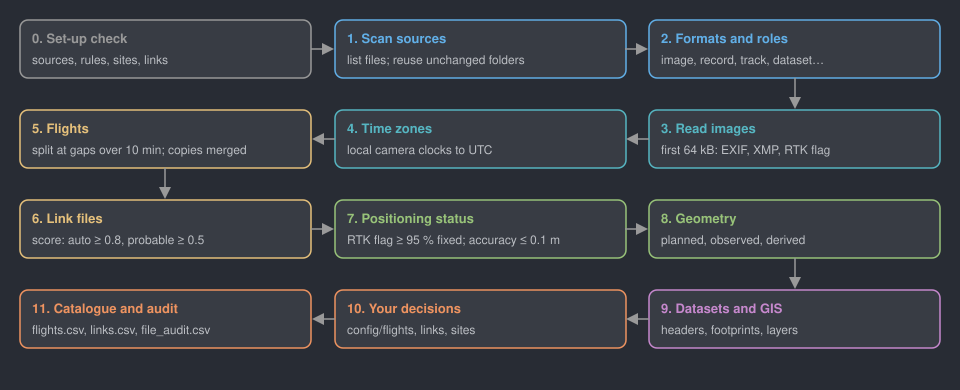

# ovid RS Reference Guide

Remote sensing archive: what the app does to every drone image, log and dataset it finds, why, and how to check it.
For RS 0.6.0 (ovid Core 1.15.0). ovid RS is a catalogue, provenance and positioning-status tool; it does not process imagery.
The archive is never changed: files are only read, and nothing is written inside a source. Settings are quoted with their defaults;
change them in `CFG` at the top of `rs_pipeline.R` or in the files under `<project>/config/`.

**Contents**

1. [Quick start](#quick-start)
3. [What happens to the files, in order](#what-happens-to-the-files-in-order)
4. [One image traced through](#one-image-traced-through)
5. [1. Sources and scanning](#1-sources-and-scanning)
6. [2. Formats and roles](#2-formats-and-roles)
7. [3. Image time and time zones](#3-image-time-and-time-zones)
8. [4. Flights](#4-flights)
9. [5. Missions](#5-missions)
10. [6. Linking files to flights](#6-linking-files-to-flights)
11. [7. Positioning status](#7-positioning-status)
12. [8. Geometry for the map](#8-geometry-for-the-map)
13. [9. Datasets: satellite, aerial and LiDAR](#9-datasets-satellite-aerial-and-lidar)
14. [10. GIS layers](#10-gis-layers)
15. [11. GNSS survey points](#11-gnss-survey-points)
16. [12. QA](#12-qa)
17. [Set-up check, time zones and file audit](#set-up-check-time-zones-and-file-audit)
18. [Reading the outputs](#reading-the-outputs)
19. [The viewer](#the-viewer)
20. [Sensor notes](#sensor-notes)
21. [Reasonable values](#reasonable-values)
22. [Plots, set-up tables and Needs you](#plots-set-up-tables-and-needs-you)
22. [Troubleshooting](#troubleshooting)
23. [Glossary](#glossary)
24. [References](#references)

## Quick start

1. Open the app: double-click `Open RS (Mac).command` in Ovid_Apps (or `Ovid_RS.bat` on Windows). Packages install themselves on the first start.
2. On **Sources**, press **Browse…** to pick a drive or folder (for example an external disk with the flight archive), give it a short name and press **Scan folder**.
   The first scan opens every image once; later scans only read folders whose files changed.
3. On **Map**, every flight appears on satellite imagery, coloured by positioning status. Click a flight on the map or in the table to see it beside the map.
4. On **Flight**, give it a display name, project and site, and, in the **Workbench**, confirm or reject the files linked to it. Everything you type is saved to `config/` and backed up.
5. On **QA**, work through the flights with flags and the files tied to no flight.
6. On **Sources**, press **Export viewer (ZIP)** (it writes the viewer, then downloads it) to send the catalogue to someone without R.

From the command line:

| Command | What it does |
|---|---|
| `Rscript rs_pipeline.R scan <folder> <name>` | adds the folder as a source (or rescans it) and rebuilds the catalogue |
| `Rscript rs_pipeline.R` | rescans every source that is plugged in; the others keep their last scan |
| `Rscript rs_pipeline.R export` | writes the viewer: `<project>/output/viewer/Ovid_RS_viewer.zip` |
| `Rscript rs_pipeline.R gnss out.csv a.csv b.txt` | stitches GNSS survey files into one CSV |

## What happens to the files, in order



| Step | What happens | Where to check it |
|---|---|---|
| 0 | Set-up check: sources, file rules, sites, flights and links | `output/audit/setup_check.csv`, Sources page |
| 1 | Scan each source that is plugged in; list every file with its size and time | `output/catalogue/files.csv` |
| 2 | Give each file a format and a role (image, log, plan, track, dataset, out of scope) | `files.csv` columns `format`, `role` |
| 3 | Read the first 64 kB of each image (EXIF and XMP): time, position, altitudes, camera, RTK flag | `output/catalogue/images.csv` |
| 4 | Apply the shared time-zone table to cameras whose clock was on local time | `images.csv` columns `time_utc`, `tz_rule` |
| 5 | Group images into flights, and copies of a flight into one flight | `output/catalogue/flights.csv` |
| 6 | Link logs, plans, tracks, RINEX and other files to flights, with a score | `output/catalogue/links.csv` |
| 7 | Work out each flight's positioning status from its evidence | `flights.csv` columns `positioning_found`, `positioning_evidence` |
| 8 | Build lines and outlines for the map (planned, observed, derived) | `output/catalogue/geometry.csv` |
| 9 | Read satellite, aerial and LiDAR headers, and GIS layers | `output/catalogue/datasets.csv` |
| 10 | Apply what people decided (`config/flights.csv`, `links.csv`, `sites.csv`) | `flights.csv` (`site` beside `site_found`) |
| 11 | File audit: what became of every file | `output/audit/file_audit.csv` |

## One image traced through

A DJI Matrice 350 RTK image taken with a Zenmuse P1, in a mission folder named `DJI_202001011200_001_Site-A`.

1. **Found.** The scan lists the file: `.JPG`, 18 MB, in source `T7`. Format `jpg`, role `image`.
2. **Read.** Its first 64 kB give `DateTimeOriginal` 2024:07:12 10:42:07, latitude and longitude, `drone-dji:RelativeAltitude` +60.1 m, `RtkFlag` 50 and the camera serial.
3. **Time.** DJI cameras write UTC in the XMP (`UTCAtExposure`), so `time_utc` is used as written and no zone rule is needed.
4. **Flight.** The images from this camera in this folder are sorted by time. The gap to the image before is 2 s, so it belongs to the same flight; the next gap of 14 min starts a new flight. The flight's id is built from the camera serial and the first exposure in UTC.
5. **Site.** From the folder name: `Bog`. The `-P1` suffix is not trusted for the sensor; that comes from the image metadata.
6. **Links.** `DJI_202001011200_001_Timestamp.MRK` in the same folder: same folder 0.5, time in the file name within the flight +0.4, so the score is 0.9 and the link is `auto`.
7. **Status.** 412 of the flight's 420 images have `RtkFlag` 50 (fixed): 98.1 %, which is 95 % or more, so the flight is **RTK corrected**. The evidence column says so in words.
8. **Map.** The image positions draw the observed outline (solid) in the RTK colour.

## 1. Sources and scanning

A source is one drive or folder with archived data. Sources are listed in `config/sources.csv` (id, path, label, added). The same flight
on several sources is one flight with copies: copies are found by the flight id, not by the path.

- Every photo's header is read (the first 64 kB, where EXIF and XMP sit), once. The result is kept per file in
  `<project>/cache/sources/<source>/exif.rds`, by path, size and modified time, so a rescan reads only new or changed photos.
- Only drone photos make flights: a photo counts when it carries a drone tag (DJI drone-dji, senseFly or Camera: XMP) or its EXIF make
  and model match a row of `config/drone_cameras.csv` (Set-up tables; make in any case, model as a prefix, a blank model for any model
  of that make; a row with drone "no", such as DJI's handheld Osmo and Pocket cameras, wins over a drone tag). Other photos (phones, compact cameras, trail cameras, DSLRs, screenshots) are left out and listed in `catalogue/other_photos.csv` with why.
- The same photo in several folders or sources (by size, camera serial, exposure time and band; without an EXIF time, size and the md5 of
  the first 64 kB) is counted once; the copies are listed in `catalogue/duplicates.csv` (kind, key, kept_path, dup_path, why), which the
  eMotion logs share.
- A source inside another source (real paths compared) keeps its own files: each file is counted once, under the innermost source. The
  Sources page says so before such a folder is scanned, and marks the sources "inside" or "contains".
- Satellite scenes (TIFF, JP2 or NITF beside .IMD, .TIL or DIMAP metadata, or with a satellite name) are rasters, never photos or flights.
- Remove (Sources page) takes a source out of `config/sources.csv` and its rows out of the catalogue. Its folder and files are never touched.
- A source that is not plugged in keeps its last scan. Its flights stay in the catalogue and the Sources page shows it as not connected.
- `config/file_rules.csv` can ignore a path pattern (for example a recycle bin) or give it a role.

## 2. Formats and roles

| Role | Formats | Read inside? |
|---|---|---|
| image | JPG, DNG, TIF from a drone camera | first 64 kB (EXIF, XMP) |
| record | DJI `Timestamp.MRK`, `.RPT`; eMotion `geoinfo.txt`; `.bb3/.bbx/.bbz` logs; `.mis3` plans | MRK, RPT and geoinfo yes; logs and plans are encrypted, so listed only |
| track or plan | KML, KMZ, WPML | yes |
| map tile | Google Earth tile KMLs (a super-overlay: thousands of small KMLs that each place one image tile) | checked, then listed and counted apart; never read as plans or tracks |
| receiver | RINEX observation files | header only |
| dataset | satellite scenes (.IMD, DIMAP), aerial photos, LAS/LAZ, GeoTIFF | header and sidecars only |
| GIS layer | shapefile, GeoJSON, GPX | yes |
| out of scope | orthomosaics, DSMs, Pix4D and DJI Terra outputs, point clouds | listed, not read |
| other | anything else | listed |

## 3. Image time and time zones

- DJI writes UTC in the XMP; that wins. Other cameras write local time in `DateTimeOriginal` with no zone.
- For those, the shared time-zone table `config/timezones.csv` (ovid Core) gives the offset: one row per rule with `serial`, `model`,
  `file_pattern`, `start`, `end`, `offset_hours` and `reason`. Blank columns match anything; the first matching row wins.
- `time_utc` = local time − offset. The rule used is kept in `tz_rule`.

<div class="ex"><b>Worked example.</b> A senseFly S.O.D.A. image says 2024-07-12 09:15:00 with no zone. A row with model <code>S.O.D.A.</code>, offset <code>-7</code> and reason "camera on local summer time" matches, so <code>time_utc</code> = 09:15 − (−7 h) = 16:15 UTC.</div>

- A camera with an unusable clock (the Canon S110 often reads 1980) takes its time from the flight log or a linked flown track (KML), and the flight's `time_source` says so (see below).

### Flight log time first

A decoded flight log's GNSS time wins over eMotion's KML and over the camera clock. A camera clock more than 14 h from the log or the KML (the widest UTC offset) is taken as never set, and the GNSS time is used. The KML's time is used when it is the only GNSS time. The flight's `time_source` says which was used, and the Flight page shows the log and KML start times.

## 4. Flights

A flight is a run of images from one camera in one folder, split where exposures pause for more than **10 minutes** (`flight_gap_min`).

<div class="f">new flight where  t(i) − t(i−1) &gt; flight_gap_min</div>

<div class="ex"><b>Worked example.</b> Exposures at 10:30:02, 10:30:04 … 10:41:58, then 10:56:10. The gap 10:41:58 → 10:56:10 is 14 min 12 s, more than 10 min, so the images from 10:56:10 on are a second flight.</div>

- senseFly images are grouped by the flight number in their names (`<serial>_<flight>_<image>.JPG`) or folder. Images with no number take it from
  the one flight number among the logs in their folder or the two above.
- Sequoia writes four band images per capture; a flight counts both images and captures and is grouped by the camera's FlightUUID.
- The flight id comes from the camera serial and the first exposure in UTC, or from the flight number when the clock is unusable,
  so the same flight in another folder or source is the same flight.

### Flight quality from the image headers (added October 2026)

Each image gets, where its headers allow, and each flight gets the median (on the Flight page and in `flights.csv`):

| Value | How it is worked out |
|---|---|
| Ground sample distance (`gsd_cm`) | sensor width × height above take-off ÷ (focal length × image width), in cm per pixel. The sensor width comes from the EXIF focal plane resolution, or from a table of the archive's cameras (1-inch sensors 13.2 mm, 1/2.3-inch 6.17 mm, 1/1.7-inch 7.44 mm, full frame 35.9 mm). The height is DJI's `RelativeAltitude`, above the take-off point and not the ground under the image, so over slopes or water it is approximate; eBee images have no such height and no GSD. |
| Speed (`speed_ms`) | DJI's `FlightXSpeed` and `FlightYSpeed` where written, otherwise the distance to the previous image over the time between them (images up to 30 s apart in one folder). |
| Motion blur (`blur_px`) | speed × exposure time ÷ GSD, in pixels. Under about 0.5 to 1 pixel is the usual aim for mapping; `blur_over_1px_pct` is the share of a flight's images above 1 pixel. |
| Forward overlap (`fwd_overlap_pct`) | 1 − distance to the previous image on the same line ÷ footprint along the track, taking the short side of the image as along the track (the usual layout for mapping flights). In a big folder only a sample of headers is read (30 images), so neighbouring images rarely both have a position; the flight's value is then estimated from its median speed × the median time between exposures, and `fwd_overlap_source` says "speed x interval" instead of "image pairs". |
| Side overlap (`side_overlap_pct_median`) | 1 − spacing between neighbouring parallel lines ÷ footprint across the track. A line starts where the heading turns by more than 45° or images are more than 30 s apart. It needs the lines, so it is empty for big folders read from a sample of headers. |
| Sun elevation (`sun_elev_deg`) | from the image's position and UTC time, to about a degree. |

Nothing here is written into the images or used to change a status; it describes the flight for anyone re-using it. On the Samsung USB drive (scanned 6 October 2026) the three Zenmuse L2 flights of 22 September 2024 came out at a GSD of 1.6 cm (60 m above take-off), forward overlap 77 to 84 % (speed x interval), motion blur 0.6 to 0.8 pixels and sun elevation 23 to 27°. The eBee Plus flights with the Canon S110 have no height above take-off and no position in their EXIF, so none of these values can be worked out for them.

### Editing the Flights list and joining flights

In the Flights list under the map, select rows, then set site, project, name or positioning (dropdowns of known values; a new one can be typed), **Join into one flight**, **Move to photo sets** or **Leave out**. Changes wait in one Save bar (Undo, Discard, Save, or Cmd/Ctrl+S) and are written to `flights.csv` at once; leaving with unsaved changes asks first.

A flight joined by hand (`mission_set` in `flights.csv`) is one row in the list and on the map; its sorties stay separate flights in the catalogue and exports.

### Site names found in folder names

The Timeline's **Site names found** card lists names read from folder names, each with a suggested known site: the same name in another case, a name within it, a name several flights use, or a `sites.csv` site whose coordinates the flights cover. The flights' bounding boxes are not used: they are too wide to tell sites apart. Choices are saved to `config/site_names.csv` (a blank site means "not a site") and applied by the next rebuild; names kept as sites go into `sites.csv`.

## 5. Missions

Sorties flown as one survey are grouped into a mission: the same aircraft flying again within an hour from the same plan or folder, or
over the same area and site soon after (battery swaps, two flights on one battery). On the Flight page, **Confirm this grouping** or
**Split this sortie off**; to group sorties by hand, select them in the Flights list and **Join into one flight**.

### Photo sets

A run of fewer images than `photoset_max_images` (calibration table, default **20**; an ovid default with no published source) is a photo set: listed on its own tab, kept out of mission grouping and checked for its images only. A `kind` set in `flights.csv` (flight or photo set) wins over the count.

## 6. Linking files to flights

Records are linked by what they say first: senseFly logs, eMotion geotags, plans and Pix4D projects by aircraft serial and flight number,
or by the image names a geoinfo file or eMotion KML lists (score 0.95). Other files in the folder are scored:

| Evidence | Score |
|---|---|
| same folder as the flight | +0.5 |
| time in the file name within the flight | +0.4 |
| named after the folder | +0.4 |
| only flight in the folder | +0.3 |
| time in the file name outside the flight | −0.3 |

<div class="f">state = auto       if score ≥ 0.8
        probable   if 0.5 ≤ score &lt; 0.8
        suggested  if score &lt; 0.5</div>

<div class="ex"><b>Worked example.</b> A flight log in the flight's folder (0.5) whose name holds a time 3 min after take-off (+0.4): 0.9, <code>auto</code>. A PDF report in the same folder with no time in its name, while two flights share the folder: 0.5, <code>probable</code>.</div>

RINEX observations anywhere in the archive that span a flight are a probable link and never proof of correction. On the Flight page,
each link can be confirmed or rejected with a reason (`config/links.csv`).

### Logs no flight has yet

The Flight page lists the flight logs that no flight has yet, from the same aircraft near the flight's time, the closest photo-tag count first, each with **Link this log**. The catalogue lists every log in `catalogue/logs.csv`.

## 7. Positioning status

One of: RTK corrected, partly RTK corrected, PPK corrected, standalone GNSS / uncorrected, correction data available, not confirmed, unknown.
A status typed on the Flight page (with a reason) wins; the found one stays beside it in `positioning_found`.

**DJI** (from each image's RTK flag: 50 fixed, 34 float, 16 single):

<div class="f">fixed share = images with RtkFlag 50 / images with a flag
≥ 95 %                  → RTK corrected
&gt; 0 %                   → partly RTK corrected
0 % and onboard GNSS kept → correction data available, not confirmed
0 %                     → standalone GNSS / uncorrected
no flag, Phantom 3 or 4 → standalone GNSS / uncorrected (no RTK on board)</div>

**senseFly** (from geotag accuracy, `CORRECTED_M` = 0.1 m):

<div class="f">camera's own geotag accuracy ≤ 0.1 m              → RTK corrected
metres in the camera, ≤ 0.1 m in eMotion's geotags → PPK corrected
metres everywhere                                → standalone GNSS / uncorrected
(base or RINEX files alone never count as corrected)</div>

<div class="ex"><b>Worked example.</b> An eBee Plus flight: the S.O.D.A. images say 3.2 m horizontal accuracy; the eMotion geoinfo for the same images gives a median of 0.03 m. 3.2 m &gt; 0.1 m but 0.03 m ≤ 0.1 m, so the flight is <b>PPK corrected</b>.</div>

## 8. Geometry for the map

| Kind | Line style | From |
|---|---|---|
| planned | dashed | KML/KMZ/WPML lines or areas without times |
| observed | solid | image positions, flown KML tracks, receiver positions |
| derived | dotted | footprints and extents worked out by ovid |

Colour is the positioning status: RTK green, partly RTK cyan, PPK blue, uncorrected red, "available, not confirmed" orange, unknown grey (accent.vim).

Every map (Map page, GNSS page and the shared viewer) has a small **Legend** / **PNG** bar. **Legend** shows or hides the legend
(remembered per map); **PNG** saves the view as it is on screen, with or without the legend, redrawn at 250 ppi: imagery tiles
are fetched at the matching finer zoom and every shape is redrawn, so lines stay sharp.

### Flight footprints and one footprint per year (added October 2026)

Each flight is drawn by its **footprint**, dotted: the ground each photo covered, or for LiDAR the swath along the flown lines.
A flight without the numbers for a footprint keeps a dotted box round its positions, and its tooltip says so.

| Value | Formula | Source |
|---|---|---|
| Photo footprint across the track | sensor width · h / focal length | McGlone 2013; Wolf et al. 2014 |
| Photo footprint along the track | across · image height / image width | McGlone 2013 |
| LiDAR swath width | 2 · h · tan(FOV / 2); FOV 70° L2, 70.4° L1 | Baltsavias 1999; DJI 2024 |
| h, height above take-off ground | DJI: relative altitude. eBee: photo GNSS height less take-off GNSS height from the RTK log; else less the GNSS base ground (RINEX height less antenna height) | Bowring 1976; RINEX 3.04 |
| One footprint per year | frames marked on a 2 m grid, covered cells traced into outlines with holes, simplified by one cell; parts and holes under 500 m² dropped | Foley et al. 1990; Lorensen & Cline 1987; Douglas & Peucker 1973 |

**Footprint** (Filters) picks Optical, LiDAR or Both. A LiDAR flight is one with LiDAR raw data and a known LiDAR payload; all
others are Optical. **One footprint per year** joins the footprints of the flights in view into one outline per year and kind; in
Both, the Optical (yellow) and LiDAR (blue) outlines are drawn on top of each other. The side card shows area, parts and holes,
the area flown once, twice and more, and the flights' GSD, height, overlap, speed, sun elevation and RTK share. Photo sets and
undated flights are left out.

**Report (PDF)** prints the current view: the map as shown with legend, scale bar, north arrow and corner coordinates, the
coverage numbers, the flights in view, the method and references. Without Chrome it saves HTML.

Footprints are written by the pipeline to `catalogue/footprints.csv` (flight_id, kind, part, ring, line) and the summary columns
`fp_kind`, `fp_area_m2`, `fp_height_m`, `fp_height_from`, `fp_width_m`, `fp_gsd_cm`, `fp_images`, `fp_cell_m`, `fp_note` in `flights.csv`.

## 9. Datasets: satellite, aerial and LiDAR

The Imagery page lists satellite scenes (WorldView, QuickBird, GeoEye, IKONOS `.IMD`; SPOT DIMAP), aerial photos, airborne LiDAR tiles (LAS/LAZ
headers) and other georeferenced rasters, with platform, product, date (marked inferred when it comes from a name), ground sample distance,
cloud cover and footprint. Footprints are drawn solid from vendor scene corners and dashed from file headers (UTM converted for display only).
Only headers and sidecars are read. Catalogue: `output/catalogue/datasets.csv`.

### Other geodata: keep or remove

The Other geodata tab lists satellite, aerial, LiDAR, raster and GIS files by folder, with **Keep** or **Remove**. Remove is an ignore rule in `file_rules.csv` (the files are not touched); Keep is a review decision (`review_decisions.csv`). A folder with no position, or far from the flights, is suggested for removal.

## 10. GIS layers

Shapefiles, GeoJSON and GPX are listed on the Imagery page and drawn on the Map by kind from their names: GCPs and checkpoints, plots/transects/grids,
boundaries and extents, field sites and trails, other. A shapefile without a `.prj` borrows its folder neighbour's (marked inferred). Folders
with more than 20 layers keep only extents.

## 11. GNSS survey points

On the GNSS page, upload survey files from Emlid Reach (point CSVs, .LLH, NMEA, Emlid Studio .pos, or the Emlid Flow zip), DJI RTK (point CSVs,
`Timestamp.MRK`) or Leica (Viva / Captivate / LGO ASCII, GSI-8/16, LandXML). They are stitched into one table: exact repeats dropped, a point name
reused with other coordinates flagged in `note`. Points with latitude and longitude are shown on the map; grid-only points need a UTM zone typed
on the page. **Export stitched points (CSV)** writes `ovid_rs_gnss_stitched_<date>.csv` (also kept in `output/gnss/`). Coordinates are copied as found; nothing is converted.

### Position quality (added October 2026)

Where a file gives them, each point also carries the number of satellites (`n_sat`; Emlid Flow's per-constellation counts are added up), `pdop`, `hdop` and `vdop`, the averaging `samples`, the age of the corrections in seconds (`age_s`), the `baseline_m` to the base and the `correction` type (NTRIP, LoRa and so on). Reach `.LLH` logs give satellites and age (the RTKLIB solution columns), and NMEA GGA sentences give satellites, HDOP and age. The GNSS page shows a table per file: points, share fixed, median horizontal and vertical RMS, median PDOP and HDOP, fewest satellites, oldest corrections and longest baseline. Values are copied as found; nothing is reprocessed.

## 12. QA

The QA page shows positioning status by year, missing metadata (site, project, sensor), flights with QA flags (no georeferenced images, positions only in eMotion geotags,
camera clock unusable, MRK or RPT counts that differ from the images found, mission grouping uncertain) and files tied to no flight (`unassigned.csv`, with why).

## Set-up check, time zones and file audit

These are shared with the other ovid apps and come from the core. Each run writes them to `output/audit/`, and the Sources page shows them
in the **Set-up check and file audit** card.

- **Set-up check** (`setup_check.csv`): sources (a source that is not plugged in is `info`, not an error), duplicate source ids, file rules that
  are not valid patterns, sites without a project, positioning statuses that are not on the list, links to files that no longer exist, and the time-zone table.
- **Time zones** (`config/timezones.csv`): see [section 3](#3-image-time-and-time-zones).
- **File audit** (`file_audit.csv`): one row per file found with `what_happened`, either "in the catalogue: …" (as an image of a flight, a linked
  record, a dataset or a layer) or "not in the catalogue: …" with the reason (ignored by a rule, out of scope, not linked). Export it with **Export file audit (CSV)**.

## Reading the outputs

```
<project>/config/               what people decide (sources, flights, sites, links, file_rules, timezones); every change backed up in config/history/
<project>/cache/sources/<id>/   one scan per folder (safe to delete; the next scan reads everything again)
<project>/output/catalogue/     flights.csv, images.csv, links.csv, geometry.csv, files.csv, datasets.csv, unassigned.csv
<project>/output/audit/         setup_check.csv, file_audit.csv, run_manifest.csv, problems.csv
<project>/output/gnss/          stitched GNSS points
<project>/output/viewer/        the viewer folder and Ovid_RS_viewer.zip
```

Exports from the app are named `ovid_rs_<what>_<YYYY-MM-DD>.<ext>`.

## The viewer

One folder (and its zip) with `index.html`, a map, filters, summary cards and the flight table, plus `flights.csv`, `links.csv` and `sources.csv`.
The person receiving it unzips it and double-clicks `index.html`; no R and no archive are needed, only the internet for map tiles. Image positions
are thinned to 150 per flight (`points_per_flight`); flights marked `exclude_from_archive` are left out.

## Sensor notes

| Aircraft or camera | How it is recognised | Positioning |
|---|---|---|
| DJI Matrice 350 RTK (P1, L2, H30T) | XMP `drone-dji`, camera model | RTK flag per image |
| DJI Phantom 4 RTK (FC6310R) | camera model | RTK flag per image |
| DJI Phantom 4 / 4 Pro (FC330, FC6310), Phantom 3 (FC300X) | camera model | standalone (no RTK) |
| senseFly eBee, eBee Plus (EP- serial prefix, inferred) | XMP `sensefly`, file and folder names | geotag accuracy |
| S.O.D.A., Sequoia, Canon S110/S110R | camera model; Sequoia FlightUUID | from the aircraft's geotags |

## Reasonable values

| Quantity | Typical | Look again if |
|---|---|---|
| Geotag accuracy, RTK or PPK | 0.01 to 0.05 m | over 0.1 m while the status says corrected |
| Geotag accuracy, standalone | 2 to 5 m | under 0.1 m while the status says standalone |
| DJI fixed share, RTK flight | 98 to 100 % | between 1 and 95 % (partly corrected) |
| Relative altitude | 40 to 120 m | negative, or over 500 m |
| Gap between exposures | 1 to 5 s | many gaps over 10 min within one folder |
| Images per flight | 100 to 2,000 | fewer than 10 (a test or an aborted flight) |

## When something goes wrong


- If part of a page fails, a notice says so with a short reference (E- and six characters) and the app carries on. The life-ring button collects versions, logs and the set-up into a troubleshooting zip (no raw data) to send with the reference.
- If the output folder is deleted or moved while the app is open, the pages notice within seconds and show what is left; run again to rebuild it.
- A project folder that cannot be written to (read-only, a locked or full drive), or a file where the output, cache or config folder should be, stops the run before anything is changed, with what to do.
- A set-up table that is damaged or was saved by another program with columns missing is shown with those columns added empty and a notice; nothing changes in the file until it is saved.


## Plots, set-up tables and Needs you

### Plot gestures

The same on the Workbench point chart (photo positions); the maps keep map habits.

- **Drag left to right** zooms in on the dragged stretch (a box on depth, scatter and section plots). **Drag right to left** zooms out, twice as wide each time, up to the whole record. A drag shorter than 6 px is a click.
- **Shift + drag** (or right-drag) selects: a time stretch across all panels, or a box on depth, scatter and section plots. Click selects one record; Shift + click adds one (or drops it, if already selected); Esc clears.
- The wheel or a pinch zooms at the pointer; Shift + wheel or a sideways swipe scrolls. Drag the time axis or the whole-record strip, or hold Space and drag, to move along. Double-click shows the whole record; Backspace returns to the previous view.
- Maps keep map habits: drag moves, click picks one item, Shift + drag draws a selection box.

### Yes/No picks in set-up tables

Columns that hold yes or no (`enabled`, `show`, `identifies`, `include`, `active`, `hidden`) show **Yes** or **No** with a pick, in the Standard sheet and the Workbench grid alike. Typed or imported values are read in any case: yes, y, true, t, 1, on and no, n, false, f, 0, off. They are written `TRUE` or `FALSE`. Any other text is marked as an error, and the table cannot be applied until it is fixed.

### Needs you by site

Needs you (the Workbench pop-up and the review list) lists what waits on a person, grouped by site (the aircraft serial where no site is known; findings about the set-up tables or the project under Project). The same check on nearby days is one line. Each line says what to do and has a button that does it:

| Label | What it means |
|---|---|
| decide | a flag to keep, remove or note |
| fix in ovid | a set-up change ovid can make |
| raw data | a problem in the files themselves, which ovid cannot fix |
| add a file | a file that is missing and may exist |

The pop-up can also be grouped by what to do.

## Troubleshooting

| What you see | Why | What to do |
|---|---|---|
| A flight dated 1980 | Canon S110 clock not set | link the flown track (KML); its time is used |
| A mission flagged uncertain | sorties close in time but from different plans or areas | **Confirm this grouping** or **Split this sortie off** on the Flight page |
| Map is blank | no internet for Leaflet and map tiles | connect, then reload the page |
| Status "unknown" | no RTK flag and no geotag accuracy | type a status with a reason on the Flight page |
| A source shows "not connected" | the drive is not plugged in | plug it in and press **Rescan connected drives**; its last scan is kept meanwhile |
| A file is missing from a flight | its score was below 0.5 | find it in `links.csv` as suggested and confirm it |
| GNSS points not on the map | grid coordinates only | type the UTM zone on the GNSS page |
| A scan ends with "No flights found" | the source holds no drone images (for example only satellite or GIS data) | the scan stops there; any satellite, aerial and LiDAR list it found is still written. Check the source path if it should hold flights |

## Glossary

- **Flight**: a run of images from one camera, split at pauses over 10 minutes.
- **Mission**: flights flown as one survey.
- **Source**: a drive or folder in the archive.
- **RTK / PPK**: real-time or post-processed kinematic GNSS correction (centimetre positions).
- **RTK flag**: DJI's per-image fix state (50 fixed, 34 float, 16 single).
- **Geotag**: the position written for an image, by the camera or later by software.
- **GSD**: ground sample distance, the ground size of one pixel.
- **Footprint**: the outline of a scene or flight on the ground.

## References

- DJI, *Zenmuse P1 / L2 user manuals* and the DJI XMP tags (`drone-dji:*`).
- senseFly, *eMotion user manual*, geotag and log formats.
- Parrot, *Sequoia user guide*.
- Maxar, *IMD metadata*; Airbus, *DIMAP format*.
- ASPRS, *LAS specification 1.4*.
- RINEX 3 format description, IGS.
- National Marine Electronics Association, *NMEA 0183 standard*: the GGA sentence (fix quality, satellites in use, HDOP, age of differential data).
- Takasu, T., *RTKLIB manual*: the solution file format of `.pos` and Emlid `.LLH` logs (Q, ns, standard deviations, age, ratio).
- Emlid, *Emlid Flow* documentation: point CSV export columns (solution status, RMS, samples, PDOP, satellites per constellation, baseline, correction type). [docs.emlid.com](https://docs.emlid.com)
- CIPA DC-008, *Exchangeable image file format for digital still cameras (Exif)*: FocalLength, FocalPlaneXResolution, FocalPlaneResolutionUnit, PixelXDimension, PixelYDimension, ExposureTime.
- Baltsavias, E. P. (1999). Airborne laser scanning: basic relations and formulas. *ISPRS J. Photogramm. Remote Sens.* 54, 199-214.
- Bowring, B. R. (1976). Transformation from spatial to geographical coordinates. *Survey Review* 23(181), 323-327.
- Douglas, D. H., Peucker, T. K. (1973). Algorithms for the reduction of the number of points required to represent a digitized line or its caricature. *Cartographica* 10(2), 112-122.
- Foley, J. D., van Dam, A., Feiner, S. K., Hughes, J. F. (1990). *Computer Graphics: Principles and Practice*, 2nd ed. Addison-Wesley.
- Lorensen, W. E., Cline, H. E. (1987). Marching cubes: a high resolution 3D surface construction algorithm. *SIGGRAPH Comput. Graph.* 21(4), 163-169.
- McGlone, J. C. (ed.) (2013). *Manual of Photogrammetry*, 6th ed. ASPRS.
- Wolf, P. R., Dewitt, B. A., Wilkinson, B. E. (2014). *Elements of Photogrammetry with Applications in GIS*, 4th ed. McGraw-Hill.
