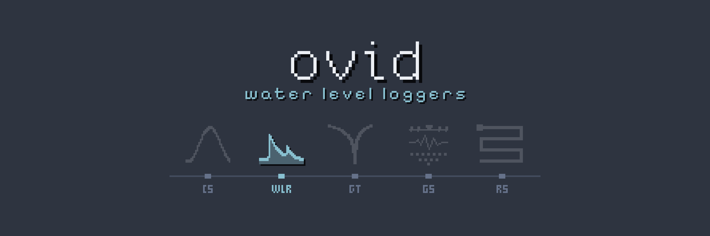

# ovid Core // WLR

<!-- layout: ovid-app-readme v1 (short page; detail folded below) -->

Ingests HOBO and Solinst water level logger files, stitches each logger into one record, applies barometric compensation per deployment, and derives water depth, depth to water and water elevation with quality flags.

| Goes in | Comes out |
|---|---|
| HOBO `.hobo` files with their CSV exports | One file per deployment: depth, depth to water, elevation |
| Solinst `.xle` files with their CSV exports | One corrected file per site |
| Barologger files | Barometric series |
| Metadata workbook (`.xlsx`) | Daily, monthly and water-year summaries |
| dGPS survey exports (`.csv`) | Run and site reports |
|  | Audit trail |

## Open it

- **Mac:** double-click `Open WLR (Mac).command` in the Ovid_Apps folder. The first time, right-click > Open if macOS warns.
- **Windows:** double-click `Ovid_WLR.bat` in this folder.
- Needs R 4.x. The first start installs the R packages it needs, which takes a few minutes.
- Running from R or the command line, and making a copy for computers without R: see **Run it** under More detail.
- **No metadata file needed.** Without a WL_Metadata workbook each logger is processed under its serial. To name loggers or give sites, years and hang lengths, fill in the **logger list** (Loggers and metadata > Logger list): start from the loggers found, paste rows from Excel or import a spreadsheet, and add columns of your own. Only the serial is needed.
- **Workbench (preview):** an additional, more detailed view of the same project, with every Standard page (listed under Pages)
  around a spreadsheet of one deployment or barologger: click, drag or shift-click cells, click a time to select a record or a
  heading to select a parameter, and the chart highlights the selection. Drag across the chart to zoom in, use the wheel to zoom
  in and out, and double-click to see the whole period again. Remove, Restore, Out of water, Drop records, Clock, In / out dates
  and Measurement act on the selection and write the same set-up tables as Plot and explore; the pipeline applies them on the
  next run. Open it with **Workbench** in the title bar or `?ui=workbench` in the address; **Standard** in its title bar goes back.

## More detail

<details>
<summary><b>About</b></summary>

Processing suite for water level recorders (HOBO and Solinst), built on the same pattern as ovid Core // CS: a pipeline script that does the work, and a Shiny app (Nord dark) that calls it and edits its set-up tables.

Full detail: [docs/WLR_reference_guide.md](docs/WLR_reference_guide.md) (also .html and .pdf).

</details>

<details>
<summary><b>Run it</b></summary>

### Run it on a Mac
Double-click **`Open WLR (Mac).command`** in the Ovid_Apps folder (the first time, right-click > Open if macOS warns).

### Run it on Windows
Unzip the folder anywhere and double-click **`Ovid_WLR.bat`**. The app opens in your browser; closing the tab (or the black window) stops it.

- The launcher uses `R-portable\` inside the folder if it is there, otherwise the R installed on the computer (R 4.2 or newer; "Install for me only" needs no admin rights).
- Packages are kept in `library\` inside the folder. The first start installs them (needs the internet once); copy package `.zip` files into `launcher\packages\` to install offline.
- **To share it with people who have no R:** run **`Make_Portable.bat`** once on a computer with R and the internet. It copies that R into `R-portable\` and every package into `library\`; zip the whole folder and it runs anywhere by double-clicking `Ovid_WLR.bat`.
- Every folder field has a **Browse…** button: it opens Finder or Explorer, or the app's own folder browser where neither is available. Settings are saved in `app_settings.json` beside `app.R`.

### Run it from R
```r
shiny::runApp("path/to/ovid_WLR")      # the app; set the folders under Home > Data source, then Run pipeline
```
or without the app:
```
Rscript wlr_pipeline.R                    # uses the folders in CFG at the top of the file (or WLR_* environment variables)
Rscript tests/run_tests.R                 # checks (also the reader samples, damaged files, the golden project and the formula checks below)
Rscript tests/test_bad_files.R            # damaged copies of the samples and barometric records that do not fit: each gives a clear problem or flag
Rscript tests/test_golden.R               # a whole run on tests/golden against accepted outputs; `accept "<name>"` after checking them
Rscript tests/test_formulas.R             # each derived value against a published table, the maker's software or a hand-computed case
```
Needs R with data.table, ggplot2, xml2, readxl, shiny, DT and zip (installed on first run if missing).

</details>

<details>
<summary><b>Folders</b></summary>

```
WLR/data/2025/            water level and conductivity downloads for 2025 (.hobo + HOBOware .csv, .xle + Solinst .csv)
WLR/data/baro/2025/       barologgers for 2025
WLR/metadata/             WL_Metadata.xlsx (one sheet per year; the newest .xlsx is used)
WLR/dgps/                 dGPS survey exports (.csv, Emlid style: Name, Location = T / TOC / GS, heights)
<project>/config/         set-up tables (written by the app)
<project>/output/         sites/ (one CSV per deployment), corrected/ (one CSV per site), baro/ (each serial and each station), plots/, audit/
```

</details>

<details>
<summary><b>What a run does</b></summary>

1. Finds every file, reads its serial, zone and units, pairs `.hobo` with its HOBOware CSV and `.xle` with its Solinst CSV, and marks byte-identical copies.
2. Reads the workbook (without one the run still completes, but only deployments set by hand on Deployment history are built). Older Levelogger `.xle` files in Latin-1 are read too. A `.hobo` is only read through its HOBOware CSV: use Bulk Export in HOBOware Pro for many files. Serials with and without a Solinst prefix (72028253 / 2028253) are treated as one logger.
3. Stitches every file of a serial, from every year, into one record in kPa (Solinst LEVEL in m × the adjustable kPa-per-m factor). Repeat downloads are kept once; where files disagree, the newest download wins and the other value is audited.
4. Splits each record into deployments: a serial at a site for a year, from the logger's previous visit to this year's visit. A year without a visit date ends mid-September (flagged as estimated). Dates, sites and hang lengths can be corrected without touching the workbook.
5. Joins barologgers into **stations**: every barologger that sat at one place (Settings table on Barometric > Baro stations across years) is stitched into one series across all years, the newer instrument winning where two overlap, and each seam is listed with its pressure difference.
6. For each year, groups sites by barologger (suggested on the first run: nearest baro, best coverage) with a primary and a secondary that fills gaps, and converts water minus baro to metres of water above the sensor (fixed or temperature-dependent density).
7. Adds depth to water below the T-coupler or casing (T_ST − offset − depth) and water elevation (survey of T, or TOC where T_ST was measured from the casing, − T_ST + offset + depth), and compares the logger with the tape at every visit. The offset is the distance from the logger tip to its pressure sensor (`logger_offsets.csv`, seeded from the makers' specifications), added only where the hang length was measured to the tip; Settings can switch it off or say hang lengths are measured to the sensor, and `measured_to` on Deployment history sets it per deployment or per site.
8. Applies limits, manual removals and out-of-water periods, finds readings in the air at the start or end of each deployment (flagged, or dropped with Trim readings in the air), flags readings below the air pressure (a failing or frozen sensor; reported as a problem when over 5% of a deployment), flags service visits, freezing, secondary-baro, filled-baro and no-baro readings, and writes everything with an audit trail. The run stops if any logger's record count does not reconcile.
9. Writes `output/corrected/<site>.csv` (every year of a site, with flag columns) and `audit/file_audit.csv` (every raw file: md5, readings read, readings in the output, where they went, what was dropped and why, and whether read = in output + dropped).

A rerun only does what changed (`incremental = TRUE`, kept in `<project>/cache/`): each file as read (by its MD5), each logger as stitched, each water logger's deployments as compensated and checked, each site's corrected file and each deployment plot are reused while what they depend on is unchanged, so an edit redoes only the loggers it applies to (a removal on a barologger, the water loggers it compensates), and the message at the end of a run says how many were redone; **Rescan selected files** on the Raw files page reads chosen files again. Records with corrupt time stamps among good ones (off the time grid and out of written order) are left out and audited (`drop_stray_records`). A Solinst Barologger's LEVEL is written less 9.5 m of water; the app adds it back. Dates in set-up tables can be a date alone (an end date covers that whole day).

A record that spans many years is compensated, for each season (mid-September to mid-September), by the primary and secondary chosen for that year; where neither has a reading, other stations fill in, shifted onto the primary's level by their median difference and flagged.

</details>

<details>
<summary><b>Removing bad data</b></summary>

- **Drag a box** on Plot and explore (one site): remove the points inside it, every value in the period, whole records (a logger launched before it went in), mark it out of the water, or move the deployment start or end.
- **Quality rules > Readings in the air**: runs found at the start or end of a deployment; select and drop them.
- **Quality rules > Manual removals**: `parameter` is blank (every value), names separated by `|`, or `records`; `min_value`/`max_value` limit a removal to values inside that band.
- **Datum and dGPS > Survey history**: every survey of each reference point over the years, as change from the first; leave bad surveys out. With several surveys of one point the elevation comes from the nearest, the latest or the mean (Settings, or follows the surveys in time (for subsiding ground).
- **Hydrology and uncertainty**: each deployment's uncertainty, barometric efficiency, casing movement, hydroperiod, gradients between pairs of wells, recharge from a specific yield, and approval dates for exports.

</details>

<details>
<summary><b>Comparing</b></summary>

Plot and explore has **Compare sites** (several sites on one axis, values or difference from each site's median, raw/hourly/daily) and **Compare years** (one site, each season on a common September-to-September axis). Any value can be plotted, temperature included.

</details>

<details>
<summary><b>Exporting</b></summary>

Reports and export has the zip per deployment and **Corrected data**: pick sites and values, every reading or hourly/daily means, long or wide, a period, with or without flag columns.

All time stamps are UTC-7 without daylight saving. Files that state a zone (HOBOware GMT-06:00) are converted; files that state none follow the shared time-zone table (`config/timezones.csv`), else are taken as UTC-7; a file's zone can be set by hand with a Sorting rule. Exports are named `ovid_wlr_<what>_<YYYY-MM-DD>.<ext>`.

</details>

<details>
<summary><b>Code</b></summary>

| File | What it holds |
|---|---|
| `wlr_pipeline.R` | settings (`CFG`) and `run_pipeline()` |
| `app.R` | the Shiny app |
| `Ovid_WLR.bat`, `Make_Portable.bat`, `launcher/run_app.R` | Windows launcher, private package library, portable copy |
| `R/readers.R` | HOBOware CSV, `.hobo` identity, Solinst `.xle` and CSV readers |
| `R/discover.R` | file discovery, pairing, duplicates, file sorting rules |
| `R/metadata.R` | workbook reader, deployments |
| `R/stitch.R` | one record per serial, clock corrections |
| `R/units.R` | kPa factors, water density, kPa to metres, specific conductance |
| `R/baro.R` | baro stations and stitching, groups, suggestions, compensation chain |
| `R/datum.R` | dGPS reader, survey exclusions and history, survey links, reference elevations, logger offsets, tape check |
| `R/qc.R` | limits, deployment trimming, readings in the air, manual and out-of-water removals, flags |
| `R/summaries.R` | monthly and water-year summaries from daily means (`output/summaries/`), and manual measurements set against the logger (`config/manual_measurements.csv` in, `output/audit/measurements.csv` out; reference only, never applied) |
| `R/report.R` | the run report (written to `output/report.html` on every run) and one report per site, in HTML, PDF or both |
| `R/config.R`, `R/preflight.R`, `R/export.R`, `R/plots.R`, `R/util.R` | set-up tables, set-up checks, outputs and export, Nord theme and plots, date styles and serial numbers |
| ovid Core (`../core`) | shared with CS, GT, GS and RS: the audit trail (`remove_rows()`, `remove_cells()`), helpers, reading and backing up set-up tables, the run cache, the time-zone table, corrupt-timestamp removal, reports, the app shell, import and export, the run manifest, the set-up check's collector and the launcher. Found through `OVID_CORE`, then `core/` in this folder (made by `Make_Portable.bat`), then `../core` (the Ovid_Apps bundle) |

</details>

<details>
<summary><b>What's new</b></summary>

### New in WLR 0.10.0
- Tape against logger on Field visits: deployments whose tape and logger differ by more than 5 cm (Settings) are listed as likely metadata errors with a hint; adjust the hang length, offset or reference, or keep them as they are.
- Every quality rule has a `rule_id`, and `flags.csv` names the rule behind each flag.

### New in WLR 0.9.0
- Drift and offset correction between tape checks, off by default (Settings, and `drift_corrections.csv` on the Field visits page). The logger's values are kept; corrected values go in `_corr` columns.
- Bulk export on Reports and export: one file per site, all sites together, and a readme.
- WMO quality codes (`_qc`) in `corrected/` and exports by default.
- See `CHANGELOG.md` and section 11b of the reference guide.

</details>

[Reference guide](docs/WLR_reference_guide.md) · [Changelog](CHANGELOG.md) · [System overview](../docs/overview.md) · [All five apps](../README.md)
