# ovid WLR how-to guide

One task per section: when to use it, the steps, what changes and how to check it. Page names are those in the rail on the left (**1 Bring in**, **2 Organize**, **3 Correct**, **4 Report** and **More**); an orange number in a step points to the same marker in its figure. For a first project, start with the WLR quick start; for what WLR does to the data and why, see the WLR reference guide.

## Contents

**Bring in:** 1. Add a new download; 2. Leave out a file or say what logger it is

**Organize:** 3. Give a logger a site, dates or a hang length; 4. Accept suggestions and decide what the run found; 5. Rename a site or hide it; 6. Correct the workbook for one deployment

**Correct:** 7. Set the time zone of files that state none; 8. Fix a logger clock; 9. Choose the barologgers; 10. Enter a logger offset or a survey point; 11. Enter tape checks and check drift; 12. Remove a stretch of data; 13. Change a quality limit; 14. Switch an automatic correction off

**Check and report:** 15. Look at a site over time; 16. Find out why a value was removed; 17. Run the set-up check; 18. Export data and reports; 19. Back up or share the set-up; 20. Report a problem

## 1. Add a new download

**When:** After a field visit, with new .hobo or .xle files.

<figure>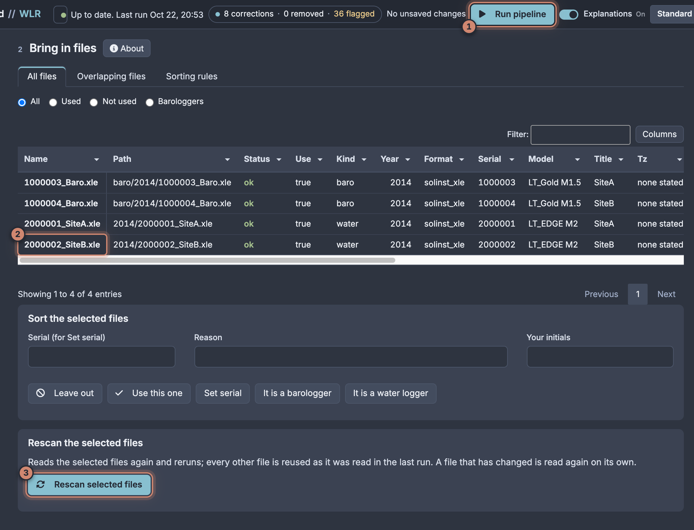</figure>

1. Copy the files into the year folder of a data folder (`2025/`, or `baro/2025/` for barologgers). U20 and U20L .hobo files are read as they are; for other HOBO models, export the CSV from HOBOware beside the .hobo.
2. Press **Run pipeline** (1).

**Result:** Only loggers whose files or set-up changed are read and drawn again; the rest are reused from the last run. A logger's downloads from several years are joined into one record, then split into deployments.

**Check:** **2 Bring in files** lists each file with its status. To read some files again without a full run, select them (2) and press **Rescan selected files** (3).

## 2. Leave out a file or say what logger it is

**When:** A file is a bad copy, has the wrong serial in it, or is a barologger outside a `baro/` folder (or the reverse).

<figure>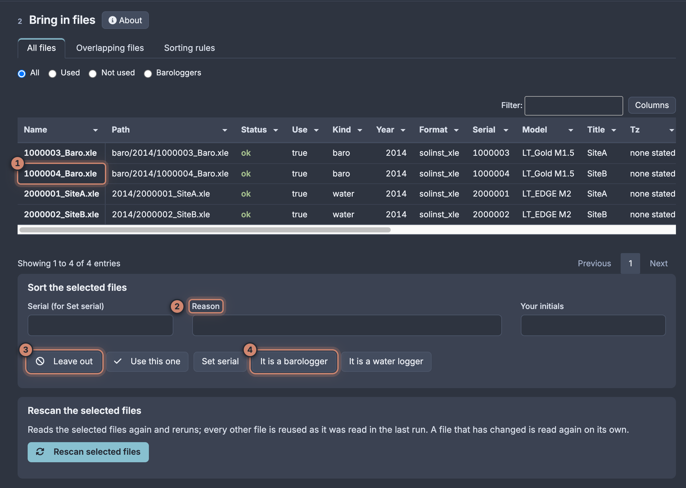</figure>

1. **2 Bring in files:** select the file (1).
2. Give a **Reason** and your initials (2).
3. Press **Leave out** (3), **Set serial** (with the serial typed beside it), or **It is a barologger** / **It is a water logger** (4).
4. Press **Run pipeline**.

**Result:** A sorting rule is added to the set-up tables and applied on every run. The raw file is not changed.

**Check:** The file's **Use** and **Kind** columns show the change, and the **Audit trail** gives the reason.

## 3. Give a logger a site, dates or a hang length

**When:** A logger has no site ("Unlisted" in the outputs), was moved, or the workbook is missing.

<figure>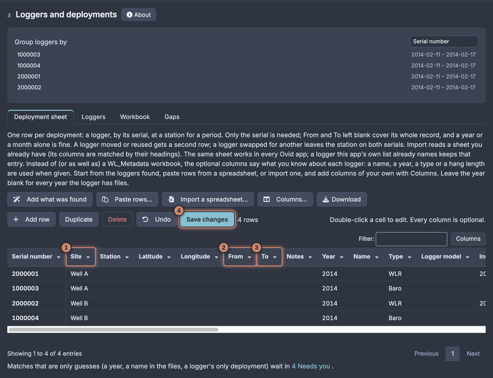</figure>

1. **3 Loggers and deployments:** double-click a cell of the logger's row to edit it. **Site** (1) is the one column most rows need.
2. **From** (2) and **To** (3) limit the row to a period; blank covers the logger's whole record, and a year or a month alone is fine. A logger moved to another site gets a second row.
3. **Hang length (cm)**, the T-coupler and casing columns and the others (scroll right) are used when given.
4. **Save changes** (4), then **Run pipeline**.

**Result:** The logger's records go to that site for that period. What you type here wins over the workbook, which wins over what the files say.

**Check:** **Deployment history** lists every deployment with its start, end and where each came from.

## 4. Accept suggestions and decide what the run found

**When:** After a run, when **Data check** in the side panel shows something to look at.

<figure>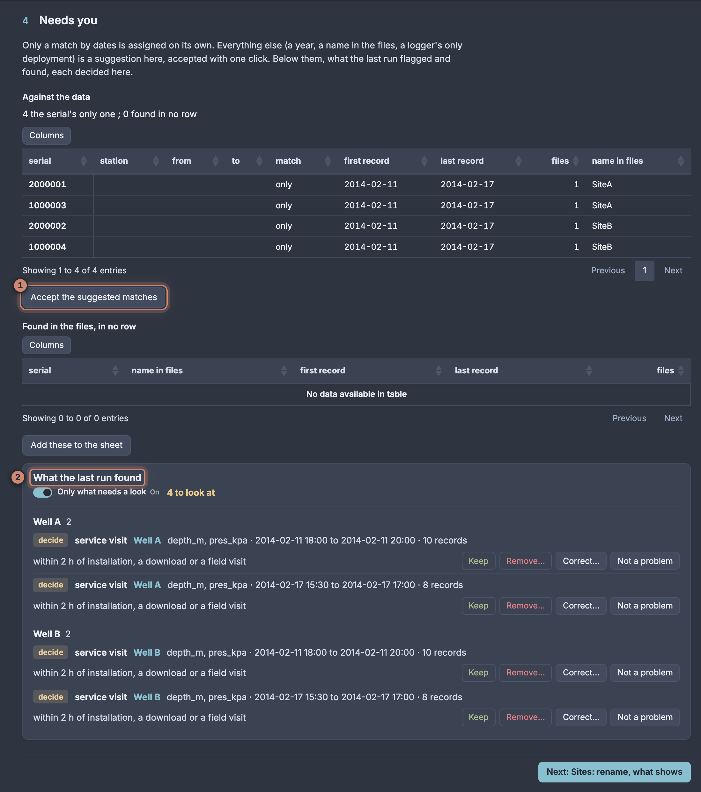</figure>

1. **4 Needs you:** **Accept the suggested matches** (1) of loggers to rows, made from a year, a name in the files or a logger's only deployment.
2. Under **What the last run found** (2), decide each line: **Keep**, **Remove…**, **Correct…** or **Not a problem**, or follow its link to the page that fixes it.
3. Each decision is saved as you make it (**Not a problem** asks why); the next run uses it.

**Result:** A kept flag stays in the data as a flag. A removal or correction becomes a row in Corrections over a period, noted "Needs you".

**Check:** The item leaves the list. Turn **Only what needs a look** off to see decided items with their decision.

## 5. Rename a site or hide it

**When:** A site was named wrongly, or a site should stay out of the overview pages.

<figure>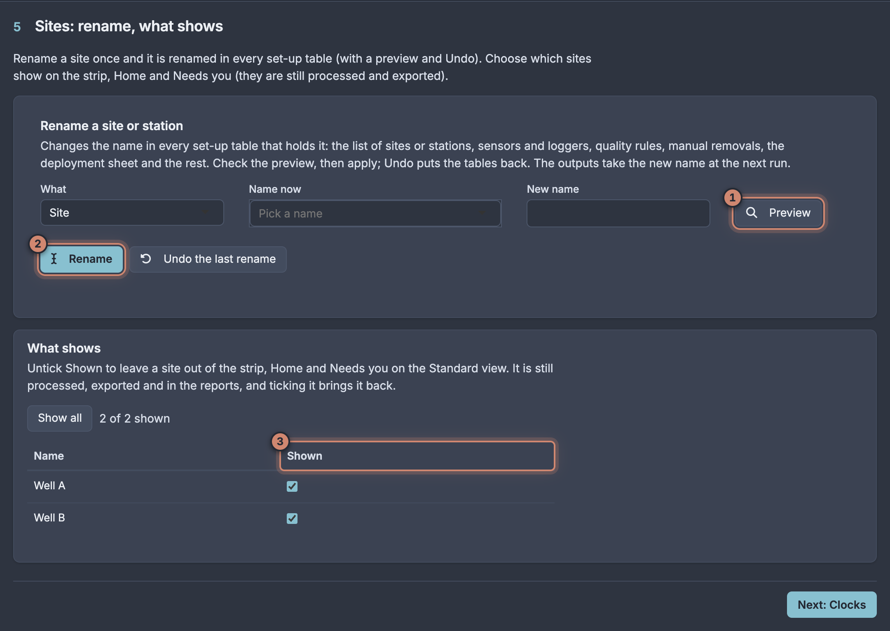</figure>

1. **5 Sites: rename, what shows:** pick the site, type the new name and press **Preview** (1), then **Rename** (2). Every set-up table that holds the name is changed; **Undo the last rename** puts them back.
2. Untick **Shown** (3) to leave a site out of the site strip, Overview and Needs you. It is still processed, exported and in the reports.

**Result:** The outputs take the new name at the next run.

## 6. Correct the workbook for one deployment

**When:** The WL_Metadata workbook has a wrong hang length, date or site for one logger, and the workbook itself should stay as it is.

<figure>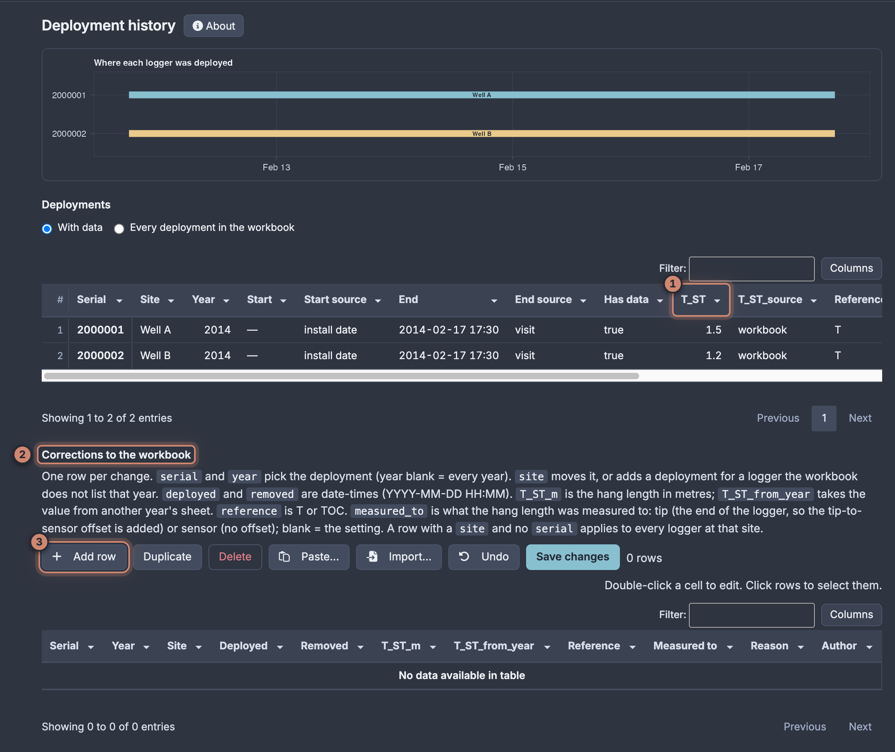</figure>

1. **Deployment history:** check the deployment's **T_ST** (1), its start and end, and where each value came from.
2. Under **Corrections to the workbook** (2), **Add row** (3): serial and year pick the deployment; fill in only what is wrong (site, deployed, removed, the hang length `T_ST_m` in metres, or `T_ST_from_year` to take another year's value), with a reason and your initials.
3. **Save changes**, then **Run pipeline**.

**Result:** The correction wins over the workbook for that deployment; the workbook is not changed.

**Check:** **Set-up check** (More) lists every deployment's hang length and its source.

## 7. Set the time zone of files that state none

**When:** Some files that state no time zone (Solinst files, or CSVs exported without one) were logged in a different zone from the one given at the first run.

<figure>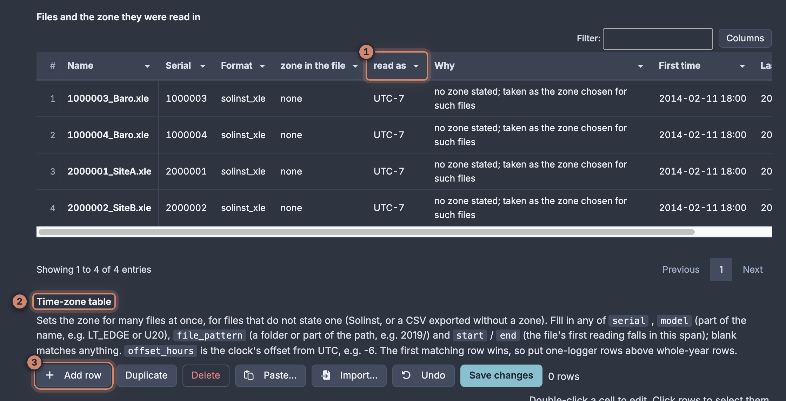</figure>

1. **Clocks:** **read as** (1) shows the zone each file was read in, and why.
2. In the **Time-zone table** (2), **Add row** (3) and fill in any of serial, model, file pattern (a folder such as `2019/`), and start and end; `offset_hours` is the clock's offset from UTC, e.g. −6.
3. **Save changes**, then **Run pipeline**. The first matching row wins, so put one-logger rows above whole-year rows.

**Result:** Those files are read in their own zone, then moved to the project's time zone (Settings) like every other record.

**Check:** The **read as** column shows the new zone, and the site plot has no whole-hour step at the download.

## 8. Fix a logger clock

**When:** A logger's clock was wrong by a known amount, or drifted and was found out at download.

<figure>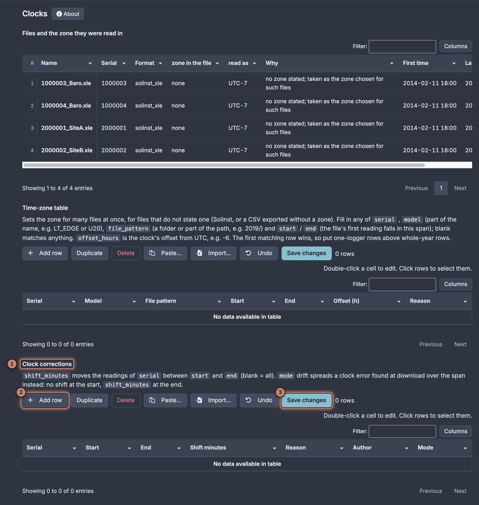</figure>

1. **Clocks:** under **Clock corrections** (1), **Add row** (2).
2. Fill in the serial, the start and end (blank = all of its record) and `shift_minutes`. With `mode` set to drift, the shift grows from none at the start to `shift_minutes` at the end.
3. **Save changes** (3), then **Run pipeline**.

**Result:** The readings are moved in time; each shifted record is in the audit trail.

**Check:** On the site plot, events and field visits line up with the logger's record again.

## 9. Choose the barologgers

**When:** A site has more than one barologger near it, a barologger failed, or the suggested one is not the best.

<figure>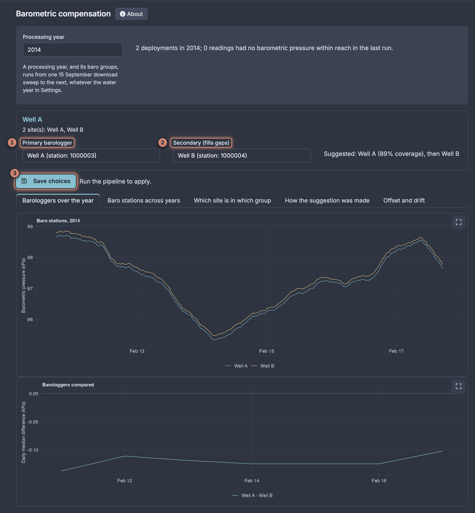</figure>

1. **Barometric compensation:** pick the **Processing year**, then for each group the **Primary barologger** (1) and a **Secondary** (2) that fills its gaps.
2. **Save choices** (3), then **Run pipeline**.

**Result:** Every water reading is compensated with the primary's air pressure at its time, or the secondary's where the primary has none; a fill-in from another barologger is shifted onto the primary's level and flagged.

**Check:** **Barologgers over the year** plots each candidate; **Offset and drift** shows how far they differ.

## 10. Enter a logger offset or a survey point

**When:** Hang lengths are measured to the logger's tip, or a site has a surveyed reference point, so depths can become water elevations.

<figure>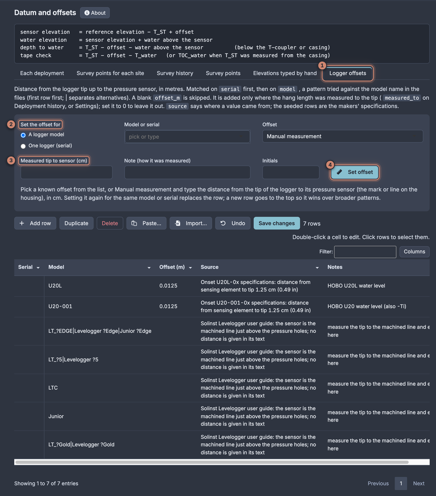</figure>

1. **Datum and offsets:** the formulas at the top show how each value is made from the hang length (T_ST), the offset and the reference elevation.
2. **Logger offsets** (1): **Set the offset for** a logger model or one logger (2), pick a known offset or **Manual measurement** and type the tip-to-sensor distance in cm (3), then **Set offset** (4).
3. For elevations: **Survey points for each site** links a site to a dGPS point (code T, TOC or GS); **Elevations typed by hand** takes a reference elevation surveyed another way. Record the vertical datum and geoid model with every elevation (the table has columns for them): elevations on different datums cannot be compared.
4. Press **Run pipeline**.

**Result:** Every deployment with a hang length gets depth to water below its reference point; those with a surveyed reference also get sensor and water elevations.

**Check:** **Deployment history** shows the offset used for each deployment and where it came from.

## 11. Enter tape checks and check drift

**When:** After each field visit with a tape reading of the water level.

<figure>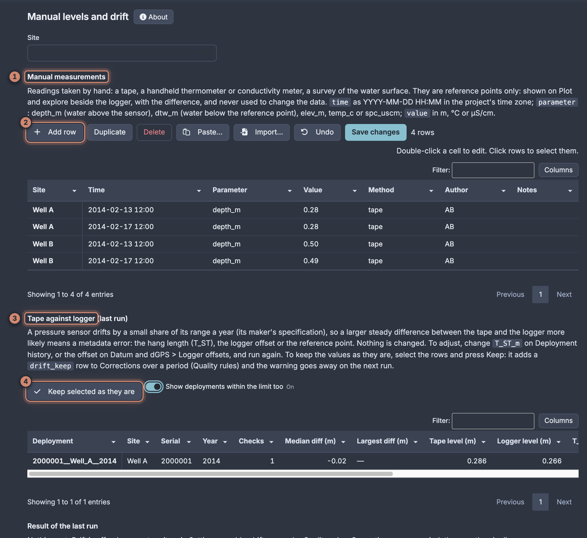</figure>

1. The tape reading at each download goes with the deployment: **T-coupler to water (cm)** (or casing to water) in the WL_Metadata workbook or on the deployment sheet (task 3).
2. Other readings by hand go on **Manual levels and drift**: under **Manual measurements** (1), **Add row** (2) with the site, time (YYYY-MM-DD HH:MM in the project's zone), parameter (`depth_m` water above the sensor, `dtw_m` depth to water, `elev_m` water elevation, `temp_c` or `spc_uscm`) and value, then **Save changes**. They show on the plots and on the site's **Manual vs logger** card, with the difference, and never change the data.
3. Press **Run pipeline**. **Tape against logger** (3) compares each visit's tape with the logger just before the visit.
4. A deployment with one check shows its median only. A difference beyond the limit (5 cm unless set in Settings) is more likely a metadata error than sensor drift: fix the hang length (task 6) or the offset (task 10). To keep the values as they are, select the rows and press **Keep selected as they are** (4).

**Result:** The readings by hand show beside the logger with their difference; the data are not changed. Drift correction from the tapes is off by default: switch it on in Settings to export corrected values beside the logger's own.

**Check:** After the run, look at the site's **Manual vs logger** card and the **Tape against logger** table.

## 12. Remove a stretch of data

**When:** The logger was out of the water, frozen, disturbed during a visit, or still settling after it went into the well. The automatic check flags readings within 2 h of installation, a download or a visit; remove those that are not water level, and anything else the check did not catch.

<figure>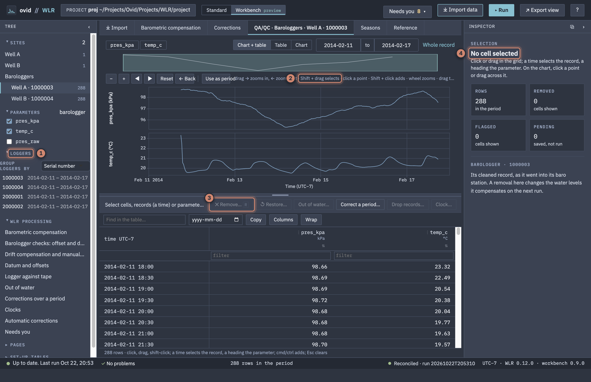</figure>

1. Switch to **Workbench** (top right). In the tree, pick the site, deployment or logger (1).
2. Shift + drag across the chart (2) to select the stretch; the inspector (4) shows its count, mean, minimum, maximum and how many are already removed or flagged.
3. Press **Remove…** (3) and give a reason and your initials. **Out of water…**, **Correct a period…** and **Drop records…** beside it work the same way.
4. Press **Run**.

**Result:** A row is added to Corrections over a period. The old values stay in the audit trail and raw files are never changed. **Restore** undoes it the same way.

**Check:** After the run, the stretch shows as removed on the plot (a faint line keeps the old values) and the **Audit trail** lists it.

## 13. Change a quality limit

**When:** A limit removes good readings, or lets bad ones through, for your loggers or sites.

<figure>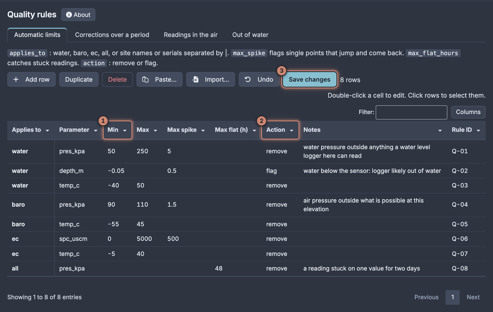</figure>

1. **Quality rules:** double-click a cell to change it: **Min** and **Max** (1), the largest single jump (max spike) or the longest flat stretch (max flat h).
2. **Action** (2): remove or flag. **Applies to** takes water, baro, ec, all, or site names or serials separated by |.
3. **Save changes** (3), then **Run pipeline**.

**Result:** The rule is applied to every reading it covers; each removal or flag carries the rule's ID.

**Check:** The **Audit trail** lists the rule's ID and how many values it removed or flagged.

**Note:** The seeded limits are ovid defaults with no published source (reference guide, section 13); check them against your loggers' specifications. The barometric range, 90 to 110 kPa, fits sites from sea level to about 1,000 m: widen Q-04 for higher sites, or good readings are removed.

## 14. Switch an automatic correction off

**When:** A correction the run makes on its own does not suit the project.

<figure>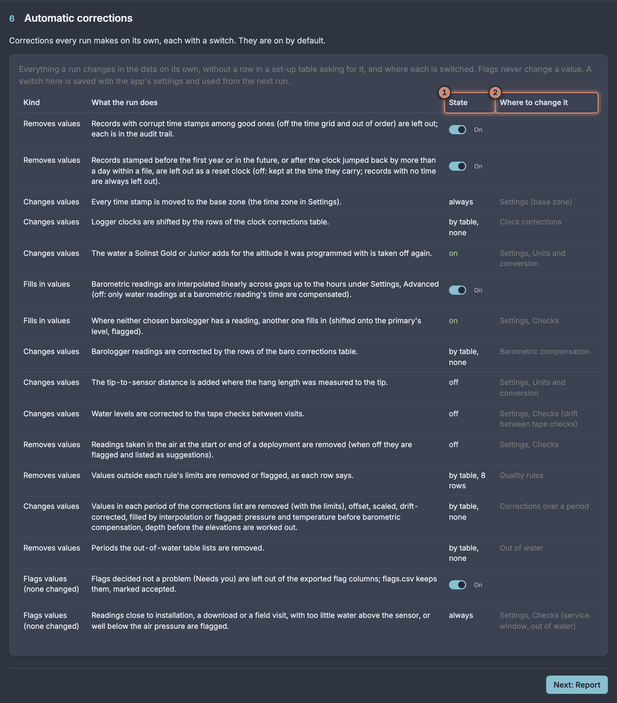</figure>

1. **6 Automatic corrections** lists everything a run changes on its own, with its **State** (1) and **Where to change it** (2).
2. Turn its switch off, or change the setting named in the last column, then **Run pipeline**.

**Result:** From the next run the correction is not made; flags never change a value either way.

**Check:** The **State** column shows the change; after the run, the **Audit trail** no longer lists that correction.

## 15. Look at a site over time

**When:** To look at a deployment in detail, compare its values, or save a figure or the data in view.

<figure>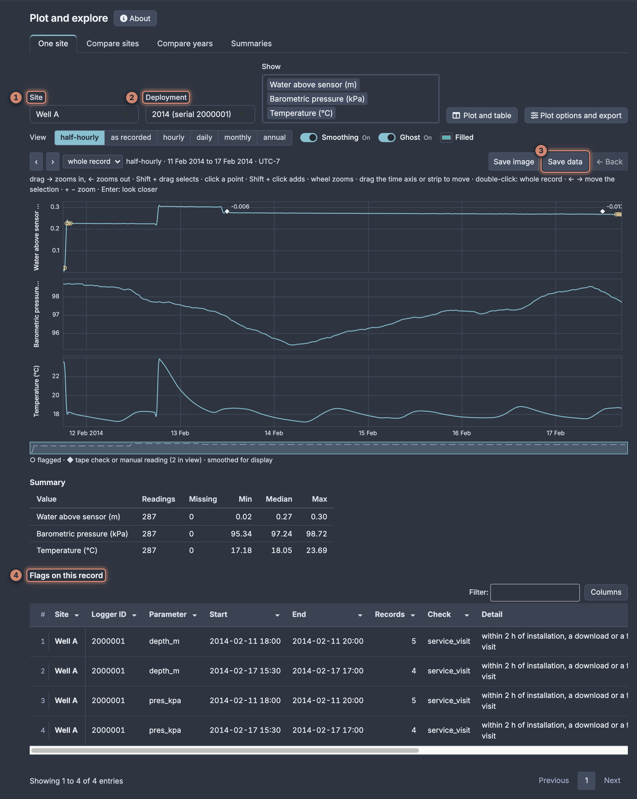</figure>

1. **Plot and explore** (More): pick the **Site** (1) and **Deployment** (2), and the values to show.
2. Drag left to right zooms in, right to left zooms out; Shift + drag selects a stretch; double-click shows the whole record. The line is smoothed for display (**Smoothing** in the plot options turns it off); **Save data** gives the readings themselves.
3. **Save image** or **Save data** (3) saves what is in view.
4. **Flags on this record** (4) lists every flag with its check and rule.

**Result:** Nothing changes in the project; the plot and the data saved are what is in view.

## 16. Find out why a value was removed

**When:** A value is missing from an export or a plot and you want to know why.

<figure>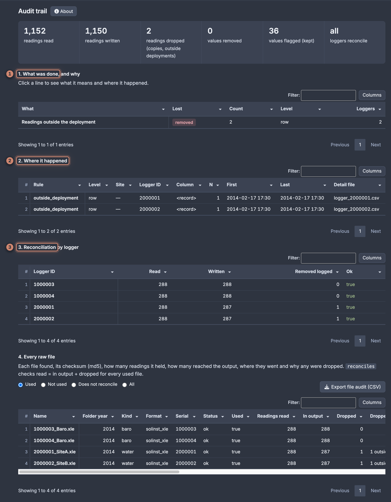</figure>

1. **Audit trail** (More): read it top down: what was done and why (1), where it happened (2), then each logger's reconciliation (3) and every raw file.
2. Click a line in (1) to see what it means and where it happened.

**Result:** Every reading read is either written or accounted for, logger by logger.

## 17. Run the set-up check

**When:** Before the first run, after changing the set-up, and before exporting.

<figure>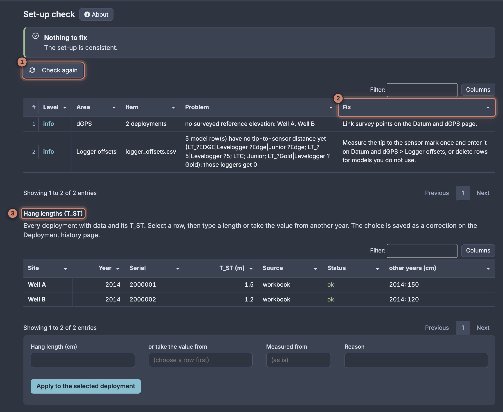</figure>

1. **Set-up check** (More) lists what is missing or inconsistent in the set-up, each with a **Fix** (2). Fix what is red first.
2. **Check again** (1) after a change.
3. **Hang lengths (T_ST)** (3): every deployment with data and its hang length; select a row and type a length or take another year's value.

**Result:** Nothing changes until you follow a fix and run again.

## 18. Export data and reports

**When:** To send data to someone, archive it, or build reports.

<figure>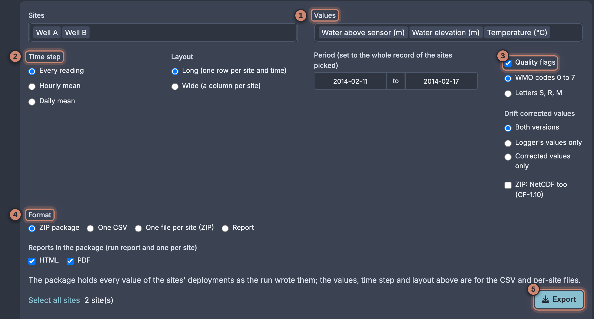</figure>

1. **7 Report:** pick the sites, the **Values** (1) and the **Time step** (2).
2. **Quality flags** (3): WMO codes 0 to 7, or letters S, R, M. Drift-corrected values can be included beside the logger's own.
3. **Format** (4): a ZIP package (NetCDF too if ticked), one CSV, one file per site, or the report alone. Reports in HTML, PDF or both.
4. **Export** (5).

**Result:** The package holds every value of the sites' deployments as the run wrote them, the manual measurements beside the logger, the reports and a README with the processing level of each file; it can be used without the app. Fill in the **Dataset** card in Settings first: it is written into every NetCDF file.

## 19. Back up or share the set-up

**When:** To keep a copy of the set-up, or start another project with it.

<figure>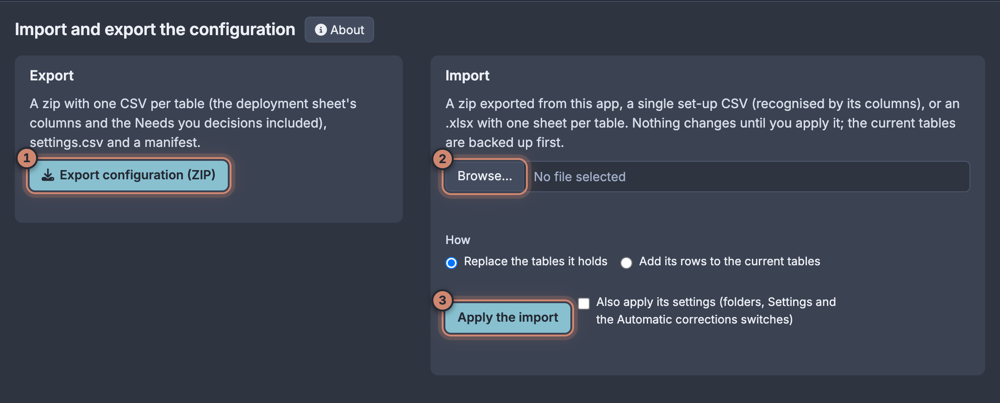</figure>

1. **Configuration** (More): **Export configuration (ZIP)** (1) writes every set-up table, the deployment sheet, the Needs you decisions and the settings.
2. In another project: **Browse…** for the zip (2), choose to replace the tables or add its rows, then **Apply the import** (3).

**Result:** The tables it replaces are kept in the project's history folder (config/history).

## 20. Report a problem

**When:** A page shows a notice with a reference, or something looks wrong.

<figure>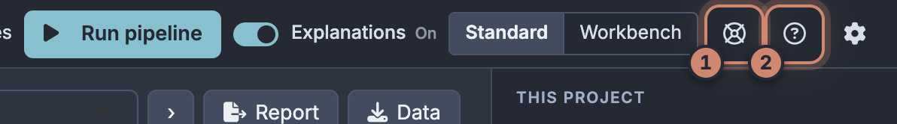</figure>

1. A notice with a reference (E- and six characters) means part of a page failed; the app carries on.
2. The lifebuoy button (1) builds a troubleshooting zip: versions, logs, problems and the set-up, no raw data. Send it with the reference.
3. The **?** button (2) opens the reference guide.

**Result:** The zip and the reference let a problem be traced without your raw data.
