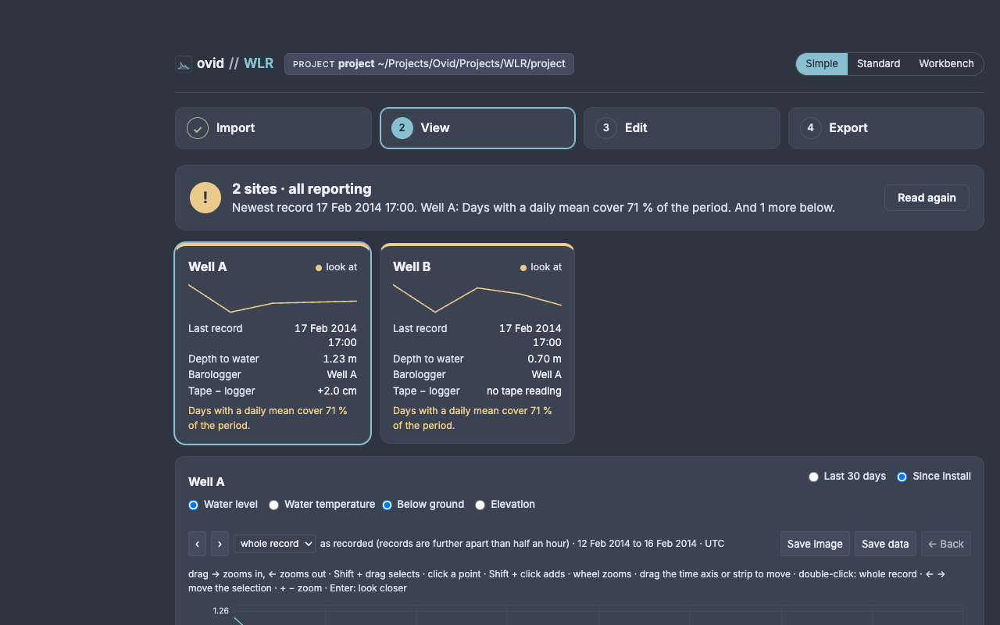
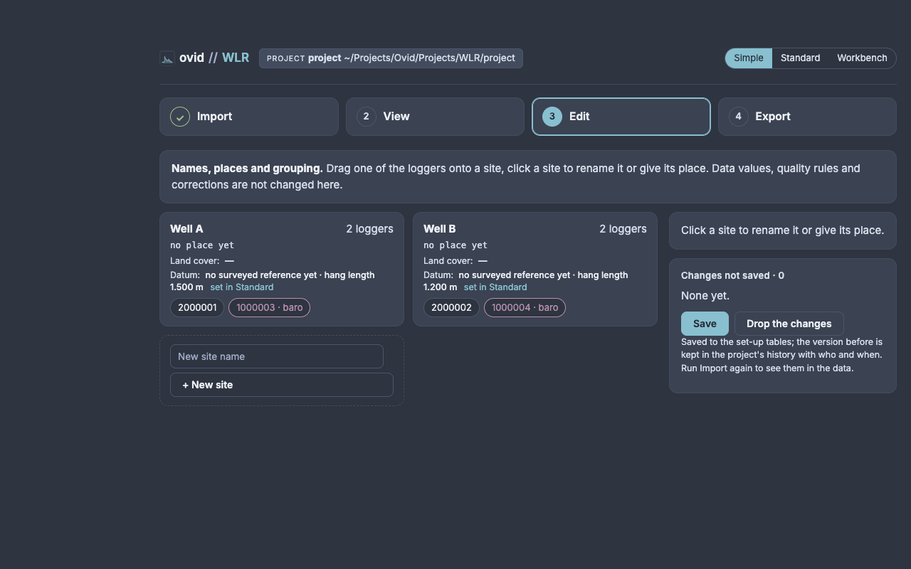
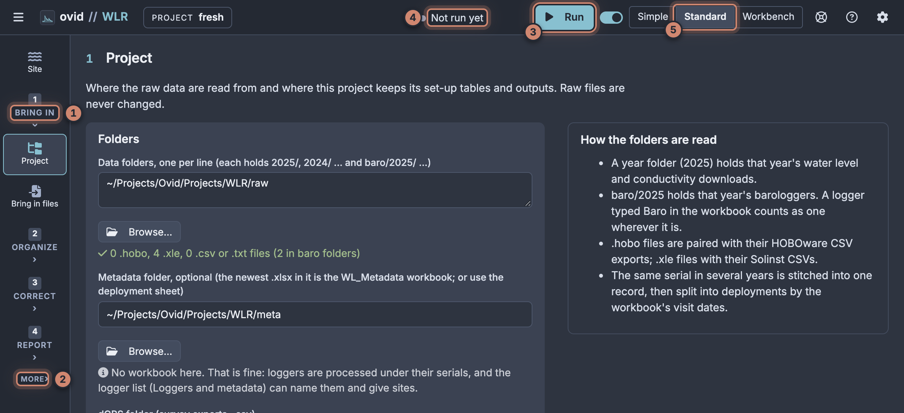
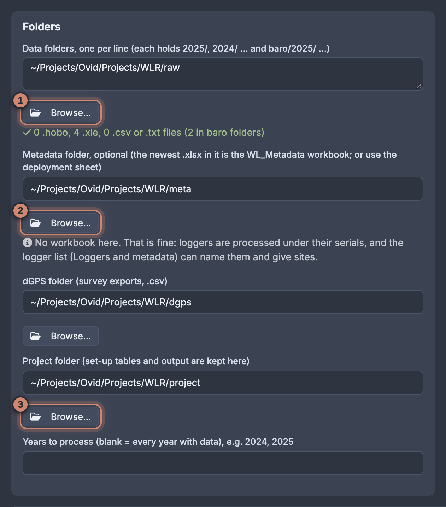
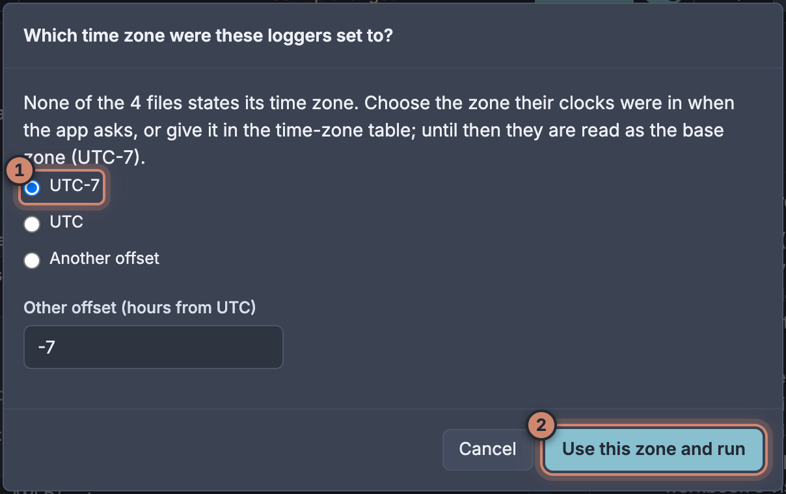
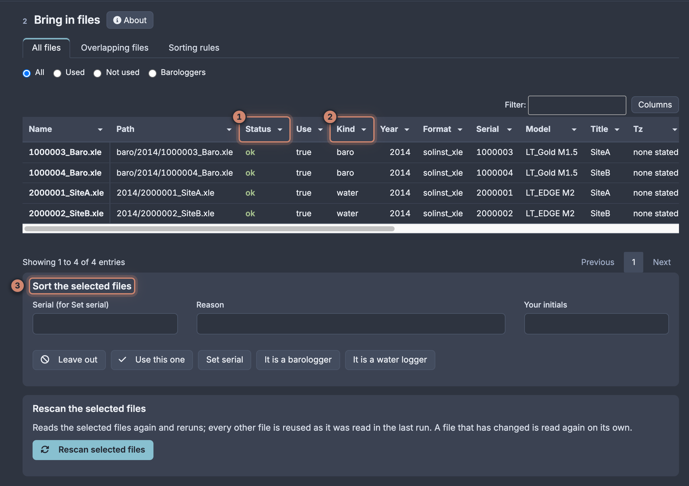
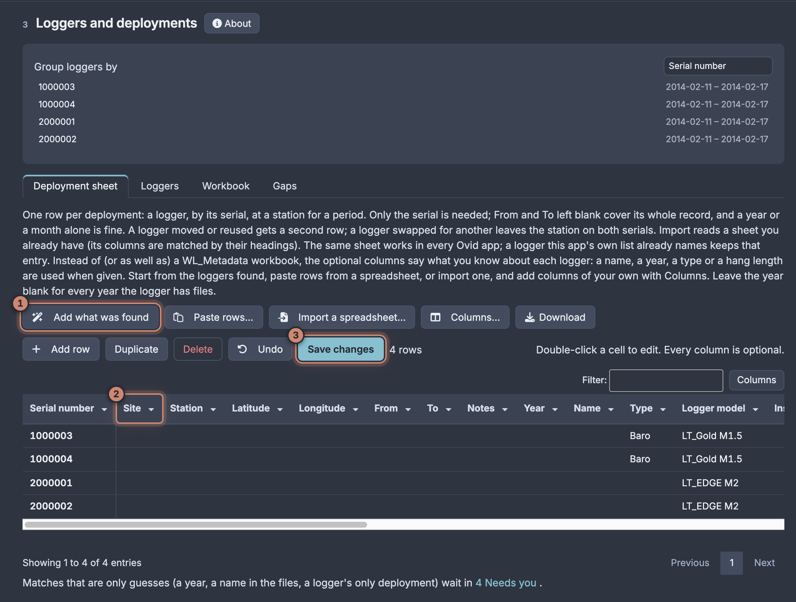
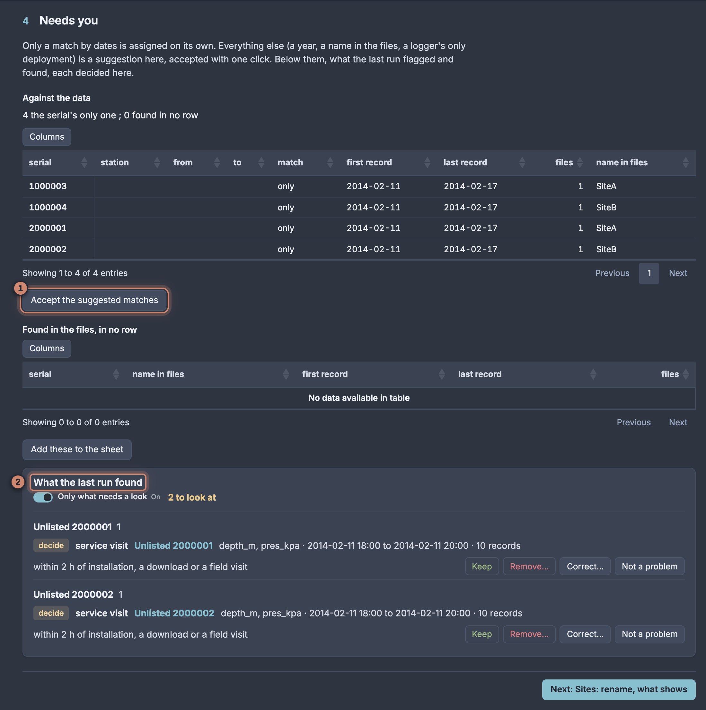
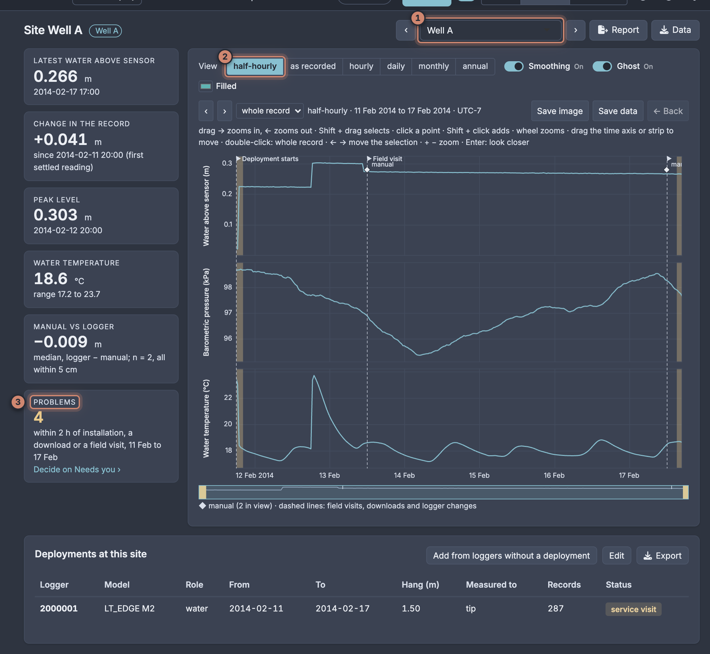
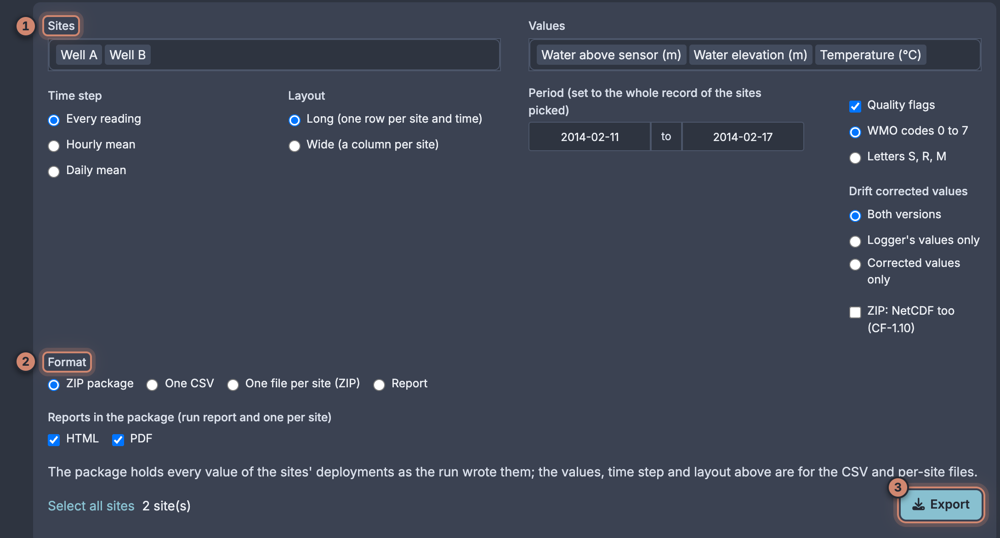

# ovid WLR quick start

Water level loggers (HOBO and Solinst), from raw downloads to water above the sensor, water elevation and checked records for each site.

## Before you start

- **Raw files.** Put each year's downloads in a year folder and the barologgers in `baro/<year>`: `raw/2025/…`, `raw/baro/2025/…`. U20 and U20L `.hobo` files and Solinst `.xle` files are read as they are; for other HOBO models, keep the HOBOware CSV export beside the `.hobo`. Raw files are never changed.
- **Optional.** The WL_Metadata workbook (sites, hang lengths, visit dates) in the project's `metadata/` folder, and dGPS survey exports in `dgps/`. Without a workbook WLR still runs: you give each logger a site on **3 Loggers and deployments**.
- **Optional.** The tape reading at each download (T-coupler to water) in the workbook or the deployment sheet; other readings by hand on **Manual levels and drift**.

Open the app with **Open WLR (Mac).command** (Windows: **Ovid_WLR.bat**). The orange numbers in each figure match the list under it. The figures use a constructed example, not field data: one week of a Levelogger and a Barologger from the app's test files (Well A), and a second well and barologger derived from them (Well B). Its values show what the pages do; they are not typical of a field site.

## The Simple view

For someone new to the data, or a field check: four steps in one column, and nothing that changes a data value. A new install opens in Simple; the switch at the top (**Simple**, **Standard**, **Workbench**) moves between the three views of the same project, as does ?ui=simple, ?ui=standard or ?ui=workbench in the address.

<figure></figure>

- **Import**: the logger folders, the field sheet folder and the project folder, then **Read the data**. The first read asks the time zone of files that state none, as on the first run below. A summary says what was read and what to check.
- **View**: one tile per site (last record, depth to water, its barologger, tape − logger; amber or red when it needs a look, with a link to the Standard page that fixes it) and a plot of water level, water temperature, depth below the ground or elevation.
- **Edit**: rename a site, give it a place or a land cover, or drag a logger onto another site. The datum and hang length are shown, not edited: **set in Standard** opens **Datum and offsets**. Changes wait in a list until **Save**, with **Undo** and a change log. Data values, quality rules and corrections are not changed here.
- **Export**: the field check report (one page, HTML) and the daily water levels (one CSV per site, with a README) or the plots, each as a .zip.

<figure></figure>

## The top bar and the pages

<figure></figure>

1. The pages, in working order: **1 Bring in**, **2 Organize**, **3 Correct**, **4 Report**. Each opens a numbered list of steps.
2. **More**: Overview, Plot and explore, Hydrology and uncertainty, Audit trail, Set-up check, Configuration, Convert and Reference.
3. **Run**: reads the raw files and rebuilds every output.
4. The run state: up to date, or set-up changed and waiting for a run; the counts of corrections, removed and flagged values; unsaved changes.
5. **Standard** is the step-by-step view used here; **Simple** is the field check above; **Workbench** shows the same project as a chart over a grid of every value, and is where values are changed by hand.

## 1 Project

<figure></figure>

1. **Data folders**, one per line, each holding the year folders. The line under it counts the files found.
2. **Metadata folder** (optional): the newest .xlsx in it is read as the WL_Metadata workbook.
3. **Project folder**: where the set-up tables (config/) and outputs (output/) are kept. With none set it is ~/Projects/Ovid/Projects/WLR/project.

**Browse…** picks a folder instead of typing it. The dGPS folder and the years to process are below; leave the years blank to process every year with data.

## The first run

<figure></figure>

Press **Run**. Solinst files and CSVs exported without a zone do not say which time zone their clock was in, so the first run asks:

1. Pick the zone the loggers were set to (the project's time zone is offered first).
2. **Use this zone and run**.

The answer is kept for every later run. Files of another zone get a row in the time-zone table on **Clocks** (how-to task 7).

## 2 Bring in files

<figure></figure>

1. **Status**: ok, or why a file was not used: a duplicate copy, an empty file, a .hobo without its CSV export, a format WLR does not read, or left out by you.
2. **Kind**: water or baro. A file in a `baro/` folder, or typed Baro in the workbook, is a barologger.
3. **Sort the selected files**: leave a file out, set its serial, or say what kind of logger it is (how-to task 2).

## 3 Loggers and deployments

<figure></figure>

1. **Add what was found** puts a row in the deployment sheet for each logger in the files.
2. **Site**: type the site of each logger. From and To left blank cover the logger's whole record; Hang length, Type and the other columns are used when given.
3. **Save changes**, then **Run**.

With a WL_Metadata workbook the sheet only needs the rows the workbook gets wrong or leaves out.

## 4 Needs you

<figure></figure>

1. **Accept the suggested matches**: loggers matched to a row by a year, a name in the files or their only deployment are suggestions until accepted. A match by dates is assigned on its own.
2. **What the last run found**: decide each finding (Keep, Remove…, Correct… or Not a problem), or follow its link to the page that fixes it. Each decision is saved as you make it; the next run uses it.

## Look at each site

<figure></figure>

1. Pick the site; ‹ and › step through them.
2. The time step of the plot: half-hourly, as recorded, hourly, daily, monthly or annual. Drag left to right zooms in, right to left zooms out; Shift + drag selects a stretch.
3. **Problems**: what the checks flagged at this site. **Decide on Needs you** opens the list.

The cards on the left give the latest water above the sensor, its change, the peak, the water temperature and how the readings by hand compare with the logger.

- **Change** covers the last 60 days, or the whole record when it is shorter. It starts from the first settled reading: the first 2 hours after a logger goes into the well are left out.
- **Peak** uses every reading kept. Readings within 2 h of installation or a download are flagged (**Problems**); remove any that are not water level (how-to task 12).
- **Manual vs logger** is the median difference, logger minus manual, with the number of readings compared.
- The plots are smoothed for display by default (a spline; **Smoothing** turns it off). The cards and every export use the readings themselves. **Precipitation** appears when a precipitation file is set on **1 Project**.
- Depths use a fixed water density of 1,000 kg/m³ and standard gravity unless they are changed in Settings.

## 3 Correct

Each page under **3 Correct** fixes one thing. Most projects need the first three.

- **Barometric compensation**: one primary barologger per group and year, a secondary to fill gaps (how-to task 9).
- **Datum and offsets**: logger offsets and survey points, so depths become water elevations (task 10). A wrong hang length is corrected on **Deployment history**, under 2 Organize (task 6).
- **Manual levels and drift**: readings by hand and the tape check at each visit (task 11).
- **Clocks**, **Quality rules** and **Automatic corrections**: time zones and clock errors (tasks 7 and 8), limits, and the corrections every run makes on its own.

Tables that change data values (quality rules, out of water, clock corrections, barologger checks and corrections over a period) are shown in Standard and edited by hand only in the **Workbench**.

Run again after a change; only what changed is rebuilt.

## 7 Report

<figure></figure>

1. **Sites**: pick the sites to export.
2. **Format**: a ZIP package, one CSV, one file per site, or the report alone.
3. **Export**.

The package holds every value of the sites' deployments with flag columns, the reports (HTML, PDF or both) and a README with the processing level of each file.

For each task in more detail, see the WLR how-to guide; for what WLR does to the data and why, see the WLR reference guide.
