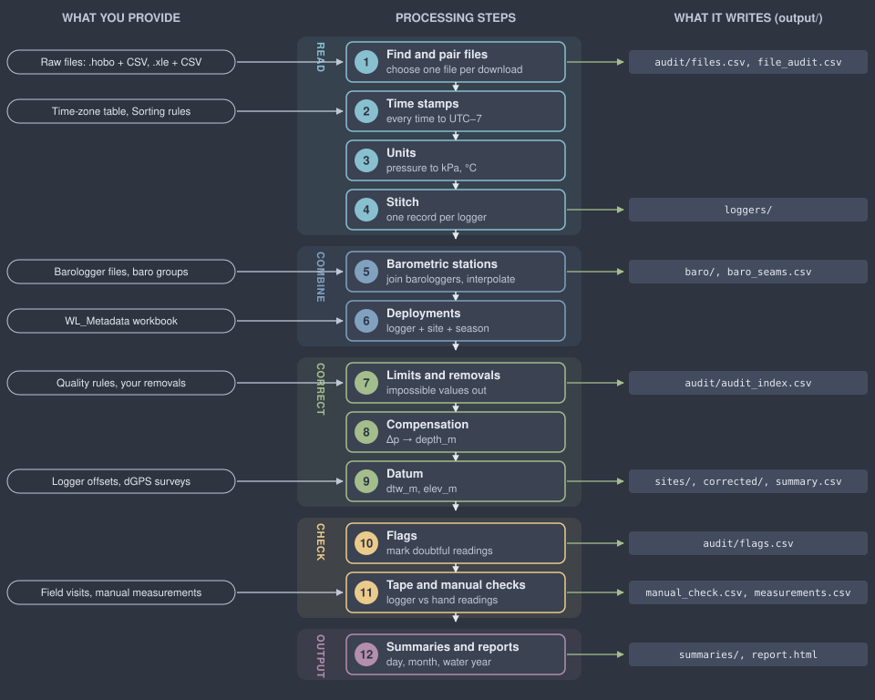
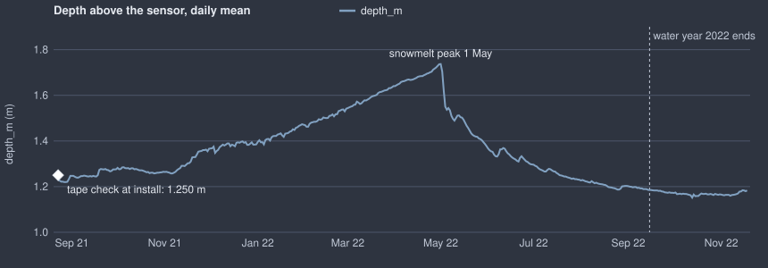
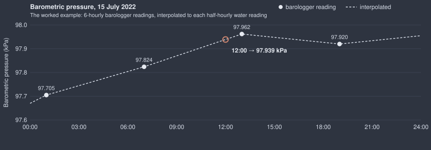
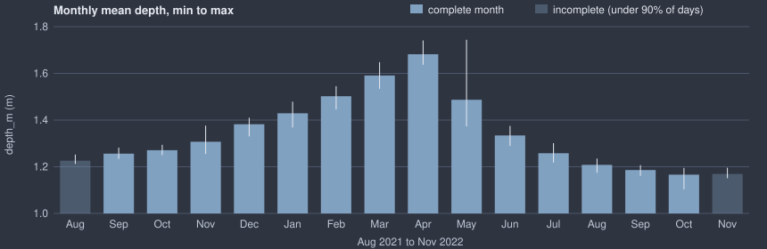

# ovid WLR Reference Guide

Water level loggers: what the app does to every reading, why, and how to check it. For WLR 0.12.0 (ovid Core 1.15.0). Settings are quoted with their defaults; change them in the app or in `wlr_pipeline.R`.

## Quick start

1.  Put raw files in year folders: `data/2025/…` for water loggers, `data/baro/2025/…` for barologgers. Keep both the `.hobo` and its HOBOware CSV export, or the `.xle` and its Solinst CSV.
2.  Put the newest WL_Metadata workbook in `metadata/` and dGPS exports in `dgps/`. Without a workbook the run still completes, but WLR cannot build deployments except those you set by hand on Deployment history.
3.  Open the app (`Open WLR (Mac).command`, `Ovid_WLR.bat` on Windows, or `shiny::runApp()`) and choose the project folder with **Browse…** (where `config/` and `output/` will live).
4.  Run the **Set-up check**. Fix anything it lists in red first.
5.  Press **Run**. The first run writes the set-up tables and suggests barometric groups.
6.  Check the **Barometric** page: one primary barologger per group and year, a secondary if you have one.
7.  Check **Deployment history**: every logger has a site and dates. Give unlisted loggers a site.
8.  Enter logger offsets and survey points on the **Datum** page.
9.  Run again. Read the **Problems** list and the **Quality rules** suggestions (readings in the air).
10. Look at each site in **Explore**, then export data and reports (HTML, PDF or both) from **Reports and export**.

After a change to one raw file, use **Rescan** on the Raw files page instead of a full run: only what changed is rebuilt. With `incremental = TRUE` each file is kept as read (by its MD5) and each deployment plot (by its data) in `<project>/cache/`, so a rerun reads and draws only what changed; a code update makes the next run a full one, and deleting `cache/` does the same.

## What happens to the data, in order

| \#  | Step                       | What changes                                                                | Logged in                                          |
|-----|----------------------------|-----------------------------------------------------------------------------|----------------------------------------------------|
| 1   | Find and pair files        | Chooses which file is read for each logger download; duplicates are skipped | `audit/files.csv`, `audit/file_audit.csv`          |
| 2   | Time stamps                | Every time is moved to UTC−7                                                | `audit/files.csv` (zone used)                      |
| 3   | Units                      | Pressure to kPa, temperature to °C                                          | column `unit_pres`                                 |
| 4   | Stitch                     | One continuous record per logger; overlapping downloads de-duplicated       | `loggers/`, audit trail                            |
| 5   | Barometric                 | Barologgers cleaned and joined into stations                                | `baro/`, `audit/baro_seams.csv`                    |
| 6   | Deployments                | Records outside a deployment are left out                                   | Problems list, audit trail                         |
| 7   | Limits and manual removals | Impossible values removed; your removals applied                            | `audit/audit_index.csv`                            |
| 8   | Compensation               | Adds `baro_kpa`, `dp_kpa`, `depth_m`                                        | columns `baro_source`, `baro_name`, `baro_shift`   |
| 9   | Datum                      | Adds `dtw_m` and `elev_m`                                                   | `audit/summary.csv` (T_ST, z_ref, offset)          |
| 10  | Flags                      | Marks doubtful readings without changing them                               | columns `flag_*`, `audit/flags.csv`                |
| 11  | Checks                     | Compares logger with tape and manual measurements (never changes data)      | `audit/manual_check.csv`, `audit/measurements.csv` |
| 12  | Summaries                  | Daily, monthly and water-year values                                        | `summaries/`                                       |

Every record read is accounted for: **records read = records in the output + records dropped**, per logger. The run stops if that does not hold.

## The pipeline at a glance

Five stages, twelve steps. Inputs on the left enter at the step that uses them; files on the right are written at the step that makes them. Every step passes the full record down; nothing is dropped without an entry in the audit files.

## One reading through the pipeline

A real reading from one of your fen wells (a HOBO U20-001-04, 30-minute logging), followed from the raw file to the outputs. Site and logger names are left out.

### In the raw file

"#","Date Time, GMT-07:00","Abs Pres, kPa (…)","Temp, °C (…)" 15639,07/15/22 12:00:00 PM,110.346,2.195

| Step           | What happens to this reading                                                                                             | Value after the step                     |
|----------------|--------------------------------------------------------------------------------------------------------------------------|------------------------------------------|
| 1 Files        | The .hobo has a HOBOware CSV export (paired_hobo), so the CSV is read; MD5 recorded                                      | row 15639 of the CSV                     |
| 2 Time         | The header states GMT−07:00, the same as the base zone: no shift                                                         | 2022-07-15 12:00:00                      |
| 3 Units        | Already kPa: factor 1                                                                                                    | pres_kpa = 110.346, temp_c = 2.195       |
| 4 Stitch       | Joined with the logger's other downloads; this time stamp appears once                                                   | unchanged                                |
| 5 Baro         | The group's primary station logs every 6 h: 97.824 kPa at 07:00, 97.962 kPa at 13:00. Interpolated: 97.824 + 0.138 × 5/6 | baro_kpa = 97.939, baro_source = primary |
| 6 Deployment   | Inside the 2022 season (16 Sept 2021 to 15 Sept 2022) for this site                                                      | kept                                     |
| 7 Limits       | 110.346 is inside 50–250 kPa; temperature inside −40 to 50 °C; no spike, not flat                                        | kept                                     |
| 8 Compensation | Δp = 110.346 − 97.939 = 12.407 kPa; depth = 12.407 / 9.80665                                                             | dp_kpa = 12.407, depth_m = 1.2652        |
| 9 Datum        | T_ST = 1.620 m (workbook), offset 0; no dGPS survey for this well, so no elevation. dtw = 1.620 − 0 − 1.2652             | dtw_m = 0.3548, elev_m blank             |
| 10 Flags       | Not near a visit, not frozen, more than 0.02 m of water, primary baro                                                    | no flag                                  |
| 11 Checks      | No visit or manual measurement that day                                                                                  | —                                        |
| 12 Summaries   | One of 48 readings that day (needs 39); day mean 1.266 m. Part of July 2022 and water year 2022                          | see below                                |

### What the outputs look like

**sites/\<deployment\>.csv** (the corrected record; some columns left out):

| TIMESTAMP           | unit_pres | pres_raw | pres_kpa | temp_c | baro_kpa | baro_source | dp_kpa  | depth_m | dtw_m  | elev_m | flag_depth_m |
|---------------------|-----------|----------|----------|--------|----------|-------------|---------|---------|--------|--------|--------------|
| 2022-07-15 12:00:00 | kPa       | 110.346  | 110.346  | 2.195  | 97.9390  | primary     | 12.4070 | 1.2652  | 0.3548 |        |              |
| 2022-07-15 12:30:00 | kPa       | 110.346  | 110.346  | 2.195  | 97.9505  | primary     | 12.3955 | 1.2640  | 0.3560 |        |              |

**audit/flags.csv** (a flag from the same logger, at the visit when it was installed):

| parameter | start            | end              | records | check         | detail                                  |
|-----------|------------------|------------------|---------|---------------|-----------------------------------------|
| depth_m   | 2021-08-23 17:00 | 2021-08-23 17:00 | 1       | service_visit | within 2 h of a download or field visit |

**audit/file_audit.csv** (this raw file): status ok, readings read 21,687, in output 21,687, dropped 0, reconciles TRUE.

**summaries/monthly.csv**:

| parameter | year | month | mean  | min   | max   | days | days_in_month | complete |
|-----------|------|-------|-------|-------|-------|------|---------------|----------|
| depth_m   | 2022 | 7     | 1.258 | 1.218 | 1.301 | 31   | 31            | TRUE     |

**summaries/water_year.csv**:

| parameter | water_year | mean  | min   | date_min   | max   | date_max   | range | days | complete |
|-----------|------------|-------|-------|------------|-------|------------|-------|------|----------|
| depth_m   | 2021       | 1.238 | 1.212 | 2021-08-28 | 1.256 | 2021-09-15 | 0.044 | 23   | FALSE    |
| depth_m   | 2022       | 1.389 | 1.174 | 2022-08-25 | 1.744 | 2022-05-01 | 0.570 | 365  | TRUE     |

Water year 2021 is incomplete because the logger went in on 23 August 2021, 23 days before the season ended. The 2022 maximum on 1 May is the snowmelt peak.

### What the plots look like

The same well's outputs drawn as the app shows them on Explore and in the site report.

The water level rises through the winter while the logger stays above freezing, peaks with snowmelt on 1 May, and falls through the summer. The white diamond is the tape check at installation; the logger agrees with it.

The barologger here records every 6 hours (black dots). For each 30-minute water reading the app draws a straight line between the two nearest readings (dashed). At 12:00 that gives 97.939 kPa, the value used in the trace above.

August 2021 (8 days) and November 2022 (17 days) are pale because they hold under 90% of their days. The bars show each month's mean and the whiskers its lowest and highest daily mean.

## 1. Finding and pairing files

The app reads every file under the raw folders and records its size, checksum (MD5), serial, model, units and stated time zone.

| Status                    | Meaning                                                                     | Read?           |
|---------------------------|-----------------------------------------------------------------------------|-----------------|
| ok                        | A file that will be read                                                    | yes             |
| paired_hobo               | A `.hobo` with a HOBOware CSV export of the same download. The CSV is read. | no              |
| companion_csv             | A Solinst CSV beside its `.xle` (or the reverse)                            | one of the pair |
| hobo_without_csv          | A `.hobo` with no CSV export. Export it from HOBOware (Bulk Export in HOBOware Pro for many files). | no              |
| temperature_logger        | A HOBO with temperature but no pressure or conductivity channel (its CSV, the `.hobo` beside it, or a temperature-only model such as the U12). Read by ovid GT, not WLR. | no              |
| duplicate_file            | Byte-identical to another file (same MD5)                                   | no              |
| unreadable / no_data_rows | Could not be parsed, or holds a header only                                 | no              |

The `.hobo` file itself only gives the logger's identity; HOBOware cannot be read directly: for many files at once use **Bulk Export** in HOBOware Pro, which writes a CSV beside each `.hobo`. Older Levelogger software writes `.xle` files in Latin-1 (a degree sign in the units) without saying so; the app reads them again as Latin-1 instead of failing.

Override any decision on the Raw files page (Sorting rules): ignore a file, set its serial, its zone, or whether it is water or baro.

**Serial numbers** are normalised so the same logger matches everywhere: leading zeros are dropped and a typed prefix is reduced to the logger's own serial (for example `0012345678` → `12345678`).

## 2. Time stamps and time zones

All times are stored at **UTC−7** (setting `base_offset_h = -7`), with no daylight saving.

t_out = t_file − (offset_file − offset_base) hours

**Example.** A HOBO CSV header says `GMT-06:00`. A reading at `2025-06-01 12:00` becomes 12:00 − (−6 − (−7)) h = **11:00** at UTC−7.

Which zone is used for a file, first match wins:

1.  A Sorting rule you set for that file (`tz` action)
2.  A zone stated in the file (HOBO header, Solinst header)
3.  The time-zone table `config/timezones.csv` (by serial, model, file name or folder, and date span)
4.  Otherwise the base zone, UTC−7

Date formats from HOBOware (US and ISO) and Solinst are recognised; the zone text can be `GMT-07:00`, `UTC-6` or a name like *Mountain Daylight Time* (−6).

Time stamps before `min_year` (2000) or in the future are a reset clock and are left out. A record with a corrupt time stamp among good ones, both off the time grid and out of the order its file was written in, is left out too (`stray_record`, setting `drop_stray_records = TRUE`, shared core `timestamps.R`); a record written in order but off the grid is kept.

Dates in the set-up tables (manual removals, out-of-water periods, clock corrections, deployment changes) can be a date alone, a date and time, or M/D/YYYY as Excel saves it. An end date with no time covers that whole day.

### Standardising to UTC−6, and files that state no zone (added October 2026)

Every record is stored in the base zone, UTC−7 by default (Settings, *Base time zone*). Set it to −6 to standardise all records
to UTC−6; nothing else changes by default. A file that states its zone is converted from that zone. A file that states none is
read in the zone set under *Zone of files that state none*; left blank, it is read in the base zone, as before. If no file in
a run states its zone and none has been chosen, the app asks which zone the loggers' clocks were in before running (a script
carries on in the base zone and lists it in the problems). The time-zone table and a zone set by hand still win.

## 3. Units to kPa and °C

p_kPa = p_raw × factor(unit) T\_°C = (T\_°F − 32) × 5/9

| Unit              | kPa per unit                          | Unit           | kPa per unit                 |
|-------------------|---------------------------------------|----------------|------------------------------|
| kPa               | 1                                     | psi            | 6.894757                     |
| mbar, hPa         | 0.1                                   | bar            | 100                          |
| inHg              | 3.386389                              | mmHg           | 0.133322                     |
| m (Solinst LEVEL) | 9.80665 (setting `solinst_kpa_per_m`) | cm, mm, ft, in | derived from the metre value |

**Examples.** 14.500 psi × 6.894757 = **99.974 kPa**. A Solinst LEVEL of 10.250 m × 9.80665 = **100.518 kPa**.

Solinst loggers report pressure as metres of water. Converting back to kPa lets them be compensated the same way as HOBO loggers. If your Solinst software used a different conversion, set `solinst_kpa_per_m` to match. A Solinst Barologger writes air pressure as LEVEL less 9.5 m of water (it reads about 0.3 to 1 m), so when a barologger's readings are far below a whole atmosphere the app adds the 9.5 m back before converting: 0.700 m + 9.5 m = 10.200 m × 9.80665 = **100.028 kPa**.

### Solinst altitude setting

A Levelogger or Barologger **Gold** (and Junior) programmed with an altitude adds that altitude's air-pressure difference to every reading it stores: altitude / 826 m of water (Solinst), about 1.2 kPa per 100 m. Each `.xle` file states the altitude in its header (`<Altitude Val="269" Unit="m">`). By default WLR takes it off again, file by file, so every logger reads absolute pressure: p_kPa = (LEVEL − altitude / 826) × `solinst_kpa_per_m`. Levelogger Edge, 5 and 6 do not change their readings (Solinst applies altitude only afterwards, in its software), and their files carry no altitude. The setting `solinst_altitude` (Settings page) chooses **undo** (default) or **keep** (the readings as stored). Every file corrected is listed in `audit/solinst_altitude.csv`.

**Example.** Solinst_555 (Barologger Gold, altitude 269 m): 269 / 826 = 0.326 m of water = **3.19 kPa** taken off every reading. Before this step it read 3.24–3.36 kPa above Pluvio_loggerbox, a Barologger Gold programmed with altitude 0 at the same site, in every year 2014–2021.

## 4. Stitching each logger

All downloads of one serial are joined into one record, in time order. Where two downloads overlap, the same time stamp is kept once. Records are never interpolated or invented here.

Output: `output/loggers/logger_<serial>.csv`. Overlaps and gaps are listed per file in `audit/file_audit.csv`.

## 5. Barometric pressure

### Barologger limits

Barologger pressure outside **90–110 kPa** is removed (impossible at this elevation), and a jump of more than 1.5 kPa that comes straight back is flagged as a spike.

### Stations: joining barologgers over the years

A station is one place with a barometric record. When its barologger is replaced, the serials are joined into one series; where two overlap, the one installed later wins. Each change is a **seam**, reported with the median difference over the overlap. A seam over 0.3 kPa is listed as a problem.

### Barologger offset and drift check

On the Barometric page (*Offset and drift*), any barologger station or serial can be checked against any other (`config/baro_corrections.csv`: barologger, reference, method check / offset / offset_drift, optional from / to, apply yes / no). The check uses hourly paired differences d = p_baro − p_ref, their daily medians, the median and Hodges–Lehmann estimates of the offset, the Theil–Sen slope for the drift (fit a + b (t − t_mid)), the Mann–Kendall test with the Hamed–Rao correction for autocorrelation, and 95 % intervals from a moving-block bootstrap (30-day blocks, 1000 resamples, fixed seed). An offset counts when it is at least 0.1 kPa and its interval excludes zero; a drift when p < 0.05, its interval excludes zero and it adds up to at least 0.1 kPa over the record. Nothing is changed unless `apply` is yes; then the barologger's readings become p − a (offset) or p − (a + b (t − t_mid)) (offset_drift). Each check writes `output/reports/baro_check_<barologger>_vs_<reference>.html` with the question, the data, the equations, the results, plots, the decision and the exact R code used; all results are in `audit/baro_checks.csv`.

### Interpolating to the water logger's times

Barologgers and water loggers rarely record at the same moment, so the barometric value is interpolated in a straight line between the two nearest readings, across gaps up to `baro_max_gap_h = 3` hours (or 1.5 × the logging interval, if longer).

p_baro(t) = p₁ + (p₂ − p₁) × (t − t₁) / (t₂ − t₁)

**Example.** Baro 97.60 kPa at 10:00 and 97.80 kPa at 11:00. A water reading at 10:30 gets 97.60 + 0.20 × 30/60 = **97.70 kPa**.

### Primary, secondary and fill-in

Each group of sites has a primary barologger per season and optionally a secondary. For every water reading the app tries, in order: the primary; the secondary; then (with `baro_fill = TRUE`) any other barologger, **shifted onto the primary's level** so a barologger at a different elevation does not put a step into the water level:

shift = median( p_primary − p_fill ) over the times both have readings p_baro = p_fill + shift

**Example.** Over their overlap the fill-in station reads a median 1.25 kPa above the primary, so shift = −1.25 kPa. A fill-in reading of 99.05 kPa is used as **97.80 kPa**. The column `baro_shift` records −1.25 and `baro_source` says `fill`.

Columns: `baro_kpa`, `baro_source` (primary, secondary, fill or blank), `baro_name`, `baro_serial`, `baro_shift`.

## 6. Deployments and seasons

Deployments come from the WL_Metadata workbook: one sheet per year, one row per logger and site. A year runs from the previous mid-September download sweep to its own:

season = calendar year + 1 if the time is after 15 Sept 12:00 of that year season = calendar year otherwise

**Examples.** 2024-10-01 → season (water year) **2025**. 2025-09-15 11:00 → **2025**. 2025-09-16 → **2026**.

A year with no visit date ends on 15 September; the next year starts where it ended. Records outside every deployment are left out and listed (with counts and dates) under Problems, so you can add the missing deployment on the Deployment history page.

A logger can be redeployed in a new role: a water logger in some years and a barologger in others (by the workbook's Type). It is then a water logger inside its WLR (or Piezo) deployments and a barologger the rest of the time (a barologger has no removal date), and its barologger records feed that baro station. A workbook row that names a different make from the logger's Baro rows (a Solinst WLR row for a HOBO barologger) is two loggers sharing a short serial, so that row is set aside and listed under Problems. A logger in a `baro/` folder is always a barologger.

### Whole record: a site across seasons

In the Workbench, a site with more than one deployment has a **Whole record** first in its tree: every deployment there in time order, whichever logger it was, with a `serial` column. The time between deployments is left empty, never filled. A correction made on the Whole record goes to the logger of each row. The Site page opens it. It is the same series the run writes to `output/corrected/<site>.csv`.

## 7. Compensation: pressure to depth

A water level logger is not vented: it measures the water *plus* the air above it. Removing the air pressure leaves the water.

Δp (kPa) = p_water − p_baro depth (m) = Δp × 1000 / (ρ × g)

with ρ the water density (kg/m³) and g = 9.80665 m/s². By default (`density_mode = "fixed"`) ρ = 1000 kg/m³, so 1 m of water = 9.80665 kPa. With `density_mode = "temperature"`, ρ comes from the logger's own water temperature (Tanaka et al. 2001, valid 0–40 °C; below 0 °C the 0 °C value is used):

ρ(T) = 999.974950 × \[1 − (T − 3.983035)² × (T + 301.797) / (522528.9 × (T + 69.34881))\]

**Example.** p_water = 112.40 kPa, p_baro = 97.80 kPa → Δp = 14.60 kPa.

| Density        | ρ (kg/m³) | depth (m)  |
|----------------|-----------|------------|
| fixed          | 1000.000  | **1.4888** |
| water at 4 °C  | 999.975   | 1.4888     |
| water at 10 °C | 999.703   | 1.4892     |
| water at 20 °C | 998.207   | 1.4915     |

The temperature effect is under 3 mm per metre of water, smaller than the logger's own accuracy, which is why fixed density is the default.

## 8. Depth to water and elevation

**T_ST** is the measured length from the reference point (the T-coupler, or the top of casing, TOC) to the logger's tip. **offset** is the distance from the tip up to the pressure sensor (Datum page, per serial or model; 0 if not entered, and 0 unless *Add tip-to-sensor offset* is on under Settings, Units and conversion; off by default). **z_ref** is the surveyed elevation of the reference point (dGPS, Datum page).

dtw_m = T_ST − offset − depth (water below the reference point; positive = below) elev_m = z_ref − T_ST + offset + depth (water surface elevation, m)

**Example.** T_ST = 1.800 m, offset = 0.020 m, depth = 1.250 m, z_ref = 285.400 m.  
dtw = 1.800 − 0.020 − 1.250 = **0.530 m** below the reference point.  
elev = 285.400 − 1.800 + 0.020 + 1.250 = **284.870 m**.

Which survey of the reference point is used is set by `dgps_pick`: *nearest* in time to the deployment (default), *latest*, or the *mean* of all surveys. Survey points without a FIX solution are left out. If the deployment's reference type (T or TOC) was never surveyed, the other is used and the summary says so.

Without T_ST, `dtw_m` is blank; without a survey, `elev_m` is blank. Depth is still calculated.

## 9. Specific conductance

Conductivity rises about 2% per °C, so readings are normalised to 25 °C to be comparable:

SpC₂₅ = EC / (1 + α × (T − 25)) α = 0.0191 per °C (setting ec_alpha)

**Example.** EC = 180 µS/cm at 4.0 °C: SpC = 180 / (1 + 0.0191 × (4 − 25)) = 180 / 0.5989 = **300.6 µS/cm**.

Solinst's software uses α = 0.02 by default; the app uses 0.0191 (the common value for natural waters, as in USGS practice). Where the logger already reports specific conductance, that value is used as it is.

## 10. Quality checks and flags

**Removed** values are blanked and logged with the reason (you can see and restore them in Explore). **Flagged** values are kept and marked in a `flag_<parameter>` column. Default rules (`config/qc_rules.csv`, editable on the Quality rules page):

| Applies to | Parameter | Min                   | Max  | Spike   | Action | Why                                           |
|------------|-----------|-----------------------|------|---------|--------|-----------------------------------------------|
| water      | pres_kpa  | 50                    | 250  | 5 kPa   | remove | outside anything a water logger here can read |
| water      | depth_m   | −0.05                 |      | 0.5 m   | flag   | water below the sensor: likely out of water   |
| water      | temp_c    | −40                   | 50   |         | remove |                                               |
| baro       | pres_kpa  | 90                    | 110  | 1.5 kPa | remove | impossible air pressure at this elevation     |
| baro       | temp_c    | −55                   | 45   |         | remove |                                               |
| ec         | spc_uscm  | 0                     | 5000 | 500     | remove |                                               |
| ec         | temp_c    | −5                    | 40   |         | remove |                                               |
| all        | pres_kpa  | flat for 48 h or more |      |         | remove | a reading stuck on one value                  |

**Spike:** a value that jumps by more than the limit from the reading before *and* back by more than the limit to the reading after. A spike is always **flagged** (`spike`), whatever the Action column says: the Action column applies to the Min and Max limits and to flat readings, not to spikes.

**Example (spike).** Depths 1.20, 1.95, 1.21 m with limit 0.5 m: +0.75 then −0.74, opposite signs, both over 0.5 → the 1.95 is flagged `spike`.

### Automatic flags (data kept)

| Flag                                 | When                                                                                                                                                                                                         | Setting                                       |
|--------------------------------------|--------------------------------------------------------------------------------------------------------------------------------------------------------------------------------------------------------------|-----------------------------------------------|
| in_air                               | Less water than the out-of-water limit (0.02 m) at the very start or end of a deployment, for at most 72 h: logger launched before it went down, or lifted before it was stopped. With *In-air detection uses the out-of-water limit* off, its own limit (3 cm) is used. Dropped instead with *Trim readings in the air*. | out_of_water_m, air_same_as_oow, air_threshold_cm, air_max_hours, auto_trim_air |
| below_air                            | Depth more than 0.1 m below zero: the logger reads less than the air pressure, which is impossible in water. A failing or frozen sensor, or a wrong unit. Over 5% of a season is listed under Problems.      | below_air_m, below_air_share                  |
| out_of_water                         | Less than 0.02 m of water above the sensor                                                                                                                                                                   | out_of_water_m                                |
| freezing                             | Logger temperature at or below 0 °C (ice can squeeze the sensor)                                                                                                                                             |                                               |
| service_visit                        | Within 2 h of a download or field visit (logger out of the well)                                                                                                                                             | service_window_h                              |
| baro_secondary / baro_fill / no_baro | Compensated with the secondary, with a shifted fill-in, or not at all                                                                                                                                        |                                               |
| manual removal                       | Your own removals and out-of-water periods (removed, not flagged), logged with author and reason                                                                                                             | Quality rules page                            |

**Example (below air).** p_water = 92.10 kPa while p_baro = 97.20 kPa → Δp = −5.10 kPa → depth = **−0.52 m**. A logger in air reads about the air pressure (depth ≈ 0); reading 5 kPa less is a sensor fault, so the reading is flagged `below_air`.

## 11. Tape checks and manual measurements

### Tape check at each field visit

h_tape = T_ST − offset − tape_to_water difference = h_logger − h_tape

h_logger is the median of the last six logger depths in the 3 hours before the visit (after it, if there are none before).

**Example.** T_ST 1.800, offset 0.020, tape to water 0.550 → h_tape = **1.230 m**. Logger median 1.250 m → difference **+0.020 m**.

A steady difference across visits points at a wrong T_ST, offset or barologger; a difference that drifts over the years points at the sensor. Tape checks never change the data.

### Manual measurements

Readings taken by hand (tape, handheld thermometer or conductivity meter, a survey of the water surface) are entered on the Field visits page with site, time, parameter, value, method and author. The logger value at that moment is interpolated between the two nearest records (at most 1 hour away, `meas_window_h`):

difference = logger − manual

**Example.** Logger depth 1.240 m at 12:00 and 1.250 m at 12:30; manual 1.230 m at 12:10. Logger at 12:10 = 1.240 + 0.010 × 10/30 = 1.2433 m → difference **+0.013 m**.

They are shown as white diamonds on the plots (labelled with the difference) when *Show manual measurements* is on, and listed in `audit/measurements.csv`. They are reference points only and never alter the logger data.

## 11b. Drift and offset correction (off by default)

Nothing in this section changes a value unless you ask. The logger's own
`depth_m`, `elev_m` and `dtw_m` are never overwritten: a correction adds
`depth_m_corr`, `elev_m_corr`, `dtw_m_corr` and `drift_offset_m` beside
them.

**The offset.** At each tape check the offset is the tape level minus the
logger level (section 11), so a positive offset means the logger read too
low. Between two checks it is prorated linearly with time, the usual
practice for pressure transducers ("a drift correction, usually a linear
proration with time") \[Freeman et al. 2004\]. Before the first check and
after the last it is held at the nearest check. With one check in a
deployment it is held constant, or, if you choose, grows from zero at the
start of the deployment. Transducer readings should be checked against
the water level at every visit, and they are subject to drift, offset
and slippage of the suspension \[Cunningham and Schalk 2011, GWPD 16\];
a correction is only worth making when the cause is believed to be
drift, which is why it is a choice.

**How to turn it on.**

| Where | Choice | What it does |
|---|---|---|
| Settings, *Drift between tape checks* | Off (default) | nothing |
| | Work out the offsets and report them | writes `output/audit/drift_corrections.csv`, applies nothing |
| | Apply the offsets from the tape checks | applies them where the largest offset in a deployment is at least *drift_min_m* (default 0.01 m) |
| `config/drift_corrections.csv` (Field visits page) | `mode` = tape | apply the tape offsets to this serial or site (and year), even when the setting is off |
| | `mode` = manual | apply `offset_m` at the start and `offset_end_m` at the end (blank = the same all through), over `start`–`end` (blank = the whole deployment) |
| | `mode` = none | never correct this serial or site |
| | `mode` = keep | a large tape offset was checked and is kept as it is (see *Tape against logger*); nothing is corrected because of it |

A manual row wins over the tape offsets for its period. Every applied
correction is logged in the audit trail (`correct`, `drift_correction`)
and listed in `drift_corrections.csv` with the offsets, the largest one,
whether it was applied and why not.

**Corrected values.** `depth_m_corr = depth_m + offset`, `elev_m_corr =
elev_m + offset` and `dtw_m_corr = dtw_m − offset`. *Corrected files
carry* in Settings chooses whether `corrected/` holds both versions
(default), the logger's values only, or the corrected values in the
usual columns. The Corrected data export has the same choice. A
corrected value that differs from the logger's has WMO code 5, "has been
changed".

**Tape against logger (every run, drift on or off).** Each deployment
with a tape check gets a row in `output/audit/tape_offsets.csv`: the
number of checks, the median and largest difference (logger minus tape),
the median tape and logger levels, T_ST and where it came from, the
logger offset and the reference point. Drift is usually 1 to 3 cm a
year, so a median difference above *tape_warn_m* (Settings, default
0.05 m) more likely means a metadata error. Those rows are marked
`check the metadata`, with a hint (the logger read about zero at the
visit; the tape puts the water below the sensor; no T_ST; a steady
offset at every check), and the problems list gets one line with their
number. On Field visits, *Tape against logger* lists them: fix the
hang length (`T_ST_m` on Deployment history), the logger offset (Datum
and dGPS, Logger offsets) or the reference, and run again; or select
them and press *Keep selected as they are*, which adds a `keep` row to
`drift_corrections.csv` and marks them `kept as it is` on the next run.
Nothing is changed either way. On the test record 119 of 159
deployments are above 5 cm.

**On the test record.** With the tape offsets applied to the
2023–2025 data, the largest offset in a deployment had a median of 0.15 m
and was above 3 cm in 131 of 159 deployments (1.7 m at most). Offsets of
that size are more likely a wrong T_ST, logger offset or reference
elevation than drift, so check those first; this is the reason the
correction stays off by default.

**WMO quality codes and the bulk export.** Exports give each value a
`_qc` column with the code of WMO BUFR table 0 33 020 \[WMO\]: readings in
the air or out of the water are 3 (wrong); below the air pressure,
freezing, near a service visit or without a barometric reading are 2
(doubtful); a barometric fill-in is 6 (estimated); compensation with the
secondary barologger leaves 0. Depth to water and elevation inherit the
codes of the depth and pressure they are computed from. On the Reports
and export page, *Select all sites* and *Export one file per site (ZIP)*
give every site at once: one corrected-data CSV per site, all sites in
one file, and a readme.

## 11c. Missing values typed by hand or interpolated

Missing values are never filled unless a person asks. In the Workbench inspector, a selected run of missing values can be:

- **typed by hand**, with a reason: a Corrections over a period row with action `set_value`. It fills missing values only, never replaces a value, and is flagged `hand_value`.
- **filled by linear interpolation**, through the period tool (action `interpolate`), flagged `period_interpolate`. The gap's length is shown before the row is added; no length limit is set.

v(t) = v_b + (v_e − v_b) × (t − t_b) / (t_e − t_b)

where t_b is the last value before the gap and t_e the first after it. Both kinds are kept apart in the audit trail and counted in Corrections applied. Linear interpolation is sound for short gaps (hours to a day) and poor for long ones (Meggiorin et al. 2023; Niedzielski et al. 2023); estimated values are marked as estimated in the record (Wagner et al. 2006; WMO 2010).

## 12. Daily, monthly and water-year summaries

a day counts if records that day ≥ 0.8 × usual records per day (min_complete) usual per day = 86400 / logging interval (s) a month is complete if its days ≥ 0.9 × days in the month (year_complete) a water year is complete if its days ≥ 0.9 × 365

**Example.** 30-minute logging → 48 records a day; a day needs at least 0.8 × 48 = 38.4, so **39** records. September 2024 with 26 good days: 26 ≥ 0.9 × 30 = 27? No → **incomplete**.

Monthly: mean, min, max and days per site and parameter. Water year (1 October to 30 September by default; the project may set another start): mean, min and its date, max and its date, range and days. Two loggers at one site on the same day are pooled. Files: `output/summaries/monthly.csv`, `water_year.csv`.

## 13. ovid defaults with no published source

The methods above have published sources; these limits and defaults do
not. They are ovid's own choices, kept as settings where they can be
changed, and should be reported as such.

| Value | Default | Where to change it |
|---|---|---|
| Casing height change reported above | 2 cm | Settings |
| Barometric efficiency listed above, and the r² it needs | 0.1, 0.2 | Settings (0.1); code (0.2) |
| Barologger offset or drift counted as material at | 0.1 kPa | code (baro check) |
| Air temperature for the hypsometric reduction when none is logged | 5 °C | code (external barometer) |
| Deployment (processing) year starts | 15 September | code (the water year is a setting) |

## Reading the outputs

| File                                     | What it holds                                                                                                                                           |
|------------------------------------------|---------------------------------------------------------------------------------------------------------------------------------------------------------|
| sites/\<deployment\>.csv                 | The corrected record: TIMESTAMP, pres_raw, pres_kpa, temp_c, baro_kpa, baro_source, dp_kpa, depth_m, dtw_m, elev_m and flag\_\* columns                 |
| corrected/                               | Corrected data per site, ready to share                                                                                                                 |
| loggers/logger\_\<serial\>.csv           | Each logger stitched, before deployments                                                                                                                |
| baro/                                    | Cleaned barologgers and stitched stations                                                                                                               |
| audit/flags.csv                          | Every flag: site, logger, parameter, start, end, records, check, detail, then rule_id (the row of qc_rules.csv, or the check's name), qc_code (WMO), app, run_id                                                                                 |
| audit/tape_offsets.csv                   | Tape against logger for every deployment with a tape check, with a status and a hint (section 11b) |
| audit/summary.csv                        | One row per deployment: records, baro used and share, depth min/median/max, below_air_share, T_ST and source, reference, z_ref, offset, tape difference |
| audit/audit_index.csv                    | Every removal: step, rule, parameter, count, first and last time, file                                                                                  |
| audit/file_audit.csv                     | Per raw file: status, serial, records read, kept, dropped and why                                                                                       |
| audit/baro_seams.csv                     | Barologger changes at each station with overlap and difference                                                                                          |
| audit/manual_check.csv, measurements.csv | Tape checks and manual measurements against the logger                                                                                                  |
| summaries/                               | Monthly and water-year summaries                                                                                                                        |
| report.html                              | The run report; site reports from Reports and export                                                                                                    |

## Processing levels and the Dataset card

### Processing levels

Every export names its processing level, on one scale for every ovid app, by stage of correction:

| Level | Name | Meaning |
|---|---|---|
| L0 | raw | as read from the logger's files; nothing checked or changed |
| L1A | filtered | automatic basic checks run: record structure, clock and duplicates fixed, impossible values taken out; nothing else changed |
| L1B | flagged | automatic checks mark suspect values with a WMO code (step, persistence, internal and between-station consistency); values unchanged |
| L2 | QA/QC | a person has decided the flags (keep, remove, not a problem) and corrections are applied (clock, barometric compensation, drift) |
| L3 | refined | gaps filled or estimated (each flagged and cited) and the record approved: the dataset to publish |
| L4 | derived | computed from other values with a cited formula (daily and annual statistics, indices, degree days, water level) |

A file's level follows from the WMO quality codes of its values, the review and the approval: computed values are L4; an approved record, or estimated values (code 6) in it, L3; every flag decided, or corrected values (code 5), L2; flagged values (codes 1, 2, 3) L1B; checked values (0, 7) L1A; otherwise L0. WLR takes the approval from the export's approval setting. Every level above L0 is provisional until reviewed and approved, and the label says so, for example `L1B flagged (provisional)`. L3 is the refined record, not gridded data as in NASA's scheme. The level is the `processing_level` attribute of each NetCDF export and is listed in each export's README.

Sources: NASA Earthdata data processing levels (L0, L1A, L1B); ARM data levels; Horsburgh et al. (2008) ODM quality control levels; Zahumenský (2004); Estévez et al. (2011).

### Dataset card

**Settings > Dataset** holds who made the data and how it may be used: title, summary, creator, email, institution and license. It is kept in the project (`config/dataset.json`) and written into every NetCDF export as ACDD attributes (`title`, `summary`, `creator_name`, `creator_email`, `institution`, `license`); a blank field is left out. NetCDF exports follow CF 1.8 (timeSeries).

## Sensor notes

From the makers' manuals. FS = full scale (the top of the logger's range). All are absolute (non-vented) pressure loggers, so all need barometric compensation.

| Logger                       | Range                                              | Water level accuracy                              | Resolution           | Temperature                                                                         |
|------------------------------|----------------------------------------------------|---------------------------------------------------|----------------------|-------------------------------------------------------------------------------------|
| HOBO U20 (-001-04, 4 m)      | 0–145 kPa, about 0–4 m                             | typ. ±0.075% FS (0.3 cm), max ±0.15% FS (0.6 cm)  | \<0.014 kPa, 0.14 cm | −20 to 50 °C; ±0.44 °C (0–50 °C); 0.10 °C; drift 0.1 °C/yr; 5 min response in water |
| HOBO U20 (-001-01, 9 m)      | 0–207 kPa, about 0–9 m                             | typ. ±0.05% FS (0.5 cm), max ±0.1% FS (1.0 cm)    | \<0.02 kPa, 0.21 cm  |                                                                                     |
| HOBO U20 (-001-02, 30 m)     | 0–400 kPa, about 0–30 m                            | typ. ±0.05% FS (1.5 cm), max 3 cm                 | \<0.04 kPa, 0.41 cm  |                                                                                     |
| HOBO U20L (-04 / -01 / -02)  | as U20; factory calibrated 69 kPa upwards, 0–40 °C | typ. ±0.1% FS (0.4 / 1.0 / 3.0 cm)                | as U20               | as U20                                                                              |
| Solinst Levelogger (M5, M10) | 5 m, 10 m of water                                 | ±0.05% FS (±0.3 cm, ±0.5 cm)                      | 0.001% FS            | ±0.05 °C, 0.003 °C; compensated 0–50 °C                                             |
| Solinst Barologger           | air only                                           | ±0.05 kPa                                         | 0.002% FS            | compensated −10 to 50 °C                                                            |
| Solinst LTC (conductivity)   | 0–100,000 µS/cm (calibrated 50–80,000)             | greater of ±2% or 15 µS/cm below 5,000; ±1% above | 0.1 µS/cm            | as Levelogger                                                                       |

### Known quirks

- **Raw pressure accuracy** of a HOBO U20 is ±0.3% FS (0.43 kPa for the 4 m model). Water level is more accurate because both loggers' offsets largely cancel in compensation, especially if the water logger and barologger were checked side by side.
- **Temperature lag.** The temperature sensor takes about 5 minutes to settle in water; pressure is temperature-compensated, so readings right after deployment can be slightly off. The `service_visit` flag covers this.
- **Freezing.** Ice in a well can press on the sensor and give false high or erratic readings; a sensor damaged by freezing can read low, even below air pressure (see `below_air`).
- **Clock drift** is about ±1 minute a year for Solinst loggers. HOBO clocks are set at launch from the computer: a wrong computer zone gives a whole-hour offset, fixed with the time-zone table.
- **Barologger placement.** Keep it in the shade and dry, at a similar elevation to the wells. Every 100 m of elevation difference changes air pressure by about 1.2 kPa (about 12 cm of water), which is why fill-ins are shifted.

## Reasonable values

Typical ranges for northern boreal peatland wells and ponds at about 250–300 m elevation. Use them to spot problems, not as limits; your sites may differ.

| Parameter                             | Typical       | Possible but check                           | Not possible / sensor fault               |
|---------------------------------------|---------------|----------------------------------------------|-------------------------------------------|
| Air pressure (baro)                   | 96–100 kPa    | 94–96 or 100–102 kPa (strong lows and highs) | \<90 or \>110 kPa                         |
| Day-to-day air pressure change        | \<1.5 kPa     | 1.5–3 kPa (storms)                           | a jump that comes straight back           |
| Water logger pressure (4 m model)     | 97–120 kPa    | 120–145 kPa                                  | below the air pressure by more than 1 kPa |
| Depth above sensor, wells             | 0.2–1.5 m     | 0–0.2 m (dry spells) or \>2 m                | \<−0.1 m                                  |
| Water table change in a day           | \<5 cm        | 5–20 cm after heavy rain or snowmelt         | \>50 cm that comes back (spike)           |
| Water temperature, wells              | 0–15 °C       | 15–25 °C (shallow, open water)               | \<−2 °C in water                          |
| Barologger air temperature            | −45 to 30 °C  | −50 to 35 °C                                 | \<−55 or \>45 °C                          |
| Specific conductance, bog             | 20–100 µS/cm  | 100–200 µS/cm                                | \<0 or a sudden step                      |
| Specific conductance, fen and channel | 100–500 µS/cm | 500–1500 µS/cm                               | \>5000 µS/cm                              |
| Tape vs logger difference             | ±2 cm         | ±2–5 cm                                      | \>10 cm: check T_ST, offset, baro         |
| Barologger seam difference            | \<0.1 kPa     | 0.1–0.3 kPa                                  | \>0.3 kPa (listed as a problem)           |

Print just this page and keep it in the field book.

## Using the app: the set-up flow and the Workbench

The app has two views of the same project, data and edits: the **Standard** view, a numbered set-up flow (1 Bring in, 2 Organize, 3 Correct, 4 Report, 5 Save), and the **Workbench**, a chart over a grid of every value. The switch at the top right moves between them; an edit made in either shows in the other at once.

### Check the data

- Each site or station gets a plot of its main series with what the automatic checks found listed under it. Decide each one (Keep, Remove, or Flag where offered); the decisions wait in the "unsaved changes" chip at the top until **Apply**, then one run applies them.
- A drag zooms (see Plot gestures). Shift + drag (or right-drag) across a plot selects a stretch: its records, missing values, mean, minimum, maximum and change are listed under the plot. **Look closer** zooms to it and opens the Workbench there.
- The view bar sets every plot to half-hourly, as recorded, hourly, daily, monthly or annual values; the smoothing and the ghost of the raw data are display only.

### The Workbench

- The tree on the left picks a site, station, deployment or table and its parameters; the chart shows one panel per parameter, the grid every value with its unit under the heading.
- Dashed red lines on a panel are the quality-rule limits (Settings: quality rules) when they fall within the view; each panel is labelled with its unit.
- Shift + drag (or right-drag) on the chart, or a drag in the grid, selects values; Shift + click adds a value, Esc clears the selection. A plain drag on the chart zooms. The inspector on the right lists the selection's count, mean, standard deviation, minimum, maximum, missing, removed and flagged values.
- **Remove**, **Flag** and **Restore** write rows to the set-up tables (manual removals) with a reason and initials. They show as pending until the next run applies them; the old values stay in the audit trail and raw files are never changed.

### When something goes wrong

- If part of a page fails, a notice says so with a short reference (E- and six characters) and the app carries on. The life-ring button collects versions, logs and the set-up into a troubleshooting zip (no raw data) to send with the reference.
- If the output folder is deleted or moved while the app is open, the pages notice within seconds and show what is left; run again to rebuild it.
- A project folder that cannot be written to (read-only, a locked or full drive), or a file where the output, cache or config folder should be, stops the run before anything is changed, with what to do.
- A set-up table that is damaged or was saved by another program with columns missing is shown with those columns added empty and a notice; nothing changes in the file until it is saved.

### HOBO .hobo files

U20 and U20L .hobo files are read directly when there is no HOBOware CSV export beside them: their header gives the launch time, start delay, logging interval and the logger's own calibration, and each record gives temperature (Steinhart-Hart) and absolute pressure. Checked against the HOBOware export of 200 downloads, 99.4% of values were identical. Other HOBO models still need the CSV export; the Raw files page says so for each file.

### Configuration

Set up > Configuration exports every set-up table and the settings as one zip, and imports a zip, a single set-up CSV (recognised by its columns) or a workbook with one sheet per table. Nothing changes until the import is applied; the tables it replaces are kept in config/history.

## Plots, set-up tables and Needs you

### Plot gestures

The same on every time plot in both views, the Workbench chart and its point charts.

- **Drag left to right** zooms in on the dragged stretch (a box on depth, scatter and section plots). **Drag right to left** zooms out, twice as wide each time, up to the whole record. A drag shorter than 6 px is a click.
- **Shift + drag** (or right-drag) selects: a time stretch across all panels, or a box on depth, scatter and section plots. Click selects one record; Shift + click adds one (or drops it, if already selected); Esc clears.
- The wheel or a pinch zooms at the pointer; Shift + wheel or a sideways swipe scrolls. Drag the time axis or the whole-record strip, or hold Space and drag, to move along. Double-click shows the whole record; Backspace returns to the previous view.
- Maps keep map habits: drag moves, click picks one item, Shift + drag draws a selection box.

### Yes/No picks in set-up tables

Columns that hold yes or no (`enabled`, `show`, `identifies`, `include`, `active`, `hidden`) show **Yes** or **No** with a pick, in the Standard sheet and the Workbench grid alike. Typed or imported values are read in any case: yes, y, true, t, 1, on and no, n, false, f, 0, off. They are written `TRUE` or `FALSE`. Any other text is marked as an error, and the table cannot be applied until it is fixed.

### Needs you by site

Needs you (the Workbench pop-up and the review list) lists what waits on a person, grouped by site (the logger serial where no site is known; findings about the set-up tables or the project under Project). The same check on nearby days is one line. Each line says what to do and has a button that does it:

| Label | What it means |
|---|---|
| decide | a flag to keep, remove or note |
| fix in ovid | a set-up change ovid can make |
| raw data | a problem in the files themselves, which ovid cannot fix |
| add a file | a file that is missing and may exist |

The pop-up can also be grouped by what to do.

## Troubleshooting

| Message or symptom                                                | What it means                                                     | What to do                                                                            |
|-------------------------------------------------------------------|-------------------------------------------------------------------|---------------------------------------------------------------------------------------|
| logger X: not in the metadata workbook; processed as "Unlisted X" | A serial with data but no row in the workbook                     | Give it a site and dates on Deployment history, or add it to the workbook             |
| N records (dates) fall outside every deployment                   | The logger recorded before or after its deployment dates          | If it was in the water, add or extend the deployment                                  |
| no records inside the deployment dates                            | Wrong year, serial or dates in the workbook, or a missing file    | Check the workbook row and Raw files                                                  |
| … read below the air pressure, down to −X m                       | A failing or frozen sensor, or the wrong barologger               | Compare with a tape check; if the logger is at fault, remove the period or the season |
| seam over 0.3 kPa at a baro station                               | Two barologgers at one station disagree                           | Check elevation and placement; consider a manual offset or another primary            |
| hobo_without_csv                                                  | A .hobo file with no CSV export                                   | Export it from HOBOware (with the time zone in the header)                            |
| unknown pressure unit                                             | A unit the app does not know                                      | Re-export in kPa or psi, or set the unit with a Sorting rule                          |
| no_baro flags                                                     | No barometric reading within 3 h                                  | Add a secondary barologger to the group, or allow fill-ins                            |
| A whole-hour step at a download                                   | A file in a different time zone                                   | Add a row to the time-zone table or a tz Sorting rule                                 |
| A step in water level when the barologger changes                 | Seam between barologgers, or a different elevation                | See Barometric › stations; fill-ins are shifted automatically                         |
| Constant tape difference                                          | T_ST, offset or reference point wrong                             | Check T_ST in the workbook and the offset on the Datum page                           |
| Run stopped: records do not reconcile                             | A logger's counts do not add up (a bug or an edited file mid-run) | Run again; if it persists, send the audit folder                                      |

## Glossary

|                                  |                                                                                              |
|----------------------------------|----------------------------------------------------------------------------------------------|
| **Absolute (non-vented) logger** | Measures total pressure (water + air); needs a barologger to remove the air.                 |
| **Barologger**                   | A logger left in the air to record barometric (air) pressure.                                |
| **Compensation**                 | Subtracting air pressure from the water logger's pressure to get the water above the sensor. |
| **Deployment**                   | One logger at one site for one season.                                                       |
| **dGPS**                         | Differential GPS survey giving elevations to about a centimetre.                             |
| **dtw (depth to water)**         | Distance from the reference point down to the water surface.                                 |
| **FS (full scale)**              | The top of a sensor's range; accuracy given as % FS scales with it.                          |
| **Flag**                         | A mark on a reading that is kept but doubtful.                                               |
| **Seam**                         | The join where one barologger replaces another at a station.                                 |
| **Specific conductance (SpC)**   | Electrical conductivity normalised to 25 °C.                                                 |
| **T / TOC**                      | Reference points: the T-coupler, or the top of casing.                                       |
| **T_ST**                         | Length from the reference point to the logger tip.                                           |
| **Water year / season**          | 1 October to 30 September by default (USGS; AMS Glossary), named by the year it ends; a project may set another start. Deployment years still follow the mid-September download sweep.                                     |
| **UTC−7**                        | The single time zone all data are stored in (Mountain Standard Time, no daylight saving).    |

## References

- Onset, *HOBO U20 Water Level Logger* (U20-001-0x) and *HOBO U20L Water Level Logger* manuals: `WLR/reference_manuals/U20.pdf`, `U20L.pdf`; [onsetcomp.com](https://www.onsetcomp.com).
- Onset, *HOBOware User's Guide*, barometric compensation assistant: `WLR/reference_manuals/Hoboware.pdf`.
- Solinst, *Levelogger Series User Guide* (Levelogger, Barologger, LTC; specific conductance and data compensation): `WLR/reference_manuals/Levellogger.pdf`; [solinst.com](https://www.solinst.com).
- Tanaka M., Girard G., Davis R., Peuto A., Bignell N. (2001). Recommended table for the density of water between 0 °C and 40 °C based on recent experimental reports. *Metrologia* 38, 301–309.
- Standard gravity g = 9.80665 m/s² (CGPM 1901; BIPM SI Brochure).
- USGS, *National Field Manual for the Collection of Water-Quality Data*, Chapter A6.3 Specific Electrical Conductance (temperature compensation to 25 °C).
- Freeze R.A., Cherry J.A. (1979). *Groundwater*. Prentice-Hall. (Pressure head and water table measurement.)
- Freeman L.A., Carpenter M.C., Rosenberry D.O., Rousseau J.P., Unger R., McLean J.S. (2004). *Use of submersible pressure transducers in water-resources investigations*. U.S. Geological Survey Techniques of Water-Resources Investigations, Book 8, Chapter A3. [pubs.usgs.gov/twri/twri8a3](https://pubs.usgs.gov/twri/twri8a3/)
- Cunningham W.L., Schalk C.W., comps. (2011). *Groundwater technical procedures of the U.S. Geological Survey*. U.S. Geological Survey Techniques and Methods 1-A1; GWPD 16, Measuring water levels in wells and piezometers by use of a submersible pressure transducer. [pubs.usgs.gov/tm/1a1/pdf/GWPD16.pdf](https://pubs.usgs.gov/tm/1a1/pdf/GWPD16.pdf)
- World Meteorological Organization. BUFR code table 0 33 020, *Quality control indication of following value*. WMO Codes Registry. [codes.wmo.int/bufr4/codeflag/0-33-020](https://codes.wmo.int/bufr4/codeflag/0-33-020)
- Zahumenský I. (2004). *Guidelines on Quality Control Procedures for Data from Automatic Weather Stations*. World Meteorological Organization, Geneva.
- NASA Earthdata. *Data processing levels*. [earthdata.nasa.gov](https://www.earthdata.nasa.gov/learn/earth-observation-data-basics/data-processing-levels)
- ARM (Atmospheric Radiation Measurement). *Data file formatting and naming protocols* (data levels 00, a0, a1, b1, c1). [arm.gov](https://armgov.svcs.arm.gov/guidance/datause/formatting-and-file-naming-protocols)
- Horsburgh J.S., Tarboton D.G., Maidment D.R., Zaslavsky I. (2008). A relational model for environmental and water resources data. *Water Resources Research* 44, W05406.
- Estévez J., Gavilán P., Giráldez J.V. (2011). Guidelines on validation procedures for meteorological data from automatic weather stations. *Journal of Hydrology* 402, 144–154. doi:10.1016/j.jhydrol.2011.02.031
- Wagner R.J., Boulger R.W., Oblinger C.J., Smith B.A. (2006). *Guidelines and standard procedures for continuous water-quality monitors*. U.S. Geological Survey Techniques and Methods 1-D3 (estimated values in continuous records).
- World Meteorological Organization (2010). *Manual on Stream Gauging*. WMO-No. 1044 (estimating missing record from adjacent values).
- Meggiorin M., et al. (2023). Comparison of imputation methods for groundwater piezometric head time series. *Water*.
- Chalmers University / EGU23-2605 (2023). Assessing automated gap imputation of regional scale groundwater level data sets with typical gap patterns. [research.chalmers.se](https://research.chalmers.se/publication/535309)
- Niedzielski T., et al. (2023). EGU23-9962: gap filling of hourly water levels. [meetingorganizer.copernicus.org](https://meetingorganizer.copernicus.org/EGU23/EGU23-9962.html)
