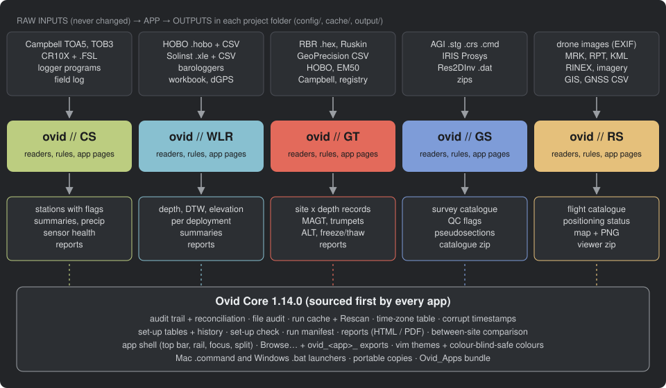

# ovid System Overview

ovid Core with the five apps CS
WLR GT
ERT RS:
what they share, what each does, and where the detailed guides are.
Core 1.14.0, shell 1.1.0; CS 1.10.0, WLR 0.11.0, GT 1.7.0, ERT 0.4.0, RS 0.5.0 (6 October 2026), with unreleased changes since: the Workbench interface (preview), the optional logger list and Paste and Import in every set-up table. What changed: `CHANGELOG.md` in Ovid_Apps and in each app.

1.  [What ovid is](#what)
2.  [The shared core](#core)
3.  [System diagram](#diagram)
4.  [The five apps](#apps)
5.  [Comparison](#compare)
6.  [Common workflow](#workflow)
7.  [Glossary](#glossary)
8.  [References](#refs)

## What ovid is

ovid is a set of five R/Shiny apps that turn raw environmental logger
downloads, geophysical surveys and drone archives into clean, documented,
analysis-ready records. Each app handles one kind of monitoring; all five
share one core of code for the work that does not depend on the data type.
Every app is named "ovid // &lt;app&gt;", has its own icon and its own dark
colour theme from vimcolorschemes, so it is recognisable at a glance.

- CS Campbell Scientific climate
  stations (theme olive-crt).
- WLR water level loggers with
  barometric compensation (theme Nord).
- GT ground temperature cables and soil
  sensors (theme soviet.nvim).
- ERT electrical resistivity surveys
  (AGI SuperSting, IRIS Instruments): a catalogue, metadata, QC and
  viewing tool, not an inversion package (theme kanagawa.nvim).
- RS remote sensing: a catalogue,
  provenance and positioning-status tool for archived drone flights,
  satellite and aerial imagery, LiDAR, GIS layers and GNSS surveys; it does
  not process imagery (theme accent.vim).

It is for the people who download loggers in the field and the people
who use the data: the field staff get a check list of what went wrong
(clock faults, missing exports, overlapping files), and the data users
get records in which every removed or changed value is explained. Raw
files are never changed. Colleagues can open a project read-only in
viewer mode.

## The shared core

ovid Core is one folder of R files that every app sources before its
own `R/` folder; a fix made there reaches all five apps. The apps find
it through the `OVID_CORE` environment variable, a `core/` folder
inside the app (portable copies), `../core` beside the app (the
Ovid_Apps bundle), or `~/Desktop/Ovid`.

| Part | What it does |
|---|---|
| Audit trail and reconciliation | Every removal and change is logged with its rule and reason. For each raw file and logger, **records read = records in the output + records dropped**; a run stops if that does not hold. `output/audit/file_audit.csv` accounts for every raw file. |
| Configuration and history | Set-up tables live in the project's `config/` folder as CSV. Every change made in the app is backed up in `config/history/`; a whole configuration can be exported and imported. Dates in set-up tables can be a date alone, and an end date then covers that whole day. |
| Run cache and Rescan | Results are kept in `<project>/cache/`, keyed by file contents, settings and code version. A run only rebuilds what changed, and an edit to a set-up table redoes only the loggers, sites, surveys or flights it can apply to; the message after a run says how many were redone. **Rescan** on the Raw files page reads chosen files again. A code update makes the next run a full one, and so does deleting the cache. |
| Time-zone table | `config/timezones.csv` says which zone a logger's or camera's clock was in (by serial, model, path pattern and date span; first matching row wins). Logger times are moved to one base: UTC−7, no daylight saving. |
| Corrupt timestamps | A failing logger memory or clock can write records stamped at random times among good ones. A record that is both off the time grid and out of the order its file was written in is left out and audited (`timestamps.R`, used by CS, WLR and GT). |
| Between-site comparison | Each site's daily means against the median of the others, allowing for a seasonal offset (`neighbours.R`, used by GT). |
| Quality checks and WMO codes | `qc.R` holds the mechanics shared by CS, WLR and GT (runs, spikes, flat lines, steps as a rate per hour, conditions that last), and the WMO quality control codes of BUFR table 0 33 020 (0 good, 1 inconsistent, 2 doubtful, 3 wrong, 4 not checked, 5 changed, 6 estimated, 7 missing). Exports of CS, WLR and GT give every value its code by default; each app decides what its own checks mean. |
| Reports | Reports are written once from blocks (headings, text, cards, tables, plots) and rendered as HTML, PDF or both, in the app's theme. |
| Set-up check | A pre-flight check of folders, set-up tables (bad patterns, numbers, dates) and the time-zone table, with red items to fix before running. |
| Set-up tables in the app | Every set-up table has an editor (`editor.R`): edit cells, add, duplicate and delete rows, **Paste** rows copied from Excel and **Import** a CSV or Excel file with its columns matched to the table's by heading. The same table open in two windows stays one table: a copy with unsaved edits asks before it overwrites a newer save. |
| Logger list (optional metadata) | No app needs a metadata file. WLR and GT have a **logger list** (`config/metadata.csv`, `metasheet.R`) for what people know: only the serial is required, and a name, site, year, depths, hang length and so on are used when given. It can start from the loggers found, take pasted or imported rows, and each project can rename, hide or add columns. A value that cannot be read is left blank and noted, never an error. |
| Workbench (preview) | A second interface on the same project (`workbench.R`): every Standard page around a spreadsheet of one record (a station, deployment, site, survey or flight) with its chart above it; select cells, rows, columns or a stretch of the chart, see where a value came from and what changed it, and correct it through the same set-up tables. Open it with **Workbench** in the title bar or `?ui=workbench`. |
| Standards and exports | `standards.R`: one scale of processing levels for the suite (L0 raw, L1 quality controlled, L2 corrected, L3 gap-filled, L4 derived), the WMO codes as CF flag attributes, and a NetCDF writer in base R for CF-1.10 / ACDD-1.3 exports (CS, WLR and GT). |
| Run manifest | Each run writes `run_manifest.csv` and `run_history.csv` with app and core versions and file checksums. |
| App shell | `shell.R` gives every app the same frame: a compact top bar with the app's icon and name, a context bar, run state and main action; a narrow navigation rail that collapses to icons; controls with an Options popover; focus (fullscreen) and optional split views; one QA/QC look for statuses and flags. |
| Import and export | `files.R`: every folder field has a **Browse…** button that opens Finder or Explorer, or an in-app folder browser. Export buttons say their format ("Export data (CSV)"), and exported files are named `ovid_<app>_<what>_<YYYY-MM-DD>.<ext>`. |
| Themes and colour | `theme.R` holds each app's vim colour scheme. Parameters use intuitive colours (temperature red, humidity green, water and precipitation blue, wind purple, sunlight yellow, battery grey); colours shown together are kept apart for colour-blind eyes, and contrast helpers keep text at 4.5:1 and plot lines at 3:1. |
| Launchers and the bundle | Mac launchers (`Open CS (Mac).command` and so on) and Windows launchers (`Ovid_CS.bat` and so on) use a private package library and install what is missing on first start. `Make_Portable.bat` makes a copy that runs on computers without R. The one-folder bundle **Ovid_Apps** (also the GitHub repository yedoma/ovid) carries the five apps and the core and holds no data. |

What stays in each app: readers, stitching, quality rules, flags, date
styles, palette, set-up tables and app-specific checks.

## System diagram

<figure>

<figcaption>Figure 1. Raw inputs flow through each app to its outputs;
all five apps run on the same ovid Core.</figcaption>
</figure>

## The five apps

### CS: climate stations

**Reads** Campbell TOA5 `.dat` files (LoggerNet, PC400, CardConvert), TOB3 binary
`.dat` files (10 Hz `ts_data` tables are listed with their time span, not loaded) and
CR10X mixed-array files with their Edlog `.FSL`; logger programs; a field
log and gauge set-up for weighing precipitation gauges.

**Steps** find files (loggers set aside on the Stations page are not
read), read records and time stamps, clock corrections and the time-zone
table, corrupt timestamps, text to numbers, stitch each logger table, map
raw columns to common parameter names (paired sensors kept apart, sensor
swaps joined), assign records to stations, calibrations, quality rules
and removals, flags and sensor health, derived values and summaries,
weighing-gauge precipitation.

**Outputs** one record per station with flag columns,
daily/monthly/annual summaries, precipitation by year and water year,
sensor health, station reports.

**Key checks** clock checks, gaps, overlap conflicts between files and
loggers, sensor health, between-station checks, gauge servicing and
bucket cycles.

**New in 1.9.0** BSRN radiation limits, humidity above 103 %, a frozen-anemometer check and rain below freezing (all flag only); wind direction averaged on the circle with Yamartino spread and resultant wind; dew point; a step test as a rate; gauge correction with the 10 m coefficients and its ±0.2 uncertainty.

**Unreleased** FAO-56 and Priestley-Taylor evapotranspiration; frozen-soil water marked liquid only; missing daily means estimated from neighbouring stations and breakpoints against them (reported, never adjusted); short gaps filled on export (code 6); NetCDF export.

Detail: [ovid CS Reference Guide](../CS/docs/CS_reference_guide.md).

### WLR: water level loggers

**Reads** HOBO `.hobo` and Solinst `.xle` files with their CSV exports
(Latin-1 `.xle` from older Levelogger software too), barologger files,
the metadata workbook (a run without one still completes, but builds no
deployments) and dGPS survey exports.

**Steps** find and pair files, time stamps and time zones, units to kPa
and °C (Solinst Barologger offset added back), stitch each logger,
barometric stations (primary, secondary, fill-in), deployments,
compensation (pressure to depth), depth to water and elevation, specific
conductance, quality checks and flags (readings in the air, readings
below air pressure), tape checks and manual measurements, summaries.

**Outputs** per-deployment records with `depth_m`, `dtw_m`, `elev_m` and
flags; daily, monthly and water-year summaries; run and site reports.

**Key checks** logger against tape at each field visit, barologger
agreement, survey history, Problems list.

**New in 0.9.0** drift and offset correction between tape checks, off by default (tape offsets prorated linearly, or an offset typed in), keeping the logger's values beside the corrected ones; a bulk export of every site.

**Unreleased** an uncertainty budget per deployment; barometric efficiency; casing movement between visits; reference elevations that follow their surveys in time; the water table against the ground, hydroperiod, gradients between wells and recharge; approvals; NetCDF export.

Detail: [ovid WLR Reference Guide](../WLR/docs/WLR_reference_guide.md).

### GT: ground temperature

**Reads** RBR `.hex` (with Ruskin exports), GeoPrecision FG2_Shell CSV
exports of `.f2b` files, HOBOware CSV exports of `.hobo` files, EM50 and
Campbell files; a sensor registry, borehole metadata and
field notes.

**Steps** find files and bundles, read and calibrate (RBR counts to °C),
time stamps and time zones, corrupt timestamps, clock faults and drift,
stitch each logger, sensors to sites and depths, quality rules and flags,
site records, daily means, annual statistics, thaw depth and
active-layer thickness, freeze/thaw dates and zero curtain, between-site
check, soil moisture and EC.

**Outputs** site and depth records, daily means, MAGT and trumpet
curves, active-layer thickness, freeze/thaw tables, soil moisture and
EC, run and site reports.

**Key checks** clock resets and drift, stuck sensors and zero curtain,
between-site comparison, sensor health, bundles that need export.

**New in 1.6.0** WMO quality codes in exports; a daily or monthly mean takes the worst code of its values.

**Unreleased** degree days, n-factors and TTOP; taliks; zero-curtain sensor offsets; trends; estimated daily means; thermal diffusivity and gradient; ground-surface changes; NetCDF export for GTN-P and PermafrostNet.

Detail: [ovid GT Reference Guide](../GT/docs/GT_reference_guide.md).

### ERT: electrical resistivity surveys

**Reads** AGI SuperSting `.stg` with `.crs` contact resistance and `.cmd`
command files (also inside zips), EarthImager sets, IRIS Prosys exports
(three header styles) and Res2DInv `.dat`; every other file in the
archive is listed.

**Steps** find and identify files, read into one model for both makers,
link copies, merges and processed sets, geometry (electrodes, array,
pseudo-depth, elevations), QC profiles that flag but never delete
(limits from the EarthImager and SuperSting manuals; a frozen-ground
profile by default), statistics.

**Outputs** a catalogue of surveys and files, one folder per survey,
pseudosection previews, survey exports with provenance, a transect map
(legend toggle, 250 ppi PNG export) and a shareable catalogue zip with an
`index.html` viewer.

**Key checks** repeat error, current, voltage, contact resistance,
negative and extreme apparent resistivity, repeats, geometry, outliers;
survey quality and transects are set by people, with a satellite map.

**New in 0.3.0** moving-median and bad-electrode rules (for new projects; Herring et al. 2023, CPERS), electrodes turned off, and limits that differ by site, transect or season.

**Unreleased** reporting fields and checklist (Herring et al. 2023, CPERS); negative chargeability; a reciprocal error model; inversion files for pyGIMLi, R2/ResIPy and Res2DInv; electrode heights from a GNSS file.

Detail: [ovid ERT Reference Guide](../ERT/docs/ERT_reference_guide.md).

### RS: remote sensing

**Reads** drone images (DJI Matrice 350 RTK, Phantom 3/4/4 RTK, senseFly
eBee and eBee Plus) through their EXIF and XMP headers, MRK, RPT, eMotion
geotags, KML/KMZ plans and tracks, RINEX headers; satellite and aerial
scene metadata, LiDAR headers, shapefiles, GeoJSON and GPX; GNSS survey
CSVs. Google Earth tile KMLs are listed as map tiles, not read. Only
headers and sidecars are read; nothing is written inside a source.

**Steps** scan sources (drives or folders, one after another, with a
per-folder cache), group images into flights, link logs and other files
to flights with a score and evidence, work out each flight's positioning
status (RTK, PPK, standalone), build map geometry (planned, observed,
derived), list datasets and GIS layers, stitch GNSS survey points.

**Outputs** flight, link, image, file and dataset catalogues; a map of
every flight and layer (legend toggle, 250 ppi PNG export); stitched GNSS
points; a shareable viewer zip that opens in any browser.

**Key checks** positioning status by year, missing metadata, QA flags,
files tied to no flight; people confirm or reject links and statuses.

**New in 0.5.0** flight quality from the image headers (ground sample distance, speed, motion blur, forward and side overlap, sun elevation) and GNSS position quality (satellites, DOP, samples, age of corrections, baseline). Missions group the sorties of one survey (battery swaps, two flights on one battery). GNSS formats read: Emlid Flow CSV and zip, Reach .LLH, Emlid Studio .pos, NMEA, DJI point CSVs and MRK, Leica Viva ASCII, GSI-8/16 and LandXML.

**Unreleased** checkpoint accuracy (ASPRS 2023); LiDAR density and classes; multispectral panels; frames and datum status; product records with processing levels; coverage by site and year; a STAC catalogue.

Detail: [ovid RS Reference Guide](../RS/docs/RS_reference_guide.md).

## Comparison across apps

The three logger apps:

| | CS | WLR | GT |
|---|---|---|---|
| Loggers | Campbell (TOA5, CR10X) | HOBO, Solinst, barologgers | RBR, GeoPrecision, HOBO, EM50, Campbell |
| Parameters | air temperature, humidity, precipitation, snow depth, **wind**, **radiation**, battery | pressure, water depth, depth to water, elevation, water temperature, conductivity | ground temperature by depth, soil moisture, EC, battery |
| Record shape | wide (one column per parameter) | wide per deployment | long (site, depth, value) |
| Time base | UTC−7 for all, through the shared time-zone table | | |
| QC | limits, spikes, flat lines, corrupt timestamps, manual removals, calibrations | limits, corrupt timestamps, readings in the air, below air pressure, manual removals, tape checks | limits, spikes, stuck sensor, air-like, pre-install, corrupt timestamps, between-site check |
| Summaries | daily, monthly, annual; precipitation by water year | daily, monthly, water year | daily means, annual statistics, ALT, freeze/thaw |
| Reports | HTML, PDF or both, from Reports and export; a run report each run | | |

ERT and RS are catalogues rather than logger time series: ERT's records
are one row per quadrupole measurement, its QC adds flags only, and its
summaries are per-survey distributions; RS's records are one row per
flight, image, linked file or dataset, and its status is decided from
evidence that people can confirm. Both share the core's audit, cache,
time-zone table, set-up history, shell and file import and export, and
both write shareable zips that open without R.

## Common workflow

1.  Put raw downloads in the raw folder(s), keeping every download and
    its exports. `.hobo` and `.f2b` files cannot be read on their own:
    export them first with HOBOware Pro's **Bulk Export** and FG2_Shell,
    which write a CSV beside each file; a metadata workbook is optional (WLR and GT read one from the metadata folder; the logger list can stand in for it) (RS: add
    each drive or folder as a source).
2.  Start the app (`Open <app> (Mac).command`, its `.bat` launcher on
    Windows, or `shiny::runApp()`) and set the folders and project
    folder with **Browse…**.
3.  Run the **Set-up check** and fix anything in red.
4.  Press **Run**. The first run writes the set-up tables with defaults.
5.  Complete the app's set-up pages (stations, deployments and
    barometric groups, sensors and depths, survey details, or flight
    details).
6.  Read the clock checks, Problems and Sensor health; add clock fixes
    and manual removals; run again (only changes are rebuilt, or use
    **Rescan**).
7.  Look at the data in **Plot and explore** (or the Map), then export
    data and reports from **Reports and export**.

## Glossary

| Term | Meaning |
|---|---|
| Audit trail | The log of every removal and change, with rule, reason and file. |
| Reconciliation | The check that records read equal records kept plus records dropped, per file and logger. |
| Bundle | One logger download: the logger's own file and its exports. |
| Stitching | Joining a logger's downloads into one continuous record, dropping repeats; the newest file wins a disagreement. |
| Corrupt timestamp | A record off the time grid and out of written order among good records; left out and audited. |
| Flag | A mark on a doubtful value that is kept; removed values are blanked and logged. |
| Manual removal | A period you mark as bad, often by dragging across a plot. |
| Rescan | Read chosen files again; everything else is reused from the cache. |
| Set aside | A logger whose files are not read at all (CS station `ignore`). |
| Set-up check | Pre-flight check of folders and set-up tables. |
| Base time | UTC−7, the single time zone of every logger output. |
| Water year | 1 October to 30 September, named for the year it ends in. |
| Viewer mode | A read-only copy of a project for colleagues. |
| Ovid_Apps | The one-folder portable bundle with all five apps and the core (GitHub: yedoma/ovid). |

## References

Each app has a reference guide as .md, .html and .pdf (the PDF in dark
mode, in the app's colours):

- CS [ovid CS Reference
  Guide](../CS/docs/CS_reference_guide.md) (CS/docs/CS_reference_guide.html, .md, .pdf)
- WLR [ovid WLR Reference
  Guide](../WLR/docs/WLR_reference_guide.md) (WLR/docs/WLR_reference_guide.html, .md, .pdf)
- GT [ovid GT Reference
  Guide](../GT/docs/GT_reference_guide.md) (GT/docs/GT_reference_guide.html, .md, .pdf)
- ERT [ovid ERT Reference
  Guide](../ERT/docs/ERT_reference_guide.md) (ERT/docs/ERT_reference_guide.html, .md, .pdf)
- RS [ovid RS Reference
  Guide](../RS/docs/RS_reference_guide.md) (RS/docs/RS_reference_guide.html, .md, .pdf)
- ovid Core README (`core/README.md`) and each app's README.

